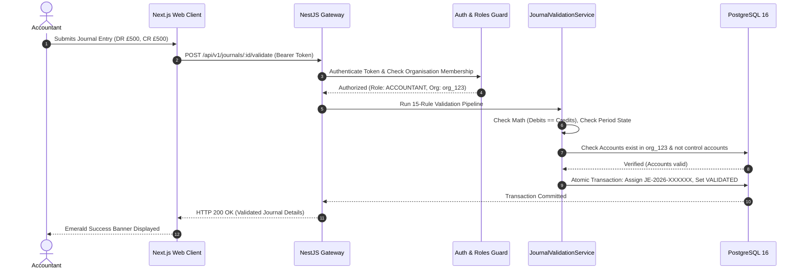

# 05. System Architecture Document (SAD / TDD)

**System Name:** blynt Multi-Tenant Accounting Platform  
**Architecture Pattern:** Modular Monolith with Relational Engine Defense-in-Depth  
**Backend Framework:** NestJS 11 (Node.js 20+ LTS)  
**Database Engine:** PostgreSQL 16+ (Prisma ORM)  
**Frontend Framework:** Next.js 15 (Turbopack, React 19)  

---

## 1. High-Level Architectural Vision (Non-Technical Explanation)

Think of blynt’s architecture like a secure modern airport:
1. **The Terminal Entrance (Next.js Web Client):** This is the user interface where the accountant sits. It is fast, intuitive, and responsive. Before a passenger even approaches the gate, the interface checks their passport and tickets (client-side validation), ensuring numbers balance before sending any request across the internet.
2. **Security & Immigration (NestJS Backend API Gateway):** Every incoming request passes through an automated security checkpoint. The system validates the user's session badge, checks their access permissions (Is this person a Bookkeeper or the Business Owner?), and routes the request to the specific department (Accounting Engine, Contacts Subledger, Invoicing).
3. **The Secure Vault (PostgreSQL Relational Database):** The database is where financial truth lives. Unlike ordinary software where the application code does all the security checking, blynt programs physical security rules directly into the database vault itself. Even if a programmer made a typo in the application code, the database vault physically refuses to mix two companies' data or delete an audit log.


---

## 2. Technical Component Architecture

### 2.1 Web Client Layer (`apps/web`)
* **Framework:** Next.js 15 using the new App Router and React 19 server/client components.
* **Turbopack Engine:** High-performance bundler providing sub-50ms hot-module reloading and optimized static asset compilation.
* **Financial Data Grid:** Custom accounting table components with monospaced numerical fonts (`tabular-nums`) to align decimal points vertically.
* **Sticky Live Tally Footer:** A client-side reactive state bar on the journal creation screen that continuously calculates:
  $$\text{Live Difference} = \left|\sum \text{Debits} - \sum \text{Credits}\right|$$
  If the difference is greater than zero, the validation button is disabled, giving instant ergonomic feedback.

### 2.2 Backend Gateway & Modules (`apps/api/src/`)
Built as a **modular monolith** divided into distinct domain boundaries:

```
apps/api/src/
├── main.ts                         # Bootstrap, CORS, Helmet, ValidationPipe, Filters
├── app.module.ts                   # Root dependency injection container
├── accounting-engine/              # Mathematical validation, posting, and reversal
├── accounting-periods/             # 12-month calendar generation & 3-tier locking
├── accounts/                       # Nominal Chart of Accounts (1000-8999)
├── audit/                          # Append-only audit trail logger
├── auth/                           # scrypt password hashing & session management
├── common/                         # DomainException, guards, correlation IDs, logging
├── contacts/                       # Customer AR & Supplier AP subledger derivation
├── invoices/                       # Sales invoicing, VAT calculation, GL auto-posting
├── journals/                       # Journal entry drafting, sequences, line calculation
├── organizations/                  # Multi-tenant workspace handling & settings
├── reports/                        # Trial Balance, Balance Sheet, Profit & Loss
└── roles/                          # Granular RBAC guards and permission sets
```

### 2.3 Relational Database Layer (PostgreSQL 16)
The relational engine enforces four authoritative guarantees:

1. **Fixed-Point Precision (`NUMERIC(19,4)`):**
   * Eliminates the IEEE 754 binary floating-point rounding errors native to JavaScript.
   * All debits, credits, and tax amounts are stored with 4 decimal places of precision.
2. **Composite Multi-Tenant Foreign Keys:**
   * Standard relational design links tables by single IDs (e.g., `contact_id`). This creates a vulnerability where a buggy query could attach Tenant A's invoice to Tenant B's contact.
   * blynt uses composite foreign keys `(organization_id, id) REFERENCES parent(organization_id, id)`. The database engine physically rejects any foreign key that crosses company boundaries.
3. **Temporal Exclusion Constraints (`btree_gist`):**
   * Uses PostgreSQL's Generalized Search Tree (`GIST`) extension to guarantee that no two financial years within an organisation can have overlapping date ranges.
4. **Append-Only Audit Trigger:**
   * Database-level trigger functions intercept and immediately abort any SQL `UPDATE` or `DELETE` executed against `audit_logs`.

---

## 3. Request Lifecycle Pipeline (Tracing a Transaction)


