# Blynt — Visual Diagrams Only (Non-IT Business & Client Guide)

All Use Cases and Test Cases presented purely as visual diagrams with embedded business rules, steps, and pass/fail conditions.

---

## 1. Master System Overview Diagram

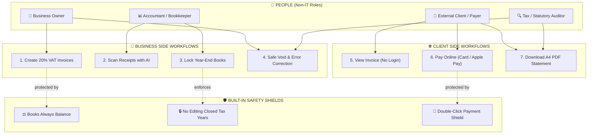

---

## 2. Business Use Case 1: Issue & Send Invoice (Sales Flow)

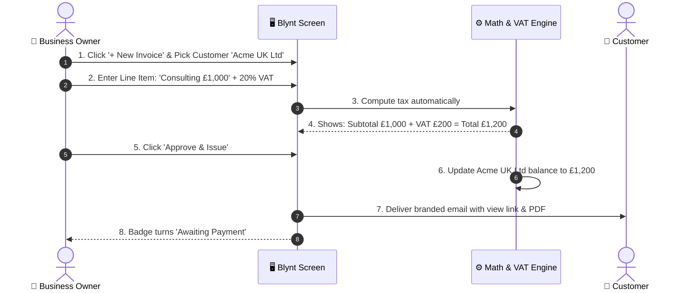

---

## 3. Client Use Case 2: Client Views & Pays Online (Client Flow)

```mermaid
sequenceDiagram
    autonumber
    actor Client as 🛒 External Customer
    participant Link as 🌐 Web Invoice View
    participant Card as 💳 Secure Card Checkout
    participant Blynt as 🏦 Blynt Accounting
    actor Owner as 👔 Business Owner

    Client->>Link: 1. Click email link (No password needed)
    Link-->>Client: 2. Shows branded invoice, £1,200 total & 'Pay Now'
    Client->>Card: 3. Click 'Pay Now' & enter card details
    Card->>Card: 4. Process transaction securely
    Card-->>Link: 5. Green checkmark: 'Payment Successful!'
    Link->>Blynt: 6. Flip invoice status to 'PAID'
    Blynt->>Blynt: 7. Record cash received in Bank Account
    Link-->>Client: 8. Email payment receipt PDF
    Blynt-->>Owner: 9. Alert: 'Invoice INV-1001 paid by Acme UK Ltd'
```

---

## 4. Business Use Case 3: Scan Receipts with AI (Expense Flow)

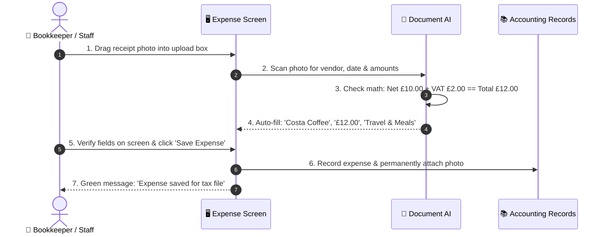

---

## 5. Client Use Case 4: Client Self-Service Statement & A4 PDF

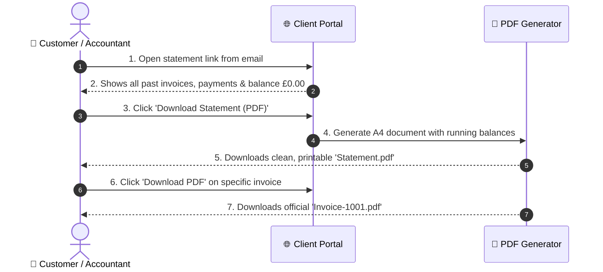

---

## 6. Business Use Case 5: Lock Financial Year-End Books

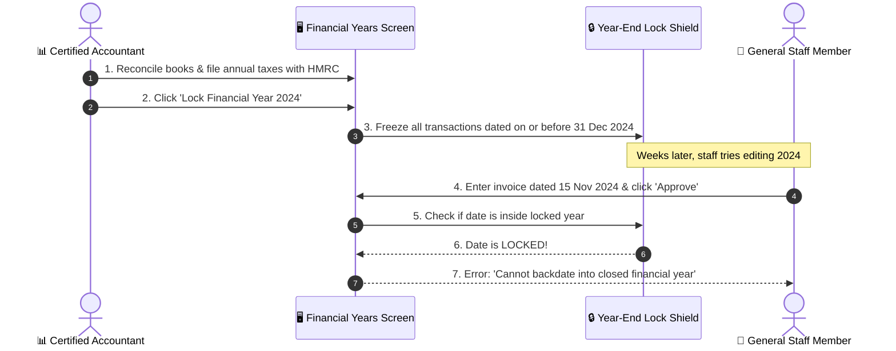

---

## 7. Business Use Case 6: Safe Error Correction (Void Invoice)

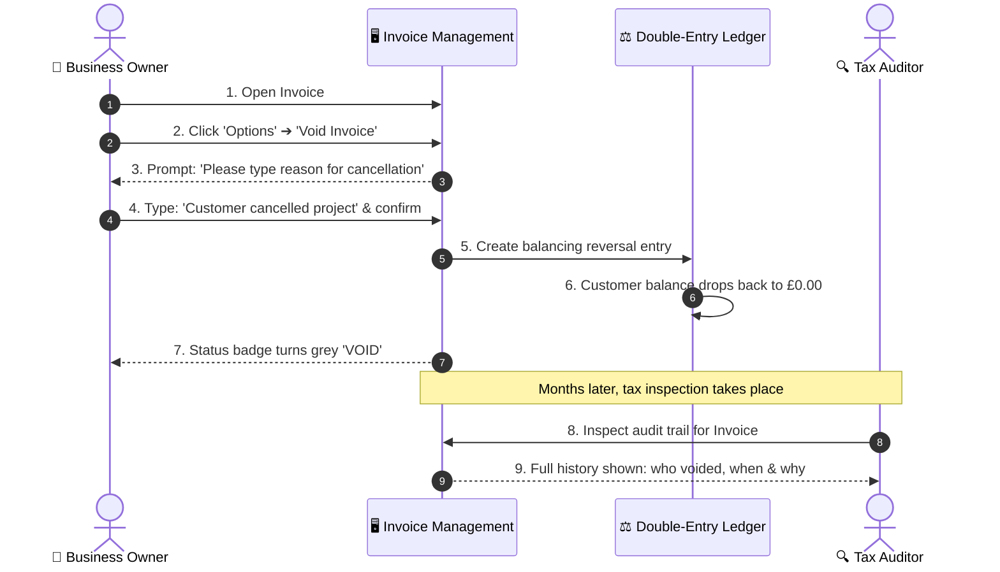

---

## 8. Test Case: 20% VAT Math & Customer Balance (Pass / Fail)

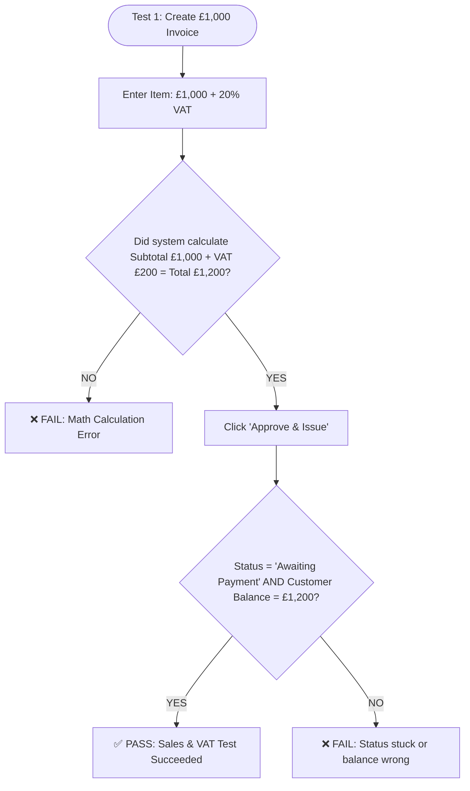

---

## 9. Test Case: Client Online Card Payment (Pass / Fail)

```mermaid
flowchart TD
    Start([Test 2: Client Online Payment]) --> Step1[Client clicks email link: invoice opens without login]
    Step1 --> Step2[Client clicks 'Pay Now' & enters test card]
    Step2 --> Step3[Click 'Pay £1,200' button]
    Step3 --> CheckButton{Does button instantly disable & show spinner?}
    CheckButton -- NO --> FailDouble[❌ FAIL: Button allowed double-clicks]
    CheckButton -- YES --> CheckPay{Did payment succeed?}
    CheckPay -- YES --> Step4[Invoice flips to 'PAID' + Receipt emailed]
    Step4 --> PassPay[✅ PASS: Online Payment Succeeded]
    CheckPay -- Card Declined --> Handled[⚠️ PASS (Handled): Friendly 'Card declined' error]
```

---

## 10. Test Case: AI Receipt Scanner Guardrail (Pass / Fail)

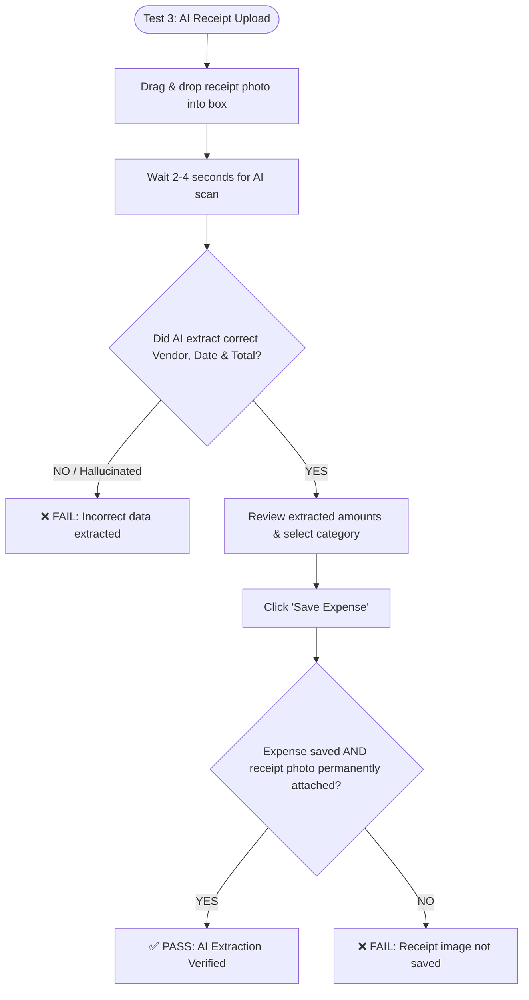

---

## 11. Test Case: "Never Unbalanced" Safety Ledger Rule (Pass / Fail)

```mermaid
flowchart TD
    Start([Test 4: Unbalanced Journal Entry]) --> Step1[Line 1: Debit Bank Account £500]
    Step1 --> Step2[Line 2: Credit Sales Income £400 (leaving £100 gap)]
    Step2 --> Step3[Try clicking 'Post to Ledger']
    Step3 --> CheckBlock{Does system block the save?}
    CheckBlock -- YES --> Step4[Red banner: 'Debits and Credits must balance']
    Step4 --> PassBalance[✅ PASS: System blocked unbalanced books]
    CheckBlock -- NO --> FailBalance[❌ FAIL CRITICAL: Corrupt unbalanced books saved!]
```

---

## 12. Test Case: Locked Year-End Backdating Block (Pass / Fail)

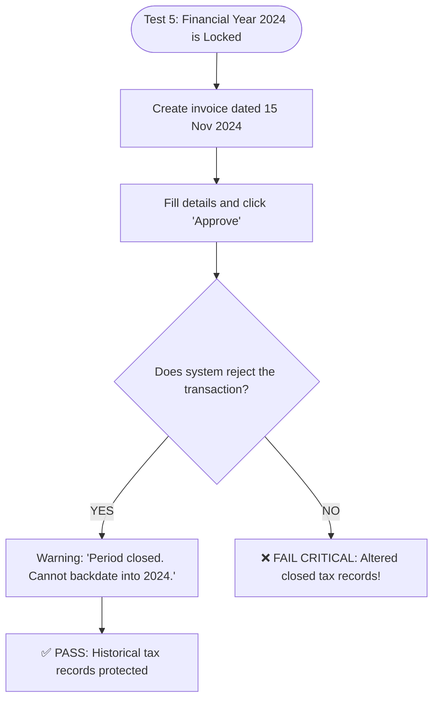

---

## 13. Test Case: Client-Side Instant Form Validation (Pass / Fail)

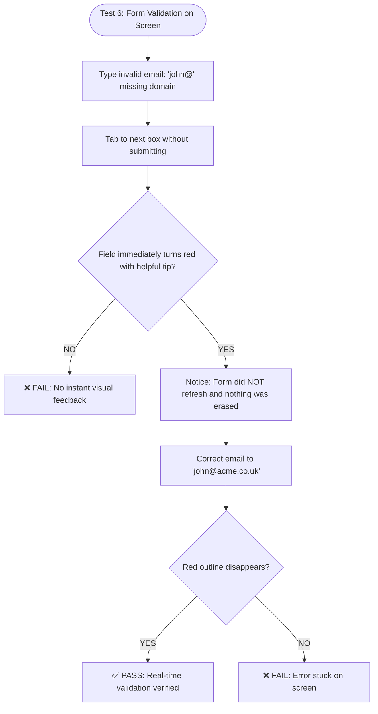

---

## 14. Test Case: Mobile Phone Layout & Thumb Test (Pass / Fail)

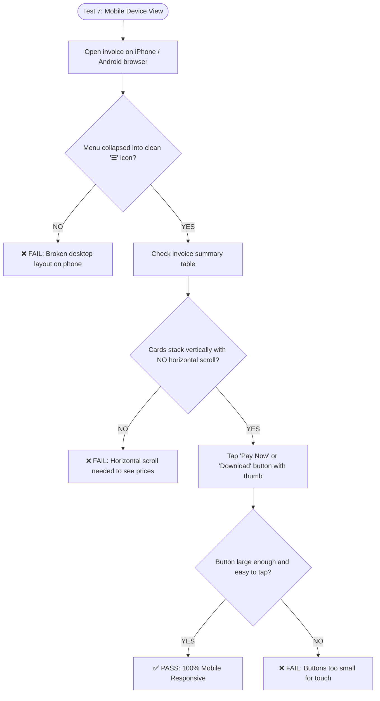
