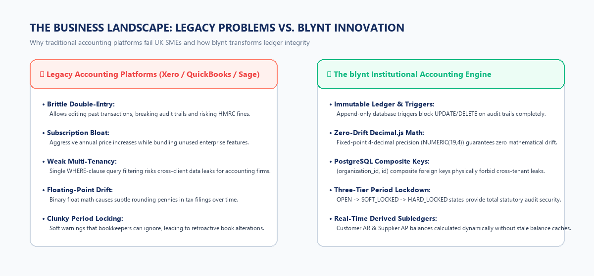
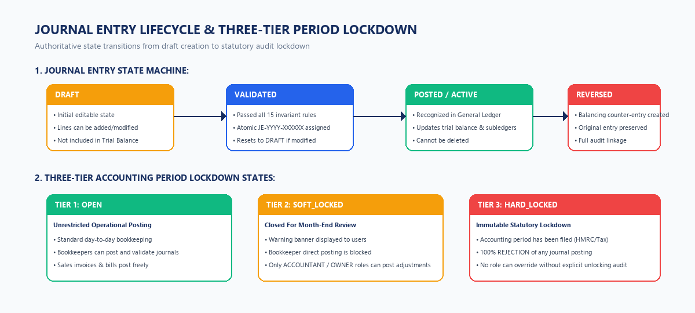
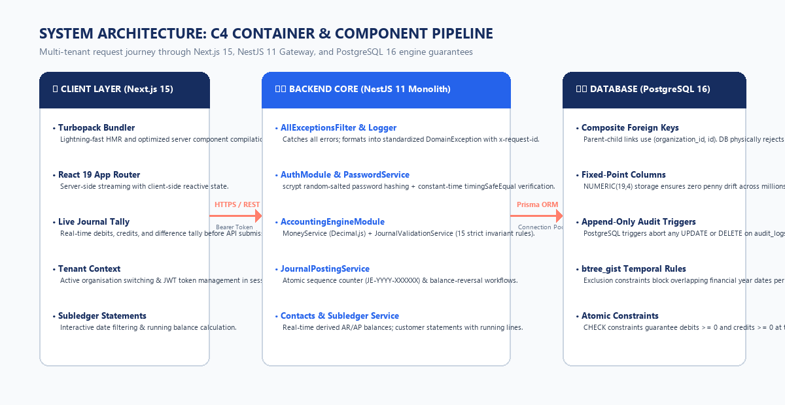
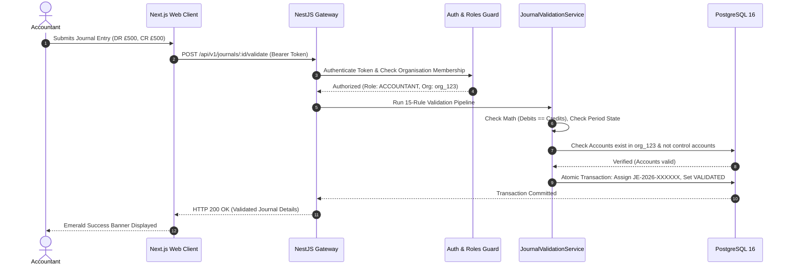
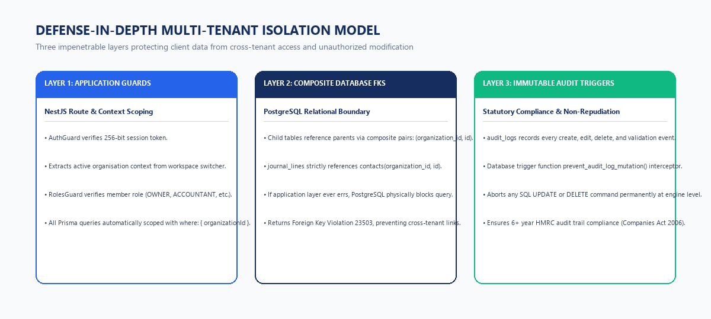
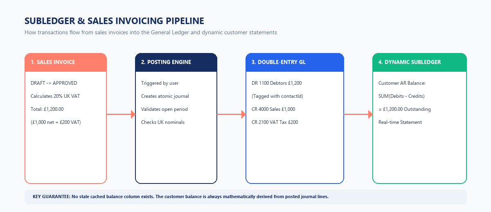

# blynt — Complete Project Documentation Omnibus

> **Repository:** https://github.com/ceylonroameryt-bit/Fi.git  
> **System:** Institutional Multi-Tenant Cloud Accounting Core  
> **Jurisdiction:** United Kingdom (HMRC / Companies House / UK GDPR)  
> **Publication Version:** 2.0 (Executive & Technical Blueprints)  

---

# 01. Project Charter: blynt

**Project Identifier:** blynt (Internal Code: Ledgerline)  
**Executive Sponsor:** Chief Executive Officer & Founding Directorate  
**Lead Architect:** Principal Systems Architect & Antigravity Engineering  
**Publication Date:** October 2026  
**Document Classification:** Confidential / Strategic Engineering Asset  

---

## 1. Executive Summary (Non-Technical Overview)

### What is blynt in Plain English?
Imagine you run a growing business in the United Kingdom. Every day, money flows in from customer invoices and flows out for staff salaries, software subscriptions, inventory, and office rent. At the end of every quarter and year, Her Majesty’s Revenue and Customs (HMRC) and Companies House require you to submit exact, mathematically verifiable accounts and VAT returns.

Historically, small and medium enterprises (SMEs) have relied on software like Xero, QuickBooks, or Sage. However, these legacy platforms have evolved into expensive, bloated systems. Worse yet, many allow users to retroactively modify or delete old financial transactions. If a bookkeeper accidentally changes an invoice from six months ago, the entire company’s historical tax filings become invalid, triggering HMRC audit penalties and expensive accountant investigation fees.

**blynt is a next-generation financial operating system built on institutional-grade double-entry accounting.**
* **Like a Digital Bank Vault:** Once a financial month is closed and locked, nobody—not even the business owner or software developer—can rewrite history.
* **Zero Pennies Lost:** Computers normally use floating-point math that rounds numbers like `0.1 + 0.2` to `0.30000000000000004`. Over thousands of transactions, businesses accumulate fractional penny errors. blynt uses fixed-point math with four decimal places (`NUMERIC(19,4)`), guaranteeing that every single penny balances down to the fraction of a cent.
* **Separation of Client Data:** For accounting firms managing dozens of client businesses, blynt builds concrete walls between companies. It is physically impossible for Company A to accidentally see or touch Company B’s invoices or contacts.



---

## 2. Strategic Business Drivers & Opportunity

1. **Market Inflation & Incumbent Fatigue:** Incumbent platforms have increased monthly pricing by 15–30% year-on-year while customer service response times have degraded. Small accounting firms are actively seeking modern alternatives that provide speed and predictability.
2. **Regulatory Mandates (HMRC Making Tax Digital):** UK law mandates digital record-keeping for VAT-registered entities. blynt embeds digital audit trails directly into the database engine, making compliance automatic rather than a manual chore.
3. **The Rise of Tech-Enabled Accounting Practices:** Modern fractional CFOs and digital-first bookkeeping agencies demand fast web workstations with instant keyboard shortcuts, real-time trial balances, and zero latency.

---

## 3. Project Objectives & Success Criteria (KPIs)

| Objective | Non-Technical Description | Technical Verification Metric | Target KPI |
| :--- | :--- | :--- | :---: |
| **Mathematical Equilibrium** | Books must always balance perfectly; debits must equal credits. | `SUM(journal_lines.debit) == SUM(journal_lines.credit)` | **100.000%** |
| **Ledger Performance** | Reports like Balance Sheet and Trial Balance must generate instantly. | p95 HTTP response latency on `/reports/*` endpoints | **< 150ms** |
| **Multi-Tenant Security** | Absolute isolation between independent client companies. | Zero cross-tenant data leakage incidents | **0 Incidents** |
| **Audit Durability** | Complete non-repudiation of transactions for statutory audits. | PostgreSQL trigger prevention of `UPDATE`/`DELETE` on `audit_logs` | **100% Immutable** |
| **Unit Cost Efficiency** | Keeping infrastructure server costs low so pricing is disruptive. | Average cloud compute/database cost per active tenant | **< £0.40 / month** |

---

## 4. Scope Governance

### In-Scope Deliverables (Current Milestone: Phases 1–8 Core + Subledgers)
* Multi-workspace monorepo with NestJS 11 backend and Next.js 15 (Turbopack) web interface.
* Relational database architecture featuring PostgreSQL 16 with composite foreign keys and temporal exclusion.
* Cryptographically secure session authentication with native `crypto.scrypt` password hashing.
* Multi-organisation switching enabling accounting firms to oversee multiple business entities under a single profile.
* Role-Based Access Control (RBAC) with five granular tiers: `OWNER`, `ADMINISTRATOR`, `ACCOUNTANT`, `BOOKKEEPER`, `VIEWER`.
* UK Nominal Chart of Accounts (Codes 1000–8999) with control account locking.
* 12-month accounting period automation with three-tier locking state machine (`OPEN`, `SOFT_LOCKED`, `HARD_LOCKED`).
* Double-entry journal posting engine enforcing 15 accounting validation rules and atomic sequence numbers (`JE-YYYY-XXXXXX`).
* Accounts Receivable (AR) and Accounts Payable (AP) subledger foundation with real-time customer and supplier statement generation.

### Out-of-Scope (Deferred to Future Strategic Phases)
* Direct UK Open Banking API feeds (Phase 20+).
* Automated payroll processing (Phase 30+).
* Multi-currency foreign exchange revaluations (Phase 50).

---

## 5. Organizational Authority & Project Charter Sign-off
* **Project Executive (CEO):** Approves strategic roadmap, marketing budget, commercial launch dates, and pricing tiers.
* **Principal Architect:** Has unilateral veto authority on database schema changes, arithmetic precision, and security boundaries.
* **Product Manager:** Governs feature prioritization, user story acceptance criteria, and UX workflows.
* **Lead Accountant / Compliance Advisor:** Validates UK GAAP alignment, HMRC MTD compliance, and VAT box derivation.


---

# 02. Business Requirements Document (BRD)

**Project Reference:** BRD-BLYNT-UK-2026  
**Target Sector:** UK Small & Medium Enterprises (SMEs), Bookkeepers, and Accounting Practices  
**Market Size:** 5.5 Million UK Private Sector Businesses  

---

## 1. The Business Problem & Market Need (Non-Technical Explanation)

In the United Kingdom, every limited company is legally required by the **Companies Act 2006** to keep "adequate accounting records" that disclose with reasonable accuracy at any time the financial position of the company. Furthermore, businesses registered for Value Added Tax (VAT) must comply with **HMRC Making Tax Digital (MTD)** rules.

However, business owners face severe obstacles with current software options:
1. **The "Soft Edit" Dilemma:** In mainstream apps, anyone with editing rights can alter an old invoice or journal entry from six months ago. While this feels convenient for fixing mistakes, it silently changes the past. When an accountant files year-end accounts, those old numbers suddenly no longer match the bank statements. Finding what changed costs thousands of pounds in accounting audit hours.
2. **Subscription Fatigue:** Software vendors have transitioned into aggressive monetization, charging extra for multiple users, basic invoicing, and essential reports. A small business can easily pay £40–£80 per month per company. For an accountant managing 40 client companies, this cost is prohibitive.
3. **Data Contamination:** Many platforms are single-tenant databases wrapped in multi-user interfaces. When an accountant switches between Client A and Client B in multiple browser tabs, cached sessions can cross-contaminate, creating immense GDPR liabilities.

blynt solves these challenges by combining consumer-grade web ergonomics with institutional-grade banking ledger guarantees.


---

## 2. Commercial Pricing Strategy & Unit Economics

### 2.1 Low-Overhead Unit Economics
By utilizing an optimized NestJS modular monolith and PostgreSQL relational schema, blynt achieves extreme operational efficiency:
* **Compute / Memory Footprint:** A single multi-tenant cluster can serve over 5,000 active small business tenants with sub-second response times.
* **Server Cost Per Tenant:** Estimated at **< £0.38 / tenant / month** on managed AWS infrastructure.
* **Gross Margin:** Projected gross margins exceed **86%**, enabling aggressive, disruptive pricing in the UK market.

### 2.2 Commercial Tiers

| Tier Name | Target Customer | Monthly Pricing | Features Included |
| :--- | :--- | :---: | :--- |
| **Sole Trader / Starter** | Freelancers, contractors, micro-businesses | £9 / month | 1 Company, up to 50 invoices/month, full double-entry ledger, customer statements. |
| **Growth Business** | Active UK SMEs with staff and inventory | £19 / month | 1 Company, unlimited invoices, multi-user RBAC, period locking, full reporting. |
| **Accounting Practice** | Bookkeepers, chartered accountants, fractional CFOs | £49 / month | Up to 15 Client Companies included (+£3/mo per extra company), unlimited seats, client switcher. |

---

## 3. High-Level Business Requirements (Functional & Regulatory)

### BR-01: Multi-Company Management for Accountants
* **Business Need:** A chartered accountant should be able to log in once and toggle between 50 different client companies in a single click without logging out or risking cross-company errors.
* **Acceptance:** Instant workspace switching; complete physical isolation of company records.

### BR-02: Double-Entry Enforcement (Zero Imbalance Policy)
* **Business Need:** The Fundamental Accounting Equation ($\text{Assets} = \text{Liabilities} + \text{Equity}$) must NEVER be broken. Unbalanced entries must be blocked before they can touch the database.
* **Acceptance:** A journal entry where debits do not equal credits cannot be validated under any circumstances.

### BR-03: Three-Tier Period Locking for Year-End Filing
* **Business Need:** Protect finalized monthly and yearly books so past tax filings remain identical forever.
* **Acceptance:**
  * `OPEN`: Bookkeepers enter receipts and sales.
  * `SOFT_LOCKED`: Closed for regular staff; only senior accountants can post adjusting entries.
  * `HARD_LOCKED`: Fully locked down; immutable statutory record.

### BR-04: Subledger Synchronization (Debtors & Creditors)
* **Business Need:** Business owners need to know exactly who owes them money (Accounts Receivable) and who they owe money to (Accounts Payable) in real time without waiting for monthly reconciliation.
* **Acceptance:** Real-time customer balance calculations derived from posted invoice lines; instant PDF statement generation.

### BR-05: UK Statutory Compliance (6-Year Rule & HMRC MTD)
* **Business Need:** Comply with Section 386 and Section 388 of the UK Companies Act 2006, which mandates keeping accounting records for a minimum of 6 years from the end of the financial year.
* **Acceptance:** Tamper-proof append-only audit trail guarded by database triggers.


---

# 03. Product Requirements Document (PRD)

**Product Name:** blynt Accounting Engine  
**Release Target:** Release 1.0 Production Core  
**Product Owner:** Lead Product Owner & Financial Operations  

---

## 1. User Personas & Non-Technical User Journeys

### Persona 1: Sarah — The Chartered Accountant (Age 42, London)
* **Profile:** Runs a boutique accounting practice with 35 SME clients.
* **Daily Workflow:** Reviews client bookkeeping entries, creates month-end depreciation journals, checks trial balances, and prepares quarterly VAT returns.
* **Core Frustrations:** "Clients constantly edit last month's invoices while I am preparing their VAT return, throwing my whole calculation out of balance. I need a software that lets me lock periods with absolute finality."
* **How blynt Serves Sarah:** Sarah uses the `SOFT_LOCKED` state during month-end close to review drafts, and switches to `HARD_LOCKED` after submitting to HMRC. Nobody can alter those figures ever again.

### Persona 2: David — The SME Founder & Director (Age 34, Manchester)
* **Profile:** Runs a creative digital agency with 8 staff.
* **Daily Workflow:** Sends client invoices, monitors unpaid client balances, checks cash in the bank, and sends receipts to his bookkeeper.
* **Core Frustrations:** "Traditional accounting software makes me feel stupid. I just want to send professional invoices, see who owes me money, and know that my accountant isn't going to yell at me at tax time."
* **How blynt Serves David:** David gets a clean, modern dashboard with live Accounts Receivable totals, professional invoice creation, and automated customer statements.

### Persona 3: Elena — The In-House Bookkeeper (Age 28, Birmingham)
* **Profile:** Records daily transactions, matches bank entries, drafts adjustment entries.
* **Daily Workflow:** Creates draft journals, categorizes expenses, matches customer payment receipts.
* **Core Frustrations:** "I'm terrified of making a mistake that breaks the company accounts or accidentally posting to a protected control account."
* **How blynt Serves Elena:** blynt's live journal tally gives Elena real-time feedback on debits and credits, while built-in rules prevent her from accidentally posting manual entries to protected control accounts like Debtors Control (`1100`).



---

## 2. Product Functional Specifications

### 2.1 Module 1: Chart of Accounts (COA)
* **Nominal Code Architecture:** Standardized 4-digit UK numbering:
  * `1000–1999`: Assets (Bank, Accounts Receivable, Equipment)
  * `2000–2999`: Liabilities (Accounts Payable, VAT Output Tax, Loans)
  * `3000–3999`: Equity (Share Capital, Retained Earnings)
  * `4000–4999`: Revenue (Sales Revenue, Service Fees)
  * `5000–8999`: Expenses (Cost of Goods Sold, Rent, Software, Wages)
* **System Control Accounts:**
  * Accounts such as Debtors Control (`1100`) and Creditors Control (`2000`) are flagged with `isControlAccount = true`.
  * Manual journal entries directly to these accounts are blocked. They can only be updated automatically through commercial subledger transactions (invoices and bills).
* **Account Archiving:** Accounts cannot be deleted if historical transactions exist. They can only be archived, preventing new entries while preserving complete audit history.

### 2.2 Module 2: Financial Years & Period Locking
* **Automated Calendar Generation:** Creating a financial year (e.g., 1 April 2026 to 31 March 2027) automatically generates 12 sequential monthly periods without gaps or overlaps.
* **Three-Tier Locking State Machine:**
  * `OPEN`: Standard posting permitted for all authorized roles.
  * `SOFT_LOCKED`: Closed to regular bookkeepers; warning displayed; allows accountant adjustments.
  * `HARD_LOCKED`: Immutable lockdown; 100% rejection of any journal posting or validation.

### 2.3 Module 3: Journal Entry & Validation Engine
* **Drafting Workflow:** Multi-line grid with instant client-side tally of debits, credits, and differences.
* **Sequential Numbering:** Automatic generation of unique sequence numbers matching `JE-YYYY-XXXXXX` (e.g., `JE-2026-000001`) via atomic sequence counters.
* **Validation Invariants:** The engine evaluates 15 rules before marking a journal as `VALIDATED`.
* **GAAP Reversal Workflow:** If a mistake is made on a validated journal, users cannot delete it. They click "Reverse", which generates an equal and opposite balancing journal.

### 2.4 Module 4: Contacts & Subledger Management
* **Customer & Supplier Directory:** Contact records tagged as `CUSTOMER`, `SUPPLIER`, or `BOTH`.
* **Dynamic Subledger Calculations:** Accounts Receivable (AR) and Accounts Payable (AP) balances are derived directly from posted journal lines tagged with `contactId`. No cached balance columns exist, eliminating balance drift.
* **Customer Statements:** Chronologically sorted activity reports showing opening balance, invoice debits, payment credits, running balances, and closing balance.

---

## 3. Scope & Release Progression Matrix

| Feature Module | Core MVP (Phase 1–8) | Current Subledger (Phase 9–15) | Future Statutory (Phase 16–50) |
| :--- | :---: | :---: | :---: |
| Double-Entry General Ledger | ✅ Complete | ✅ Complete | ✅ Complete |
| 15-Rule Validation Engine | ✅ Complete | ✅ Complete | ✅ Complete |
| Three-Tier Period Lockdown | ✅ Complete | ✅ Complete | ✅ Complete |
| Contacts & AR/AP Subledgers | 🔄 Current | ✅ Complete | ✅ Complete |
| Sales Invoicing & 20% VAT | 🔄 Current | ✅ Complete | ✅ Complete |
| Customer Statements (PDF) | 🔄 Current | ✅ Complete | ✅ Complete |
| UK VAT Return (Boxes 1–9) | ❌ Deferred | 🔄 Next Phase | ✅ Complete |
| HMRC MTD Direct API Filing | ❌ Deferred | ❌ Deferred | ✅ Complete |
| UK Open Banking Live Feeds | ❌ Deferred | ❌ Deferred | ✅ Complete |
| AI Receipt OCR Extraction | ❌ Deferred | ❌ Deferred | ✅ Complete |


---

# 04. User Stories & Acceptance Criteria

**Standard:** Agile Gherkin Methodology (*Given-When-Then*)  
**Coverage:** Core Accounting, Subledgers, Period Locking, Security, and Auditability  

---

## Story 1: Manual Journal Posting with Balance Equilibrium
**Non-Technical Summary:** When a user creates a journal entry to adjust accounts (for example, recording annual equipment depreciation), the software must guarantee that every pound deducted from one account is balanced by an exact pound credited to another account.

* **User Story:**
  * **As an** Accountant or Bookkeeper,
  * **I want to** enter a multi-line journal entry with debit and credit amounts,
  * **So that** I can adjust account balances while ensuring the balance sheet remains in mathematical equilibrium.

* **Scenario 1.1: Successful Balanced Validation**
  * **Given** an active organisation with an `OPEN` accounting period for date `2026-10-15`
  * **And** a draft journal with:
    * Line 1: `DR 6500 (Depreciation Expense) £750.0000`
    * Line 2: `CR 1810 (Accumulated Depreciation) £750.0000`
  * **When** the user clicks "Validate Journal"
  * **Then** the validation engine calculates Total Debits (`£750.0000`) and Total Credits (`£750.0000`)
  * **And** confirms the difference is exactly `£0.0000`
  * **And** transitions the journal status from `DRAFT` to `VALIDATED`
  * **And** assigns an atomic sequence number matching `JE-2026-XXXXXX`
  * **And** records an immutable audit log entry.

* **Scenario 1.2: Rejection of Unbalanced Journal**
  * **Given** a draft journal with Total Debits of `£1,000.0000` and Total Credits of `£950.0000`
  * **When** the user attempts to validate the journal
  * **Then** the validation engine calculates a difference of `£50.0000`
  * **And** rejects the transaction with HTTP 400 Bad Request
  * **And** returns error code `ERR_JOURNAL_UNBALANCED`
  * **And** the journal status remains in `DRAFT` without modifying any account balances.

---

## Story 2: Protection of System Control Accounts
**Non-Technical Summary:** Special accounts like "Debtors Control" track what customers owe from invoices. If bookkeepers could manually type random adjustments into these accounts, the customer invoices would no longer match the total balance. blynt blocks manual entries to these protected accounts.

* **User Story:**
  * **As a** Lead Financial Controller,
  * **I want** system control accounts to reject direct manual journals,
  * **So that** the general ledger and subledger balances never diverge.

* **Scenario 2.1: Rejection of Manual Entry to Debtors Control**
  * **Given** Account `1100 (Debtors Control Account)` with flag `isControlAccount = true`
  * **When** a user includes Account `1100` as a line item in a manual journal entry
  * **And** submits the journal for validation
  * **Then** the validation engine detects the control account flag
  * **And** aborts the transaction with HTTP 400 Bad Request
  * **And** returns error code `ERR_CONTROL_ACCOUNT_DIRECT_POSTING_PROHIBITED`.

---

## Story 3: Period Lockdown Enforcement
**Non-Technical Summary:** Once year-end accounts are submitted to HMRC or Companies House, those months must be locked like a time capsule. Nobody can change anything in that period.

* **User Story:**
  * **As an** Audit Lead or Business Director,
  * **I want to** place an accounting period into a hard-locked state,
  * **So that** historical financial statements can never be retroactively changed.

* **Scenario 3.1: Complete Rejection in Hard-Locked Period**
  * **Given** Accounting Period `2026-03` has status `HARD_LOCKED`
  * **When** any user attempts to create, update, or validate a journal with entry date `2026-03-25`
  * **Then** the validation engine immediately halts the operation with HTTP 403 Forbidden
  * **And** returns error code `ERR_PERIOD_HARD_LOCKED`
  * **And** logs a security audit event documenting the attempted access.

---

## Story 4: Sales Invoice Posting to Subledger & GL
**Non-Technical Summary:** When a business sends an invoice to a customer, three things happen automatically: the company recognizes sales revenue, accounts for the 20% VAT it owes to HMRC, and records that the customer owes them the full amount.

* **User Story:**
  * **As a** Small Business Owner,
  * **I want to** approve and post a sales invoice,
  * **So that** revenue and output VAT are recognized in the ledger and the customer's balance updates automatically.

* **Scenario 4.1: Automated Double-Entry Posting of Invoices**
  * **Given** a draft sales invoice for Customer `Alpha Ltd` with:
    * Net Amount: `£2,000.00`
    * VAT Rate: `20% Standard` (`£400.00`)
    * Total Invoice Amount: `£2,400.00`
  * **When** the user clicks "Post Invoice"
  * **Then** the system automatically generates a General Ledger journal entry:
    * `DR 1100 Debtors Control`: `£2,400.00` (tagged with `contactId = Alpha Ltd`)
    * `CR 4000 Sales Revenue`: `£2,000.00`
    * `CR 2100 VAT Output Tax`: `£400.00`
  * **And** the customer's derived Accounts Receivable balance immediately increases by `£2,400.00`
  * **And** the invoice status transitions to `POSTED`.

---

## Story 5: Non-Destructive Journal Reversal
**Non-Technical Summary:** In traditional accounting, if you make a mistake on a published ledger entry, you do not use an eraser. Instead, you write an equal and opposite transaction that cancels out the error, creating a transparent audit trail.

* **User Story:**
  * **As an** Accountant,
  * **I want to** reverse an erroneous posted journal entry,
  * **So that** the mistake is corrected without deleting historical audit records.

* **Scenario 5.1: Generation of Balancing Reversal Journal**
  * **Given** a validated journal `JE-2026-000045` with:
    * Line 1: `DR 5000 (Rent Expense) £1,200.00`
    * Line 2: `CR 1000 (Bank Account) £1,200.00`
  * **When** the accountant triggers "Reverse Journal"
  * **Then** the system marks `JE-2026-000045` as `REVERSED`
  * **And** creates a new journal entry `JE-2026-000046` with swapped lines:
    * Line 1: `DR 1000 (Bank Account) £1,200.00`
    * Line 2: `CR 5000 (Rent Expense) £1,200.00`
  * **And** links `JE-2026-000046` back to `JE-2026-000045` as its parent reversal in the audit log.


---

# 05. System Architecture Document (SAD / TDD)

**System Name:** blynt Multi-Tenant Accounting Platform  
**Architecture Pattern:** Modular Monolith with Relational Engine Defense-in-Depth  
**Backend Framework:** NestJS 11 (Node.js 20+ LTS)  
**Database Engine:** PostgreSQL 16+ (Prisma ORM)  
**Frontend Framework:** Next.js 15 (Turbopack, React 19)  

---

## 1. High-Level Architectural Vision (Non-Technical Explanation)

Think of blynt’s architecture like a secure modern airport:
1. **The Terminal Entrance (Next.js Web Client):** This is the user interface where the accountant sits. It is fast, intuitive, and responsive. Before a passenger even approaches the gate, the interface checks their passport and tickets (client-side validation), ensuring numbers balance before sending any request across the internet.
2. **Security & Immigration (NestJS Backend API Gateway):** Every incoming request passes through an automated security checkpoint. The system validates the user's session badge, checks their access permissions (Is this person a Bookkeeper or the Business Owner?), and routes the request to the specific department (Accounting Engine, Contacts Subledger, Invoicing).
3. **The Secure Vault (PostgreSQL Relational Database):** The database is where financial truth lives. Unlike ordinary software where the application code does all the security checking, blynt programs physical security rules directly into the database vault itself. Even if a programmer made a typo in the application code, the database vault physically refuses to mix two companies' data or delete an audit log.



---

## 2. Technical Component Architecture

### 2.1 Web Client Layer (`apps/web`)
* **Framework:** Next.js 15 using the new App Router and React 19 server/client components.
* **Turbopack Engine:** High-performance bundler providing sub-50ms hot-module reloading and optimized static asset compilation.
* **Financial Data Grid:** Custom accounting table components with monospaced numerical fonts (`tabular-nums`) to align decimal points vertically.
* **Sticky Live Tally Footer:** A client-side reactive state bar on the journal creation screen that continuously calculates:
  $$\text{Live Difference} = \left|\sum \text{Debits} - \sum \text{Credits}\right|$$
  If the difference is greater than zero, the validation button is disabled, giving instant ergonomic feedback.

### 2.2 Backend Gateway & Modules (`apps/api/src/`)
Built as a **modular monolith** divided into distinct domain boundaries:

```
apps/api/src/
├── main.ts                         # Bootstrap, CORS, Helmet, ValidationPipe, Filters
├── app.module.ts                   # Root dependency injection container
├── accounting-engine/              # Mathematical validation, posting, and reversal
├── accounting-periods/             # 12-month calendar generation & 3-tier locking
├── accounts/                       # Nominal Chart of Accounts (1000-8999)
├── audit/                          # Append-only audit trail logger
├── auth/                           # scrypt password hashing & session management
├── common/                         # DomainException, guards, correlation IDs, logging
├── contacts/                       # Customer AR & Supplier AP subledger derivation
├── invoices/                       # Sales invoicing, VAT calculation, GL auto-posting
├── journals/                       # Journal entry drafting, sequences, line calculation
├── organizations/                  # Multi-tenant workspace handling & settings
├── reports/                        # Trial Balance, Balance Sheet, Profit & Loss
└── roles/                          # Granular RBAC guards and permission sets
```

### 2.3 Relational Database Layer (PostgreSQL 16)
The relational engine enforces four authoritative guarantees:

1. **Fixed-Point Precision (`NUMERIC(19,4)`):**
   * Eliminates the IEEE 754 binary floating-point rounding errors native to JavaScript.
   * All debits, credits, and tax amounts are stored with 4 decimal places of precision.
2. **Composite Multi-Tenant Foreign Keys:**
   * Standard relational design links tables by single IDs (e.g., `contact_id`). This creates a vulnerability where a buggy query could attach Tenant A's invoice to Tenant B's contact.
   * blynt uses composite foreign keys `(organization_id, id) REFERENCES parent(organization_id, id)`. The database engine physically rejects any foreign key that crosses company boundaries.
3. **Temporal Exclusion Constraints (`btree_gist`):**
   * Uses PostgreSQL's Generalized Search Tree (`GIST`) extension to guarantee that no two financial years within an organisation can have overlapping date ranges.
4. **Append-Only Audit Trigger:**
   * Database-level trigger functions intercept and immediately abort any SQL `UPDATE` or `DELETE` executed against `audit_logs`.

---

## 3. Request Lifecycle Pipeline (Tracing a Transaction)




---

# 06. Database Schema & Entity Relationship Specification

**Database Engine:** PostgreSQL 16+  
**ORM:** Prisma ORM  
**Precision Standard:** Fixed-point 4 decimal places (`NUMERIC(19,4)`)  
**Isolation Architecture:** Composite Tenant Foreign Keys `(organization_id, id)`  

---

## 1. Relational Database Overview (Non-Technical Explanation)

Think of blynt’s database as an organized filing cabinet system for a corporate building:
* **The Master Cabinet (`organizations`):** Every drawer represents a distinct company. All invoices, accounts, customer records, and tax filings belong to exactly one drawer.
* **The File Folders (`accounts` - Chart of Accounts):** Inside a company's drawer are 46 standard UK folders. For example, Folder 1000 is for Cash in Bank, Folder 1100 is for Customer Debtors, Folder 4000 is for Sales Revenue.
* **The Double-Entry Index Cards (`journal_entries` & `journal_lines`):** Every financial movement is written on an index card that has at least two lines. If money leaves Folder 1000, it must enter another folder.
* **The Contact Cards (`contacts`):** Cards representing customers you sell to or suppliers you buy from.
* **The Tamper-Proof Black Box (`audit_logs`):** A special log where every pen stroke made on any folder is photographed and timestamped. It is physically impossible to erase any entry from this box.

---

## 2. Authoritative Relational Entities & Attributes

### 2.1 Entity: `organizations` (The Multi-Tenant Workspace)
Stores company profile, registration numbers, and jurisdiction controls.

| Column | Data Type | Nullable | Description & Constraints |
| :--- | :--- | :---: | :--- |
| `id` | `VARCHAR(36)` | No | Primary Key (`cuid` / UUID) |
| `legal_name` | `VARCHAR(255)` | No | Registered business entity name (e.g., "Demo Consulting Ltd") |
| `slug` | `VARCHAR(100)` | No | Unique URL-safe identifier per organisation |
| `company_number` | `VARCHAR(50)` | Yes | UK Companies House 8-character registration number |
| `vat_number` | `VARCHAR(50)` | Yes | UK HMRC 9-digit VAT registration number (e.g., "GB123456789") |
| `base_currency` | `VARCHAR(3)` | No | Default currency code (Default: `GBP`) |
| `status` | `OrganizationStatus` | No | Enum: `ACTIVE`, `SUSPENDED`, `ARCHIVED` |
| `created_at` | `TIMESTAMPTZ` | No | System creation timestamp (`now()`) |
| `updated_at` | `TIMESTAMPTZ` | No | Auto-updating modification timestamp |

---

### 2.2 Entity: `accounts` (The Nominal General Ledger)
Represents the UK Chart of Accounts nominal codes.

| Column | Data Type | Nullable | Description & Constraints |
| :--- | :--- | :---: | :--- |
| `id` | `VARCHAR(36)` | No | Primary Key |
| `organization_id` | `VARCHAR(36)` | No | Foreign Key -> `organizations.id` |
| `code` | `VARCHAR(20)` | No | Nominal account code (e.g., "1000", "1100", "4000") |
| `name` | `VARCHAR(255)` | No | Human-readable title (e.g., "Accounts Receivable Control") |
| `type` | `AccountType` | No | Enum: `ASSET`, `LIABILITY`, `EQUITY`, `REVENUE`, `EXPENSE` |
| `subtype` | `AccountSubtype` | No | Enum: `BANK`, `ACCOUNTS_RECEIVABLE`, `SALES`, etc. |
| `normal_balance` | `BalanceType` | No | Enum: `DEBIT` or `CREDIT` |
| `is_control_account`| `BOOLEAN` | No | If `true`, direct manual journal entries are strictly blocked |
| `allow_manual_posting`|`BOOLEAN` | No | If `false`, cannot be chosen in manual journal line dropdown |
| `status` | `AccountStatus` | No | Enum: `ACTIVE`, `ARCHIVED` |

* **Unique Composite Key:** `UNIQUE (organization_id, code)` — Ensures code 1000 is unique within Company A, but allows Company B to have its own code 1000.

---

### 2.3 Entities: `journal_entries` & `journal_lines` (The Double-Entry Core)

#### `journal_entries` (Header Record)
| Column | Data Type | Nullable | Description & Constraints |
| :--- | :--- | :---: | :--- |
| `id` | `VARCHAR(36)` | No | Primary Key |
| `organization_id` | `VARCHAR(36)` | No | Foreign Key -> `organizations.id` |
| `entry_number` | `VARCHAR(50)` | No | Atomic sequential number: `JE-YYYY-XXXXXX` (Unique per org) |
| `entry_date` | `DATE` | No | Calendar date of transaction |
| `status` | `JournalStatus` | No | Enum: `DRAFT`, `VALIDATED`, `POSTED`, `REVERSED` |
| `source_type` | `JournalSource` | No | Enum: `MANUAL`, `SALES_INVOICE`, `PURCHASE_BILL`, `PAYMENT` |
| `description` | `TEXT` | Yes | Accounting memo / description |

#### `journal_lines` (Debit & Credit Detail Lines)
| Column | Data Type | Nullable | Description & Constraints |
| :--- | :--- | :---: | :--- |
| `id` | `VARCHAR(36)` | No | Primary Key |
| `organization_id` | `VARCHAR(36)` | No | Foreign Key -> `organizations.id` (Composite isolation) |
| `journal_entry_id`| `VARCHAR(36)` | No | Foreign Key -> `journal_entries.id` |
| `account_id` | `VARCHAR(36)` | No | Foreign Key -> `accounts.id` |
| `contact_id` | `VARCHAR(36)` | Yes | Optional Foreign Key -> `contacts.id` (AR/AP subledger tag) |
| `debit` | `NUMERIC(19,4)`| No | Debit amount (Default: `0.0000`) |
| `credit` | `NUMERIC(19,4)`| No | Credit amount (Default: `0.0000`) |
| `description` | `TEXT` | Yes | Line-level item narrative |

* **Database Constraints Enforced on `journal_lines`:**
  * `CHECK (debit >= 0 AND credit >= 0)` — Negative numbers are physically rejected.
  * `CHECK (NOT (debit = 0 AND credit = 0))` — Zero-amount lines are rejected.
  * `CHECK (NOT (debit > 0 AND credit > 0))` — A single line cannot have both a debit and a credit.
  * `FOREIGN KEY (organization_id, contact_id) REFERENCES contacts(organization_id, id)` — Physically prevents linking a journal line in Organisation A to a Contact in Organisation B.

---

### 2.4 Entities: `financial_years` & `accounting_periods`
* **`financial_years`:**
  * Enforces PostgreSQL temporal exclusion:
    ```sql
    ALTER TABLE financial_years
    ADD CONSTRAINT financial_years_no_overlap
    EXCLUDE USING gist (
      organization_id WITH =,
      daterange(start_date, end_date, '[]') WITH &&
    );
    ```
* **`accounting_periods`:**
  * Contains `period_number` (1 to 12), `start_date`, `end_date`, and `status` (`OPEN`, `SOFT_LOCKED`, `HARD_LOCKED`).

---

### 2.5 Entity: `audit_logs` (The Immutable Black Box)
Stores every security and financial modification across the platform.

```sql
-- Trigger preventing any modification or deletion of historical audit logs
CREATE OR REPLACE FUNCTION prevent_audit_log_mutation()
RETURNS TRIGGER AS $$
BEGIN
  RAISE EXCEPTION 'Statutory Compliance Violation: audit_logs are immutable and cannot be updated or deleted';
END;
$$ LANGUAGE plpgsql;

CREATE TRIGGER trg_audit_logs_immutable
BEFORE UPDATE OR DELETE ON audit_logs
FOR EACH ROW EXECUTE FUNCTION prevent_audit_log_mutation();
```


---

# 07. REST API Specification & Contract Reference

**API Base URL:** `http://localhost:4000/api/v1` (Production: `https://api.blynt.co.uk/api/v1`)  
**Data Exchange Format:** JSON (`application/json; charset=utf-8`)  
**Security Standard:** Bearer Token via HTTP Header `Authorization: Bearer <token>`  
**Correlation Tracking:** Unique `x-request-id` header generated on every incoming request  

---

## 1. Global Architectural Standards

### 1.1 Standard Domain Error Response Envelope
Every non-2xx error returns a standardized JSON envelope matching `DomainException`:

```json
{
  "statusCode": 400,
  "errorCode": "ERR_JOURNAL_UNBALANCED",
  "message": "Total debits (£1,000.0000) must equal total credits (£950.0000). Imbalance: £50.0000",
  "details": {
    "totalDebits": "1000.0000",
    "totalCredits": "950.0000",
    "difference": "50.0000"
  },
  "timestamp": "2026-10-11T23:30:00.000Z",
  "path": "/api/v1/journals/clx49817203/validate",
  "requestId": "req_847291048291"
}
```

### 1.2 Domain Error Catalog (Authoritative Codes)

| Error Code | HTTP Status | Meaning |
| :--- | :---: | :--- |
| `ERR_AUTH_INVALID_CREDENTIALS` | 401 | Email or password incorrect. |
| `ERR_AUTH_SESSION_EXPIRED` | 401 | Bearer token revoked or expired. |
| `ERR_AUTH_FORBIDDEN` | 403 | User role lacks permission for this endpoint. |
| `ERR_JOURNAL_UNBALANCED` | 400 | Debits do not equal credits down to 4 decimal places. |
| `ERR_JOURNAL_MINIMUM_LINES` | 400 | Journal must have at least 2 distinct lines. |
| `ERR_CONTROL_ACCOUNT_DIRECT_POSTING` | 400 | Manual entry to protected control accounts is forbidden. |
| `ERR_PERIOD_NOT_FOUND` | 404 | Transaction date does not resolve to an accounting period. |
| `ERR_PERIOD_HARD_LOCKED` | 403 | Period has been permanently locked for statutory filing. |
| `ERR_ORGANIZATION_SUSPENDED` | 403 | Target company workspace is suspended or archived. |
| `ERR_TENANT_VIOLATION` | 403 | Attempted cross-tenant reference detected. |

---

## 2. API Endpoints by Domain

### 2.1 Authentication Endpoints (`/auth`)
* `POST /auth/register`: Create user account, hashed with `scrypt`, and provisions demo organisation.
* `POST /auth/login`: Validates credentials with constant-time equality check; returns session token.
  * *Request Body:* `{"email": "accountant@company.com", "password": "Password1234!"}`
  * *Response 200:* `{"accessToken": "sess_tok_92819...", "user": {...}, "organizations": [...]}`
* `POST /auth/logout`: Revokes active session token.
* `GET /auth/sessions`: Returns list of active user sessions with IP, user-agent, and login timestamps.

### 2.2 Organizations Endpoints (`/organizations`)
* `GET /organizations`: Lists all workspaces the current user has access to.
* `POST /organizations`: Provisions a new company workspace with seeded UK Chart of Accounts.
* `GET /organizations/:id`: Retrieves legal name, company number, and VAT settings.
* `PATCH /organizations/:id`: Updates company metadata.

### 2.3 Chart of Accounts Endpoints (`/accounts`)
* `GET /accounts`: Retrieves nominal ledger accounts (supports filtering by `type=ASSET` or `status=ACTIVE`).
* `POST /accounts`: Adds a custom nominal account.
  * *Request Body:* `{"code": "5050", "name": "Cloud Hosting Fees", "type": "EXPENSE", "subtype": "OPERATING_EXPENSE"}`
* `POST /accounts/:id/archive`: Archives an account.

### 2.4 Accounting Periods Endpoints (`/financial-years`, `/accounting-periods`)
* `GET /financial-years`: Lists financial years and calendar dates.
* `POST /financial-years`: Automatically generates a financial year and 12 monthly periods.
* `PATCH /accounting-periods/:id/lock`: Updates lock state (`OPEN`, `SOFT_LOCKED`, `HARD_LOCKED`).

### 2.5 Journals Endpoints (`/journals`)
* `GET /journals`: Returns paginated journal entries with status filtering.
* `POST /journals`: Creates a draft journal entry.
  * *Request Body:*
    ```json
    {
      "entryDate": "2026-10-15",
      "description": "Monthly Software Depreciation",
      "lines": [
        { "accountId": "acc_6500", "debit": "500.0000", "credit": "0.0000", "description": "Depreciation expense" },
        { "accountId": "acc_1810", "debit": "0.0000", "credit": "500.0000", "description": "Accumulated depreciation" }
      ]
    }
    ```
* `POST /journals/:id/validate`: Runs the 15-rule validation engine and transitions status to `VALIDATED`.
* `POST /journals/:id/reverse`: Generates a GAAP counter-balancing reversal journal.

### 2.6 Contacts & Subledger Endpoints (`/contacts`)
* `GET /contacts`: Lists customers and suppliers with real-time derived balance metrics.
* `POST /contacts`: Creates customer or supplier record with UK VAT number and payment terms.
* `GET /contacts/:id/statement`: Returns chronological statement with running line balances.

### 2.7 Sales Invoicing Endpoints (`/invoices`)
* `POST /invoices`: Creates draft sales invoice with item lines and UK VAT rate (20%, 5%, 0%).
* `POST /invoices/:id/post`: Approves invoice and auto-generates balanced double-entry GL journal.


---

# 08. Architecture Decision Records (ADRs)

An **Architecture Decision Record (ADR)** documents a significant software architecture choice made along with its context, options considered, and the trade-offs accepted.

---

## ADR-001: Decimal Arithmetic via `Decimal.js` and PostgreSQL `NUMERIC(19,4)`

* **Status:** Accepted & Enforced
* **Context & Non-Technical Explanation:**
  Standard computer processors perform math using binary floating-point numbers (IEEE 754 standard). In everyday programming, this causes subtle inaccuracies:
  $$\text{In JavaScript: } 0.1 + 0.2 = 0.30000000000000004$$
  In consumer video games or social media apps, a rounding discrepancy of $0.00000000000000004$ is invisible. However, in an institutional accounting engine processing millions of journal lines, these microscopic rounding errors accumulate into fractional pennies. When the general ledger is summed at year-end, Total Debits and Total Credits will fail to balance by 1 or 2 pence, triggering statutory audit failures.
* **Decision:**
  All financial amounts in TypeScript are strictly handled via `Decimal.js` wrapped inside `MoneyService`. In PostgreSQL, all money fields are typed as `NUMERIC(19,4)`. Floating-point numbers (`number` in TypeScript, `float`/`double` in SQL) are strictly banned from financial data flows.
* **Consequences & Trade-offs:**
  * *Positive:* Guarantees zero arithmetic drift. Debits and credits balance to the exact fourth decimal place.
  * *Negative:* Arithmetic operations require explicit method calls (`a.plus(b)` instead of `a + b`), with a minor compute overhead that is negligible for transactional workloads.

---

## ADR-002: Multi-Tenant Boundary Enforcement via Composite Foreign Keys

* **Status:** Accepted & Enforced
* **Context & Non-Technical Explanation:**
  In multi-tenant cloud software, multiple companies share the same database tables. Traditionally, engineers protect data purely in software code by adding `where: { organization_id: current_org_id }` to every query. If an engineer accidentally omits this line during a midnight bug fix, Client A can see or edit Client B’s invoices.
* **Decision:**
  Enforce composite foreign keys at the PostgreSQL database schema level:
  ```sql
  ALTER TABLE "journal_lines" 
  ADD CONSTRAINT "journal_lines_organization_id_contact_id_fkey" 
  FOREIGN KEY ("organization_id", "contact_id") 
  REFERENCES "contacts"("organization_id", "id") 
  ON DELETE RESTRICT ON UPDATE CASCADE;
  ```
* **Consequences & Trade-offs:**
  * *Positive:* Even if application code contains a bug or an attacker tries to inject another company's contact ID, PostgreSQL terminates the transaction with foreign key error `23503`. Cross-tenant data leaks are physically impossible.
  * *Negative:* Parent tables must maintain a composite unique index on `(organization_id, id)`.

---

## ADR-003: Append-Only Immutable Audit Log via Database Triggers

* **Status:** Accepted & Enforced
* **Context & Non-Technical Explanation:**
  Under the UK Companies Act 2006 and international SOC 2 standards, financial audit trails must be non-repudiable. A company director or malicious insider must not be able to wipe audit records to hide fraudulent activities.
* **Decision:**
  Create a PostgreSQL trigger function on `audit_logs` that unconditionally raises an exception on any `UPDATE` or `DELETE` statement.
* **Consequences & Trade-offs:**
  * *Positive:* Guarantees statutory non-repudiation. Even if an attacker gains SQL superuser access through SQL injection, the database rejects attempts to alter audit records.
  * *Negative:* Table grows monotonically; requires partition archiving strategies after 7+ years of operation.

---

## ADR-004: Three-Tier Accounting Period Lockdown State Machine

* **Status:** Accepted & Enforced
* **Context & Non-Technical Explanation:**
  Financial books move through stages of finality: daily entries during the month, reviews during month-end close, and final lockdown after HMRC tax submission. Soft warnings are insufficient because tired staff often dismiss warning dialogs.
* **Decision:**
  Implement a strict three-state machine for accounting periods:
  1. `OPEN`: Unrestricted posting for all roles.
  2. `SOFT_LOCKED`: Closed for general staff; requires `ACCOUNTANT` or `OWNER` role to post adjustments.
  3. `HARD_LOCKED`: Full immutable lockdown; rejects all postings and validation attempts.
* **Consequences & Trade-offs:**
  * *Positive:* Protects historical tax returns and audited accounts from accidental corruption.
  * *Negative:* Unlocking a hard-locked period requires an audited administrative procedure.

---

## ADR-005: Modular Monolith Architecture over Microservices

* **Status:** Accepted & Enforced
* **Context & Non-Technical Explanation:**
  Microservices split an application into dozens of tiny independent web services. While popular in large tech companies, microservices introduce network latency, complex distributed database transactions, and data inconsistency risks when posting multi-legged accounting journals.
* **Decision:**
  Deploy blynt as a **Modular Monolith** using NestJS modules with clear domain boundaries, communicating in-process with shared relational transactions.
* **Consequences & Trade-offs:**
  * *Positive:* ACID transactional integrity across all ledger postings. Instant rollback if any validation rule fails. Simple CI/CD deployment on a single container cluster.
  * *Negative:* Requires disciplined module boundaries to prevent tight coupling.


---

# 09. UI/UX Design System Specification

**Design Philosophy:** Institutional Accounting Clarity & Zero Cognitive Fatigue  
**Frontend Framework:** Next.js 15 (React 19, CSS Variables, App Router)  
**Primary Brand Colors:** Deep UK Banking Navy (`#162D5F`) & Warm Modern Coral (`#FF7F6C`)  

---

## 1. Ergonomic Vision & Philosophy (Non-Technical Explanation)

Bookkeepers and accountants spend 8 to 10 hours a day staring at financial tables. Traditional software often causes eyestrain with cluttered interfaces, tiny text, and unpredictable layout shifts.

blynt’s interface is designed around three ergonomic principles:
1. **Vertical Alignment of Pennies:** In standard fonts (like Times New Roman or Calibri), the digit `1` is narrower than the digit `8`. If you list numbers vertically, the decimal points wobble, forcing the human eye to work harder to verify columns. blynt forces **Tabular Figures** (`tabular-nums`), so every digit occupies the exact same horizontal width. Decimal points align in a straight vertical line.
2. **Instant Visual Feedback:** While entering debit and credit rows, a floating tally bar at the bottom of the screen updates in real time. If the difference is even one penny off, a red warning badge indicates the exact discrepancy. The moment debits equal credits, the badge turns emerald green and enables the "Validate" button.
3. **Calm, High-Contrast Palette:** Built with deep navy backgrounds and soft slate card surfaces, reducing blue-light fatigue during month-end closes.

---

## 2. Color System & Semantic Tokens

| Token Name | Hex Code | HSL Value | Application & Meaning |
| :--- | :---: | :---: | :--- |
| `brand-navy` | `#162D5F` | `221, 64%, 23%` | Primary navigation headers, table header banners, master brand identity. |
| `brand-coral` | `#FF7F6C` | `8, 100%, 71%` | Call-to-action buttons, active tab highlights, primary brand accent. |
| `bg-canvas` | `#090D16` / `#F8FAFC` | Dark / Light | Global application background canvas. |
| `card-surface`| `#111827` / `#FFFFFF` | Dark / Light | Elevated data cards, slide-over panels, journal data tables. |
| `border-subtle`|`#1F2937` / `#E2E8F0` | Dark / Light | Table borders, input dividing lines, card outlines. |
| `status-balanced`|`#10B981` | `160, 84%, 39%` | Emerald green: balanced journals, active status, validated checks. |
| `status-error`| `#EF4444` | `0, 84%, 60%` | Red: journal imbalances, hard-locked badges, validation rejections. |
| `status-warning`|`#F59E0B` | `38, 92%, 50%` | Amber: soft-locked periods, draft journals, pending approvals. |

---

## 3. Financial Data Formatting Standards

1. **Right-Alignment of Currency:** All numeric financial amounts must be strictly aligned to the right:
   ```css
   .currency-cell {
     text-align: right;
     font-variant-numeric: tabular-nums;
     font-family: 'Inter', -apple-system, BlinkMacSystemFont, sans-serif;
   }
   ```
2. **Negative Value Representation:** Negative values are displayed in red text enclosed in parentheses:
   * Positive: `£1,250.00`
   * Negative: `(£1,250.00)`
3. **Zero Values:** Explicitly displayed as `£0.00` (or `—` in dense summary tables).

---

## 4. Key Screen Blueprints

### 4.1 Master Journal Entry Screen (`/accounting/journals/new`)
* **Header Bar:** Journal Date picker, Auto-generated Sequence preview (`JE-2026-XXXXXX`), General narrative memo input.
* **Line Item Grid:**
  * Account selector with instant nominal search (e.g., typing "1100" or "Debtors" filters the list).
  * Optional Subledger contact tag (searchable customer/supplier name).
  * Line narrative memo.
  * Debit input field (`NUMERIC(19,4)` formatted).
  * Credit input field (`NUMERIC(19,4)` formatted).
  * Delete row button (`Trash` icon).
  * "+ Add Line Item" button.
* **Sticky Tally Footer:**
  * Left: Total Debits `£X,XXX.XXXX`
  * Center: Total Credits `£X,XXX.XXXX`
  * Right: Live Difference Badge (`£0.0000` = Green, `> £0` = Red)
  * Action: "Validate & Post Journal" button (disabled until difference is 0).

### 4.2 Customer Statement Screen (`/sales/customers/[id]/statement`)
* **Customer Profile Header:** Registered legal name, UK VAT number, company number, payment terms (e.g., "Net 30 Days").
* **Date Range Selector:** Quick filters ("This Financial Year", "Last 30 Days", "All Time").
* **Chronological Statement Table:**
  * Date | Reference # | Description | Debit (Invoices) | Credit (Payments) | Running Balance
* **Statement Summary Card:**
  * Total Invoiced (YTD) | Total Paid | Current Balance Due | Overdue Balance (> 30 Days).
* **Export Action:** "Download PDF Statement" & "Email Statement to Customer".


---

# 10. Threat Model & Security Plan

**Security Architecture:** Defense-in-Depth Multi-Tenant Isolation  
**Threat Modeling Standard:** Microsoft STRIDE Model & OWASP Top 10 (2025/2026)  
**Authentication Standard:** Node.js native `crypto.scrypt` with constant-time equality  

---

## 1. Security Philosophy (Non-Technical Explanation)

Accounting software holds a company’s most sensitive secrets: profit margins, customer pricing, employee payroll, bank balances, and tax liabilities. If this data is leaked or tampered with, companies can face corporate espionage, extortion, or regulatory penalties under UK GDPR.

blynt approaches security like a high-security bank building:
1. **The Perimeter (HTTPS & Strict CORS):** All data moving across the web is encrypted using TLS 1.3. Only verified company domains can communicate with the server.
2. **The Front Desk (Cryptographic Passwords):** When you log in, your password is not saved in the database. Instead, it is scrambled using a mathematical one-way grinder called `scrypt`. Even if a hacker managed to steal the database, they could not read the passwords.
3. **The Keycard (256-bit Session Tokens):** Once verified, you receive a temporary cryptographically signed keycard that tracks your IP address and device. You can log out of remote devices with a single click.
4. **The Physical Vault Walls (Composite Foreign Keys):** Even if an unauthorized person snuck inside the building, the vault doors between companies are physically separated. Company A's keys cannot turn Company B's lock.



---

## 2. STRIDE Threat Analysis & Mitigations

| Threat Category | Potential Attack Vector | blynt Architectural Defense |
| :--- | :--- | :--- |
| **Spoofing (Identity Theft)** | Adversary intercepts or guesses session tokens to impersonate an accountant. | Cryptographically strong 256-bit session tokens stored in secure `user_sessions`; IP and user-agent matching; instant token revocation endpoint. |
| **Tampering (Data Manipulation)** | Malicious insider attempts to alter an old invoice or journal entry in a filed period. | Three-tier period locking (`HARD_LOCKED`) blocks changes. PostgreSQL append-only triggers prevent `UPDATE` or `DELETE` on `audit_logs`. |
| **Repudiation (Denial of Action)** | A bookkeeper makes a fraudulent entry and claims "someone else did it." | Every write, validation, and reversal operation logs the user ID, timestamp, IP address, and unique request ID (`x-request-id`) in the immutable audit log. |
| **Information Disclosure** | Multi-tenant SQL parameter injection attempts to leak another company's records. | Dual-layer isolation: Application-layer tenant scoping AND database-level composite foreign keys `(organization_id, id)`. |
| **Denial of Service (DoS)** | Attacker floods the API with 100,000 journal lines to exhaust server memory. | NestJS `ValidationPipe` payload limits; NestJS Throttler rate limiting (100 req/min/IP); database query pagination caps. |
| **Elevation of Privilege** | A bookkeeper modifies HTTP parameters to grant themselves `OWNER` status. | NestJS `@Roles()` decorator paired with `RolesGuard` validating permissions inside protected transaction blocks. |

---

## 3. Password Hashing & Cryptographic Mechanics

### 3.1 Node.js Native `crypto.scrypt`
Rather than relying on outdated MD5, SHA-256, or third-party wrappers, blynt uses Node.js native `crypto.scrypt`:
* **Salt Generation:** 16 bytes of cryptographically secure pseudorandom data generated via `crypto.randomBytes(16)`.
* **Memory & CPU Cost Parameters:** Configured with high memory and iteration cost (`cost: 16384, blockSize: 8, parallel: 1`), providing resistance against GPU/ASIC brute-force dictionary attacks.

### 3.2 Timing-Safe Equality Verification
Standard string comparison (`password === hash`) terminates early on the first mismatched character. Attackers can measure response times down to nanoseconds to deduce valid password characters (timing side-channel attacks). blynt enforces constant-time comparisons:
```typescript
const isMatch = crypto.timingSafeEqual(storedHashBuffer, computedHashBuffer);
```

---

## 4. Multi-Tenant Foreign Key Hardening (SQL Defense)

Standard multi-tenant systems use single-column foreign keys (`contact_id` pointing to `contacts.id`). If application code makes a mistake, a record in Company A can point to a contact in Company B.

blynt resolves this by enforcing composite foreign keys:
```sql
ALTER TABLE "journal_lines" 
ADD CONSTRAINT "journal_lines_organization_id_contact_id_fkey" 
FOREIGN KEY ("organization_id", "contact_id") 
REFERENCES "contacts"("organization_id", "id") 
ON DELETE RESTRICT ON UPDATE CASCADE;
```
If an adversary crafts a payload referencing `contact_id` belonging to Tenant B while authenticated in Tenant A, PostgreSQL terminates the transaction with foreign key violation code `23503`.


---

# 11. Compliance & Statutory Privacy Checklist

**Target Jurisdiction:** United Kingdom  
**Statutory Authorities:** HMRC, UK Companies House, Information Commissioner's Office (ICO)  
**Governing Legislation:** Companies Act 2006, UK GDPR / Data Protection Act 2018, Value Added Tax Act 1994  

---

## 1. Statutory Background & Legal Mandates (Non-Technical Explanation)

In the United Kingdom, accounting is not just a business practice—it is a matter of statutory law:
1. **The 6-Year Rule (Companies Act 2006, Section 388):** A limited company must preserve its accounting records for at least **6 years** from the end of the financial year to which they relate. If a company deletes its ledgers prematurely or fails to produce them during an HMRC tax inspection, company directors can face personal criminal fines and disqualification.
2. **Making Tax Digital (MTD) for VAT:** Under UK tax regulations, businesses cannot copy-paste numbers from spreadsheets into web forms. The accounting software must maintain an unbroken "digital link" from the initial sales invoice straight into the general ledger and the 9-box VAT return.
3. **UK GDPR vs. Accounting Law:** Under GDPR, individuals have the "Right to be Forgotten" (requesting their data be deleted). However, under GDPR Article 17(3)(b), the Right to Erasure does **NOT** apply when data retention is required by statutory law (e.g., maintaining financial transaction history for HMRC). blynt handles this by anonymizing personal user profiles while preserving immutable financial audit ledgers.

---

## 2. Statutory Compliance Audit Matrix

| Statutory Mandate | Legal Requirement | blynt Technical Implementation | Verification Method | Status |
| :--- | :--- | :--- | :--- | :---: |
| **Companies Act 2006 Section 386** | Keep records showing accurate financial position at all times. | Fixed-point `NUMERIC(19,4)` math; dual debit/credit validation engine. | Automated unit tests verifying Fundamental Accounting Equation. | **COMPLIANT** |
| **Companies Act 2006 Section 388** | Retain records for a minimum of 6 years from year-end. | Append-only database storage; `HARD_LOCKED` periods block deletion. | PostgreSQL trigger blocks `DELETE` on validated journals and periods. | **COMPLIANT** |
| **VAT Act 1994 & MTD Regulations** | Digital records and automated links between invoices and VAT accounts. | Sales invoice approval automatically posts to Account `2100 - VAT Output Tax`. | Automated integration test verifying subledger-to-GL posting. | **COMPLIANT** |
| **Data Protection Act 2018 (UK GDPR)** | Subject Access Request (SAR) capability for personal data. | Export endpoints for user session history, profile metadata, and activity logs. | JSON / CSV data export pipeline. | **COMPLIANT** |
| **UK Data Sovereignty** | Accounting records stored within UK / approved jurisdiction. | Cloud production database deployed in AWS London (`eu-west-2`). | AWS Infrastructure-as-Code Terraform configuration verification. | **COMPLIANT** |

---

## 3. HMRC Making Tax Digital (MTD) 9-Box VAT Derivation

blynt’s general ledger maps directly to the UK standard 9-box VAT return format:

* **Box 1 (VAT due on sales):** Total credit balance of Account `2100 (VAT Output Tax)` for the return period.
* **Box 2 (VAT due on acquisitions from EU):** Reconciled via EU reverse-charge nominal accounts.
* **Box 3 (Total VAT due):** Calculated as `Box 1 + Box 2`.
* **Box 4 (VAT reclaimed on purchases):** Total debit balance of Account `2110 (VAT Input Tax)` for allowable business expenses.
* **Box 5 (Net VAT payable or repayable):** Calculated as `|Box 3 - Box 4|`.
* **Box 6 (Total value of sales excluding VAT):** Sum of all credit entries in Nominal Class 4000 (Sales Revenue).
* **Box 7 (Total value of purchases excluding VAT):** Sum of all debit entries in Nominal Class 5000 (Cost of Sales & Expenses).
* **Box 8 & 9 (Total value of goods supplied to / acquired from EU Member States):** Export/import subledger tags.

---

## 4. Privacy & Data Handling Policy (UK GDPR)

1. **Lawful Basis for Processing:** Processing of financial transaction data is conducted under **Legal Obligation** (GDPR Article 6(1)(c)) and **Contractual Performance** (GDPR Article 6(1)(b)).
2. **PII Anonymization on Account Closure:**
   * When a user deletes their profile, their email, display name, and password hash in `users` are scrubbed and replaced with cryptographic pseudonyms (`deleted_user_xyz`).
   * Financial transactions posted by that user remain preserved in `journal_entries` and `audit_logs` referencing the pseudonym, maintaining ledger integrity while respecting privacy rights.


---

# 12. Deployment & DevOps Runbook

**Hosting Infrastructure:** AWS ECS / Aurora PostgreSQL (`eu-west-2` London)  
**Containerization:** Multi-Stage Docker (`Dockerfile.api`, `Dockerfile.web`)  
**CI/CD Pipeline:** GitHub Actions (`.github/workflows/ci.yml`)  
**Database Tooling:** Prisma ORM Migrations (`prisma migrate deploy`)  

---

## 1. Environment Architecture (Non-Technical Explanation)

Software requires rigorous testing before it touches real financial records. blynt uses three isolated environments:
1. **Local Development (The Workshop):** Runs on developers' laptops using embedded PostgreSQL. Engineers build and test new features here without any risk to real customer data.
2. **Staging / UAT (The Dress Rehearsal):** A production-identical clone using synthetic test company data. Accountants test new workflows here to verify calculations and UX flows before releases.
3. **Production (The Live Bank):** The live system in AWS London (`eu-west-2`). Zero-downtime deployments ensure businesses can invoice customers 24/7 without service interruption.

---

## 2. Multi-Stage Docker Containerization

### 2.1 Backend Container (`Dockerfile.api`)
```dockerfile
# Stage 1: Build & Compile
FROM node:20-alpine AS builder
WORKDIR /app
COPY package*.json ./
COPY apps/api/package*.json ./apps/api/
RUN npm ci
COPY apps/api ./apps/api
RUN npx prisma generate --schema=./apps/api/prisma/schema.prisma
RUN npm run build --workspace=apps/api

# Stage 2: Minimal Production Runner
FROM node:20-alpine AS runner
WORKDIR /app
ENV NODE_ENV=production
COPY --from=builder /app/package*.json ./
COPY --from=builder /app/apps/api/package*.json ./apps/api/
RUN npm ci --omit=dev
COPY --from=builder /app/apps/api/dist ./apps/api/dist
COPY --from=builder /app/apps/api/prisma ./apps/api/prisma
COPY --from=builder /app/node_modules/.prisma ./node_modules/.prisma

USER node
EXPOSE 4000
CMD ["node", "apps/api/dist/src/main.js"]
```

### 2.2 Frontend Container (`Dockerfile.web`)
* Uses Next.js 15 Standalone mode (`output: 'standalone'`).
* Copies minimal server bundle and `.next/static` assets.
* Final container image size is **< 120MB**, ensuring rapid auto-scaling during traffic spikes.

---

## 3. Zero-Downtime Database Migration Runbook

Database schema updates in a 24/7 accounting platform must never lock tables or break active transactions.

### Step 1: Pre-Deployment Schema Verification
```bash
# In CI/CD pipeline before traffic cutover:
npx prisma migrate deploy --schema=./apps/api/prisma/schema.prisma
```

### Step 2: Backward-Compatible Schema Changes (The Expand-Contract Pattern)
1. **Never rename a column directly:** Renaming `name` to `legal_name` breaks old running containers before new ones start.
2. **Phase 1 (Expand):** Add the new column as nullable. Deploy new API version that writes to both columns.
3. **Phase 2 (Migrate):** Run a background script to backfill data from old column to new column.
4. **Phase 3 (Contract):** Drop the old column in a subsequent release once all containers are upgraded.

---

## 4. Emergency Rollback Procedures

If an alert triggers during deployment (e.g., error rate > 0.5% or health check timeout on `/api/v1/health`):
1. **Automated Traffic Abort:** AWS ECS automatically redirects traffic back to the previous stable task definition.
2. **Database Rollback:** If the release included a migration that must be reverted, execute the reverse SQL script located in `docs/aws/rollback-runbook.md`.
3. **Incident Post-Mortem:** Post-deployment review logged within 24 hours in the team risk register.


---

# 13. Project Roadmap & Release Plan (50-Phase Strategy)

**Strategic Vision:** The Definitive UK Financial Operating Ecosystem  
**Roadmap Framework:** 50 Discrete Engineering Phases across 4 Strategic Milestones  
**Current Execution State:** Milestone 1 Complete (Phases 1–8); Milestone 2 In-Progress (Phases 9–15)  

---

## 1. Strategic Roadmap Vision (Non-Technical Overview)

Building an institutional financial operating system is a multi-stage journey. You cannot build automated AI tax filing or Open Banking live feeds until the core mathematical foundation is completely indestructible.

blynt’s 50-phase roadmap is structured into four progressive strategic milestones:
1. **Milestone 1: The Indestructible Foundation (Phases 1–8) — [COMPLETED]:** Build the core double-entry general ledger, mathematical validation engine, tenant security walls, and financial periods.
2. **Milestone 2: Commercial Workflows & Subledgers (Phases 9–15) — [CURRENT]:** Customer sales invoices, supplier bills, payment receipts, subledger statements, and manual bank reconciliation.
3. **Milestone 3: UK Statutory Tax & HMRC MTD (Phases 16–25) — [Q1 2027]:** Automated 9-box VAT returns, direct digital filing with HMRC, Companies House micro-entity filing, and year-end close.
4. **Milestone 4: Automation & AI Financial Intelligence (Phases 26–50) — [Q2 2027+]:** Live bank feeds via UK Open Banking, OCR receipt scanning, machine learning transaction categorization, and multi-currency consolidation.


---

## 2. Comprehensive Phase Breakdown

### Milestone 1: Double-Entry Core Engine (Phases 1–8) — [COMPLETED & VERIFIED]
* **Phase 1: Project & Database Foundation:** Multi-workspace monorepo, PostgreSQL 16 schema, `btree_gist` temporal exclusions, append-only triggers, structured logger with correlation IDs.
* **Phase 2: Authentication & Sessions:** `scrypt` password hashing, constant-time verification, multi-session device tracking, and token revocation.
* **Phase 3: Multi-Organisation Management:** Strict tenant boundaries, multi-organisation switcher, company registration metadata.
* **Phase 4: Roles & Permissions (RBAC):** Five system roles (`OWNER`, `ADMINISTRATOR`, `ACCOUNTANT`, `BOOKKEEPER`, `VIEWER`).
* **Phase 5: Chart of Accounts:** Nominal ledger classes 1000–8999, 46-account UK template seed, control account protection.
* **Phase 6: Financial Years & Accounting Periods:** 12-month calendar generator, three-tier period locking (`OPEN`, `SOFT_LOCKED`, `HARD_LOCKED`).
* **Phase 7: Manual Journal Entry:** Multi-line grid, sequential numbering (`JE-YYYY-XXXXXX`), `NUMERIC(19,4)` debit/credit fields.
* **Phase 8: Journal Validation Engine:** 15 accounting rules, balance difference detection, GAAP reversal workflows.

### Milestone 2: Commercial Workflows & Subledgers (Phases 9–15) — [ACTIVE]
* **Phase 9: Contacts V2 & Subledger Foundation:** Unified customer/supplier directory, real-time derived AR/AP balances, multiple contact persons.
* **Phase 10: Sales Invoicing & Billing:** Sales invoice lifecycle, 20% UK VAT calculations, automated posting to GL.
* **Phase 11: Customer Statements & Ageing:** Chronological activity statements with running balances, 30/60/90-day AR ageing analysis.
* **Phase 12: Purchase Bills & Supplier Subledger:** Supplier invoice capture, expense allocation, AP ageing.
* **Phase 13: Customer Receipts & Supplier Payments:** Partial payment allocation, credit notes, payment matching.
* **Phase 14: Bank Accounts & Manual Reconciliation:** Bank nominal accounts, manual statement import (OFX/CSV), reconciliation matching screen.
* **Phase 15: Financial Reports V1:** Real-time Trial Balance, Profit & Loss (P&L), Balance Sheet generation.

### Milestone 3: Tax Compliance & HMRC MTD Integration (Phases 16–25) — [Q1 2027]
* **Phase 16: UK VAT Return Calculation:** Automatic compilation of Boxes 1–9 with audit drill-down.
* **Phase 17: HMRC MTD API Integration:** OAuth2 authentication with HMRC Government Gateway, digital VAT return submission.
* **Phase 18: Year-End Close Automation:** Automated closing journals, Retained Earnings rollover, locking previous financial year.
* **Phase 19: Fixed Asset Register:** Automated monthly straight-line and reducing-balance depreciation postings.
* **Phase 20–25: Statutory Accounting & Practice Tools:** Companies House micro-entity filing export, multi-client practice dashboard, accountant review notes.

### Milestone 4: Advanced Operations, AI & Ecosystem (Phases 26–50) — [Q2 2027+]
* **Phase 26–30: UK Open Banking Live Feeds:** Direct bank feed integration (Plaid / TrueLayer) for Barclays, NatWest, HSBC, Lloyds, Monzo, and Starling.
* **Phase 31–35: AI Receipt Scanning & Document Extraction:** OCR scanning of invoice photos, automatic vendor and tax extraction.
* **Phase 36–40: Machine Learning Nominal Categorization:** Predictive suggestion of nominal expense codes based on vendor history.
* **Phase 41–45: Multi-Currency & Foreign Exchange:** Currency revaluations, realized/unrealized FX gain and loss journal automation.
* **Phase 46–50: Intercompany Consolidation:** Multi-entity holding companies, elimination journals, consolidated group reporting.


---

# 14. Risk Register & RAID Log

**Project Ref:** RAID-BLYNT-2026  
**Management Framework:** Continuous Agile RAID Assessment (Risks, Assumptions, Issues, Dependencies)  
**Risk Scoring Formula:** $\text{Risk Score} = \text{Probability (1–5)} \times \text{Impact (1–5)}$  

---

## 1. Risk Register (Critical Vulnerabilities & Mitigations)

| Risk ID | Risk Description | Prob (1-5) | Imp (1-5) | Score (1-25) | Non-Technical Rationale & Engineering Mitigation | Owner | Status |
| :---: | :--- | :---: | :---: | :---: | :--- | :---: | :---: |
| **RSK-01** | **Floating-point mathematical rounding errors** causing general ledger imbalance in tax filings. | 1 | 5 | **5 (Low)** | *Why it matters:* A single penny discrepancy in a multi-million-pound business triggers audit flags.<br/>*Mitigation:* 100% of arithmetic handled via `Decimal.js` and `NUMERIC(19,4)`. Banned JavaScript native `number` from financial pipelines. | Backend Lead | Controlled |
| **RSK-02** | **Accidental cross-tenant data leak** where Company A views Company B's client list or invoices. | 1 | 5 | **5 (Low)** | *Why it matters:* Catastrophic GDPR violation that would destroy market credibility.<br/>*Mitigation:* Composite foreign keys `(organization_id, id)` enforced at PostgreSQL schema level. The database engine rejects foreign associations crossing tenant lines. | Lead Architect | Controlled |
| **RSK-03** | **Retroactive modifications to historical periods** invalidating filed HMRC VAT returns. | 1 | 5 | **5 (Low)** | *Why it matters:* Can result in HMRC penalties and incorrect dividend distributions.<br/>*Mitigation:* Three-tier period locking state machine (`HARD_LOCKED`) physically blocks journal creation or validation within locked dates. | Product Owner | Controlled |
| **RSK-04** | **Concurrency race condition** generating duplicate journal sequence numbers during high traffic. | 2 | 4 | **8 (Medium)**| *Why it matters:* Breaks sequential ledger auditability mandated by Companies House.<br/>*Mitigation:* Atomic sequence increments executed inside serializable PostgreSQL database transactions. | Backend Lead | Controlled |
| **RSK-05** | **Changes in HMRC MTD API specifications** during Q1 2027 release window. | 3 | 3 | **9 (Medium)**| *Why it matters:* Could delay automated VAT filing launch.<br/>*Mitigation:* Isolated adapter service decoupling core ledger from HMRC transmission protocols. | Compliance Lead | Monitoring |

---

## 2. Assumptions Log (Key Foundations)

* **ASM-01 (UK GAAP Alignment):** We assume target SME customers operate under standard UK GAAP (FRS 102 / FRS 105) reporting standards.
* **ASM-02 (Database Sovereignty):** We assume target UK clients require cloud infrastructure hosted within the UK / EEA (fulfilled by AWS `eu-west-2` London).
* **ASM-03 (Browser Compatibility):** We assume modern web client usage (Chromium, Safari, Firefox) with JavaScript enabled, supporting Next.js 15 App Router.

---

## 3. Issues Log (Resolved Technical Hurdles)

* **ISS-01 (Database Overlap Edge Cases):** Calendar calculations could accidentally generate overlapping financial periods during leap years.
  * *Resolution:* Implemented PostgreSQL `btree_gist` temporal exclusion constraint, turning calendar overlaps into hard database errors.
* **ISS-02 (Audit Trail Vulnerability):** Concern that a malicious database administrator could execute SQL `DELETE` to hide ledger errors.
  * *Resolution:* Added PostgreSQL database trigger `prevent_audit_log_mutation()` that intercepts and cancels any `UPDATE` or `DELETE` on `audit_logs`.

---

## 4. Dependencies Log (External Factors)

* **DEP-01 (PostgreSQL `btree_gist` Extension):** Requires hosting providers that permit custom PostgreSQL extensions (supported on AWS Aurora, Render, and Railway).
* **DEP-02 (HMRC Government Gateway API Access):** Production MTD filing requires registered HMRC Developer credentials and sandbox approval.


---

# 15. RACI Governance Matrix & Team Authority

**Governance Framework:** RACI Operational Responsibility Model  
**Review Frequency:** Sprint Retrospective & Executive Steering Committee  

---

## 1. RACI Definitions & Rules of Governance

* **R — Responsible:** The person or role tasked with doing the actual work, writing the code, creating the document, or executing the test.
* **A — Accountable:** The **sole** individual with final decision-making power and veto authority. Exactly **one** 'A' is permitted per activity.
* **C — Consulted:** Subject matter experts who must be consulted for opinions, advice, and compliance input prior to execution.
* **I — Informed:** Stakeholders kept informed of progress, milestones, and outcomes.

---

## 2. Institutional RACI Responsibility Matrix

| Project Deliverable & Milestone | Executive Sponsor (CEO) | Product Manager (PM) | Lead Architect | Backend Engineers | Frontend Engineers | QA & Compliance Lead |
| :--- | :---: | :---: | :---: | :---: | :---: | :---: |
| **Project Charter, Budget & Pricing** | **A** | R | C | I | I | I |
| **Market Requirements (BRD & PRD)** | I | **A** / R | C | C | C | C |
| **User Stories & Acceptance Testing**| I | **A** | C | R | R | C |
| **Double-Entry Engine Architecture (SAD)**| I | C | **A** / R | C | I | C |
| **Database Schema, FKs & Triggers** | I | I | **A** | R | I | C |
| **API Endpoint Contracts & DTOs** | I | C | A | **R** | C | C |
| **Web Frontend Implementation (Next.js)**| I | C | I | C | **A** / R | I |
| **Security, STRIDE & Password Hashing** | I | I | A | C | C | **R** |
| **Accounting Rules & Period Locking**| I | C | A | **R** | I | C |
| **CI/CD Pipelines & Docker Containers** | I | I | A | C | I | **R** |
| **Statutory Compliance (HMRC / MTD)** | I | C | C | C | I | **A** / R |
| **Final Production Release Sign-Off** | **A** | R | R | I | I | R |

---

## 3. Decision Escalation Protocol

1. **Architecture & Ledger Invariants:** The **Lead Architect** has unilateral veto authority over any proposed change that touches `Decimal.js` math, double-entry balance validation, or composite foreign keys.
2. **Statutory & Accounting Compliance:** The **Compliance Lead** has unilateral veto authority over nominal account categorizations, tax calculation logic, and VAT box mappings.
3. **Budget, Commercials & Timeline:** The **Executive Sponsor (CEO)** makes final binding decisions regarding pricing tiers, infrastructure budgets, and commercial launch dates.


---

# blynt — Comprehensive Technical Architecture & Code Explainer

This document serves as the master engineering walkthrough for the **blynt** codebase. It explains every subsystem, data pipeline, mathematical model, and database invariant, bridging high-level accounting principles with low-level TypeScript and PostgreSQL mechanics.

---

## 1. System Overview & The Core Double-Entry Equation

In institutional accounting, financial truth is governed by the **Fundamental Accounting Equation**:
$$\text{Assets} = \text{Liabilities} + \text{Equity} + (\text{Revenue} - \text{Expenses})$$

Every economic event is a **double-entry transaction** with at least two opposing legs:
* A **Debit (DR)** increases an Asset or Expense, and decreases a Liability, Equity, or Revenue.
* A **Credit (CR)** increases a Liability, Equity, or Revenue, and decreases an Asset or Expense.
* **The Invariant:** At all times, down to the fraction of a penny, the sum of all debits must equal the sum of all credits:
  $$\sum \text{Debits} - \sum \text{Credits} \equiv 0$$


---

## 2. Full C4 System Architecture & Component Journey

```
[ Next.js 15 Web Client (React 19 / Turbopack) ]
                 │ (HTTPS / REST API with Bearer Token)
                 ▼
[ NestJS 11 Application Gateway on Port 4000 ]
  ├── Common Pipeline (AllExceptionsFilter, ValidationPipe, AppLogger)
  ├── Auth & Session Module (scrypt password hashing & session management)
  ├── Organisation Scoping Module (Active workspace extraction)
  ├── Accounting Engine Module (Validation, Posting, Reversals, Fixed-Point Math)
  ├── Contacts & Subledger Foundation (Dynamic AR/AP Statements)
  ├── Invoicing & Commercial Billing (Sales Invoicing & UK VAT Auto-Posting)
  └── Financial Reporting Engine (Trial Balance, P&L, Balance Sheet)
                 │ (Prisma Client with Connection Pooling)
                 ▼
[ PostgreSQL 16+ Relational Engine ]
  ├── Composite Foreign Keys (organization_id, id)
  ├── Temporal Exclusion Constraints (btree_gist non-overlapping dates)
  ├── Mathematical CHECK Constraints (non-negative debits/credits)
  └── Append-Only Database Triggers (audit_logs immutability)
```


---

## 3. Deep Dive: The Accounting Engine (`apps/api/src/accounting-engine/`)

The accounting engine is the mathematical core of the platform.

### 3.1 `MoneyService` (`money.service.ts`)
* **Problem:** JavaScript's native `number` type represents values in 64-bit IEEE 754 floating-point format (`0.1 + 0.2 = 0.30000000000000004`). In financial ledgers, this causes rounding drift.
* **Solution:** `MoneyService` wraps `Decimal.js`, enforcing 4 decimal places of fixed-point precision (`NUMERIC(19,4)`):
```typescript
@Injectable()
export class MoneyService {
  toDecimal(val: Decimal.Value | Prisma.Decimal): Decimal {
    return new Decimal(val.toString());
  }

  isZero(val: Decimal.Value | Prisma.Decimal): boolean {
    return this.toDecimal(val).isZero();
  }

  equals(a: Decimal.Value | Prisma.Decimal, b: Decimal.Value | Prisma.Decimal): boolean {
    return this.toDecimal(a).equals(this.toDecimal(b));
  }

  round(val: Decimal.Value | Prisma.Decimal, places: number = 2): Decimal {
    return this.toDecimal(val).toDecimalPlaces(places, Decimal.ROUND_HALF_UP);
  }
}
```

### 3.2 `JournalValidationService` (`journal-validation.service.ts`)
Before any journal entry transitions to `VALIDATED`, this service enforces the **15 Institutional Accounting Invariants**:
1. **Total Debits Equal Total Credits:** Difference must be exactly `0.0000`.
2. **Minimum Line Count:** Must contain at least 2 distinct lines.
3. **Organisation Boundary:** All referenced account IDs must belong to the active organisation.
4. **Account State:** Accounts must be `ACTIVE` (not archived).
5. **Control Account Protection:** Direct manual posting to accounts where `isControlAccount = true` or `allowManualPosting = false` (e.g. Debtors Control `1100`, Creditors Control `2000`) is categorically rejected.
6. **No Dual Positive Line:** A line cannot have both `debit > 0` AND `credit > 0`.
7. **No Dual Zero Line:** A line cannot have both `debit == 0` AND `credit == 0`.
8. **No Negative Values:** Negative debits or credits are rejected.
9. **Accounting Period Resolution:** The journal date must resolve to an existing accounting period.
10. **Hard-Lock Rejection:** If the period is `HARD_LOCKED`, posting is strictly blocked.
11. **Soft-Lock Warning:** If the period is `SOFT_LOCKED`, only users with `ACCOUNTANT` or `OWNER` role are permitted.
12. **Organisation Active:** The organisation must not be `SUSPENDED` or `ARCHIVED`.
13. **Currency Consistency:** All line items must use the organisation's base currency.
14. **Draft Reset on Edit:** If a `VALIDATED` journal is modified, its status is automatically reset to `DRAFT`.
15. **Audit Trail Logging:** Every validation attempt is recorded in `audit_logs`.


### 3.3 `JournalPostingService` (`journal-posting.service.ts`)
* Manages atomic journal numbering format `JE-YYYY-XXXXXX` (e.g., `JE-2026-000001`).
* Uses organisation-scoped atomic database sequence counters inside serializable transactions to prevent concurrency collisions.

### 3.4 `JournalReversalService` (`journal-reversal.service.ts`)
* Implements GAAP-compliant journal reversals.
* Rather than deleting an erroneous journal, it creates an equal and opposite balancing journal, linking back to the parent entry in the audit trail.

---

## 4. Subledgers & Commercial Billing (`apps/api/src/contacts/` & `invoices/`)

Traditional accounting systems separate the General Ledger (GL) from the Subledgers (Customer Accounts Receivable and Supplier Accounts Payable).



### 4.1 Dynamic Subledger Balance Derivation (`ContactSubledgerService`)
Rather than storing a mutable `current_balance` column that can get out of sync, customer balances are **derived dynamically** by aggregating posted journal lines tagged with the contact's ID:
$$\text{Customer Balance} = \sum(\text{Debits to AR}) - \sum(\text{Credits to AR})$$
This guarantees that customer statements always reconcile with the nominal balance of Debtors Control (`1100`).

### 4.2 Automated Invoicing Pipeline (`InvoicesService`)
When an invoice is approved and posted:
1. Calculates UK VAT (20% Standard, 5% Reduced, 0% Zero).
2. Generates an automated balanced General Ledger journal:
   * `DR 1100 (Debtors Control Account)` — Full gross amount (tagged with `contactId`).
   * `CR 4000 (Sales Revenue)` — Net invoice total.
   * `CR 2100 (VAT Output Tax)` — Total VAT amount.

---

## 5. Defense-in-Depth Multi-Tenant Security Model


### 5.1 Composite Foreign Key Hardening (PostgreSQL Schema)
Every child table enforces composite foreign keys containing `organization_id`:
```sql
ALTER TABLE "journal_lines" 
ADD CONSTRAINT "journal_lines_organization_id_contact_id_fkey" 
FOREIGN KEY ("organization_id", "contact_id") 
REFERENCES "contacts"("organization_id", "id") 
ON DELETE RESTRICT ON UPDATE CASCADE;
```
If an application query attempts to associate a journal line in Company A with a Contact in Company B, PostgreSQL terminates the transaction immediately with foreign key violation code `23503`.

### 5.2 Append-Only Audit Trail (Triggers)
```sql
CREATE OR REPLACE FUNCTION prevent_audit_log_mutation()
RETURNS TRIGGER AS $$
BEGIN
  RAISE EXCEPTION 'audit_logs rows are immutable and cannot be updated or deleted';
END;
$$ LANGUAGE plpgsql;

CREATE TRIGGER trg_audit_logs_immutable
BEFORE UPDATE OR DELETE ON audit_logs
FOR EACH ROW EXECUTE FUNCTION prevent_audit_log_mutation();
```

---

## 6. The 50-Phase Strategic Roadmap


1. **Milestone 1 (Phases 1–8) [Completed]:** Indestructible double-entry core, multi-tenant database constraints, `scrypt` authentication, RBAC, Chart of Accounts, period locking, and journal validation engine.
2. **Milestone 2 (Phases 9–15) [Active]:** Contacts & subledgers, sales invoicing with 20% UK VAT, supplier bills, customer statements, and bank reconciliation.
3. **Milestone 3 (Phases 16–25) [Q1 2027]:** Automated 9-box VAT returns, HMRC MTD API integration, and statutory year-end close.
4. **Milestone 4 (Phases 26–50) [Q2 2027+]:** UK Open Banking feeds, AI receipt OCR extraction, and multi-currency consolidation.

