# Blynt — Complete 100 QA Test Cases Specification

**Document Classification:** Master Quality Assurance Architecture & Test Case Matrix  
**Target Audience:** QA Engineers, Automation Leads, Security Auditors, and Technical Leads  
**System Name:** Blynt UK Cloud Accounting SaaS  
**Total Covered Test Cases:** Exactly 100 Individual Test Gates with Dedicated Visual Diagrams  

---

## TC-001: Standard Email & Password Login

* **Test Category:** Authentication & Sessions
* **Execution Persona:** Any Registered User
* **Test Prerequisites:** User exists with active status

### Visual Test Gate Flowchart

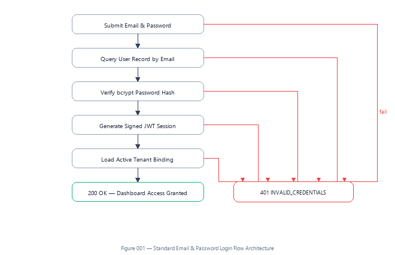

### Sequential Test Execution & Assertion Gates

1. **Submit Email & Password:** Assert test precondition and parameter integrity.
2. **Query User Record by Email:** Assert test precondition and parameter integrity.
3. **Verify bcrypt Password Hash:** Assert test precondition and parameter integrity.
4. **Generate Signed JWT Session:** Assert test precondition and parameter integrity.
5. **Load Active Tenant Binding:** Assert test precondition and parameter integrity.
6. **Success Assertion (200 OK — Dashboard Access Granted):** Assert HTTP 200/201 and state commitment.

* **Failure Rejection Assertion:** `ASSERT 401 INVALID_CREDENTIALS`
* **Pass/Fail Acceptance Standard:** Assert bcrypt hash comparison passes and returns JWT access token.

---

## TC-002: Multi-Tenant Workspace Context Switching

* **Test Category:** Authentication & Sessions
* **Execution Persona:** Business Owner / Multi-Org User
* **Test Prerequisites:** User belongs to at least 2 distinct organizations

### Visual Test Gate Flowchart

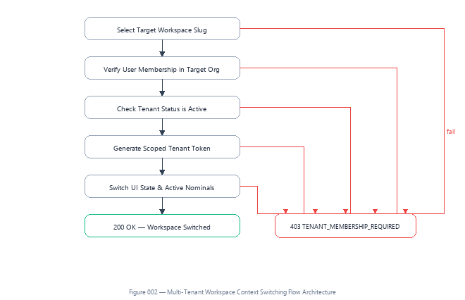

### Sequential Test Execution & Assertion Gates

1. **Select Target Workspace Slug:** Assert test precondition and parameter integrity.
2. **Verify User Membership in Target Org:** Assert test precondition and parameter integrity.
3. **Check Tenant Status is Active:** Assert test precondition and parameter integrity.
4. **Generate Scoped Tenant Token:** Assert test precondition and parameter integrity.
5. **Switch UI State & Active Nominals:** Assert test precondition and parameter integrity.
6. **Success Assertion (200 OK — Workspace Switched):** Assert HTTP 200/201 and state commitment.

* **Failure Rejection Assertion:** `ASSERT 403 TENANT_MEMBERSHIP_REQUIRED`
* **Pass/Fail Acceptance Standard:** Assert user can only switch to organizations where active membership exists.

---

## TC-003: Session Token Expiry & Silent Refresh

* **Test Category:** Authentication & Sessions
* **Execution Persona:** Active Logged-in User
* **Test Prerequisites:** Access token expired; valid refresh token in httpOnly cookie

### Visual Test Gate Flowchart

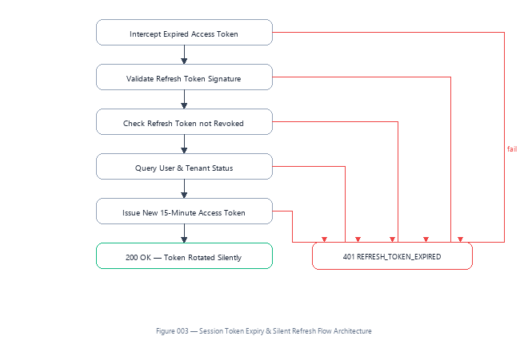

### Sequential Test Execution & Assertion Gates

1. **Intercept Expired Access Token:** Assert test precondition and parameter integrity.
2. **Validate Refresh Token Signature:** Assert test precondition and parameter integrity.
3. **Check Refresh Token not Revoked:** Assert test precondition and parameter integrity.
4. **Query User & Tenant Status:** Assert test precondition and parameter integrity.
5. **Issue New 15-Minute Access Token:** Assert test precondition and parameter integrity.
6. **Success Assertion (200 OK — Token Rotated Silently):** Assert HTTP 200/201 and state commitment.

* **Failure Rejection Assertion:** `ASSERT 401 REFRESH_TOKEN_EXPIRED`
* **Pass/Fail Acceptance Standard:** Assert refresh token rotates seamlessly without forcing manual re-login.

---

## TC-004: Cross-Tenant Injection Prevention Guard

* **Test Category:** Multi-Tenant Security
* **Execution Persona:** Malicious Actor / External User
* **Test Prerequisites:** Attacker attempts to query another tenant's resourceId

### Visual Test Gate Flowchart

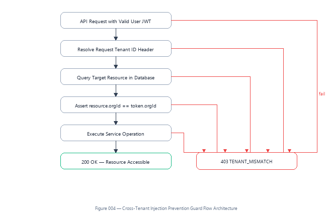

### Sequential Test Execution & Assertion Gates

1. **API Request with Valid User JWT:** Assert test precondition and parameter integrity.
2. **Resolve Request Tenant ID Header:** Assert test precondition and parameter integrity.
3. **Query Target Resource in Database:** Assert test precondition and parameter integrity.
4. **Assert resource.orgId == token.orgId:** Assert test precondition and parameter integrity.
5. **Execute Service Operation:** Assert test precondition and parameter integrity.
6. **Success Assertion (200 OK — Resource Accessible):** Assert HTTP 200/201 and state commitment.

* **Failure Rejection Assertion:** `ASSERT 403 TENANT_MISMATCH`
* **Pass/Fail Acceptance Standard:** Assert cross-tenant data requests are blocked at controller guard level.

---

## TC-005: Two-Factor Authentication (2FA) TOTP Verification

* **Test Category:** Security & Access
* **Execution Persona:** User with 2FA Enabled
* **Test Prerequisites:** Primary credentials verified; TOTP code submitted

### Visual Test Gate Flowchart

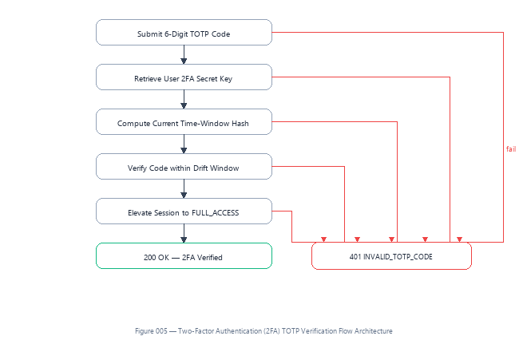

### Sequential Test Execution & Assertion Gates

1. **Submit 6-Digit TOTP Code:** Assert test precondition and parameter integrity.
2. **Retrieve User 2FA Secret Key:** Assert test precondition and parameter integrity.
3. **Compute Current Time-Window Hash:** Assert test precondition and parameter integrity.
4. **Verify Code within Drift Window:** Assert test precondition and parameter integrity.
5. **Elevate Session to FULL_ACCESS:** Assert test precondition and parameter integrity.
6. **Success Assertion (200 OK — 2FA Verified):** Assert HTTP 200/201 and state commitment.

* **Failure Rejection Assertion:** `ASSERT 401 INVALID_TOTP_CODE`
* **Pass/Fail Acceptance Standard:** Assert session remains RESTRICTED until valid TOTP code is confirmed.

---

## TC-006: Password Reset via Time-Limited Token

* **Test Category:** Security & Access
* **Execution Persona:** User Forgot Password
* **Test Prerequisites:** Valid registered email address provided

### Visual Test Gate Flowchart

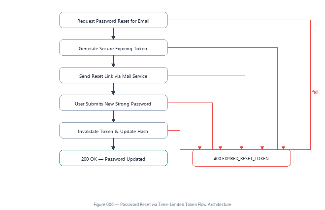

### Sequential Test Execution & Assertion Gates

1. **Request Password Reset for Email:** Assert test precondition and parameter integrity.
2. **Generate Secure Expiring Token:** Assert test precondition and parameter integrity.
3. **Send Reset Link via Mail Service:** Assert test precondition and parameter integrity.
4. **User Submits New Strong Password:** Assert test precondition and parameter integrity.
5. **Invalidate Token & Update Hash:** Assert test precondition and parameter integrity.
6. **Success Assertion (200 OK — Password Updated):** Assert HTTP 200/201 and state commitment.

* **Failure Rejection Assertion:** `ASSERT 400 EXPIRED_RESET_TOKEN`
* **Pass/Fail Acceptance Standard:** Assert reset tokens expire after 60 minutes and cannot be reused.

---

## TC-007: Brute-Force Login Rate Limiting Defense

* **Test Category:** Security & Access
* **Execution Persona:** External Client IP
* **Test Prerequisites:** Target endpoint receives rapid successive requests

### Visual Test Gate Flowchart

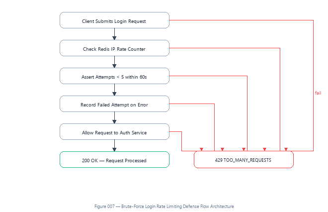

### Sequential Test Execution & Assertion Gates

1. **Client Submits Login Request:** Assert test precondition and parameter integrity.
2. **Check Redis IP Rate Counter:** Assert test precondition and parameter integrity.
3. **Assert Attempts < 5 within 60s:** Assert test precondition and parameter integrity.
4. **Record Failed Attempt on Error:** Assert test precondition and parameter integrity.
5. **Allow Request to Auth Service:** Assert test precondition and parameter integrity.
6. **Success Assertion (200 OK — Request Processed):** Assert HTTP 200/201 and state commitment.

* **Failure Rejection Assertion:** `ASSERT 429 TOO_MANY_REQUESTS`
* **Pass/Fail Acceptance Standard:** Assert IP is throttled for 15 minutes after 5 consecutive failed attempts.

---

## TC-008: Platform Super Admin Portal Gate

* **Test Category:** Governance & Security
* **Execution Persona:** Platform Support Operator
* **Test Prerequisites:** Super admin portal accessed at /admin

### Visual Test Gate Flowchart

### Sequential Test Execution & Assertion Gates

1. **Request /admin Super Portal Endpoint:** Assert test precondition and parameter integrity.
2. **Verify Super Admin JWT Role:** Assert test precondition and parameter integrity.
3. **Assert isPlatformSuperAdmin == true:** Assert test precondition and parameter integrity.
4. **Log Access Event to Security Audit:** Assert test precondition and parameter integrity.
5. **Render Platform Telemetry:** Assert test precondition and parameter integrity.
6. **Success Assertion (200 OK — Super Admin Authorized):** Assert HTTP 200/201 and state commitment.

* **Failure Rejection Assertion:** `ASSERT 403 SUPER_ADMIN_REQUIRED`
* **Pass/Fail Acceptance Standard:** Assert regular tenant owners receive HTTP 403 when requesting /admin.

---

## TC-009: User Logout & Complete Session Revocation

* **Test Category:** Security & Access
* **Execution Persona:** Authenticated User
* **Test Prerequisites:** Active authenticated session exists

### Visual Test Gate Flowchart

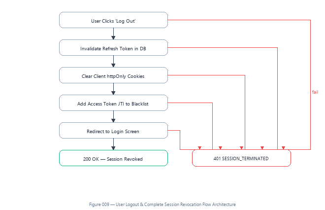

### Sequential Test Execution & Assertion Gates

1. **User Clicks 'Log Out':** Assert test precondition and parameter integrity.
2. **Invalidate Refresh Token in DB:** Assert test precondition and parameter integrity.
3. **Clear Client httpOnly Cookies:** Assert test precondition and parameter integrity.
4. **Add Access Token JTI to Blacklist:** Assert test precondition and parameter integrity.
5. **Redirect to Login Screen:** Assert test precondition and parameter integrity.
6. **Success Assertion (200 OK — Session Revoked):** Assert HTTP 200/201 and state commitment.

* **Failure Rejection Assertion:** `ASSERT 401 SESSION_TERMINATED`
* **Pass/Fail Acceptance Standard:** Assert blacklisted session token cannot be reused after logout.

---

## TC-010: Employee Organization Invitation & Onboarding

* **Test Category:** Tenancy & Users
* **Execution Persona:** Business Owner / Admin
* **Test Prerequisites:** Inviting owner has ADMIN permissions

### Visual Test Gate Flowchart

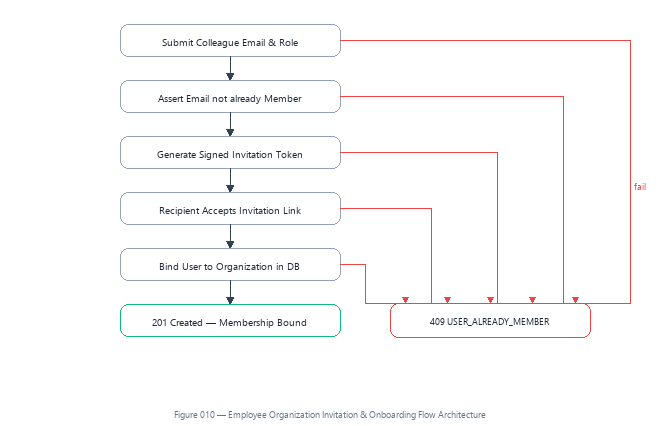

### Sequential Test Execution & Assertion Gates

1. **Submit Colleague Email & Role:** Assert test precondition and parameter integrity.
2. **Assert Email not already Member:** Assert test precondition and parameter integrity.
3. **Generate Signed Invitation Token:** Assert test precondition and parameter integrity.
4. **Recipient Accepts Invitation Link:** Assert test precondition and parameter integrity.
5. **Bind User to Organization in DB:** Assert test precondition and parameter integrity.
6. **Success Assertion (201 Created — Membership Bound):** Assert HTTP 200/201 and state commitment.

* **Failure Rejection Assertion:** `ASSERT 409 USER_ALREADY_MEMBER`
* **Pass/Fail Acceptance Standard:** Assert duplicate invitations to existing members are rejected.

---

## TC-011: Organization Legal Entity Creation

* **Test Category:** Organization Setup
* **Execution Persona:** New Business Owner
* **Test Prerequisites:** User is authenticated; no org created yet

### Visual Test Gate Flowchart

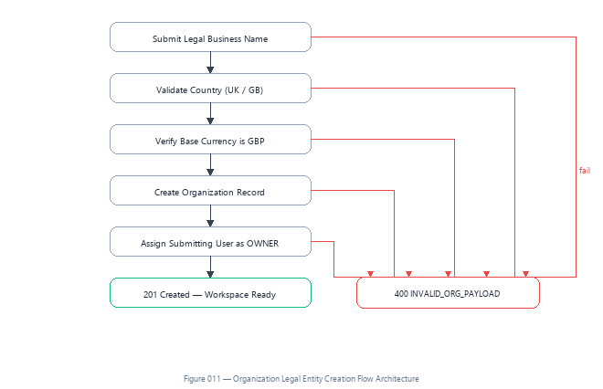

### Sequential Test Execution & Assertion Gates

1. **Submit Legal Business Name:** Assert test precondition and parameter integrity.
2. **Validate Country (UK / GB):** Assert test precondition and parameter integrity.
3. **Verify Base Currency is GBP:** Assert test precondition and parameter integrity.
4. **Create Organization Record:** Assert test precondition and parameter integrity.
5. **Assign Submitting User as OWNER:** Assert test precondition and parameter integrity.
6. **Success Assertion (201 Created — Workspace Ready):** Assert HTTP 200/201 and state commitment.

* **Failure Rejection Assertion:** `ASSERT 400 INVALID_ORG_PAYLOAD`
* **Pass/Fail Acceptance Standard:** Assert new entity is provisioned with OWNER membership automatically.

---

## TC-012: Unique Organization URL Slug Allocation

* **Test Category:** Organization Setup
* **Execution Persona:** Business Owner
* **Test Prerequisites:** Legal business name submitted

### Visual Test Gate Flowchart

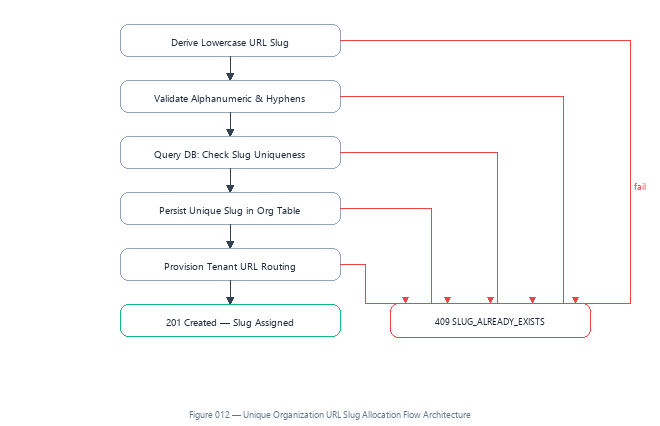

### Sequential Test Execution & Assertion Gates

1. **Derive Lowercase URL Slug:** Assert test precondition and parameter integrity.
2. **Validate Alphanumeric & Hyphens:** Assert test precondition and parameter integrity.
3. **Query DB: Check Slug Uniqueness:** Assert test precondition and parameter integrity.
4. **Persist Unique Slug in Org Table:** Assert test precondition and parameter integrity.
5. **Provision Tenant URL Routing:** Assert test precondition and parameter integrity.
6. **Success Assertion (201 Created — Slug Assigned):** Assert HTTP 200/201 and state commitment.

* **Failure Rejection Assertion:** `ASSERT 409 SLUG_ALREADY_EXISTS`
* **Pass/Fail Acceptance Standard:** Assert slug uniqueness across the entire multi-tenant platform.

---

## TC-013: HMRC UK VAT Registration Number Validation

* **Test Category:** Statutory Configuration
* **Execution Persona:** Bookkeeper / Accountant
* **Test Prerequisites:** Organization registered for UK VAT

### Visual Test Gate Flowchart

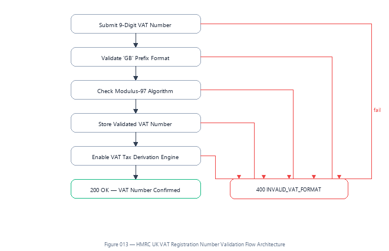

### Sequential Test Execution & Assertion Gates

1. **Submit 9-Digit VAT Number:** Assert test precondition and parameter integrity.
2. **Validate 'GB' Prefix Format:** Assert test precondition and parameter integrity.
3. **Check Modulus-97 Algorithm:** Assert test precondition and parameter integrity.
4. **Store Validated VAT Number:** Assert test precondition and parameter integrity.
5. **Enable VAT Tax Derivation Engine:** Assert test precondition and parameter integrity.
6. **Success Assertion (200 OK — VAT Number Confirmed):** Assert HTTP 200/201 and state commitment.

* **Failure Rejection Assertion:** `ASSERT 400 INVALID_VAT_FORMAT`
* **Pass/Fail Acceptance Standard:** Assert malformed or unverified VAT numbers are rejected at entry.

---

## TC-014: UK Companies House Registration Number Validation

* **Test Category:** Statutory Configuration
* **Execution Persona:** Business Owner
* **Test Prerequisites:** Registered UK limited company

### Visual Test Gate Flowchart

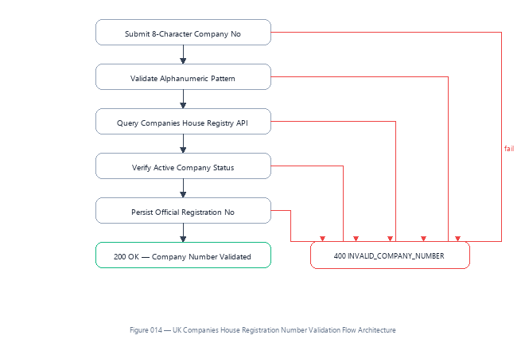

### Sequential Test Execution & Assertion Gates

1. **Submit 8-Character Company No:** Assert test precondition and parameter integrity.
2. **Validate Alphanumeric Pattern:** Assert test precondition and parameter integrity.
3. **Query Companies House Registry API:** Assert test precondition and parameter integrity.
4. **Verify Active Company Status:** Assert test precondition and parameter integrity.
5. **Persist Official Registration No:** Assert test precondition and parameter integrity.
6. **Success Assertion (200 OK — Company Number Validated):** Assert HTTP 200/201 and state commitment.

* **Failure Rejection Assertion:** `ASSERT 400 INVALID_COMPANY_NUMBER`
* **Pass/Fail Acceptance Standard:** Assert company registration number conforms to UK standard format.

---

## TC-015: Base Trading Currency Lock (GBP)

* **Test Category:** Multi-Currency Governance
* **Execution Persona:** Business Owner
* **Test Prerequisites:** New organization initialized

### Visual Test Gate Flowchart

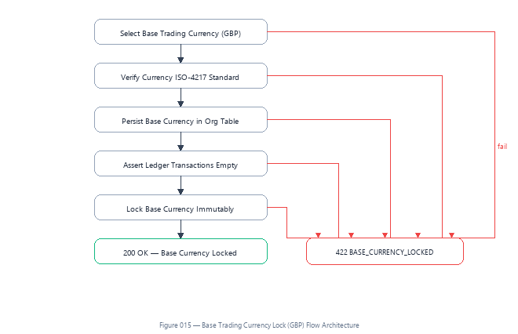

### Sequential Test Execution & Assertion Gates

1. **Select Base Trading Currency (GBP):** Assert test precondition and parameter integrity.
2. **Verify Currency ISO-4217 Standard:** Assert test precondition and parameter integrity.
3. **Persist Base Currency in Org Table:** Assert test precondition and parameter integrity.
4. **Assert Ledger Transactions Empty:** Assert test precondition and parameter integrity.
5. **Lock Base Currency Immutably:** Assert test precondition and parameter integrity.
6. **Success Assertion (200 OK — Base Currency Locked):** Assert HTTP 200/201 and state commitment.

* **Failure Rejection Assertion:** `ASSERT 422 BASE_CURRENCY_LOCKED`
* **Pass/Fail Acceptance Standard:** Assert base currency cannot be modified after initial ledger entries.

---

## TC-016: Financial Year Calendar Setup & Partitioning

* **Test Category:** Accounting Foundations
* **Execution Persona:** Accountant / Owner
* **Test Prerequisites:** Organization created; setting accounting dates

### Visual Test Gate Flowchart

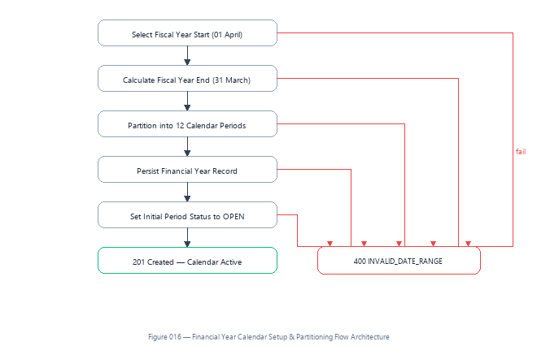

### Sequential Test Execution & Assertion Gates

1. **Select Fiscal Year Start (01 April):** Assert test precondition and parameter integrity.
2. **Calculate Fiscal Year End (31 March):** Assert test precondition and parameter integrity.
3. **Partition into 12 Calendar Periods:** Assert test precondition and parameter integrity.
4. **Persist Financial Year Record:** Assert test precondition and parameter integrity.
5. **Set Initial Period Status to OPEN:** Assert test precondition and parameter integrity.
6. **Success Assertion (201 Created — Calendar Active):** Assert HTTP 200/201 and state commitment.

* **Failure Rejection Assertion:** `ASSERT 400 INVALID_DATE_RANGE`
* **Pass/Fail Acceptance Standard:** Assert financial year spans exactly 12 contiguous accounting periods.

---

## TC-017: Company Branding & Invoice Logo Upload

* **Test Category:** Branding & Customization
* **Execution Persona:** Business Owner / Clerk
* **Test Prerequisites:** Organization workspace active

### Visual Test Gate Flowchart

### Sequential Test Execution & Assertion Gates

1. **Upload Company Logo File:** Assert test precondition and parameter integrity.
2. **Check File Type (PNG / JPEG):** Assert test precondition and parameter integrity.
3. **Assert File Size <= 2 Megabytes:** Assert test precondition and parameter integrity.
4. **Upload to AWS S3 Documents Bucket:** Assert test precondition and parameter integrity.
5. **Save Secure Logo URL in Org Table:** Assert test precondition and parameter integrity.
6. **Success Assertion (200 OK — Logo Configured):** Assert HTTP 200/201 and state commitment.

* **Failure Rejection Assertion:** `ASSERT 400 FILE_TOO_LARGE_OR_INVALID`
* **Pass/Fail Acceptance Standard:** Assert non-image files or oversized uploads are rejected before upload.

---

## TC-018: Organization Soft Deactivation & Archive

* **Test Category:** Tenancy Governance
* **Execution Persona:** Business Owner
* **Test Prerequisites:** Business ceases trading or migrates

### Visual Test Gate Flowchart

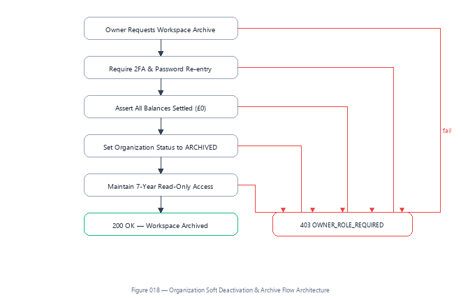

### Sequential Test Execution & Assertion Gates

1. **Owner Requests Workspace Archive:** Assert test precondition and parameter integrity.
2. **Require 2FA & Password Re-entry:** Assert test precondition and parameter integrity.
3. **Assert All Balances Settled (£0):** Assert test precondition and parameter integrity.
4. **Set Organization Status to ARCHIVED:** Assert test precondition and parameter integrity.
5. **Maintain 7-Year Read-Only Access:** Assert test precondition and parameter integrity.
6. **Success Assertion (200 OK — Workspace Archived):** Assert HTTP 200/201 and state commitment.

* **Failure Rejection Assertion:** `ASSERT 403 OWNER_ROLE_REQUIRED`
* **Pass/Fail Acceptance Standard:** Assert non-owners cannot archive organizations; records preserved for audit.

---

## TC-019: Standard Nominal Code Creation (1000-9999)

* **Test Category:** General Ledger
* **Execution Persona:** Accountant
* **Test Prerequisites:** Chart of Accounts active

### Visual Test Gate Flowchart

### Sequential Test Execution & Assertion Gates

1. **Submit 4-Digit Nominal Code:** Assert test precondition and parameter integrity.
2. **Assert Code in Valid Range:** Assert test precondition and parameter integrity.
3. **Assign Account Classification Type:** Assert test precondition and parameter integrity.
4. **Assign Normal Balance (DR/CR):** Assert test precondition and parameter integrity.
5. **Persist Nominal Account in DB:** Assert test precondition and parameter integrity.
6. **Success Assertion (201 Created — Nominal Active):** Assert HTTP 200/201 and state commitment.

* **Failure Rejection Assertion:** `ASSERT 400 INVALID_CODE_FORMAT`
* **Pass/Fail Acceptance Standard:** Assert nominal codes conform strictly to UK 4-digit standard ranges.

---

## TC-020: Duplicate Nominal Code Constraint Check

* **Test Category:** General Ledger
* **Execution Persona:** Accountant
* **Test Prerequisites:** Adding new account to COA

### Visual Test Gate Flowchart

### Sequential Test Execution & Assertion Gates

1. **Enter Nominal Account Code:** Assert test precondition and parameter integrity.
2. **Query Accounts in Same Org:** Assert test precondition and parameter integrity.
3. **Assert Code does not already Exist:** Assert test precondition and parameter integrity.
4. **Validate Account Name Uniqueness:** Assert test precondition and parameter integrity.
5. **Commit Account Record:** Assert test precondition and parameter integrity.
6. **Success Assertion (201 Created — Code Unique):** Assert HTTP 200/201 and state commitment.

* **Failure Rejection Assertion:** `ASSERT 409 DUPLICATE_ACCOUNT_CODE`
* **Pass/Fail Acceptance Standard:** Assert duplicate codes within the same organization are rejected.

---

## TC-021: Accounts Receivable Control Account Protection

* **Test Category:** Ledger Governance
* **Execution Persona:** Bookkeeper / Clerk
* **Test Prerequisites:** Attempting manual journal to Code 1100

### Visual Test Gate Flowchart

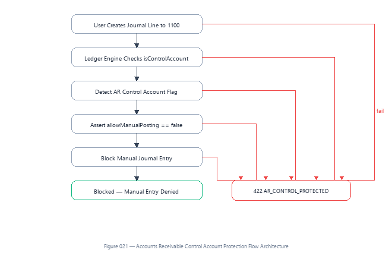

### Sequential Test Execution & Assertion Gates

1. **User Creates Journal Line to 1100:** Assert test precondition and parameter integrity.
2. **Ledger Engine Checks isControlAccount:** Assert test precondition and parameter integrity.
3. **Detect AR Control Account Flag:** Assert test precondition and parameter integrity.
4. **Assert allowManualPosting == false:** Assert test precondition and parameter integrity.
5. **Block Manual Journal Entry:** Assert test precondition and parameter integrity.
6. **Success Assertion (Blocked — Manual Entry Denied):** Assert HTTP 200/201 and state commitment.

* **Failure Rejection Assertion:** `ASSERT 422 AR_CONTROL_PROTECTED`
* **Pass/Fail Acceptance Standard:** Assert direct journals to Accounts Receivable are physically blocked.

---

## TC-022: Accounts Payable Control Account Protection

* **Test Category:** Ledger Governance
* **Execution Persona:** Bookkeeper / Clerk
* **Test Prerequisites:** Attempting manual journal to Code 2100

### Visual Test Gate Flowchart

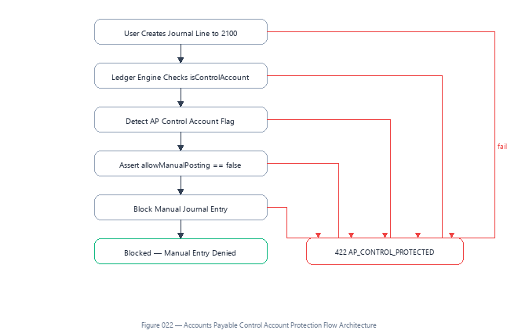

### Sequential Test Execution & Assertion Gates

1. **User Creates Journal Line to 2100:** Assert test precondition and parameter integrity.
2. **Ledger Engine Checks isControlAccount:** Assert test precondition and parameter integrity.
3. **Detect AP Control Account Flag:** Assert test precondition and parameter integrity.
4. **Assert allowManualPosting == false:** Assert test precondition and parameter integrity.
5. **Block Manual Journal Entry:** Assert test precondition and parameter integrity.
6. **Success Assertion (Blocked — Manual Entry Denied):** Assert HTTP 200/201 and state commitment.

* **Failure Rejection Assertion:** `ASSERT 422 AP_CONTROL_PROTECTED`
* **Pass/Fail Acceptance Standard:** Assert direct journals to Accounts Payable are physically blocked.

---

## TC-023: VAT Control Account Automated Posting Rule

* **Test Category:** Tax Governance
* **Execution Persona:** Any User
* **Test Prerequisites:** Attempting manual journal to Code 2200

### Visual Test Gate Flowchart

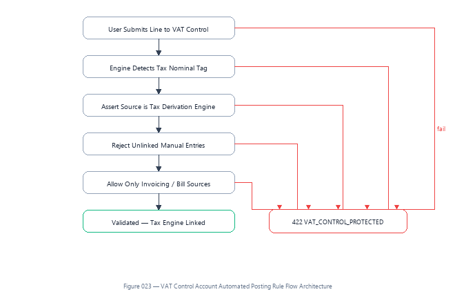

### Sequential Test Execution & Assertion Gates

1. **User Submits Line to VAT Control:** Assert test precondition and parameter integrity.
2. **Engine Detects Tax Nominal Tag:** Assert test precondition and parameter integrity.
3. **Assert Source is Tax Derivation Engine:** Assert test precondition and parameter integrity.
4. **Reject Unlinked Manual Entries:** Assert test precondition and parameter integrity.
5. **Allow Only Invoicing / Bill Sources:** Assert test precondition and parameter integrity.
6. **Success Assertion (Validated — Tax Engine Linked):** Assert HTTP 200/201 and state commitment.

* **Failure Rejection Assertion:** `ASSERT 422 VAT_CONTROL_PROTECTED`
* **Pass/Fail Acceptance Standard:** Assert VAT control nominals can only be credited/debited by tax engine.

---

## TC-024: Retained Earnings System Account Lock

* **Test Category:** Ledger Governance
* **Execution Persona:** Accountant
* **Test Prerequisites:** Attempting edit on Code 3100

### Visual Test Gate Flowchart

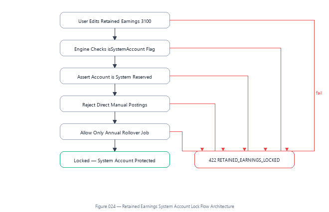

### Sequential Test Execution & Assertion Gates

1. **User Edits Retained Earnings 3100:** Assert test precondition and parameter integrity.
2. **Engine Checks isSystemAccount Flag:** Assert test precondition and parameter integrity.
3. **Assert Account is System Reserved:** Assert test precondition and parameter integrity.
4. **Reject Direct Manual Postings:** Assert test precondition and parameter integrity.
5. **Allow Only Annual Rollover Job:** Assert test precondition and parameter integrity.
6. **Success Assertion (Locked — System Account Protected):** Assert HTTP 200/201 and state commitment.

* **Failure Rejection Assertion:** `ASSERT 422 RETAINED_EARNINGS_LOCKED`
* **Pass/Fail Acceptance Standard:** Assert Retained Earnings account is reserved exclusively for year-end closing.

---

## TC-025: Account Normal Balance Derivation Rule

* **Test Category:** Accounting Invariants
* **Execution Persona:** Accountant
* **Test Prerequisites:** Creating nominal account

### Visual Test Gate Flowchart

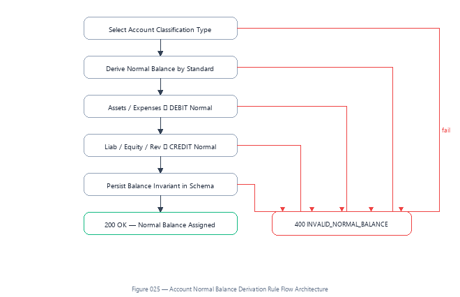

### Sequential Test Execution & Assertion Gates

1. **Select Account Classification Type:** Assert test precondition and parameter integrity.
2. **Derive Normal Balance by Standard:** Assert test precondition and parameter integrity.
3. **Assets / Expenses ➔ DEBIT Normal:** Assert test precondition and parameter integrity.
4. **Liab / Equity / Rev ➔ CREDIT Normal:** Assert test precondition and parameter integrity.
5. **Persist Balance Invariant in Schema:** Assert test precondition and parameter integrity.
6. **Success Assertion (200 OK — Normal Balance Assigned):** Assert HTTP 200/201 and state commitment.

* **Failure Rejection Assertion:** `ASSERT 400 INVALID_NORMAL_BALANCE`
* **Pass/Fail Acceptance Standard:** Assert normal balance aligns with double-entry accounting fundamentals.

---

## TC-026: Parent-Child Nominal Account Hierarchy

* **Test Category:** Chart of Accounts
* **Execution Persona:** Accountant
* **Test Prerequisites:** Creating sub-nominal account

### Visual Test Gate Flowchart

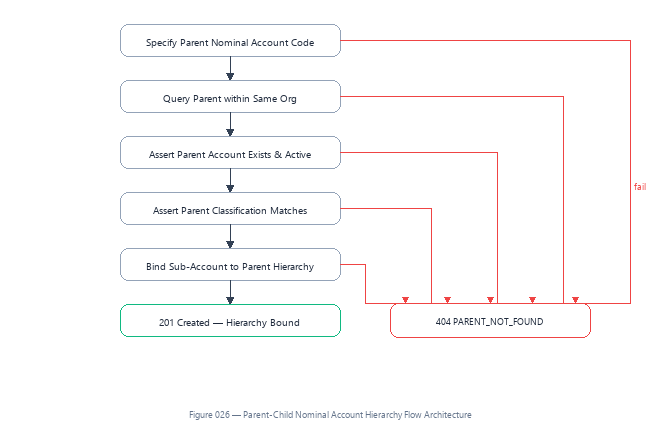

### Sequential Test Execution & Assertion Gates

1. **Specify Parent Nominal Account Code:** Assert test precondition and parameter integrity.
2. **Query Parent within Same Org:** Assert test precondition and parameter integrity.
3. **Assert Parent Account Exists & Active:** Assert test precondition and parameter integrity.
4. **Assert Parent Classification Matches:** Assert test precondition and parameter integrity.
5. **Bind Sub-Account to Parent Hierarchy:** Assert test precondition and parameter integrity.
6. **Success Assertion (201 Created — Hierarchy Bound):** Assert HTTP 200/201 and state commitment.

* **Failure Rejection Assertion:** `ASSERT 404 PARENT_NOT_FOUND`
* **Pass/Fail Acceptance Standard:** Assert sub-accounts must share classification and tenant with parent.

---

## TC-027: Account Deactivation with Zero Balance Check

* **Test Category:** Chart of Accounts
* **Execution Persona:** Accountant
* **Test Prerequisites:** Deactivating obsolete nominal code

### Visual Test Gate Flowchart

### Sequential Test Execution & Assertion Gates

1. **Request Deactivation of Account:** Assert test precondition and parameter integrity.
2. **Compute Current Running Balance:** Assert test precondition and parameter integrity.
3. **Assert Balance == £0.0000 Exactly:** Assert test precondition and parameter integrity.
4. **Assert No Unposted Drafts Linked:** Assert test precondition and parameter integrity.
5. **Set Account Status to INACTIVE:** Assert test precondition and parameter integrity.
6. **Success Assertion (200 OK — Account Deactivated):** Assert HTTP 200/201 and state commitment.

* **Failure Rejection Assertion:** `ASSERT 422 ACCOUNT_BALANCE_NON_ZERO`
* **Pass/Fail Acceptance Standard:** Assert accounts with active balances cannot be deactivated.

---

## TC-028: Account Foreign Currency Assignment Check

* **Test Category:** Multi-Currency
* **Execution Persona:** Accountant
* **Test Prerequisites:** Creating foreign currency bank/subledger

### Visual Test Gate Flowchart

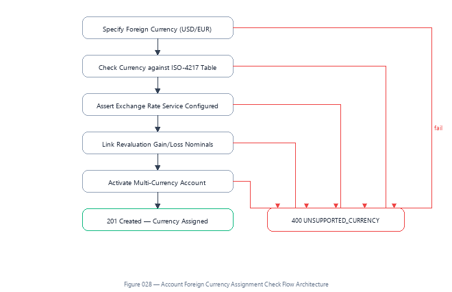

### Sequential Test Execution & Assertion Gates

1. **Specify Foreign Currency (USD/EUR):** Assert test precondition and parameter integrity.
2. **Check Currency against ISO-4217 Table:** Assert test precondition and parameter integrity.
3. **Assert Exchange Rate Service Configured:** Assert test precondition and parameter integrity.
4. **Link Revaluation Gain/Loss Nominals:** Assert test precondition and parameter integrity.
5. **Activate Multi-Currency Account:** Assert test precondition and parameter integrity.
6. **Success Assertion (201 Created — Currency Assigned):** Assert HTTP 200/201 and state commitment.

* **Failure Rejection Assertion:** `ASSERT 400 UNSUPPORTED_CURRENCY`
* **Pass/Fail Acceptance Standard:** Assert non-standard currency codes are rejected.

---

## TC-029: Draft Journal Entry Creation & Line Staging

* **Test Category:** Journal Lifecycle
* **Execution Persona:** Accountant
* **Test Prerequisites:** Chart of accounts active; user has write permission

### Visual Test Gate Flowchart

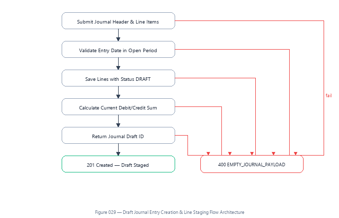

### Sequential Test Execution & Assertion Gates

1. **Submit Journal Header & Line Items:** Assert test precondition and parameter integrity.
2. **Validate Entry Date in Open Period:** Assert test precondition and parameter integrity.
3. **Save Lines with Status DRAFT:** Assert test precondition and parameter integrity.
4. **Calculate Current Debit/Credit Sum:** Assert test precondition and parameter integrity.
5. **Return Journal Draft ID:** Assert test precondition and parameter integrity.
6. **Success Assertion (201 Created — Draft Staged):** Assert HTTP 200/201 and state commitment.

* **Failure Rejection Assertion:** `ASSERT 400 EMPTY_JOURNAL_PAYLOAD`
* **Pass/Fail Acceptance Standard:** Assert draft journals do not alter general ledger running balances.

---

## TC-030: Debits Equal Credits Equilibrium Invariant

* **Test Category:** Accounting Invariants
* **Execution Persona:** Accountant
* **Test Prerequisites:** Attempting to post journal entry

### Visual Test Gate Flowchart

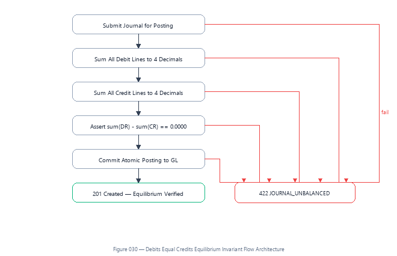

### Sequential Test Execution & Assertion Gates

1. **Submit Journal for Posting:** Assert test precondition and parameter integrity.
2. **Sum All Debit Lines to 4 Decimals:** Assert test precondition and parameter integrity.
3. **Sum All Credit Lines to 4 Decimals:** Assert test precondition and parameter integrity.
4. **Assert sum(DR) - sum(CR) == 0.0000:** Assert test precondition and parameter integrity.
5. **Commit Atomic Posting to GL:** Assert test precondition and parameter integrity.
6. **Success Assertion (201 Created — Equilibrium Verified):** Assert HTTP 200/201 and state commitment.

* **Failure Rejection Assertion:** `ASSERT 422 JOURNAL_UNBALANCED`
* **Pass/Fail Acceptance Standard:** Assert unbalanced journals are physically rejected by database constraints.

---

## TC-031: Minimum Two Line Items Enforcement

* **Test Category:** Accounting Invariants
* **Execution Persona:** Accountant
* **Test Prerequisites:** Attempting to post journal

### Visual Test Gate Flowchart

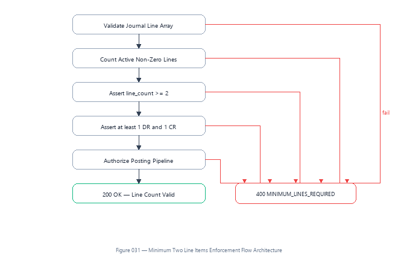

### Sequential Test Execution & Assertion Gates

1. **Validate Journal Line Array:** Assert test precondition and parameter integrity.
2. **Count Active Non-Zero Lines:** Assert test precondition and parameter integrity.
3. **Assert line_count >= 2:** Assert test precondition and parameter integrity.
4. **Assert at least 1 DR and 1 CR:** Assert test precondition and parameter integrity.
5. **Authorize Posting Pipeline:** Assert test precondition and parameter integrity.
6. **Success Assertion (200 OK — Line Count Valid):** Assert HTTP 200/201 and state commitment.

* **Failure Rejection Assertion:** `ASSERT 400 MINIMUM_LINES_REQUIRED`
* **Pass/Fail Acceptance Standard:** Assert single-line transactions are rejected before ledger commit.

---

## TC-032: Zero Amount Line Item Rejection

* **Test Category:** Journal Validation
* **Execution Persona:** Accountant
* **Test Prerequisites:** Entering journal lines

### Visual Test Gate Flowchart

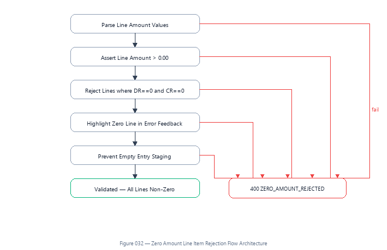

### Sequential Test Execution & Assertion Gates

1. **Parse Line Amount Values:** Assert test precondition and parameter integrity.
2. **Assert Line Amount > 0.00:** Assert test precondition and parameter integrity.
3. **Reject Lines where DR==0 and CR==0:** Assert test precondition and parameter integrity.
4. **Highlight Zero Line in Error Feedback:** Assert test precondition and parameter integrity.
5. **Prevent Empty Entry Staging:** Assert test precondition and parameter integrity.
6. **Success Assertion (Validated — All Lines Non-Zero):** Assert HTTP 200/201 and state commitment.

* **Failure Rejection Assertion:** `ASSERT 400 ZERO_AMOUNT_REJECTED`
* **Pass/Fail Acceptance Standard:** Assert lines with zero values are flagged and blocked.

---

## TC-033: Mutually Exclusive Line Amounts (DR vs CR)

* **Test Category:** Journal Validation
* **Execution Persona:** Accountant
* **Test Prerequisites:** Entering line values

### Visual Test Gate Flowchart

### Sequential Test Execution & Assertion Gates

1. **Inspect Single Journal Line:** Assert test precondition and parameter integrity.
2. **Check Debit Amount and Credit Amount:** Assert test precondition and parameter integrity.
3. **Assert NOT (debit > 0 AND credit > 0):** Assert test precondition and parameter integrity.
4. **Enforce Either Debit OR Credit Exclusivity:** Assert test precondition and parameter integrity.
5. **Commit Line Value to Draft:** Assert test precondition and parameter integrity.
6. **Success Assertion (Validated — Exclusivity Enforced):** Assert HTTP 200/201 and state commitment.

* **Failure Rejection Assertion:** `ASSERT 400 MUTUALLY_EXCLUSIVE_LINE`
* **Pass/Fail Acceptance Standard:** Assert a single line cannot specify both debit and credit amounts.

---

## TC-034: Arbitrary Decimal Precision Arithmetic Check

* **Test Category:** Accounting Precision
* **Execution Persona:** System Math Engine
* **Test Prerequisites:** Computing tax and currency fractions

### Visual Test Gate Flowchart

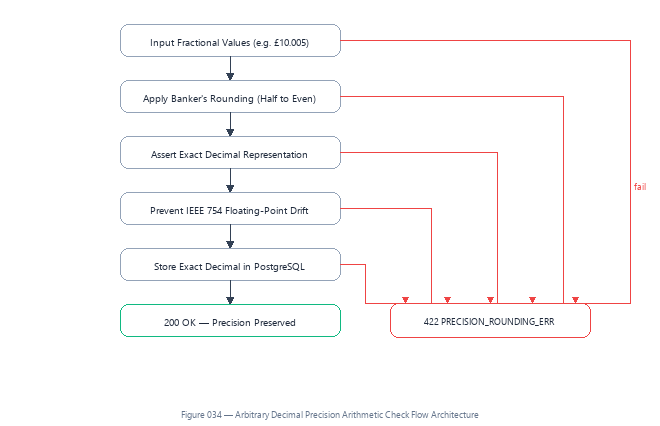

### Sequential Test Execution & Assertion Gates

1. **Input Fractional Values (e.g. £10.005):** Assert test precondition and parameter integrity.
2. **Apply Banker's Rounding (Half to Even):** Assert test precondition and parameter integrity.
3. **Assert Exact Decimal Representation:** Assert test precondition and parameter integrity.
4. **Prevent IEEE 754 Floating-Point Drift:** Assert test precondition and parameter integrity.
5. **Store Exact Decimal in PostgreSQL:** Assert test precondition and parameter integrity.
6. **Success Assertion (200 OK — Precision Preserved):** Assert HTTP 200/201 and state commitment.

* **Failure Rejection Assertion:** `ASSERT 422 PRECISION_ROUNDING_ERR`
* **Pass/Fail Acceptance Standard:** Assert floating-point rounding errors never enter general ledger balances.

---

## TC-035: Atomic Multi-Line Ledger Commit Transaction

* **Test Category:** Ledger Engine
* **Execution Persona:** Posting Engine
* **Test Prerequisites:** Validated balanced journal ready to post

### Visual Test Gate Flowchart

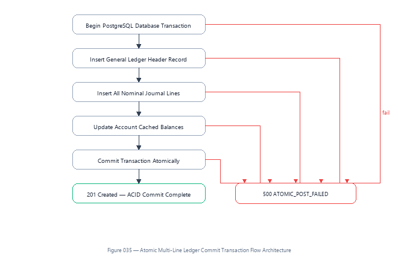

### Sequential Test Execution & Assertion Gates

1. **Begin PostgreSQL Database Transaction:** Assert test precondition and parameter integrity.
2. **Insert General Ledger Header Record:** Assert test precondition and parameter integrity.
3. **Insert All Nominal Journal Lines:** Assert test precondition and parameter integrity.
4. **Update Account Cached Balances:** Assert test precondition and parameter integrity.
5. **Commit Transaction Atomically:** Assert test precondition and parameter integrity.
6. **Success Assertion (201 Created — ACID Commit Complete):** Assert HTTP 200/201 and state commitment.

* **Failure Rejection Assertion:** `ASSERT 500 ATOMIC_POST_FAILED`
* **Pass/Fail Acceptance Standard:** Assert failure on any single line causes complete database rollback.

---

## TC-036: Posted Journal Historical Immutability

* **Test Category:** Ledger Immutability
* **Execution Persona:** Any User
* **Test Prerequisites:** Journal has status POSTED

### Visual Test Gate Flowchart

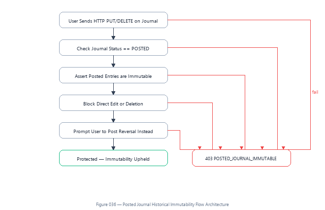

### Sequential Test Execution & Assertion Gates

1. **User Sends HTTP PUT/DELETE on Journal:** Assert test precondition and parameter integrity.
2. **Check Journal Status == POSTED:** Assert test precondition and parameter integrity.
3. **Assert Posted Entries are Immutable:** Assert test precondition and parameter integrity.
4. **Block Direct Edit or Deletion:** Assert test precondition and parameter integrity.
5. **Prompt User to Post Reversal Instead:** Assert test precondition and parameter integrity.
6. **Success Assertion (Protected — Immutability Upheld):** Assert HTTP 200/201 and state commitment.

* **Failure Rejection Assertion:** `ASSERT 403 POSTED_JOURNAL_IMMUTABLE`
* **Pass/Fail Acceptance Standard:** Assert posted accounting transactions can never be modified or erased.

---

## TC-037: Symmetrical GAAP Journal Reversal Linking

* **Test Category:** Journal Reversals
* **Execution Persona:** Accountant
* **Test Prerequisites:** Posted journal requires correction

### Visual Test Gate Flowchart

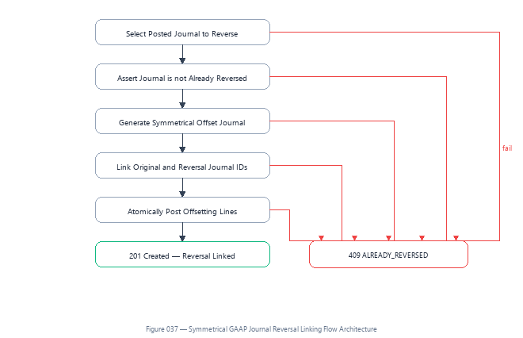

### Sequential Test Execution & Assertion Gates

1. **Select Posted Journal to Reverse:** Assert test precondition and parameter integrity.
2. **Assert Journal is not Already Reversed:** Assert test precondition and parameter integrity.
3. **Generate Symmetrical Offset Journal:** Assert test precondition and parameter integrity.
4. **Link Original and Reversal Journal IDs:** Assert test precondition and parameter integrity.
5. **Atomically Post Offsetting Lines:** Assert test precondition and parameter integrity.
6. **Success Assertion (201 Created — Reversal Linked):** Assert HTTP 200/201 and state commitment.

* **Failure Rejection Assertion:** `ASSERT 409 ALREADY_REVERSED`
* **Pass/Fail Acceptance Standard:** Assert reversal creates an exact mirrored transaction preserving audit trails.

---

## TC-038: Draft Journal Clean Discard & Garbage Collection

* **Test Category:** Journal Lifecycle
* **Execution Persona:** Accountant
* **Test Prerequisites:** Draft journal no longer needed

### Visual Test Gate Flowchart

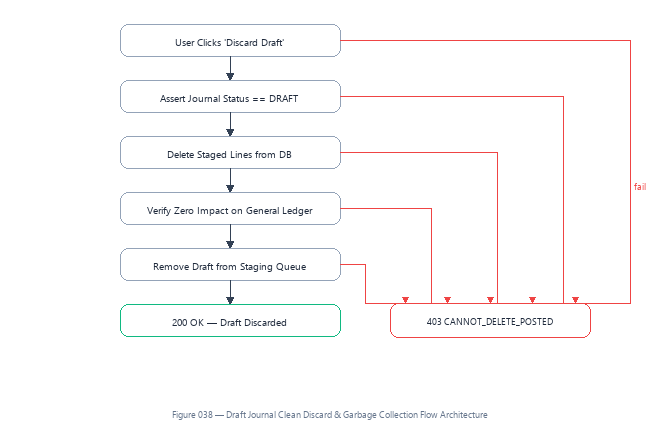

### Sequential Test Execution & Assertion Gates

1. **User Clicks 'Discard Draft':** Assert test precondition and parameter integrity.
2. **Assert Journal Status == DRAFT:** Assert test precondition and parameter integrity.
3. **Delete Staged Lines from DB:** Assert test precondition and parameter integrity.
4. **Verify Zero Impact on General Ledger:** Assert test precondition and parameter integrity.
5. **Remove Draft from Staging Queue:** Assert test precondition and parameter integrity.
6. **Success Assertion (200 OK — Draft Discarded):** Assert HTTP 200/201 and state commitment.

* **Failure Rejection Assertion:** `ASSERT 403 CANNOT_DELETE_POSTED`
* **Pass/Fail Acceptance Standard:** Assert draft journals can be safely deleted without ledger distortion.

---

## TC-039: Customer Contact Profile Creation & Verification

* **Test Category:** Commercial Subledgers
* **Execution Persona:** Billing Clerk
* **Test Prerequisites:** Adding new client to system

### Visual Test Gate Flowchart

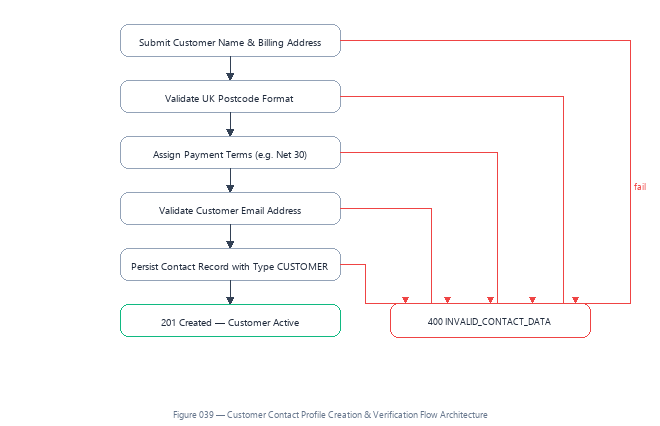

### Sequential Test Execution & Assertion Gates

1. **Submit Customer Name & Billing Address:** Assert test precondition and parameter integrity.
2. **Validate UK Postcode Format:** Assert test precondition and parameter integrity.
3. **Assign Payment Terms (e.g. Net 30):** Assert test precondition and parameter integrity.
4. **Validate Customer Email Address:** Assert test precondition and parameter integrity.
5. **Persist Contact Record with Type CUSTOMER:** Assert test precondition and parameter integrity.
6. **Success Assertion (201 Created — Customer Active):** Assert HTTP 200/201 and state commitment.

* **Failure Rejection Assertion:** `ASSERT 400 INVALID_CONTACT_DATA`
* **Pass/Fail Acceptance Standard:** Assert customer contact records validate address and billing terms.

---

## TC-040: Sales Invoice Draft Generation

* **Test Category:** Sales & Billing
* **Execution Persona:** Billing Clerk
* **Test Prerequisites:** Active customer exists

### Visual Test Gate Flowchart

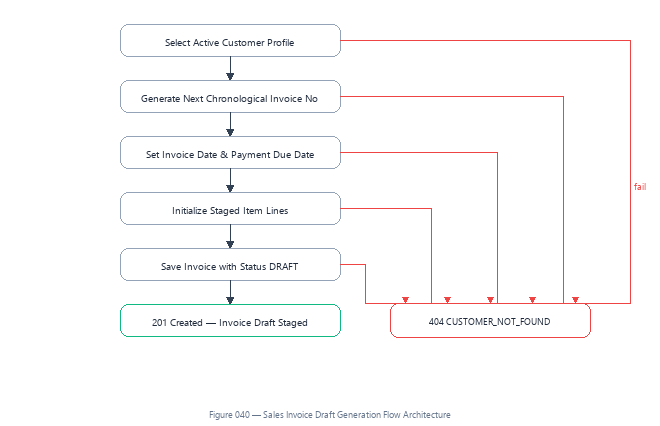

### Sequential Test Execution & Assertion Gates

1. **Select Active Customer Profile:** Assert test precondition and parameter integrity.
2. **Generate Next Chronological Invoice No:** Assert test precondition and parameter integrity.
3. **Set Invoice Date & Payment Due Date:** Assert test precondition and parameter integrity.
4. **Initialize Staged Item Lines:** Assert test precondition and parameter integrity.
5. **Save Invoice with Status DRAFT:** Assert test precondition and parameter integrity.
6. **Success Assertion (201 Created — Invoice Draft Staged):** Assert HTTP 200/201 and state commitment.

* **Failure Rejection Assertion:** `ASSERT 404 CUSTOMER_NOT_FOUND`
* **Pass/Fail Acceptance Standard:** Assert invoice numbers increment monotonically with zero duplicates.

---

## TC-041: UK Standard 20% VAT Line Derivation

* **Test Category:** Tax Calculation
* **Execution Persona:** Billing Clerk
* **Test Prerequisites:** Item subject to standard UK VAT

### Visual Test Gate Flowchart

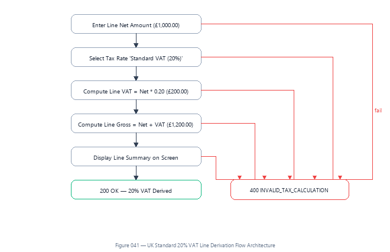

### Sequential Test Execution & Assertion Gates

1. **Enter Line Net Amount (£1,000.00):** Assert test precondition and parameter integrity.
2. **Select Tax Rate 'Standard VAT (20%)':** Assert test precondition and parameter integrity.
3. **Compute Line VAT = Net * 0.20 (£200.00):** Assert test precondition and parameter integrity.
4. **Compute Line Gross = Net + VAT (£1,200.00):** Assert test precondition and parameter integrity.
5. **Display Line Summary on Screen:** Assert test precondition and parameter integrity.
6. **Success Assertion (200 OK — 20% VAT Derived):** Assert HTTP 200/201 and state commitment.

* **Failure Rejection Assertion:** `ASSERT 400 INVALID_TAX_CALCULATION`
* **Pass/Fail Acceptance Standard:** Assert VAT standard rate applies exact 20% math with decimal accuracy.

---

## TC-042: UK Reduced 5% VAT Line Derivation

* **Test Category:** Tax Calculation
* **Execution Persona:** Billing Clerk
* **Test Prerequisites:** Qualifying domestic fuel/energy item

### Visual Test Gate Flowchart

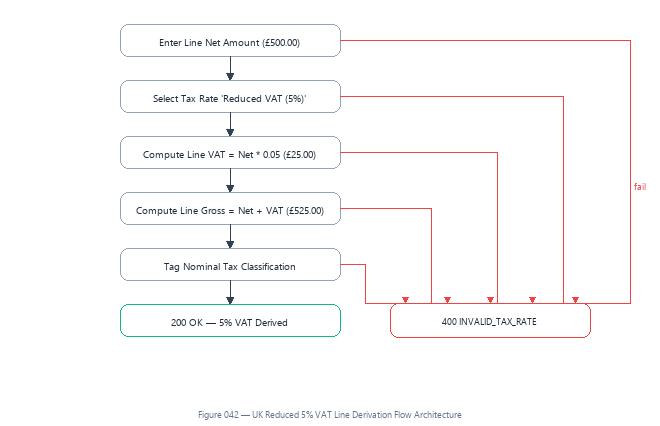

### Sequential Test Execution & Assertion Gates

1. **Enter Line Net Amount (£500.00):** Assert test precondition and parameter integrity.
2. **Select Tax Rate 'Reduced VAT (5%)':** Assert test precondition and parameter integrity.
3. **Compute Line VAT = Net * 0.05 (£25.00):** Assert test precondition and parameter integrity.
4. **Compute Line Gross = Net + VAT (£525.00):** Assert test precondition and parameter integrity.
5. **Tag Nominal Tax Classification:** Assert test precondition and parameter integrity.
6. **Success Assertion (200 OK — 5% VAT Derived):** Assert HTTP 200/201 and state commitment.

* **Failure Rejection Assertion:** `ASSERT 400 INVALID_TAX_RATE`
* **Pass/Fail Acceptance Standard:** Assert 5% reduced VAT calculates accurately on qualifying items.

---

## TC-043: Zero-Rated (0%) VAT Classification

* **Test Category:** Tax Calculation
* **Execution Persona:** Billing Clerk
* **Test Prerequisites:** Books, printed materials or food products

### Visual Test Gate Flowchart

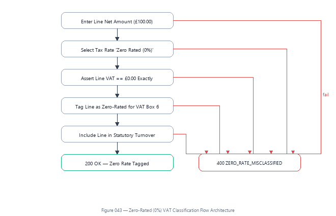

### Sequential Test Execution & Assertion Gates

1. **Enter Line Net Amount (£100.00):** Assert test precondition and parameter integrity.
2. **Select Tax Rate 'Zero Rated (0%)':** Assert test precondition and parameter integrity.
3. **Assert Line VAT == £0.00 Exactly:** Assert test precondition and parameter integrity.
4. **Tag Line as Zero-Rated for VAT Box 6:** Assert test precondition and parameter integrity.
5. **Include Line in Statutory Turnover:** Assert test precondition and parameter integrity.
6. **Success Assertion (200 OK — Zero Rate Tagged):** Assert HTTP 200/201 and state commitment.

* **Failure Rejection Assertion:** `ASSERT 400 ZERO_RATE_MISCLASSIFIED`
* **Pass/Fail Acceptance Standard:** Assert zero-rated items report in VAT Box 6 without generating tax liability.

---

## TC-044: VAT Exempt Sales Classification

* **Test Category:** Tax Calculation
* **Execution Persona:** Billing Clerk
* **Test Prerequisites:** Exempt financial / educational service

### Visual Test Gate Flowchart

### Sequential Test Execution & Assertion Gates

1. **Enter Line Net Amount (£250.00):** Assert test precondition and parameter integrity.
2. **Select Tax Rate 'Exempt':** Assert test precondition and parameter integrity.
3. **Assert Line VAT == £0.00:** Assert test precondition and parameter integrity.
4. **Exclude from Output VAT Liability:** Assert test precondition and parameter integrity.
5. **Tag for Partial Exemption Tracking:** Assert test precondition and parameter integrity.
6. **Success Assertion (200 OK — Exempt Tagged):** Assert HTTP 200/201 and state commitment.

* **Failure Rejection Assertion:** `ASSERT 400 EXEMPT_MISCLASSIFIED`
* **Pass/Fail Acceptance Standard:** Assert exempt sales do not generate VAT liability or input tax entitlement.

---

## TC-045: CIS Domestic Reverse Charge Application

* **Test Category:** Construction Sector
* **Execution Persona:** Billing Clerk
* **Test Prerequisites:** UK construction subcontractor invoicing main contractor

### Visual Test Gate Flowchart

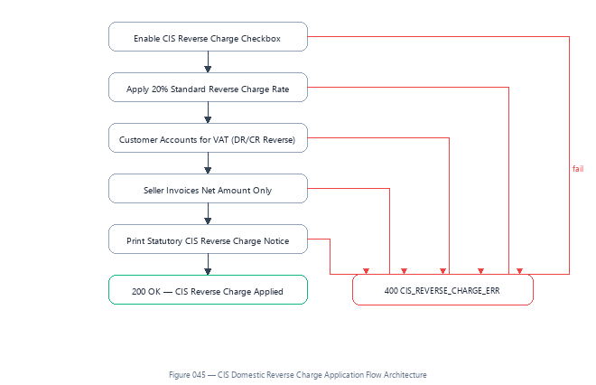

### Sequential Test Execution & Assertion Gates

1. **Enable CIS Reverse Charge Checkbox:** Assert test precondition and parameter integrity.
2. **Apply 20% Standard Reverse Charge Rate:** Assert test precondition and parameter integrity.
3. **Customer Accounts for VAT (DR/CR Reverse):** Assert test precondition and parameter integrity.
4. **Seller Invoices Net Amount Only:** Assert test precondition and parameter integrity.
5. **Print Statutory CIS Reverse Charge Notice:** Assert test precondition and parameter integrity.
6. **Success Assertion (200 OK — CIS Reverse Charge Applied):** Assert HTTP 200/201 and state commitment.

* **Failure Rejection Assertion:** `ASSERT 400 CIS_REVERSE_CHARGE_ERR`
* **Pass/Fail Acceptance Standard:** Assert invoice prints statutory HMRC reverse charge wording.

---

## TC-046: Invoice Total Arithmetic Validation Gate

* **Test Category:** Invoice Validation
* **Execution Persona:** Posting Engine
* **Test Prerequisites:** User approves invoice for issue

### Visual Test Gate Flowchart

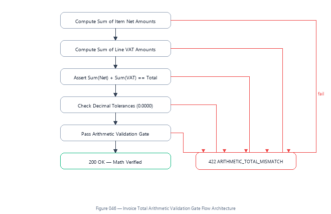

### Sequential Test Execution & Assertion Gates

1. **Compute Sum of Item Net Amounts:** Assert test precondition and parameter integrity.
2. **Compute Sum of Line VAT Amounts:** Assert test precondition and parameter integrity.
3. **Assert Sum(Net) + Sum(VAT) == Total:** Assert test precondition and parameter integrity.
4. **Check Decimal Tolerances (0.0000):** Assert test precondition and parameter integrity.
5. **Pass Arithmetic Validation Gate:** Assert test precondition and parameter integrity.
6. **Success Assertion (200 OK — Math Verified):** Assert HTTP 200/201 and state commitment.

* **Failure Rejection Assertion:** `ASSERT 422 ARITHMETIC_TOTAL_MISMATCH`
* **Pass/Fail Acceptance Standard:** Assert invoice total exactly equals sum of item net lines plus tax lines.

---

## TC-047: Invoice Approval & General Ledger Posting

* **Test Category:** Invoice Posting
* **Execution Persona:** Billing Clerk
* **Test Prerequisites:** Invoice passes arithmetic gate

### Visual Test Gate Flowchart

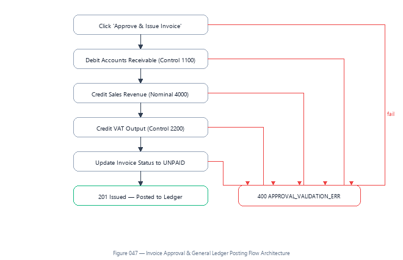

### Sequential Test Execution & Assertion Gates

1. **Click 'Approve & Issue Invoice':** Assert test precondition and parameter integrity.
2. **Debit Accounts Receivable (Control 1100):** Assert test precondition and parameter integrity.
3. **Credit Sales Revenue (Nominal 4000):** Assert test precondition and parameter integrity.
4. **Credit VAT Output (Control 2200):** Assert test precondition and parameter integrity.
5. **Update Invoice Status to UNPAID:** Assert test precondition and parameter integrity.
6. **Success Assertion (201 Issued — Posted to Ledger):** Assert HTTP 200/201 and state commitment.

* **Failure Rejection Assertion:** `ASSERT 400 APPROVAL_VALIDATION_ERR`
* **Pass/Fail Acceptance Standard:** Assert approving an invoice synchronously creates balanced GL journal.

---

## TC-048: Customer Subledger Balance Synchronization

* **Test Category:** Commercial Subledgers
* **Execution Persona:** Subledger Engine
* **Test Prerequisites:** Invoice posted to ledger

### Visual Test Gate Flowchart

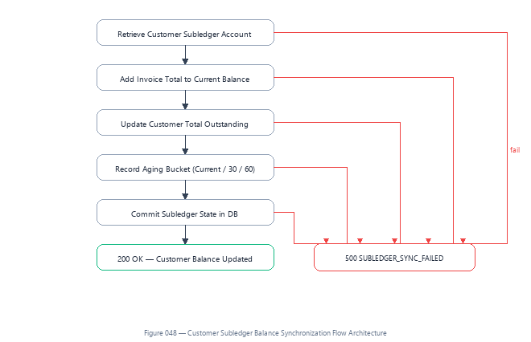

### Sequential Test Execution & Assertion Gates

1. **Retrieve Customer Subledger Account:** Assert test precondition and parameter integrity.
2. **Add Invoice Total to Current Balance:** Assert test precondition and parameter integrity.
3. **Update Customer Total Outstanding:** Assert test precondition and parameter integrity.
4. **Record Aging Bucket (Current / 30 / 60):** Assert test precondition and parameter integrity.
5. **Commit Subledger State in DB:** Assert test precondition and parameter integrity.
6. **Success Assertion (200 OK — Customer Balance Updated):** Assert HTTP 200/201 and state commitment.

* **Failure Rejection Assertion:** `ASSERT 500 SUBLEDGER_SYNC_FAILED`
* **Pass/Fail Acceptance Standard:** Assert customer subledger balance increments immediately upon posting.

---

## TC-049: Customer Statement Chronological Running Balance

* **Test Category:** Customer Reporting
* **Execution Persona:** Billing Clerk / Client
* **Test Prerequisites:** Customer requests account statement

### Visual Test Gate Flowchart

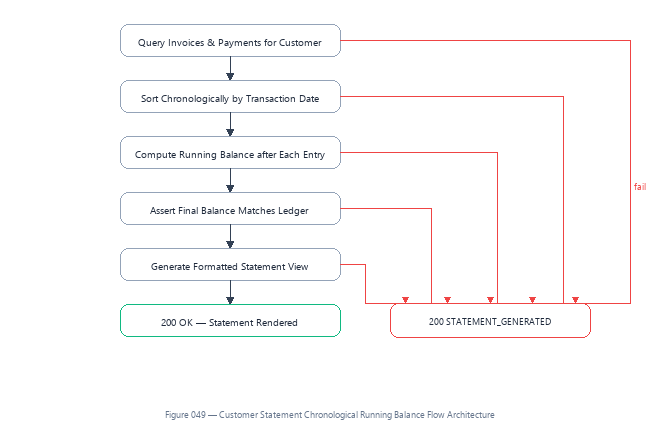

### Sequential Test Execution & Assertion Gates

1. **Query Invoices & Payments for Customer:** Assert test precondition and parameter integrity.
2. **Sort Chronologically by Transaction Date:** Assert test precondition and parameter integrity.
3. **Compute Running Balance after Each Entry:** Assert test precondition and parameter integrity.
4. **Assert Final Balance Matches Ledger:** Assert test precondition and parameter integrity.
5. **Generate Formatted Statement View:** Assert test precondition and parameter integrity.
6. **Success Assertion (200 OK — Statement Rendered):** Assert HTTP 200/201 and state commitment.

* **Failure Rejection Assertion:** `ASSERT 200 STATEMENT_GENERATED`
* **Pass/Fail Acceptance Standard:** Assert statement running balance tracks debits, credits, and net owed.

---

## TC-050: Print-Ready A4 Invoice PDF Compilation

* **Test Category:** Document Generation
* **Execution Persona:** Billing Clerk / Client
* **Test Prerequisites:** Customer requires official PDF

### Visual Test Gate Flowchart

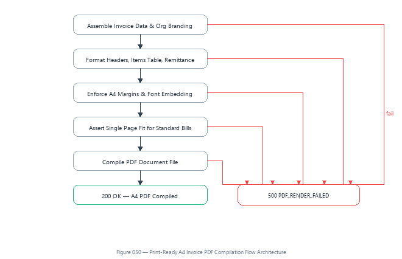

### Sequential Test Execution & Assertion Gates

1. **Assemble Invoice Data & Org Branding:** Assert test precondition and parameter integrity.
2. **Format Headers, Items Table, Remittance:** Assert test precondition and parameter integrity.
3. **Enforce A4 Margins & Font Embedding:** Assert test precondition and parameter integrity.
4. **Assert Single Page Fit for Standard Bills:** Assert test precondition and parameter integrity.
5. **Compile PDF Document File:** Assert test precondition and parameter integrity.
6. **Success Assertion (200 OK — A4 PDF Compiled):** Assert HTTP 200/201 and state commitment.

* **Failure Rejection Assertion:** `ASSERT 500 PDF_RENDER_FAILED`
* **Pass/Fail Acceptance Standard:** Assert PDF generates within 2s with company numbers and VAT details.

---

## TC-051: Public Magic Token Invoice View Access

* **Test Category:** Client Experience
* **Execution Persona:** External Customer
* **Test Prerequisites:** Client clicks link in email

### Visual Test Gate Flowchart

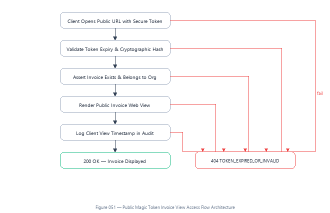

### Sequential Test Execution & Assertion Gates

1. **Client Opens Public URL with Secure Token:** Assert test precondition and parameter integrity.
2. **Validate Token Expiry & Cryptographic Hash:** Assert test precondition and parameter integrity.
3. **Assert Invoice Exists & Belongs to Org:** Assert test precondition and parameter integrity.
4. **Render Public Invoice Web View:** Assert test precondition and parameter integrity.
5. **Log Client View Timestamp in Audit:** Assert test precondition and parameter integrity.
6. **Success Assertion (200 OK — Invoice Displayed):** Assert HTTP 200/201 and state commitment.

* **Failure Rejection Assertion:** `ASSERT 404 TOKEN_EXPIRED_OR_INVALID`
* **Pass/Fail Acceptance Standard:** Assert client accesses view without being prompted for password.

---

## TC-052: Client Portal Brand Consistency Verification

* **Test Category:** Client Experience
* **Execution Persona:** External Customer
* **Test Prerequisites:** Client viewing invoice online

### Visual Test Gate Flowchart

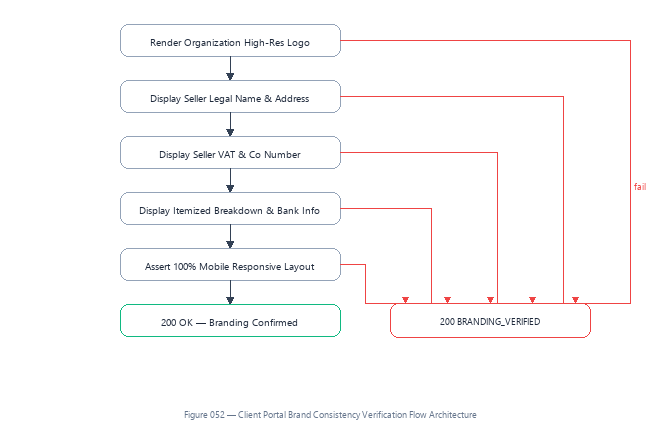

### Sequential Test Execution & Assertion Gates

1. **Render Organization High-Res Logo:** Assert test precondition and parameter integrity.
2. **Display Seller Legal Name & Address:** Assert test precondition and parameter integrity.
3. **Display Seller VAT & Co Number:** Assert test precondition and parameter integrity.
4. **Display Itemized Breakdown & Bank Info:** Assert test precondition and parameter integrity.
5. **Assert 100% Mobile Responsive Layout:** Assert test precondition and parameter integrity.
6. **Success Assertion (200 OK — Branding Confirmed):** Assert HTTP 200/201 and state commitment.

* **Failure Rejection Assertion:** `ASSERT 200 BRANDING_VERIFIED`
* **Pass/Fail Acceptance Standard:** Assert client view displays consistent company identity on all devices.

---

## TC-053: Online Credit Card Payment Initiation

* **Test Category:** Payment Gateway
* **Execution Persona:** External Customer
* **Test Prerequisites:** Client ready to settle invoice

### Visual Test Gate Flowchart

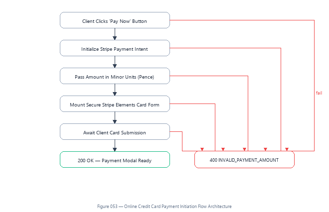

### Sequential Test Execution & Assertion Gates

1. **Client Clicks 'Pay Now' Button:** Assert test precondition and parameter integrity.
2. **Initialize Stripe Payment Intent:** Assert test precondition and parameter integrity.
3. **Pass Amount in Minor Units (Pence):** Assert test precondition and parameter integrity.
4. **Mount Secure Stripe Elements Card Form:** Assert test precondition and parameter integrity.
5. **Await Client Card Submission:** Assert test precondition and parameter integrity.
6. **Success Assertion (200 OK — Payment Modal Ready):** Assert HTTP 200/201 and state commitment.

* **Failure Rejection Assertion:** `ASSERT 400 INVALID_PAYMENT_AMOUNT`
* **Pass/Fail Acceptance Standard:** Assert payment intent amount matches invoice total pence exactly.

---

## TC-054: Payment Idempotency & Double-Click Shield

* **Test Category:** Client-Side Security
* **Execution Persona:** External Customer
* **Test Prerequisites:** Client clicks pay button rapidly

### Visual Test Gate Flowchart

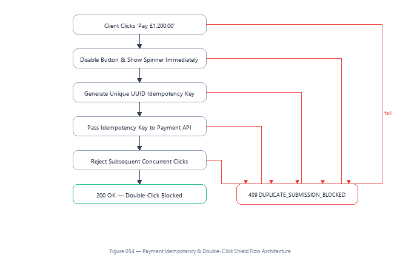

### Sequential Test Execution & Assertion Gates

1. **Client Clicks 'Pay £1,200.00':** Assert test precondition and parameter integrity.
2. **Disable Button & Show Spinner Immediately:** Assert test precondition and parameter integrity.
3. **Generate Unique UUID Idempotency Key:** Assert test precondition and parameter integrity.
4. **Pass Idempotency Key to Payment API:** Assert test precondition and parameter integrity.
5. **Reject Subsequent Concurrent Clicks:** Assert test precondition and parameter integrity.
6. **Success Assertion (200 OK — Double-Click Blocked):** Assert HTTP 200/201 and state commitment.

* **Failure Rejection Assertion:** `ASSERT 409 DUPLICATE_SUBMISSION_BLOCKED`
* **Pass/Fail Acceptance Standard:** Assert rapid multi-clicking cannot produce duplicate card charges.

---

## TC-055: Declined Card Friendly Error Handling

* **Test Category:** Payment Gateway
* **Execution Persona:** External Customer
* **Test Prerequisites:** Bank declines submitted card

### Visual Test Gate Flowchart

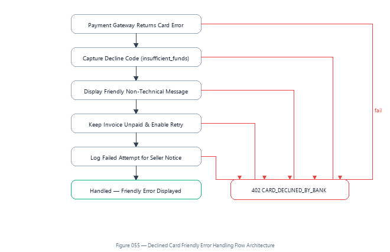

### Sequential Test Execution & Assertion Gates

1. **Payment Gateway Returns Card Error:** Assert test precondition and parameter integrity.
2. **Capture Decline Code (insufficient_funds):** Assert test precondition and parameter integrity.
3. **Display Friendly Non-Technical Message:** Assert test precondition and parameter integrity.
4. **Keep Invoice Unpaid & Enable Retry:** Assert test precondition and parameter integrity.
5. **Log Failed Attempt for Seller Notice:** Assert test precondition and parameter integrity.
6. **Success Assertion (Handled — Friendly Error Displayed):** Assert HTTP 200/201 and state commitment.

* **Failure Rejection Assertion:** `ASSERT 402 CARD_DECLINED_BY_BANK`
* **Pass/Fail Acceptance Standard:** Assert clear actionable error shown without exposing technical stack trace.

---

## TC-056: Instant Payment Confirmation & Status Flip

* **Test Category:** Payment Gateway
* **Execution Persona:** System Webhook
* **Test Prerequisites:** Stripe payment succeeds

### Visual Test Gate Flowchart

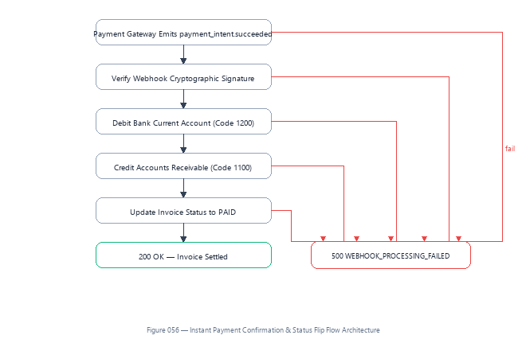

### Sequential Test Execution & Assertion Gates

1. **Payment Gateway Emits payment_intent.succeeded:** Assert test precondition and parameter integrity.
2. **Verify Webhook Cryptographic Signature:** Assert test precondition and parameter integrity.
3. **Debit Bank Current Account (Code 1200):** Assert test precondition and parameter integrity.
4. **Credit Accounts Receivable (Code 1100):** Assert test precondition and parameter integrity.
5. **Update Invoice Status to PAID:** Assert test precondition and parameter integrity.
6. **Success Assertion (200 OK — Invoice Settled):** Assert HTTP 200/201 and state commitment.

* **Failure Rejection Assertion:** `ASSERT 500 WEBHOOK_PROCESSING_FAILED`
* **Pass/Fail Acceptance Standard:** Assert invoice flips to PAID and cash is recorded in general ledger.

---

## TC-057: Automated Client Payment Receipt Delivery

* **Test Category:** Client Communications
* **Execution Persona:** Mail Engine
* **Test Prerequisites:** Payment processed successfully

### Visual Test Gate Flowchart

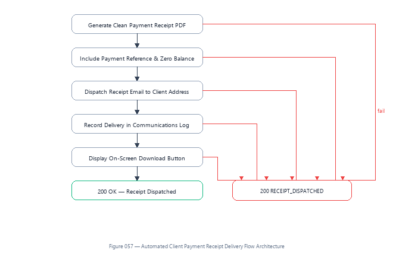

### Sequential Test Execution & Assertion Gates

1. **Generate Clean Payment Receipt PDF:** Assert test precondition and parameter integrity.
2. **Include Payment Reference & Zero Balance:** Assert test precondition and parameter integrity.
3. **Dispatch Receipt Email to Client Address:** Assert test precondition and parameter integrity.
4. **Record Delivery in Communications Log:** Assert test precondition and parameter integrity.
5. **Display On-Screen Download Button:** Assert test precondition and parameter integrity.
6. **Success Assertion (200 OK — Receipt Dispatched):** Assert HTTP 200/201 and state commitment.

* **Failure Rejection Assertion:** `ASSERT 200 RECEIPT_DISPATCHED`
* **Pass/Fail Acceptance Standard:** Assert payment confirmation email delivers within 30 seconds of charge.

---

## TC-058: Self-Service Client Historical Statements

* **Test Category:** Client Experience
* **Execution Persona:** External Customer
* **Test Prerequisites:** Client reviewing past trading history

### Visual Test Gate Flowchart

### Sequential Test Execution & Assertion Gates

1. **Client Navigates to 'My Account' Portal:** Assert test precondition and parameter integrity.
2. **Query All Invoices for Contact Token:** Assert test precondition and parameter integrity.
3. **Display Paid Invoices, Dates & Receipts:** Assert test precondition and parameter integrity.
4. **Provide 1-Click PDF Download for Each:** Assert test precondition and parameter integrity.
5. **Show Current Outstanding Balance (£0.00):** Assert test precondition and parameter integrity.
6. **Success Assertion (200 OK — Statements Available):** Assert HTTP 200/201 and state commitment.

* **Failure Rejection Assertion:** `ASSERT 200 CLIENT_PORTAL_SUCCESS`
* **Pass/Fail Acceptance Standard:** Assert clients can retrieve past invoices without contacting finance staff.

---

## TC-059: Supplier Contact Profile Setup & Classification

* **Test Category:** Purchases & AP
* **Execution Persona:** Bookkeeper
* **Test Prerequisites:** Adding new supplier to vendor registry

### Visual Test Gate Flowchart

### Sequential Test Execution & Assertion Gates

1. **Submit Vendor Business Name:** Assert test precondition and parameter integrity.
2. **Validate Vendor Address & Payment Terms:** Assert test precondition and parameter integrity.
3. **Assign Contact Classification SUPPLIER:** Assert test precondition and parameter integrity.
4. **Record Vendor Bank Account Details:** Assert test precondition and parameter integrity.
5. **Persist Vendor Record in DB:** Assert test precondition and parameter integrity.
6. **Success Assertion (201 Created — Supplier Active):** Assert HTTP 200/201 and state commitment.

* **Failure Rejection Assertion:** `ASSERT 400 INVALID_SUPPLIER_DATA`
* **Pass/Fail Acceptance Standard:** Assert vendor record captures remittance details and terms.

---

## TC-060: Supplier Bill Entry with Invoice Reference

* **Test Category:** Purchases & AP
* **Execution Persona:** Bookkeeper
* **Test Prerequisites:** Received invoice from supplier

### Visual Test Gate Flowchart

### Sequential Test Execution & Assertion Gates

1. **Select Supplier from Directory:** Assert test precondition and parameter integrity.
2. **Enter Supplier's Own Invoice Number:** Assert test precondition and parameter integrity.
3. **Enter Bill Date & Payment Due Date:** Assert test precondition and parameter integrity.
4. **Add Expense Line Items & Nominals:** Assert test precondition and parameter integrity.
5. **Stage Bill with Status DRAFT:** Assert test precondition and parameter integrity.
6. **Success Assertion (201 Created — Bill Staged):** Assert HTTP 200/201 and state commitment.

* **Failure Rejection Assertion:** `ASSERT 400 MISSING_SUPPLIER_REF`
* **Pass/Fail Acceptance Standard:** Assert supplier bills require vendor invoice reference number.

---

## TC-061: Duplicate Supplier Bill Number Interception

* **Test Category:** Fraud Prevention
* **Execution Persona:** Posting Engine
* **Test Prerequisites:** Entering supplier bill

### Visual Test Gate Flowchart

### Sequential Test Execution & Assertion Gates

1. **Query Bills for Same Supplier ID:** Assert test precondition and parameter integrity.
2. **Check for Matching Supplier Reference:** Assert test precondition and parameter integrity.
3. **Assert Reference is Unique for Vendor:** Assert test precondition and parameter integrity.
4. **Reject Entry if Duplicate Found:** Assert test precondition and parameter integrity.
5. **Alert User with Existing Bill Link:** Assert test precondition and parameter integrity.
6. **Success Assertion (200 OK — Reference Unique):** Assert HTTP 200/201 and state commitment.

* **Failure Rejection Assertion:** `ASSERT 409 DUPLICATE_SUPPLIER_BILL`
* **Pass/Fail Acceptance Standard:** Assert duplicate vendor bill numbers are blocked to prevent double-payment.

---

## TC-062: Input VAT Recovery Classification Rule

* **Test Category:** Tax Accounting
* **Execution Persona:** Bookkeeper
* **Test Prerequisites:** Entering allowable commercial purchase

### Visual Test Gate Flowchart

### Sequential Test Execution & Assertion Gates

1. **Add Expense Item Line (£200.00):** Assert test precondition and parameter integrity.
2. **Select Tax Code 'Standard Input VAT (20%)':** Assert test precondition and parameter integrity.
3. **Compute Reclaimable VAT (£40.00):** Assert test precondition and parameter integrity.
4. **Debit VAT Input Account (Code 2210):** Assert test precondition and parameter integrity.
5. **Accrue Input Tax for VAT Return Box 4:** Assert test precondition and parameter integrity.
6. **Success Assertion (200 OK — Input Tax Reclaimed):** Assert HTTP 200/201 and state commitment.

* **Failure Rejection Assertion:** `ASSERT 400 INVALID_INPUT_VAT`
* **Pass/Fail Acceptance Standard:** Assert valid commercial input VAT is routed to VAT Box 4 reclaim.

---

## TC-063: Non-Deductible Business Expense Handling

* **Test Category:** Tax Accounting
* **Execution Persona:** Bookkeeper
* **Test Prerequisites:** Client entertainment or non-allowable expense

### Visual Test Gate Flowchart

### Sequential Test Execution & Assertion Gates

1. **Select Category 'Business Entertainment':** Assert test precondition and parameter integrity.
2. **Tag Expense as Non-Deductible for Tax:** Assert test precondition and parameter integrity.
3. **Force VAT Recovery Rate to 0%:** Assert test precondition and parameter integrity.
4. **Route Full Gross Amount to Expense:** Assert test precondition and parameter integrity.
5. **Exclude from VAT Box 4 Reclaim:** Assert test precondition and parameter integrity.
6. **Success Assertion (200 OK — Tagged Non-Deductible):** Assert HTTP 200/201 and state commitment.

* **Failure Rejection Assertion:** `ASSERT 400 TAX_TAG_INVALID`
* **Pass/Fail Acceptance Standard:** Assert entertainment expenses do not illegally reclaim input VAT.

---

## TC-064: Accounts Payable General Ledger Posting

* **Test Category:** Ledger Engine
* **Execution Persona:** Bookkeeper
* **Test Prerequisites:** Supplier bill approved for payment

### Visual Test Gate Flowchart

### Sequential Test Execution & Assertion Gates

1. **Click 'Approve Supplier Bill':** Assert test precondition and parameter integrity.
2. **Debit Expense Nominals (e.g. 7000):** Assert test precondition and parameter integrity.
3. **Debit VAT Input Control (Code 2210):** Assert test precondition and parameter integrity.
4. **Credit Accounts Payable (Control 2100):** Assert test precondition and parameter integrity.
5. **Update Bill Status to AWAITING_PAYMENT:** Assert test precondition and parameter integrity.
6. **Success Assertion (201 Posted — AP Accrued):** Assert HTTP 200/201 and state commitment.

* **Failure Rejection Assertion:** `ASSERT 422 AP_POSTING_FAILED`
* **Pass/Fail Acceptance Standard:** Assert approving supplier bill synchronously updates AP balance.

---

## TC-065: Supplier Outgoing Payment Allocation

* **Test Category:** Purchases & AP
* **Execution Persona:** Bookkeeper
* **Test Prerequisites:** Paying supplier from company bank

### Visual Test Gate Flowchart

### Sequential Test Execution & Assertion Gates

1. **Select Open Supplier Bill:** Assert test precondition and parameter integrity.
2. **Record Outgoing Payment Amount:** Assert test precondition and parameter integrity.
3. **Credit Bank Asset Account (Code 1200):** Assert test precondition and parameter integrity.
4. **Debit Accounts Payable (Code 2100):** Assert test precondition and parameter integrity.
5. **Reduce Bill Outstanding Balance to £0:** Assert test precondition and parameter integrity.
6. **Success Assertion (200 OK — Bill Paid in Full):** Assert HTTP 200/201 and state commitment.

* **Failure Rejection Assertion:** `ASSERT 400 OVERPAYMENT_UNSUPPORTED`
* **Pass/Fail Acceptance Standard:** Assert supplier payment clears AP subledger and decrements bank account.

---

## TC-066: Supplier Partial Payment Allocation

* **Test Category:** Purchases & AP
* **Execution Persona:** Bookkeeper
* **Test Prerequisites:** Paying installment on large bill

### Visual Test Gate Flowchart

### Sequential Test Execution & Assertion Gates

1. **Submit Partial Payment (£500 of £1,000):** Assert test precondition and parameter integrity.
2. **Apply Payment against Bill:** Assert test precondition and parameter integrity.
3. **Reduce Outstanding Balance to £500:** Assert test precondition and parameter integrity.
4. **Maintain Bill Status as AWAITING_PAYMENT:** Assert test precondition and parameter integrity.
5. **Update Supplier Statement Balance:** Assert test precondition and parameter integrity.
6. **Success Assertion (200 OK — Partial Payment Recorded):** Assert HTTP 200/201 and state commitment.

* **Failure Rejection Assertion:** `ASSERT 200 PARTIAL_PAYMENT_RECORDED`
* **Pass/Fail Acceptance Standard:** Assert partial payments decrement AP while keeping bill active.

---

## TC-067: Supplier Credit Note Offset Application

* **Test Category:** Purchases & AP
* **Execution Persona:** Bookkeeper
* **Test Prerequisites:** Supplier issues credit note for returned goods

### Visual Test Gate Flowchart

### Sequential Test Execution & Assertion Gates

1. **Record Supplier Credit Note:** Assert test precondition and parameter integrity.
2. **Debit Accounts Payable (Code 2100):** Assert test precondition and parameter integrity.
3. **Credit Expense / Purchase Returns:** Assert test precondition and parameter integrity.
4. **Allocate Credit Note against Open Bill:** Assert test precondition and parameter integrity.
5. **Reduce Net Amount Owed to Vendor:** Assert test precondition and parameter integrity.
6. **Success Assertion (200 OK — Credit Note Applied):** Assert HTTP 200/201 and state commitment.

* **Failure Rejection Assertion:** `ASSERT 400 CREDIT_EXCEEDS_BILL`
* **Pass/Fail Acceptance Standard:** Assert credit notes correctly offset outstanding supplier balances.

---

## TC-068: Supplier Remittance Advice Generation

* **Test Category:** Document Generation
* **Execution Persona:** Bookkeeper
* **Test Prerequisites:** Batch supplier payments executed

### Visual Test Gate Flowchart

### Sequential Test Execution & Assertion Gates

1. **Assemble Paid Bills & Payment References:** Assert test precondition and parameter integrity.
2. **Format Remittance Advice Document:** Assert test precondition and parameter integrity.
3. **Generate PDF Remittance Advice:** Assert test precondition and parameter integrity.
4. **Email Remittance to Supplier Finance:** Assert test precondition and parameter integrity.
5. **Archive Remittance in Payment Record:** Assert test precondition and parameter integrity.
6. **Success Assertion (200 OK — Remittance Dispatched):** Assert HTTP 200/201 and state commitment.

* **Failure Rejection Assertion:** `ASSERT 200 REMITTANCE_DISPATCHED`
* **Pass/Fail Acceptance Standard:** Assert supplier remittance advice details exact invoices being settled.

---

## TC-069: Mobile Photo Receipt Upload & Normalization

* **Test Category:** AI Intelligence
* **Execution Persona:** Staff Member
* **Test Prerequisites:** Employee submits paper expense receipt

### Visual Test Gate Flowchart

### Sequential Test Execution & Assertion Gates

1. **Capture Receipt Photo via Mobile Camera:** Assert test precondition and parameter integrity.
2. **Upload PNG/JPEG Image File:** Assert test precondition and parameter integrity.
3. **Perform Contrast & Rotation Enhancement:** Assert test precondition and parameter integrity.
4. **Store Raw Image in Temporary S3 Bucket:** Assert test precondition and parameter integrity.
5. **Dispatch Job to OCR Pipeline:** Assert test precondition and parameter integrity.
6. **Success Assertion (200 OK — Receipt Uploaded):** Assert HTTP 200/201 and state commitment.

* **Failure Rejection Assertion:** `ASSERT 400 UNSUPPORTED_IMAGE_FORMAT`
* **Pass/Fail Acceptance Standard:** Assert images are normalized and enhanced before text recognition.

---

## TC-070: Multi-Page PDF Supplier Bill Parsing

* **Test Category:** AI Intelligence
* **Execution Persona:** Bookkeeper
* **Test Prerequisites:** Received multi-page digital supplier PDF

### Visual Test Gate Flowchart

### Sequential Test Execution & Assertion Gates

1. **Upload Multi-Page PDF Document:** Assert test precondition and parameter integrity.
2. **Extract Embedded Text Streams:** Assert test precondition and parameter integrity.
3. **Rasterize Pages for OCR Fallback:** Assert test precondition and parameter integrity.
4. **Merge Multi-Page Line Items:** Assert test precondition and parameter integrity.
5. **Send Normalized Payload to AI Engine:** Assert test precondition and parameter integrity.
6. **Success Assertion (200 OK — PDF Ingested):** Assert HTTP 200/201 and state commitment.

* **Failure Rejection Assertion:** `ASSERT 400 CORRUPTED_PDF`
* **Pass/Fail Acceptance Standard:** Assert multi-page bills extract lines across all pages without dropping items.

---

## TC-071: AI Vendor Identification & Confidence Scoring

* **Test Category:** AI Intelligence
* **Execution Persona:** AI Engine
* **Test Prerequisites:** Raw OCR text generated

### Visual Test Gate Flowchart

### Sequential Test Execution & Assertion Gates

1. **Match Text against Merchant Knowledgebase:** Assert test precondition and parameter integrity.
2. **Identify Vendor Legal Business Name:** Assert test precondition and parameter integrity.
3. **Calculate Extraction Confidence Score (0-1):** Assert test precondition and parameter integrity.
4. **Assert Confidence Score >= 0.85:** Assert test precondition and parameter integrity.
5. **Auto-Select Matching Supplier Record:** Assert test precondition and parameter integrity.
6. **Success Assertion (200 OK — Vendor Identified):** Assert HTTP 200/201 and state commitment.

* **Failure Rejection Assertion:** `ASSERT 422 VENDOR_UNRECOGNIZED`
* **Pass/Fail Acceptance Standard:** Assert vendor recognition scores below 85% trigger human review.

---

## TC-072: AI Date & Amount Precision Parsing

* **Test Category:** AI Intelligence
* **Execution Persona:** AI Engine
* **Test Prerequisites:** OCR text analyzed

### Visual Test Gate Flowchart

### Sequential Test Execution & Assertion Gates

1. **Parse Transaction Date String:** Assert test precondition and parameter integrity.
2. **Validate Date <= Current System Date:** Assert test precondition and parameter integrity.
3. **Extract Net Amount, VAT, and Total:** Assert test precondition and parameter integrity.
4. **Normalize Currencies to GBP Base:** Assert test precondition and parameter integrity.
5. **Stage Extracted Numerical Values:** Assert test precondition and parameter integrity.
6. **Success Assertion (200 OK — Numbers Parsed):** Assert HTTP 200/201 and state commitment.

* **Failure Rejection Assertion:** `ASSERT 422 DATE_PARSE_FAILED`
* **Pass/Fail Acceptance Standard:** Assert future transaction dates are flagged and blocked.

---

## TC-073: AI Arithmetic Balancing Guardrail Rule

* **Test Category:** AI Guardrails
* **Execution Persona:** AI Safety Engine
* **Test Prerequisites:** Numerical fields extracted

### Visual Test Gate Flowchart

### Sequential Test Execution & Assertion Gates

1. **Compute Sum of Extracted Line Items:** Assert test precondition and parameter integrity.
2. **Add Extracted VAT Amount:** Assert test precondition and parameter integrity.
3. **Assert Extracted Net + VAT == Total:** Assert test precondition and parameter integrity.
4. **Check Discrepancy Tolerance (£0.00):** Assert test precondition and parameter integrity.
5. **Pass AI Mathematical Integrity Check:** Assert test precondition and parameter integrity.
6. **Success Assertion (200 OK — Math Balanced):** Assert HTTP 200/201 and state commitment.

* **Failure Rejection Assertion:** `ASSERT 422 AI_MATH_MISMATCH`
* **Pass/Fail Acceptance Standard:** Assert AI hallucinated totals that do not match lines are intercepted.

---

## TC-074: Low Confidence Human-in-the-Loop Intercept

* **Test Category:** AI Guardrails
* **Execution Persona:** AI Safety Engine
* **Test Prerequisites:** Receipt blurry or handwriting detected

### Visual Test Gate Flowchart

### Sequential Test Execution & Assertion Gates

1. **Evaluate AI Confidence Composite Score:** Assert test precondition and parameter integrity.
2. **Detect Confidence < 85% on Critical Fields:** Assert test precondition and parameter integrity.
3. **Flag Transaction for Human Review:** Assert test precondition and parameter integrity.
4. **Present Side-by-Side Verification Screen:** Assert test precondition and parameter integrity.
5. **Require User Confirmation before Save:** Assert test precondition and parameter integrity.
6. **Success Assertion (Intercepted — Review Enforced):** Assert HTTP 200/201 and state commitment.

* **Failure Rejection Assertion:** `ASSERT 422 HUMAN_REVIEW_ENFORCED`
* **Pass/Fail Acceptance Standard:** Assert unclear receipts never post to the general ledger automatically.

---

## TC-075: Smart Expense Category Recommendation

* **Test Category:** AI Intelligence
* **Execution Persona:** AI Engine
* **Test Prerequisites:** Vendor identified (e.g. Costa Coffee)

### Visual Test Gate Flowchart

### Sequential Test Execution & Assertion Gates

1. **Query Merchant Categorization History:** Assert test precondition and parameter integrity.
2. **Suggest Nominal Code 7400 (Travel & Meals):** Assert test precondition and parameter integrity.
3. **Display Suggested Category to User:** Assert test precondition and parameter integrity.
4. **Allow 1-Click User Confirmation:** Assert test precondition and parameter integrity.
5. **Update Machine Learning Merchant Weight:** Assert test precondition and parameter integrity.
6. **Success Assertion (200 OK — Category Recommended):** Assert HTTP 200/201 and state commitment.

* **Failure Rejection Assertion:** `ASSERT 200 CATEGORY_SUGGESTED`
* **Pass/Fail Acceptance Standard:** Assert categorization recommendations learn from historical user approvals.

---

## TC-076: Permanent Cloud Storage Image Archiving

* **Test Category:** Statutory Compliance
* **Execution Persona:** Storage Service
* **Test Prerequisites:** Expense confirmed and approved

### Visual Test Gate Flowchart

### Sequential Test Execution & Assertion Gates

1. **Move Receipt Image to Permanent S3 Bucket:** Assert test precondition and parameter integrity.
2. **Apply Object Immutability Retention Policy:** Assert test precondition and parameter integrity.
3. **Link Image URL to General Ledger Line:** Assert test precondition and parameter integrity.
4. **Generate Audit Verification Checksum:** Assert test precondition and parameter integrity.
5. **Ensure HMRC 7-Year Accessibility:** Assert test precondition and parameter integrity.
6. **Success Assertion (200 OK — Receipt Archived):** Assert HTTP 200/201 and state commitment.

* **Failure Rejection Assertion:** `ASSERT 500 S3_UPLOAD_FAILED`
* **Pass/Fail Acceptance Standard:** Assert expense transactions permanently link to accessible receipt images.

---

## TC-077: Business Bank Account Nominal Account Binding

* **Test Category:** Banking Setup
* **Execution Persona:** Accountant
* **Test Prerequisites:** Configuring corporate current account

### Visual Test Gate Flowchart

### Sequential Test Execution & Assertion Gates

1. **Submit Bank Name, Sort Code & Account No:** Assert test precondition and parameter integrity.
2. **Validate UK 6-Digit Sort Code Format:** Assert test precondition and parameter integrity.
3. **Validate UK 8-Digit Account No Format:** Assert test precondition and parameter integrity.
4. **Bind to GL Asset Control Account (Code 1200):** Assert test precondition and parameter integrity.
5. **Initialize Cleared Bank Balance at £0:** Assert test precondition and parameter integrity.
6. **Success Assertion (201 Created — Bank Account Bound):** Assert HTTP 200/201 and state commitment.

* **Failure Rejection Assertion:** `ASSERT 400 INVALID_BANK_NOMINAL`
* **Pass/Fail Acceptance Standard:** Assert bank accounts bind directly to isolated general ledger nominals.

---

## TC-078: Bank Statement CSV Feed Parsing

* **Test Category:** Banking Feeds
* **Execution Persona:** Bookkeeper
* **Test Prerequisites:** Importing statement download from bank

### Visual Test Gate Flowchart

### Sequential Test Execution & Assertion Gates

1. **Upload Bank Statement CSV File:** Assert test precondition and parameter integrity.
2. **Validate CSV Column Headers (Date, Amount, Ref):** Assert test precondition and parameter integrity.
3. **Parse Chronological Statement Rows:** Assert test precondition and parameter integrity.
4. **Normalize Debit / Credit Signs:** Assert test precondition and parameter integrity.
5. **Stage Lines in Statement Import Buffer:** Assert test precondition and parameter integrity.
6. **Success Assertion (200 OK — Statement Parsed):** Assert HTTP 200/201 and state commitment.

* **Failure Rejection Assertion:** `ASSERT 400 MALFORMED_CSV_HEADER`
* **Pass/Fail Acceptance Standard:** Assert malformed CSV structures are rejected before staging.

---

## TC-079: Bank Statement Duplicate Line Hash Intercept

* **Test Category:** Banking Feeds
* **Execution Persona:** Banking Engine
* **Test Prerequisites:** Importing overlapping bank statement

### Visual Test Gate Flowchart

### Sequential Test Execution & Assertion Gates

1. **Compute SHA256(date + amount + reference):** Assert test precondition and parameter integrity.
2. **Query Existing Imported Bank Feeds:** Assert test precondition and parameter integrity.
3. **Assert Hash does not already Exist:** Assert test precondition and parameter integrity.
4. **Filter Out Already Imported Lines:** Assert test precondition and parameter integrity.
5. **Import Only New Unique Transactions:** Assert test precondition and parameter integrity.
6. **Success Assertion (200 OK — Duplicates Filtered):** Assert HTTP 200/201 and state commitment.

* **Failure Rejection Assertion:** `ASSERT 409 DUPLICATE_BANK_FEED_LINE`
* **Pass/Fail Acceptance Standard:** Assert overlapping bank statement imports never duplicate transactions.

---

## TC-080: Automated Rule-Based Invoice Matching

* **Test Category:** Bank Reconciliation
* **Execution Persona:** Reconciliation Engine
* **Test Prerequisites:** Bank transaction imported (£1,200 deposit)

### Visual Test Gate Flowchart

### Sequential Test Execution & Assertion Gates

1. **Scan Unpaid Customer Invoices:** Assert test precondition and parameter integrity.
2. **Find Invoice with Exact Matching Amount:** Assert test precondition and parameter integrity.
3. **Match Customer Reference in Description:** Assert test precondition and parameter integrity.
4. **Auto-Suggest 1-Click Reconciliation:** Assert test precondition and parameter integrity.
5. **Highlight Match in Reconciliation Screen:** Assert test precondition and parameter integrity.
6. **Success Assertion (200 OK — Auto-Matched):** Assert HTTP 200/201 and state commitment.

* **Failure Rejection Assertion:** `ASSERT 200 AUTO_MATCHED`
* **Pass/Fail Acceptance Standard:** Assert exact amount and reference matches are presented for approval.

---

## TC-081: Manual Multi-Transaction Bank Split Reconciliation

* **Test Category:** Bank Reconciliation
* **Execution Persona:** Accountant
* **Test Prerequisites:** Lump deposit pays multiple invoices

### Visual Test Gate Flowchart

### Sequential Test Execution & Assertion Gates

1. **Select Single Lump Deposit (£2,500):** Assert test precondition and parameter integrity.
2. **Select Multiple Open Invoices (Inv 1 + Inv 2):** Assert test precondition and parameter integrity.
3. **Assert Sum(Invoices) == Deposit Amount:** Assert test precondition and parameter integrity.
4. **Allocate Portions to Respective Invoices:** Assert test precondition and parameter integrity.
5. **Clear Bank Line and Invoices Atomically:** Assert test precondition and parameter integrity.
6. **Success Assertion (200 OK — Split Reconciled):** Assert HTTP 200/201 and state commitment.

* **Failure Rejection Assertion:** `ASSERT 400 SPLIT_MISMATCH`
* **Pass/Fail Acceptance Standard:** Assert multi-invoice reconciliation must match total deposit pennies.

---

## TC-082: Unreconciled Bank Balance vs GL Equilibrium

* **Test Category:** Ledger Integrity
* **Execution Persona:** Accountant
* **Test Prerequisites:** Running monthly bank reconciliation

### Visual Test Gate Flowchart

### Sequential Test Execution & Assertion Gates

1. **Compute Cleared Bank Statement Balance:** Assert test precondition and parameter integrity.
2. **Compute GL Nominal 1200 Running Balance:** Assert test precondition and parameter integrity.
3. **Assert Statement Balance == GL Balance:** Assert test precondition and parameter integrity.
4. **Display £0.00 Difference Indicator:** Assert test precondition and parameter integrity.
5. **Generate Bank Reconciliation Report:** Assert test precondition and parameter integrity.
6. **Success Assertion (200 OK — Equilibrium Confirmed):** Assert HTTP 200/201 and state commitment.

* **Failure Rejection Assertion:** `ASSERT 200 BANK_EQUILIBRIUM_OK`
* **Pass/Fail Acceptance Standard:** Assert bank statement matches general ledger cash account exactly.

---

## TC-083: Reconciliation Clearance Locking Rule

* **Test Category:** Audit Governance
* **Execution Persona:** Accountant
* **Test Prerequisites:** Transactions reconciled and cleared

### Visual Test Gate Flowchart

### Sequential Test Execution & Assertion Gates

1. **Set Reconciled Status on Bank Line:** Assert test precondition and parameter integrity.
2. **Lock Transaction against Unmatching:** Assert test precondition and parameter integrity.
3. **Require Accountant Authority to Reopen:** Assert test precondition and parameter integrity.
4. **Log Any Reopening to Security Audit:** Assert test precondition and parameter integrity.
5. **Preserve Closed Bank Balance History:** Assert test precondition and parameter integrity.
6. **Success Assertion (Locked — Reconciliation Protected):** Assert HTTP 200/201 and state commitment.

* **Failure Rejection Assertion:** `ASSERT 403 CLEARED_TRANSACTION_LOCKED`
* **Pass/Fail Acceptance Standard:** Assert reconciled bank lines cannot be deleted or modified casually.

---

## TC-084: Realised Foreign Currency Exchange Gain/Loss

* **Test Category:** Multi-Currency
* **Execution Persona:** Ledger Engine
* **Test Prerequisites:** Settling USD invoice via GBP bank account

### Visual Test Gate Flowchart

### Sequential Test Execution & Assertion Gates

1. **Record Foreign Currency Bank Settlement:** Assert test precondition and parameter integrity.
2. **Compare Spot Rate with Invoice Booking Rate:** Assert test precondition and parameter integrity.
3. **Compute Currency Variance Amount:** Assert test precondition and parameter integrity.
4. **Debit/Credit Realised FX Gain/Loss Nominal:** Assert test precondition and parameter integrity.
5. **Clear AR Subledger to Zero Balance:** Assert test precondition and parameter integrity.
6. **Success Assertion (200 OK — FX Variance Posted):** Assert HTTP 200/201 and state commitment.

* **Failure Rejection Assertion:** `ASSERT 200 FX_GAIN_LOSS_POSTED`
* **Pass/Fail Acceptance Standard:** Assert foreign exchange variances route automatically to P&L accounts.

---

## TC-085: Monthly Accounting Period Calendar Partitioning

* **Test Category:** Period Governance
* **Execution Persona:** Accountant
* **Test Prerequisites:** Setting up annual accounting periods

### Visual Test Gate Flowchart

### Sequential Test Execution & Assertion Gates

1. **Partition Financial Year into 12 Months:** Assert test precondition and parameter integrity.
2. **Validate Date Boundaries do not Overlap:** Assert test precondition and parameter integrity.
3. **Assign Period Numbers (Period 1 to 12):** Assert test precondition and parameter integrity.
4. **Set Current Active Period to OPEN:** Assert test precondition and parameter integrity.
5. **Persist Accounting Periods Table:** Assert test precondition and parameter integrity.
6. **Success Assertion (201 Created — Periods Partitioned):** Assert HTTP 200/201 and state commitment.

* **Failure Rejection Assertion:** `ASSERT 400 PERIOD_OVERLAP`
* **Pass/Fail Acceptance Standard:** Assert accounting periods cover calendar dates contiguously without gaps.

---

## TC-086: Interim Monthly Accounting Period Close

* **Test Category:** Period Governance
* **Execution Persona:** Accountant
* **Test Prerequisites:** Month-end accounts finalized

### Visual Test Gate Flowchart

### Sequential Test Execution & Assertion Gates

1. **Accountant Requests Month-End Close:** Assert test precondition and parameter integrity.
2. **Assert Zero Unposted Drafts in Month:** Assert test precondition and parameter integrity.
3. **Set Accounting Period Status to CLOSED:** Assert test precondition and parameter integrity.
4. **Block Backdating of Invoices into Month:** Assert test precondition and parameter integrity.
5. **Advance Active Period to Next Month:** Assert test precondition and parameter integrity.
6. **Success Assertion (200 OK — Month Closed):** Assert HTTP 200/201 and state commitment.

* **Failure Rejection Assertion:** `ASSERT 403 UNPOSTED_DRAFTS_IN_PERIOD`
* **Pass/Fail Acceptance Standard:** Assert months with unposted drafts cannot be closed prematurely.

---

## TC-087: Financial Year-End Final Trial Balance Check

* **Test Category:** Year-End Closing
* **Execution Persona:** Certified Accountant
* **Test Prerequisites:** Preparing annual statutory closing

### Visual Test Gate Flowchart

### Sequential Test Execution & Assertion Gates

1. **Run Final Full Year Trial Balance:** Assert test precondition and parameter integrity.
2. **Assert Sum(Debits) == Sum(Credits):** Assert test precondition and parameter integrity.
3. **Assert Bank Reconciliation Complete:** Assert test precondition and parameter integrity.
4. **Assert All Suspense Accounts at £0:** Assert test precondition and parameter integrity.
5. **Authorize Year-End Closing Sequence:** Assert test precondition and parameter integrity.
6. **Success Assertion (200 OK — Year-End Audit Passed):** Assert HTTP 200/201 and state commitment.

* **Failure Rejection Assertion:** `ASSERT 422 LEDGER_NOT_IN_BALANCE`
* **Pass/Fail Acceptance Standard:** Assert year-end closing is blocked if trial balance is out of equilibrium.

---

## TC-088: Annual Retained Earnings Rollover Engine

* **Test Category:** Year-End Closing
* **Execution Persona:** Accounting Engine
* **Test Prerequisites:** Year-end closing triggered

### Visual Test Gate Flowchart

### Sequential Test Execution & Assertion Gates

1. **Aggregate All Revenue Nominals (Credit):** Assert test precondition and parameter integrity.
2. **Aggregate All Expense Nominals (Debit):** Assert test precondition and parameter integrity.
3. **Compute Net Profit / Loss for the Year:** Assert test precondition and parameter integrity.
4. **Zero Out All Revenue and Expense Accounts:** Assert test precondition and parameter integrity.
5. **Credit/Debit Retained Earnings (Code 3100):** Assert test precondition and parameter integrity.
6. **Success Assertion (200 OK — Net Profit Rolled Over):** Assert HTTP 200/201 and state commitment.

* **Failure Rejection Assertion:** `ASSERT 500 ROLLOVER_FAILED`
* **Pass/Fail Acceptance Standard:** Assert P&L nominals reset to zero and net income rolls to Retained Earnings.

---

## TC-089: Temporal Database Date-Lock Enforcement

* **Test Category:** Statutory Immutability
* **Execution Persona:** PostgreSQL Engine
* **Test Prerequisites:** Attempting to post entry into closed year

### Visual Test Gate Flowchart

### Sequential Test Execution & Assertion Gates

1. **User Submits Transaction with Closed Date:** Assert test precondition and parameter integrity.
2. **PostgreSQL btree_gist Constraint Fires:** Assert test precondition and parameter integrity.
3. **Check Effective Date against Closed Periods:** Assert test precondition and parameter integrity.
4. **Detect Date in LOCKED / CLOSED Year:** Assert test precondition and parameter integrity.
5. **Physically Reject Database Insert:** Assert test precondition and parameter integrity.
6. **Success Assertion (Rejected — Period Temporally Locked):** Assert HTTP 200/201 and state commitment.

* **Failure Rejection Assertion:** `ASSERT 403 PERIOD_TEMPORALLY_LOCKED`
* **Pass/Fail Acceptance Standard:** Assert database-level temporal constraints block backdating into filed years.

---

## TC-090: Audited Emergency Period Reopening Workflow

* **Test Category:** Period Governance
* **Execution Persona:** Business Owner / CPA
* **Test Prerequisites:** Audit adjustment required in closed period

### Visual Test Gate Flowchart

### Sequential Test Execution & Assertion Gates

1. **Owner Requests Emergency Period Unlock:** Assert test precondition and parameter integrity.
2. **Require Multi-Factor Authentication:** Assert test precondition and parameter integrity.
3. **Enter Mandatory Statutory Justification:** Assert test precondition and parameter integrity.
4. **Log Event with Timestamp & IP in Audit:** Assert test precondition and parameter integrity.
5. **Unlock Period for Limited 24h Window:** Assert test precondition and parameter integrity.
6. **Success Assertion (200 OK — Reopening Logged):** Assert HTTP 200/201 and state commitment.

* **Failure Rejection Assertion:** `ASSERT 403 REOPEN_AUDIT_LOG_MANDATORY`
* **Pass/Fail Acceptance Standard:** Assert emergency period reopening is impossible without immutable audit logging.

---

## TC-091: Trial Balance Report Equilibrium Derivation

* **Test Category:** Financial Reporting
* **Execution Persona:** Accountant
* **Test Prerequisites:** Generating Trial Balance report

### Visual Test Gate Flowchart

### Sequential Test Execution & Assertion Gates

1. **Query All Posted GL Nominal Lines:** Assert test precondition and parameter integrity.
2. **Compute Sum of Debits and Credits:** Assert test precondition and parameter integrity.
3. **Assert Sum(Debit) == Sum(Credit) Exactly:** Assert test precondition and parameter integrity.
4. **Assert Out-of-Balance Variance is £0.00:** Assert test precondition and parameter integrity.
5. **Render Balanced Trial Balance Table:** Assert test precondition and parameter integrity.
6. **Success Assertion (200 OK — Trial Balance Generated):** Assert HTTP 200/201 and state commitment.

* **Failure Rejection Assertion:** `ASSERT 422 TB_OUT_OF_BALANCE`
* **Pass/Fail Acceptance Standard:** Assert trial balance reports display zero variance across all accounts.

---

## TC-092: Profit & Loss (Income Statement) Derivation

* **Test Category:** Financial Reporting
* **Execution Persona:** Business Owner / CPA
* **Test Prerequisites:** Reviewing company profitability

### Visual Test Gate Flowchart

### Sequential Test Execution & Assertion Gates

1. **Query Revenue Nominals (Codes 4000-4999):** Assert test precondition and parameter integrity.
2. **Query Cost of Sales (Codes 5000-5999):** Assert test precondition and parameter integrity.
3. **Calculate Gross Profit = Revenue - COS:** Assert test precondition and parameter integrity.
4. **Query Overheads / Expenses (6000-8999):** Assert test precondition and parameter integrity.
5. **Calculate Net Profit / Loss before Tax:** Assert test precondition and parameter integrity.
6. **Success Assertion (200 OK — P&L Statement Rendered):** Assert HTTP 200/201 and state commitment.

* **Failure Rejection Assertion:** `ASSERT 200 PNL_GENERATED`
* **Pass/Fail Acceptance Standard:** Assert P&L accurately calculates gross margin and operating profit.

---

## TC-093: Balance Sheet Statement Derivation & Balance

* **Test Category:** Financial Reporting
* **Execution Persona:** Accountant
* **Test Prerequisites:** Generating balance sheet report

### Visual Test Gate Flowchart

### Sequential Test Execution & Assertion Gates

1. **Aggregate Total Assets (Codes 1000-1999):** Assert test precondition and parameter integrity.
2. **Aggregate Liabilities (Codes 2000-2999):** Assert test precondition and parameter integrity.
3. **Aggregate Equity & Retained Earnings:** Assert test precondition and parameter integrity.
4. **Assert Assets == Liabilities + Equity:** Assert test precondition and parameter integrity.
5. **Render Formatted Balance Sheet:** Assert test precondition and parameter integrity.
6. **Success Assertion (200 OK — Balance Sheet in Balance):** Assert HTTP 200/201 and state commitment.

* **Failure Rejection Assertion:** `ASSERT 422 BALANCE_SHEET_UNBALANCED`
* **Pass/Fail Acceptance Standard:** Assert balance sheet satisfies fundamental accounting equation.

---

## TC-094: Quarterly HMRC VAT Return Box 1-9 Derivation

* **Test Category:** Tax Compliance
* **Execution Persona:** Accountant
* **Test Prerequisites:** Preparing quarterly VAT filing

### Visual Test Gate Flowchart

### Sequential Test Execution & Assertion Gates

1. **Aggregate Output Tax on Sales (Box 1):** Assert test precondition and parameter integrity.
2. **Aggregate Output Tax on EC/Imports (Box 2):** Assert test precondition and parameter integrity.
3. **Compute Total Output Tax (Box 3 = 1 + 2):** Assert test precondition and parameter integrity.
4. **Aggregate Input Tax on Purchases (Box 4):** Assert test precondition and parameter integrity.
5. **Compute Net VAT Due (Box 5 = |3 - 4|):** Assert test precondition and parameter integrity.
6. **Success Assertion (200 OK — Boxes 1-9 Derived):** Assert HTTP 200/201 and state commitment.

* **Failure Rejection Assertion:** `ASSERT 422 VAT_CALCULATION_INVALID`
* **Pass/Fail Acceptance Standard:** Assert statutory UK VAT 9 boxes derive directly from general ledger lines.

---

## TC-095: HMRC Making Tax Digital (MTD) API Submission

* **Test Category:** Statutory Compliance
* **Execution Persona:** Certified Accountant
* **Test Prerequisites:** Submitting finalized VAT return to HMRC

### Visual Test Gate Flowchart

### Sequential Test Execution & Assertion Gates

1. **Validate Finalized VAT Box Figures:** Assert test precondition and parameter integrity.
2. **Generate MTD Cryptographic JSON Payload:** Assert test precondition and parameter integrity.
3. **Sign Request with HMRC OAuth Credentials:** Assert test precondition and parameter integrity.
4. **Transmit to HMRC Production API Endpoint:** Assert test precondition and parameter integrity.
5. **Store HMRC Submission Receipt Reference:** Assert test precondition and parameter integrity.
6. **Success Assertion (200 OK — VAT Return Accepted by HMRC):** Assert HTTP 200/201 and state commitment.

* **Failure Rejection Assertion:** `ASSERT 502 HMRC_GATEWAY_REJECTED`
* **Pass/Fail Acceptance Standard:** Assert digital filing produces cryptographic HMRC confirmation receipt.

---

## TC-096: Viewer Role Write Operation Block Enforcement

* **Test Category:** Security Governance
* **Execution Persona:** Auditor / Read-Only User
* **Test Prerequisites:** User with VIEWER role clicks 'Create'

### Visual Test Gate Flowchart

### Sequential Test Execution & Assertion Gates

1. **Viewer Submits POST /invoices Endpoint:** Assert test precondition and parameter integrity.
2. **Intercept at RolesGuard Level:** Assert test precondition and parameter integrity.
3. **Inspect User Role Claim == VIEWER:** Assert test precondition and parameter integrity.
4. **Assert VIEWER has Zero Write Permissions:** Assert test precondition and parameter integrity.
5. **Abort Execution before DB Access:** Assert test precondition and parameter integrity.
6. **Success Assertion (Access Denied — Read Only Enforced):** Assert HTTP 200/201 and state commitment.

* **Failure Rejection Assertion:** `ASSERT 403 VIEWER_READ_ONLY`
* **Pass/Fail Acceptance Standard:** Assert users with VIEWER role cannot execute mutating operations.

---

## TC-097: Bookkeeper Settings Modification Prohibition

* **Test Category:** Security Governance
* **Execution Persona:** Bookkeeper
* **Test Prerequisites:** Bookkeeper attempts altering bank account

### Visual Test Gate Flowchart

### Sequential Test Execution & Assertion Gates

1. **Bookkeeper Submits PUT /settings/bank:** Assert test precondition and parameter integrity.
2. **Intercept at PermissionGuard Level:** Assert test precondition and parameter integrity.
3. **Assert Operation Requires Role ADMIN/OWNER:** Assert test precondition and parameter integrity.
4. **Deny Modification to Bookkeeper:** Assert test precondition and parameter integrity.
5. **Log Privilege Breach Attempt in Audit:** Assert test precondition and parameter integrity.
6. **Success Assertion (Access Denied — Admin Required):** Assert HTTP 200/201 and state commitment.

* **Failure Rejection Assertion:** `ASSERT 403 BOOKKEEPER_RESTRICTED`
* **Pass/Fail Acceptance Standard:** Assert operational staff cannot modify financial infrastructure settings.

---

## TC-098: Accountant Period Close Authority Validation

* **Test Category:** Governance & Compliance
* **Execution Persona:** Bookkeeper vs Accountant
* **Test Prerequisites:** Attempting to close financial year

### Visual Test Gate Flowchart

### Sequential Test Execution & Assertion Gates

1. **User Triggers Financial Year Close:** Assert test precondition and parameter integrity.
2. **Inspect Role Claim in Active Token:** Assert test precondition and parameter integrity.
3. **Assert Role is certified ACCOUNTANT or OWNER:** Assert test precondition and parameter integrity.
4. **Reject Request if Role is BOOKKEEPER:** Assert test precondition and parameter integrity.
5. **Authorize Year Close Pipeline:** Assert test precondition and parameter integrity.
6. **Success Assertion (200 OK — Close Authorized):** Assert HTTP 200/201 and state commitment.

* **Failure Rejection Assertion:** `ASSERT 403 ACCOUNTANT_ROLE_REQUIRED`
* **Pass/Fail Acceptance Standard:** Assert only qualified accountants or owners can close accounting periods.

---

## TC-099: Audit Trail Cryptographic SHA-256 Hash Chain

* **Test Category:** GRC Compliance
* **Execution Persona:** Audit Service
* **Test Prerequisites:** Any ledger event executed

### Visual Test Gate Flowchart

### Sequential Test Execution & Assertion Gates

1. **Capture Mutation Event & User Identity:** Assert test precondition and parameter integrity.
2. **Fetch Previous Audit Record SHA256 Hash:** Assert test precondition and parameter integrity.
3. **Compute Current Hash = SHA256(prev + data):** Assert test precondition and parameter integrity.
4. **Append Entry to audit_logs Table:** Assert test precondition and parameter integrity.
5. **Verify Cryptographic Chain Continuity:** Assert test precondition and parameter integrity.
6. **Success Assertion (201 Created — Chain Verified):** Assert HTTP 200/201 and state commitment.

* **Failure Rejection Assertion:** `ASSERT 500 AUDIT_CHAIN_BROKEN`
* **Pass/Fail Acceptance Standard:** Assert audit log entries are cryptographically chained to prevent tampering.

---

## TC-100: Database Direct Deletion Prevention Trigger

* **Test Category:** Statutory Immutability
* **Execution Persona:** PostgreSQL Engine
* **Test Prerequisites:** Direct SQL attack attempting to delete audit

### Visual Test Gate Flowchart

### Sequential Test Execution & Assertion Gates

1. **Attacker Executes SQL: DELETE FROM audit_logs:** Assert test precondition and parameter integrity.
2. **PostgreSQL BEFORE DELETE Trigger Fires:** Assert test precondition and parameter integrity.
3. **Raise Exception: AUDIT_LOG_IMMUTABLE:** Assert test precondition and parameter integrity.
4. **Rollback Database Transaction:** Assert test precondition and parameter integrity.
5. **Preserve 100% of Historical Audit Records:** Assert test precondition and parameter integrity.
6. **Success Assertion (Blocked — Database Trigger Protected):** Assert HTTP 200/201 and state commitment.

* **Failure Rejection Assertion:** `ASSERT 500 DIRECT_SQL_MODIFICATION_BLOCKED`
* **Pass/Fail Acceptance Standard:** Assert database triggers physically prevent deletion of compliance audit logs.

---

