# Blynt — Complete QA Test Cases Specification

**Document Classification:** Quality Assurance Architecture & Validation Matrix  
**Target Audience:** QA Engineers, Compliance Auditors, Test Automation Leads, and Technical Stakeholders  
**System Name:** Blynt UK Cloud Accounting SaaS  
**Total Test Suites Covered:** 14 Exhaustive Functional & Security Test Suites  

---

## TC-SEC-001: Multi-Tenant Request Guard & Session Boundary Test

* **Category:** Security & Multi-Tenancy
* **Primary Validation Gate:** Intercept unauthenticated or cross-tenant API requests

### Visual Test Gate Architecture

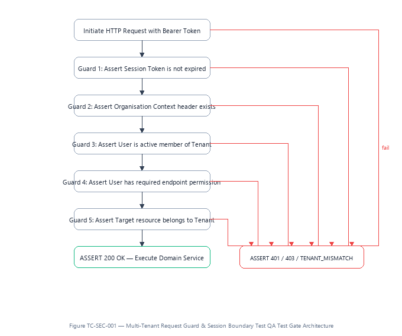

### Sequential Execution & Assertion Steps

1. **Initiate HTTP Request with Bearer Token:** Verification gate enforced.
2. **Guard 1: Assert Session Token is not expired:** Verification gate enforced.
3. **Guard 2: Assert Organisation Context header exists:** Verification gate enforced.
4. **Guard 3: Assert User is active member of Tenant:** Verification gate enforced.
5. **Guard 4: Assert User has required endpoint permission:** Verification gate enforced.
6. **Guard 5: Assert Target resource belongs to Tenant:** Verification gate enforced.
7. **Success Assertion (ASSERT 200 OK — Execute Domain Service):** All conditions verified; state committed.

* **Failure Rejection Assertion:** `ASSERT 401 / 403 / TENANT_MISMATCH`
* **Pass/Fail Standard:** Requests with forged tokens or mismatched organization IDs must be rejected immediately before invoking business logic.

---

## TC-ORG-001: Organization Creation & Unique Slug / VAT Validation

* **Category:** Tenancy & Setup
* **Primary Validation Gate:** Validate business entity registration parameters

### Visual Test Gate Architecture

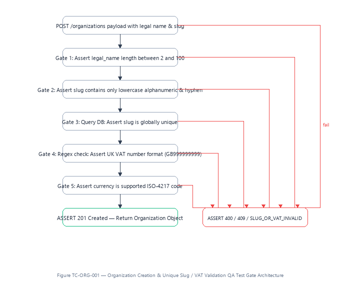

### Sequential Execution & Assertion Steps

1. **POST /organizations payload with legal name & slug:** Verification gate enforced.
2. **Gate 1: Assert legal_name length between 2 and 100:** Verification gate enforced.
3. **Gate 2: Assert slug contains only lowercase alphanumeric & hyphen:** Verification gate enforced.
4. **Gate 3: Query DB: Assert slug is globally unique:** Verification gate enforced.
5. **Gate 4: Regex check: Assert UK VAT number format (GB999999999):** Verification gate enforced.
6. **Gate 5: Assert currency is supported ISO-4217 code:** Verification gate enforced.
7. **Success Assertion (ASSERT 201 Created — Return Organization Object):** All conditions verified; state committed.

* **Failure Rejection Assertion:** `ASSERT 400 / 409 / SLUG_OR_VAT_INVALID`
* **Pass/Fail Standard:** Duplicate company slugs or invalid HMRC VAT formats must be rejected with HTTP 409 and 400.

---

## TC-COA-001: Chart of Accounts Control Immutability & Hierarchy Rules

* **Category:** General Ledger Governance
* **Primary Validation Gate:** Protect control accounts from manual tampering

### Visual Test Gate Architecture

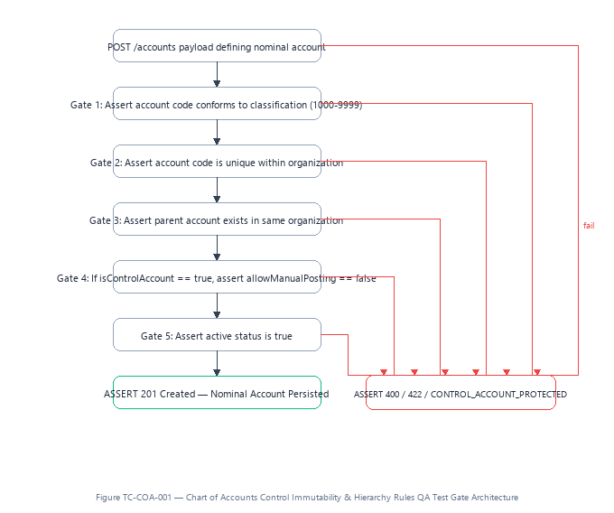

### Sequential Execution & Assertion Steps

1. **POST /accounts payload defining nominal account:** Verification gate enforced.
2. **Gate 1: Assert account code conforms to classification (1000-9999):** Verification gate enforced.
3. **Gate 2: Assert account code is unique within organization:** Verification gate enforced.
4. **Gate 3: Assert parent account exists in same organization:** Verification gate enforced.
5. **Gate 4: If isControlAccount == true, assert allowManualPosting == false:** Verification gate enforced.
6. **Gate 5: Assert active status is true:** Verification gate enforced.
7. **Success Assertion (ASSERT 201 Created — Nominal Account Persisted):** All conditions verified; state committed.

* **Failure Rejection Assertion:** `ASSERT 400 / 422 / CONTROL_ACCOUNT_PROTECTED`
* **Pass/Fail Standard:** Control accounts cannot have manual posting enabled; duplicate codes within the same tenant must be rejected.

---

## TC-INV-001: Sales Invoice 20% VAT Calculation & Subledger Sync

* **Category:** Sales & Invoicing
* **Primary Validation Gate:** Verify arithmetic precision and synchronous posting

### Visual Test Gate Architecture

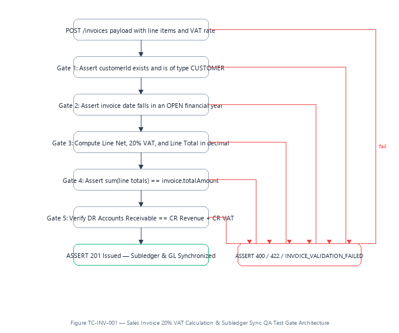

### Sequential Execution & Assertion Steps

1. **POST /invoices payload with line items and VAT rate:** Verification gate enforced.
2. **Gate 1: Assert customerId exists and is of type CUSTOMER:** Verification gate enforced.
3. **Gate 2: Assert invoice date falls in an OPEN financial year:** Verification gate enforced.
4. **Gate 3: Compute Line Net, 20% VAT, and Line Total in decimal:** Verification gate enforced.
5. **Gate 4: Assert sum(line totals) == invoice.totalAmount:** Verification gate enforced.
6. **Gate 5: Verify DR Accounts Receivable == CR Revenue + CR VAT:** Verification gate enforced.
7. **Success Assertion (ASSERT 201 Issued — Subledger & GL Synchronized):** All conditions verified; state committed.

* **Failure Rejection Assertion:** `ASSERT 400 / 422 / INVOICE_VALIDATION_FAILED`
* **Pass/Fail Standard:** Total amount must equal exact sum of lines plus 20% VAT; customer balance must increase by totalAmount immediately.

---

## TC-PAY-001: Payment Gateway Idempotency & Double-Click Shield

* **Category:** Client-Side & Payments
* **Primary Validation Gate:** Prevent duplicate charges on rapid successive clicks

### Visual Test Gate Architecture

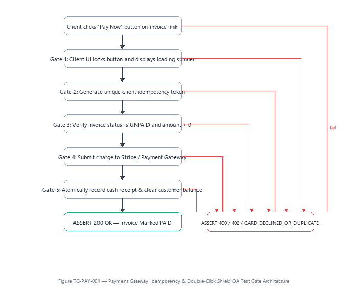

### Sequential Execution & Assertion Steps

1. **Client clicks 'Pay Now' button on invoice link:** Verification gate enforced.
2. **Gate 1: Client UI locks button and displays loading spinner:** Verification gate enforced.
3. **Gate 2: Generate unique client idempotency token:** Verification gate enforced.
4. **Gate 3: Verify invoice status is UNPAID and amount > 0:** Verification gate enforced.
5. **Gate 4: Submit charge to Stripe / Payment Gateway:** Verification gate enforced.
6. **Gate 5: Atomically record cash receipt & clear customer balance:** Verification gate enforced.
7. **Success Assertion (ASSERT 200 OK — Invoice Marked PAID):** All conditions verified; state committed.

* **Failure Rejection Assertion:** `ASSERT 400 / 402 / CARD_DECLINED_OR_DUPLICATE`
* **Pass/Fail Standard:** Successive clicks within 5 seconds must produce zero duplicate charges; invoice status must transition atomically to PAID.

---

## TC-PUR-001: Supplier Bill Duplicate Interception & AP Posting

* **Category:** Purchases & Accounts Payable
* **Primary Validation Gate:** Block duplicate supplier reference bills

### Visual Test Gate Architecture

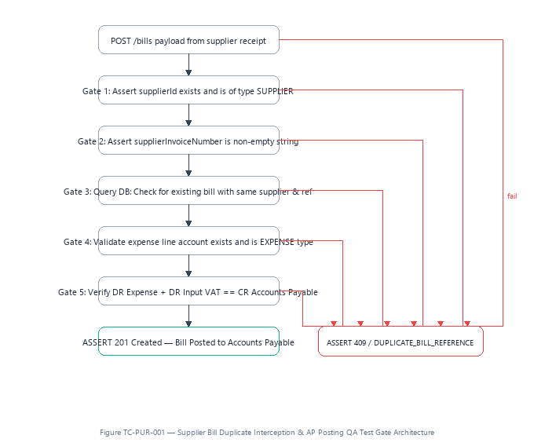

### Sequential Execution & Assertion Steps

1. **POST /bills payload from supplier receipt:** Verification gate enforced.
2. **Gate 1: Assert supplierId exists and is of type SUPPLIER:** Verification gate enforced.
3. **Gate 2: Assert supplierInvoiceNumber is non-empty string:** Verification gate enforced.
4. **Gate 3: Query DB: Check for existing bill with same supplier & ref:** Verification gate enforced.
5. **Gate 4: Validate expense line account exists and is EXPENSE type:** Verification gate enforced.
6. **Gate 5: Verify DR Expense + DR Input VAT == CR Accounts Payable:** Verification gate enforced.
7. **Success Assertion (ASSERT 201 Created — Bill Posted to Accounts Payable):** All conditions verified; state committed.

* **Failure Rejection Assertion:** `ASSERT 409 / DUPLICATE_BILL_REFERENCE`
* **Pass/Fail Standard:** Attempting to enter a supplier bill with an existing reference for that supplier must fail with HTTP 409.

---

## TC-AI-001: AI Document OCR Confidence & Arithmetic Guardrails

* **Category:** AI Intelligence & Safety
* **Primary Validation Gate:** Block hallucinated OCR extractions

### Visual Test Gate Architecture

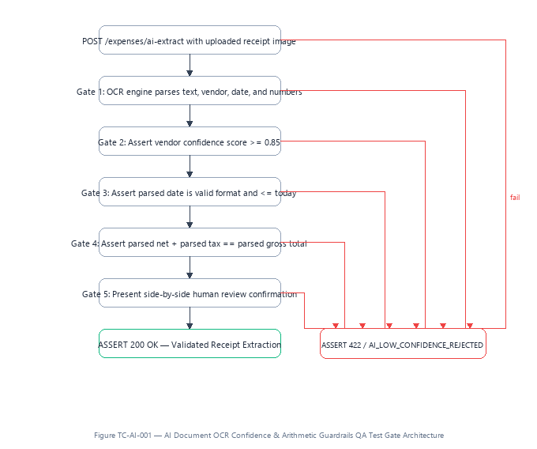

### Sequential Execution & Assertion Steps

1. **POST /expenses/ai-extract with uploaded receipt image:** Verification gate enforced.
2. **Gate 1: OCR engine parses text, vendor, date, and numbers:** Verification gate enforced.
3. **Gate 2: Assert vendor confidence score >= 0.85:** Verification gate enforced.
4. **Gate 3: Assert parsed date is valid format and <= today:** Verification gate enforced.
5. **Gate 4: Assert parsed net + parsed tax == parsed gross total:** Verification gate enforced.
6. **Gate 5: Present side-by-side human review confirmation:** Verification gate enforced.
7. **Success Assertion (ASSERT 200 OK — Validated Receipt Extraction):** All conditions verified; state committed.

* **Failure Rejection Assertion:** `ASSERT 422 / AI_LOW_CONFIDENCE_REJECTED`
* **Pass/Fail Standard:** If confidence is below 85% or line math does not equal total, automatic posting is blocked; human review is required.

---

## TC-JRN-001: Journal Balance Equilibrium Invariant (Debits == Credits)

* **Category:** General Ledger Engine
* **Primary Validation Gate:** Enforce double-entry accounting equilibrium

### Visual Test Gate Architecture

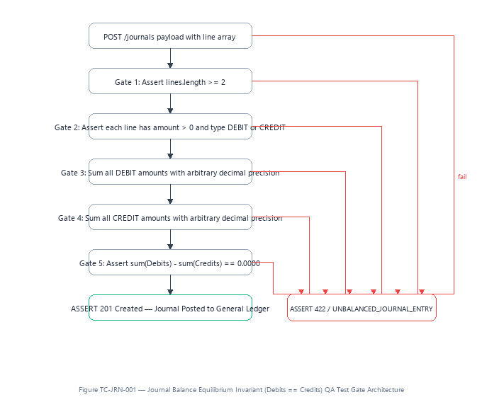

### Sequential Execution & Assertion Steps

1. **POST /journals payload with line array:** Verification gate enforced.
2. **Gate 1: Assert lines.length >= 2:** Verification gate enforced.
3. **Gate 2: Assert each line has amount > 0 and type DEBIT or CREDIT:** Verification gate enforced.
4. **Gate 3: Sum all DEBIT amounts with arbitrary decimal precision:** Verification gate enforced.
5. **Gate 4: Sum all CREDIT amounts with arbitrary decimal precision:** Verification gate enforced.
6. **Gate 5: Assert sum(Debits) - sum(Credits) == 0.0000:** Verification gate enforced.
7. **Success Assertion (ASSERT 201 Created — Journal Posted to General Ledger):** All conditions verified; state committed.

* **Failure Rejection Assertion:** `ASSERT 422 / UNBALANCED_JOURNAL_ENTRY`
* **Pass/Fail Standard:** Any journal entry with a non-zero difference between debits and credits must be rejected with HTTP 422.

---

## TC-REV-001: Invoice Voiding Reversal Invariant & Customer Zeroing

* **Category:** GAAP Reversals & Audit
* **Primary Validation Gate:** Verify symmetric non-destructive cancellation

### Visual Test Gate Architecture

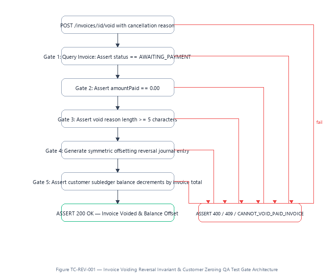

### Sequential Execution & Assertion Steps

1. **POST /invoices/:id/void with cancellation reason:** Verification gate enforced.
2. **Gate 1: Query Invoice: Assert status == AWAITING_PAYMENT:** Verification gate enforced.
3. **Gate 2: Assert amountPaid == 0.00:** Verification gate enforced.
4. **Gate 3: Assert void reason length >= 5 characters:** Verification gate enforced.
5. **Gate 4: Generate symmetric offsetting reversal journal entry:** Verification gate enforced.
6. **Gate 5: Assert customer subledger balance decrements by invoice total:** Verification gate enforced.
7. **Success Assertion (ASSERT 200 OK — Invoice Voided & Balance Offset):** All conditions verified; state committed.

* **Failure Rejection Assertion:** `ASSERT 400 / 409 / CANNOT_VOID_PAID_INVOICE`
* **Pass/Fail Standard:** Voiding must create a mirrored reversal journal, customer balance must return to pre-invoice state, and original invoice is preserved.

---

## TC-PER-001: Closed Financial Period Temporal Backdating Intercept

* **Category:** Period Governance
* **Primary Validation Gate:** Block transactions backdated into closed tax years

### Visual Test Gate Architecture

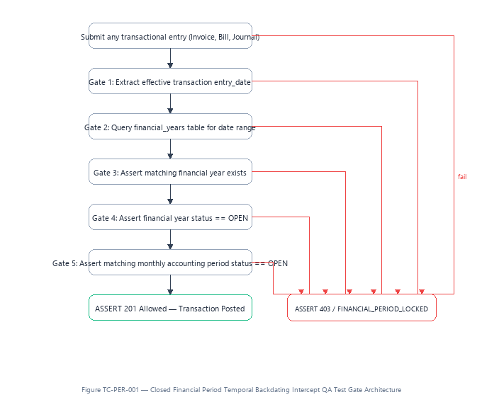

### Sequential Execution & Assertion Steps

1. **Submit any transactional entry (Invoice, Bill, Journal):** Verification gate enforced.
2. **Gate 1: Extract effective transaction entry_date:** Verification gate enforced.
3. **Gate 2: Query financial_years table for date range:** Verification gate enforced.
4. **Gate 3: Assert matching financial year exists:** Verification gate enforced.
5. **Gate 4: Assert financial year status == OPEN:** Verification gate enforced.
6. **Gate 5: Assert matching monthly accounting period status == OPEN:** Verification gate enforced.
7. **Success Assertion (ASSERT 201 Allowed — Transaction Posted):** All conditions verified; state committed.

* **Failure Rejection Assertion:** `ASSERT 403 / FINANCIAL_PERIOD_LOCKED`
* **Pass/Fail Standard:** Attempting to post any entry with an entry_date inside a closed or locked financial year must fail with HTTP 403 PERIOD_LOCKED.

---

## TC-BNK-001: Bank Feed Statement Deduplication & Reconciliation

* **Category:** Banking & Reconciliation
* **Primary Validation Gate:** Prevent duplicate bank feeds and ensure balance matching

### Visual Test Gate Architecture

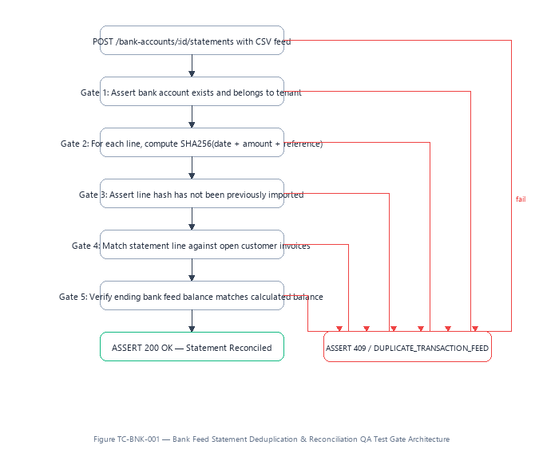

### Sequential Execution & Assertion Steps

1. **POST /bank-accounts/:id/statements with CSV feed:** Verification gate enforced.
2. **Gate 1: Assert bank account exists and belongs to tenant:** Verification gate enforced.
3. **Gate 2: For each line, compute SHA256(date + amount + reference):** Verification gate enforced.
4. **Gate 3: Assert line hash has not been previously imported:** Verification gate enforced.
5. **Gate 4: Match statement line against open customer invoices:** Verification gate enforced.
6. **Gate 5: Verify ending bank feed balance matches calculated balance:** Verification gate enforced.
7. **Success Assertion (ASSERT 200 OK — Statement Reconciled):** All conditions verified; state committed.

* **Failure Rejection Assertion:** `ASSERT 409 / DUPLICATE_TRANSACTION_FEED`
* **Pass/Fail Standard:** Duplicate imported statement lines must be ignored or rejected; clearing an invoice must update both bank and AR subledgers.

---

## TC-RBAC-001: Role Privilege Boundary Enforcement (Viewer vs Admin)

* **Category:** Access Control Security
* **Primary Validation Gate:** Verify write operation prohibition for Viewer role

### Visual Test Gate Architecture

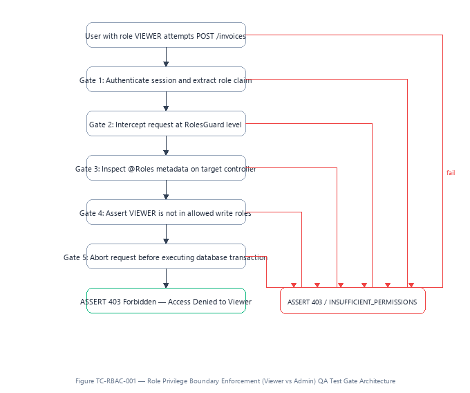

### Sequential Execution & Assertion Steps

1. **User with role VIEWER attempts POST /invoices:** Verification gate enforced.
2. **Gate 1: Authenticate session and extract role claim:** Verification gate enforced.
3. **Gate 2: Intercept request at RolesGuard level:** Verification gate enforced.
4. **Gate 3: Inspect @Roles metadata on target controller:** Verification gate enforced.
5. **Gate 4: Assert VIEWER is not in allowed write roles:** Verification gate enforced.
6. **Gate 5: Abort request before executing database transaction:** Verification gate enforced.
7. **Success Assertion (ASSERT 403 Forbidden — Access Denied to Viewer):** All conditions verified; state committed.

* **Failure Rejection Assertion:** `ASSERT 403 / INSUFFICIENT_PERMISSIONS`
* **Pass/Fail Standard:** Users with the VIEWER role must receive HTTP 403 when attempting any POST, PUT, PATCH, or DELETE operation.

---

## TC-VAT-001: Quarterly VAT Return Derivation & HMRC MTD Validation

* **Category:** Statutory Compliance
* **Primary Validation Gate:** Assert 9-box VAT mathematical equality

### Visual Test Gate Architecture

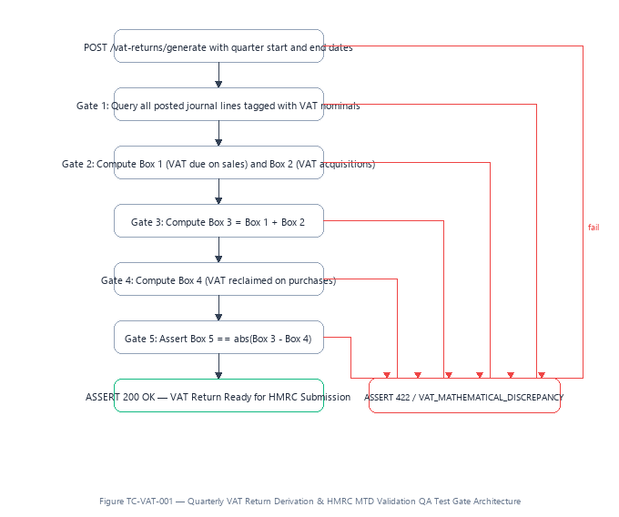

### Sequential Execution & Assertion Steps

1. **POST /vat-returns/generate with quarter start and end dates:** Verification gate enforced.
2. **Gate 1: Query all posted journal lines tagged with VAT nominals:** Verification gate enforced.
3. **Gate 2: Compute Box 1 (VAT due on sales) and Box 2 (VAT acquisitions):** Verification gate enforced.
4. **Gate 3: Compute Box 3 = Box 1 + Box 2:** Verification gate enforced.
5. **Gate 4: Compute Box 4 (VAT reclaimed on purchases):** Verification gate enforced.
6. **Gate 5: Assert Box 5 == abs(Box 3 - Box 4):** Verification gate enforced.
7. **Success Assertion (ASSERT 200 OK — VAT Return Ready for HMRC Submission):** All conditions verified; state committed.

* **Failure Rejection Assertion:** `ASSERT 422 / VAT_MATHEMATICAL_DISCREPANCY`
* **Pass/Fail Standard:** Box 5 must equal exactly Box 3 minus Box 4; no unposted or draft transactions may be included in the statutory calculation.

---

## TC-AUD-001: Audit Trail Append-Only Immutability & Hash Verification

* **Category:** Statutory Audit & GRC
* **Primary Validation Gate:** Verify cryptographic tamper-proofing of audit records

### Visual Test Gate Architecture

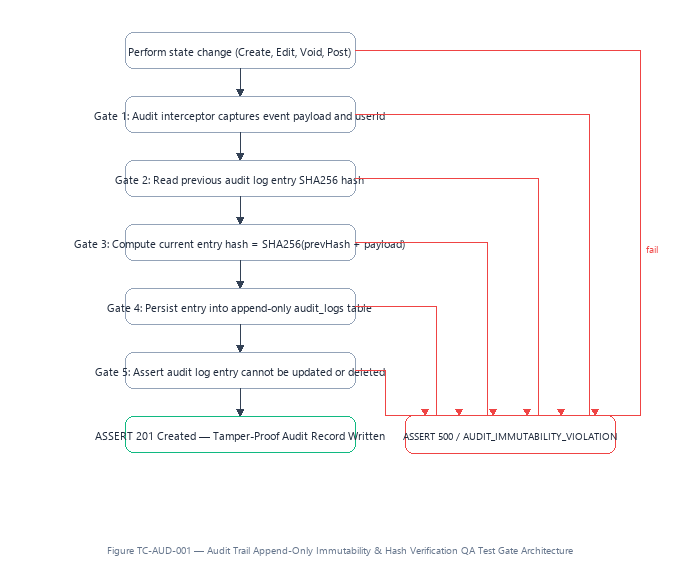

### Sequential Execution & Assertion Steps

1. **Perform state change (Create, Edit, Void, Post):** Verification gate enforced.
2. **Gate 1: Audit interceptor captures event payload and userId:** Verification gate enforced.
3. **Gate 2: Read previous audit log entry SHA256 hash:** Verification gate enforced.
4. **Gate 3: Compute current entry hash = SHA256(prevHash + payload):** Verification gate enforced.
5. **Gate 4: Persist entry into append-only audit_logs table:** Verification gate enforced.
6. **Gate 5: Assert audit log entry cannot be updated or deleted:** Verification gate enforced.
7. **Success Assertion (ASSERT 201 Created — Tamper-Proof Audit Record Written):** All conditions verified; state committed.

* **Failure Rejection Assertion:** `ASSERT 500 / AUDIT_IMMUTABILITY_VIOLATION`
* **Pass/Fail Standard:** Direct SQL UPDATE or DELETE on audit_logs must be rejected by PostgreSQL triggers; hash chain continuity must verify 100% intact.

---

