# Blynt — Complete Functional Use Cases Specification

**Document Classification:** Enterprise Functional Requirements & User Journey Architecture  
**Target Audience:** Business Owners, Operational Leads, Product Managers, and Non-Technical Stakeholders  
**System Name:** Blynt UK Cloud Accounting SaaS  
**Total Scenarios Covered:** 14 Exhaustive Business & Client Scenarios  

---

## UC-01: User Authentication & Multi-Tenant Access

* **Primary Actor:** Any User (Owner, Accountant, Staff)
* **Business Objective:** Authenticate user credentials and securely resolve organization context without cross-tenant data leaks.

### Visual Flowchart Architecture

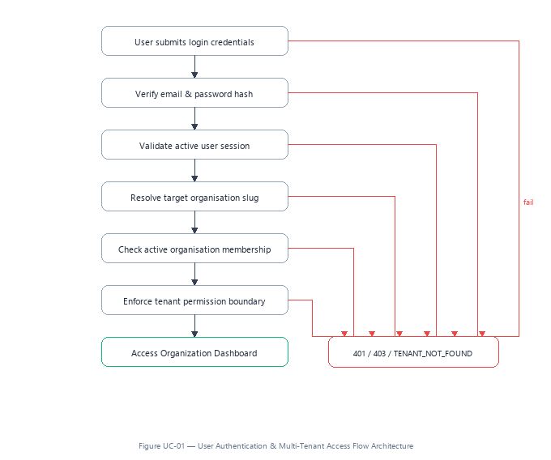

### Step-by-Step Business Progression

1. **User submits login credentials:** System validates parameters.
2. **Verify email & password hash:** System validates parameters.
3. **Validate active user session:** System validates parameters.
4. **Resolve target organisation slug:** System validates parameters.
5. **Check active organisation membership:** System validates parameters.
6. **Enforce tenant permission boundary:** System validates parameters.
7. **Success Endpoint (Access Organization Dashboard):** Operation approved and committed.

* **Failure Branch Rejection Code:** `401 / 403 / TENANT_NOT_FOUND`
* **Business Context:** Ensures that every user strictly operates inside their authorized business entity. If an expired token, wrong password, or unassigned organization is requested, the system instantly halts access.

---

## UC-02: Organization Setup & Statutory Tax Configuration

* **Primary Actor:** Business Owner / Enterprise Administrator
* **Business Objective:** Register a new UK entity, base currency (GBP), and statutory HMRC VAT number.

### Visual Flowchart Architecture

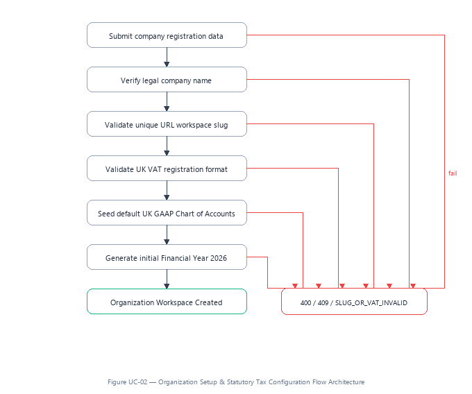

### Step-by-Step Business Progression

1. **Submit company registration data:** System validates parameters.
2. **Verify legal company name:** System validates parameters.
3. **Validate unique URL workspace slug:** System validates parameters.
4. **Validate UK VAT registration format:** System validates parameters.
5. **Seed default UK GAAP Chart of Accounts:** System validates parameters.
6. **Generate initial Financial Year 2026:** System validates parameters.
7. **Success Endpoint (Organization Workspace Created):** Operation approved and committed.

* **Failure Branch Rejection Code:** `400 / 409 / SLUG_OR_VAT_INVALID`
* **Business Context:** Validates business entity identity and seeds standardized nominal ledger accounts with VAT control accounts ready for trading.

---

## UC-03: Chart of Accounts & Control Account Governance

* **Primary Actor:** Certified Public Accountant
* **Business Objective:** Create custom nominal codes while protecting system control accounts (Bank, AR, AP, VAT).

### Visual Flowchart Architecture

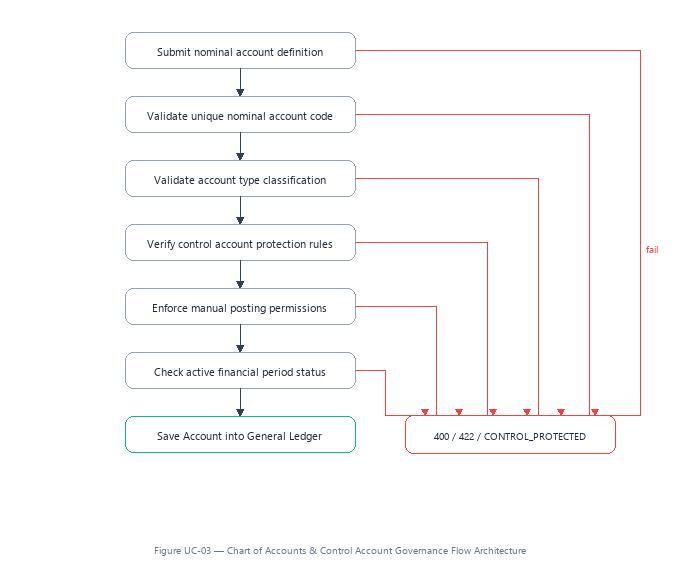

### Step-by-Step Business Progression

1. **Submit nominal account definition:** System validates parameters.
2. **Validate unique nominal account code:** System validates parameters.
3. **Validate account type classification:** System validates parameters.
4. **Verify control account protection rules:** System validates parameters.
5. **Enforce manual posting permissions:** System validates parameters.
6. **Check active financial period status:** System validates parameters.
7. **Success Endpoint (Save Account into General Ledger):** Operation approved and committed.

* **Failure Branch Rejection Code:** `400 / 422 / CONTROL_PROTECTED`
* **Business Context:** Prevents unauthorized users from manually posting direct journal lines into statutory accounts like Accounts Receivable or Tax Control.

---

## UC-04: Sales Invoice Creation & 20% VAT Calculation

* **Primary Actor:** Business Owner or Billing Clerk
* **Business Objective:** Bill a customer with automatic UK standard VAT derivation and real-time subledger posting.

### Visual Flowchart Architecture

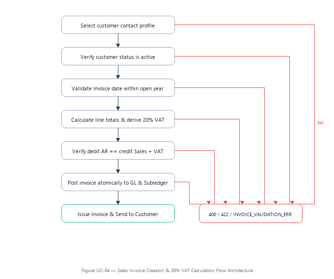

### Step-by-Step Business Progression

1. **Select customer contact profile:** System validates parameters.
2. **Verify customer status is active:** System validates parameters.
3. **Validate invoice date within open year:** System validates parameters.
4. **Calculate line totals & derive 20% VAT:** System validates parameters.
5. **Verify debit AR == credit Sales + VAT:** System validates parameters.
6. **Post invoice atomically to GL & Subledger:** System validates parameters.
7. **Success Endpoint (Issue Invoice & Send to Customer):** Operation approved and committed.

* **Failure Branch Rejection Code:** `400 / 422 / INVOICE_VALIDATION_ERR`
* **Business Context:** Guarantees that invoices always balance mathematically, calculate exact VAT pence, and synchronously update customer balances.

---

## UC-05: External Client Online Payment (Client-Side)

* **Primary Actor:** External Customer / Payer
* **Business Objective:** Allow external clients to open secure invoice links and pay via card without creating an IT account.

### Visual Flowchart Architecture

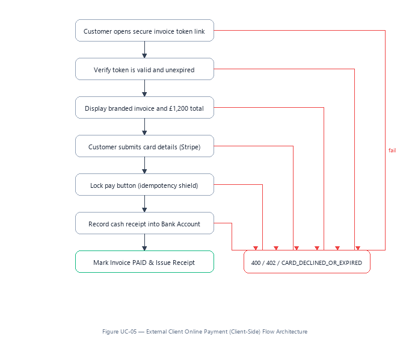

### Step-by-Step Business Progression

1. **Customer opens secure invoice token link:** System validates parameters.
2. **Verify token is valid and unexpired:** System validates parameters.
3. **Display branded invoice and £1,200 total:** System validates parameters.
4. **Customer submits card details (Stripe):** System validates parameters.
5. **Lock pay button (idempotency shield):** System validates parameters.
6. **Record cash receipt into Bank Account:** System validates parameters.
7. **Success Endpoint (Mark Invoice PAID & Issue Receipt):** Operation approved and committed.

* **Failure Branch Rejection Code:** `400 / 402 / CARD_DECLINED_OR_EXPIRED`
* **Business Context:** Enables immediate payment receipting while safeguarding payers against duplicate charges if clicking 'Pay' rapidly.

---

## UC-06: Supplier Bill Capture & Accounts Payable

* **Primary Actor:** Bookkeeper / Finance Administrator
* **Business Objective:** Log vendor bills, check for duplicate invoice references, and accrue accounts payable.

### Visual Flowchart Architecture

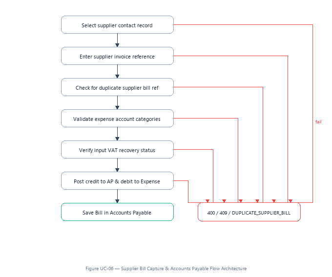

### Step-by-Step Business Progression

1. **Select supplier contact record:** System validates parameters.
2. **Enter supplier invoice reference:** System validates parameters.
3. **Check for duplicate supplier bill ref:** System validates parameters.
4. **Validate expense account categories:** System validates parameters.
5. **Verify input VAT recovery status:** System validates parameters.
6. **Post credit to AP & debit to Expense:** System validates parameters.
7. **Success Endpoint (Save Bill in Accounts Payable):** Operation approved and committed.

* **Failure Branch Rejection Code:** `400 / 409 / DUPLICATE_SUPPLIER_BILL`
* **Business Context:** Prevents the business from accidentally paying the same supplier invoice twice by checking vendor numbers and dates.

---

## UC-07: Smart AI Receipt Scanning & Document Extraction

* **Primary Actor:** Staff Member / Expense Submitter
* **Business Objective:** Extract vendor, date, and VAT breakdown from a photo receipt using AI with zero hallucinations.

### Visual Flowchart Architecture

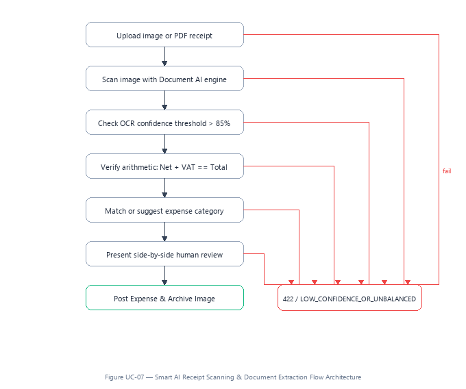

### Step-by-Step Business Progression

1. **Upload image or PDF receipt:** System validates parameters.
2. **Scan image with Document AI engine:** System validates parameters.
3. **Check OCR confidence threshold > 85%:** System validates parameters.
4. **Verify arithmetic: Net + VAT == Total:** System validates parameters.
5. **Match or suggest expense category:** System validates parameters.
6. **Present side-by-side human review:** System validates parameters.
7. **Success Endpoint (Post Expense & Archive Image):** Operation approved and committed.

* **Failure Branch Rejection Code:** `422 / LOW_CONFIDENCE_OR_UNBALANCED`
* **Business Context:** Automates receipt data entry with strict guardrails: if text is blurry or totals do not add up, human review is enforced.

---

## UC-08: Double-Entry Manual Journal Entry Creation

* **Primary Actor:** Senior Accountant
* **Business Objective:** Post end-of-month adjusting journal entries with strict debit-equals-credit equilibrium.

### Visual Flowchart Architecture

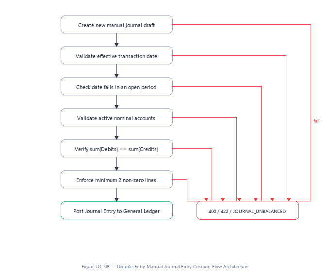

### Step-by-Step Business Progression

1. **Create new manual journal draft:** System validates parameters.
2. **Validate effective transaction date:** System validates parameters.
3. **Check date falls in an open period:** System validates parameters.
4. **Validate active nominal accounts:** System validates parameters.
5. **Verify sum(Debits) == sum(Credits):** System validates parameters.
6. **Enforce minimum 2 non-zero lines:** System validates parameters.
7. **Success Endpoint (Post Journal Entry to General Ledger):** Operation approved and committed.

* **Failure Branch Rejection Code:** `400 / 422 / JOURNAL_UNBALANCED`
* **Business Context:** Enforces the foundational rule of accounting: the system physically refuses to save any journal where debits do not match credits.

---

## UC-09: Safe Invoice Voiding & GAAP Symmetric Reversal

* **Primary Actor:** Business Owner / Certified Accountant
* **Business Objective:** Legally cancel an invoice with an offsetting symmetrical journal reversal without erasing history.

### Visual Flowchart Architecture

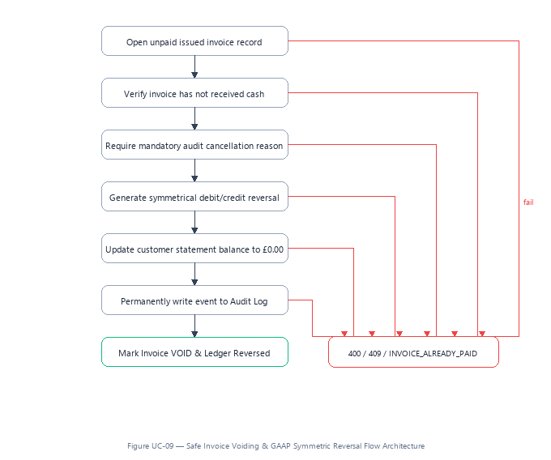

### Step-by-Step Business Progression

1. **Open unpaid issued invoice record:** System validates parameters.
2. **Verify invoice has not received cash:** System validates parameters.
3. **Require mandatory audit cancellation reason:** System validates parameters.
4. **Generate symmetrical debit/credit reversal:** System validates parameters.
5. **Update customer statement balance to £0.00:** System validates parameters.
6. **Permanently write event to Audit Log:** System validates parameters.
7. **Success Endpoint (Mark Invoice VOID & Ledger Reversed):** Operation approved and committed.

* **Failure Branch Rejection Code:** `400 / 409 / INVOICE_ALREADY_PAID`
* **Business Context:** Preserves a 100% compliant paper trail for statutory HMRC audits; issued invoices are never silently deleted.

---

## UC-10: Financial Period Closing & Locked Year Freeze

* **Primary Actor:** Certified Public Accountant
* **Business Objective:** Close a financial year after tax submission to freeze all past ledger entries against tampering.

### Visual Flowchart Architecture

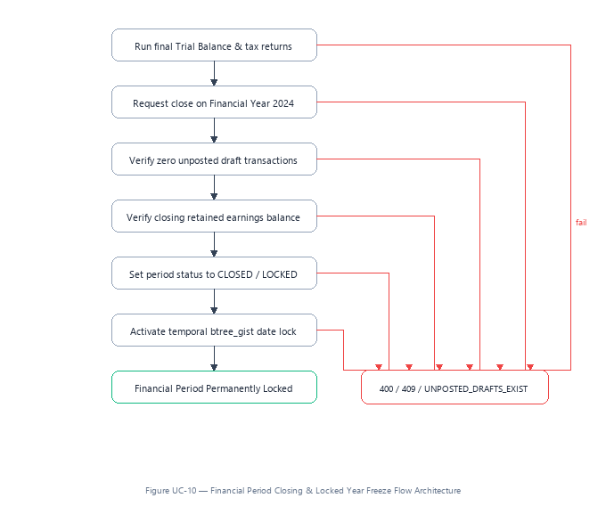

### Step-by-Step Business Progression

1. **Run final Trial Balance & tax returns:** System validates parameters.
2. **Request close on Financial Year 2024:** System validates parameters.
3. **Verify zero unposted draft transactions:** System validates parameters.
4. **Verify closing retained earnings balance:** System validates parameters.
5. **Set period status to CLOSED / LOCKED:** System validates parameters.
6. **Activate temporal btree_gist date lock:** System validates parameters.
7. **Success Endpoint (Financial Period Permanently Locked):** Operation approved and committed.

* **Failure Branch Rejection Code:** `400 / 409 / UNPOSTED_DRAFTS_EXIST`
* **Business Context:** Once locked, any subsequent attempt by any user to post, edit, or backdate entries into that year is rejected.

---

## UC-11: Bank Feed Statement Import & Reconciliation

* **Primary Actor:** Bookkeeper / Accountant
* **Business Objective:** Import electronic bank statement lines and reconcile against issued invoices and bills.

### Visual Flowchart Architecture

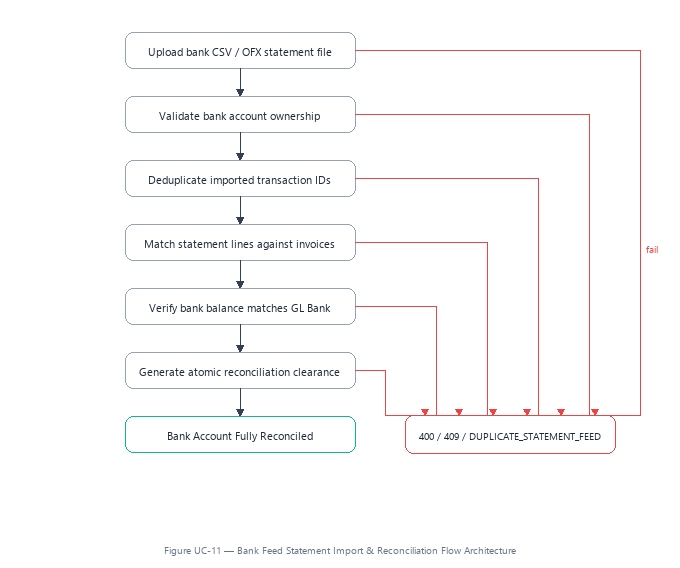

### Step-by-Step Business Progression

1. **Upload bank CSV / OFX statement file:** System validates parameters.
2. **Validate bank account ownership:** System validates parameters.
3. **Deduplicate imported transaction IDs:** System validates parameters.
4. **Match statement lines against invoices:** System validates parameters.
5. **Verify bank balance matches GL Bank:** System validates parameters.
6. **Generate atomic reconciliation clearance:** System validates parameters.
7. **Success Endpoint (Bank Account Fully Reconciled):** Operation approved and committed.

* **Failure Branch Rejection Code:** `400 / 409 / DUPLICATE_STATEMENT_FEED`
* **Business Context:** Matches actual bank cash flows with accounting records and catches duplicate bank transaction downloads.

---

## UC-12: Role-Based Access Control & Privilege Boundary

* **Primary Actor:** Platform Administrator / Business Owner
* **Business Objective:** Enforce strict least-privilege security between Owners, Accountants, Bookkeepers, and Viewers.

### Visual Flowchart Architecture

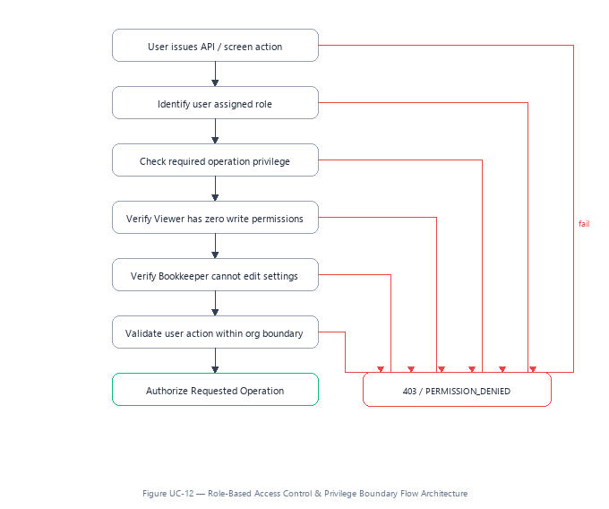

### Step-by-Step Business Progression

1. **User issues API / screen action:** System validates parameters.
2. **Identify user assigned role:** System validates parameters.
3. **Check required operation privilege:** System validates parameters.
4. **Verify Viewer has zero write permissions:** System validates parameters.
5. **Verify Bookkeeper cannot edit settings:** System validates parameters.
6. **Validate user action within org boundary:** System validates parameters.
7. **Success Endpoint (Authorize Requested Operation):** Operation approved and committed.

* **Failure Branch Rejection Code:** `403 / PERMISSION_DENIED`
* **Business Context:** Ensures external auditors or junior staff cannot alter sensitive bank accounts, delete records, or modify billing configurations.

---

## UC-13: HMRC Making Tax Digital (MTD) VAT Return

* **Primary Actor:** Certified Public Accountant
* **Business Objective:** Calculate quarterly VAT Boxes 1 through 9 from general ledger lines and submit to HMRC MTD.

### Visual Flowchart Architecture

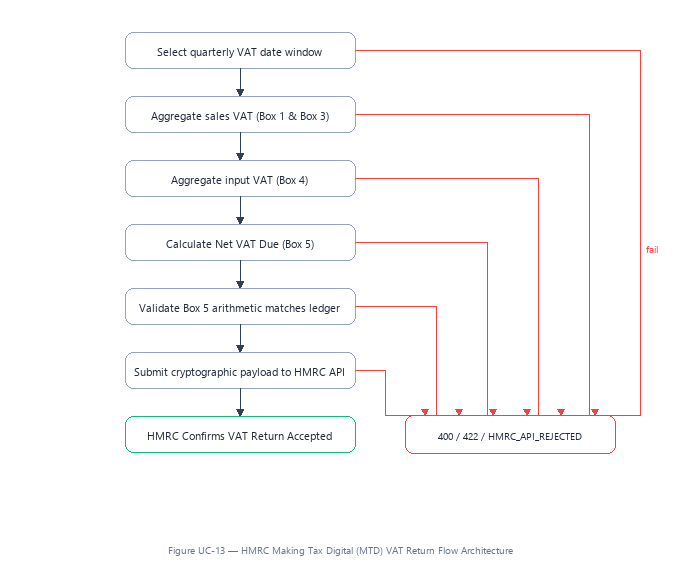

### Step-by-Step Business Progression

1. **Select quarterly VAT date window:** System validates parameters.
2. **Aggregate sales VAT (Box 1 & Box 3):** System validates parameters.
3. **Aggregate input VAT (Box 4):** System validates parameters.
4. **Calculate Net VAT Due (Box 5):** System validates parameters.
5. **Validate Box 5 arithmetic matches ledger:** System validates parameters.
6. **Submit cryptographic payload to HMRC API:** System validates parameters.
7. **Success Endpoint (HMRC Confirms VAT Return Accepted):** Operation approved and committed.

* **Failure Branch Rejection Code:** `400 / 422 / HMRC_API_REJECTED`
* **Business Context:** Generates 100% compliant UK VAT filings directly from posted invoices and receipts without spreadsheet copy-paste errors.

---

## UC-14: Statutory Tamper-Proof Audit Trail Logging

* **Primary Actor:** Compliance Auditor / Tax Inspector
* **Business Objective:** Inspect the complete historical log of all creations, edits, reversals, and access logs.

### Visual Flowchart Architecture

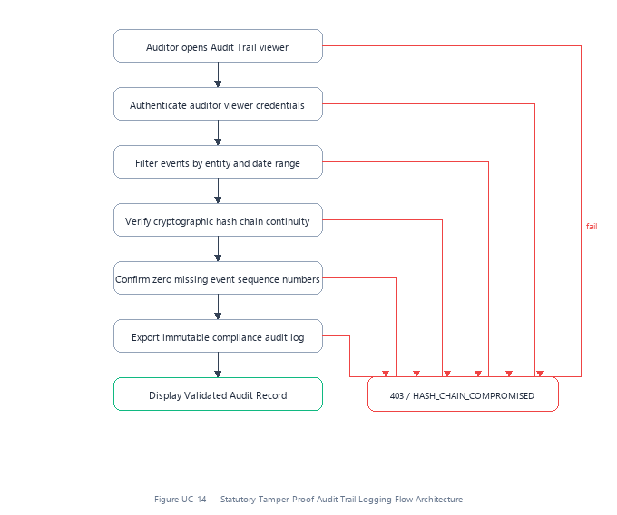

### Step-by-Step Business Progression

1. **Auditor opens Audit Trail viewer:** System validates parameters.
2. **Authenticate auditor viewer credentials:** System validates parameters.
3. **Filter events by entity and date range:** System validates parameters.
4. **Verify cryptographic hash chain continuity:** System validates parameters.
5. **Confirm zero missing event sequence numbers:** System validates parameters.
6. **Export immutable compliance audit log:** System validates parameters.
7. **Success Endpoint (Display Validated Audit Record):** Operation approved and committed.

* **Failure Branch Rejection Code:** `403 / HASH_CHAIN_COMPROMISED`
* **Business Context:** Provides statutory proof that no accounting records were altered off-the-books, satisfying UK Companies Act requirements.

---

