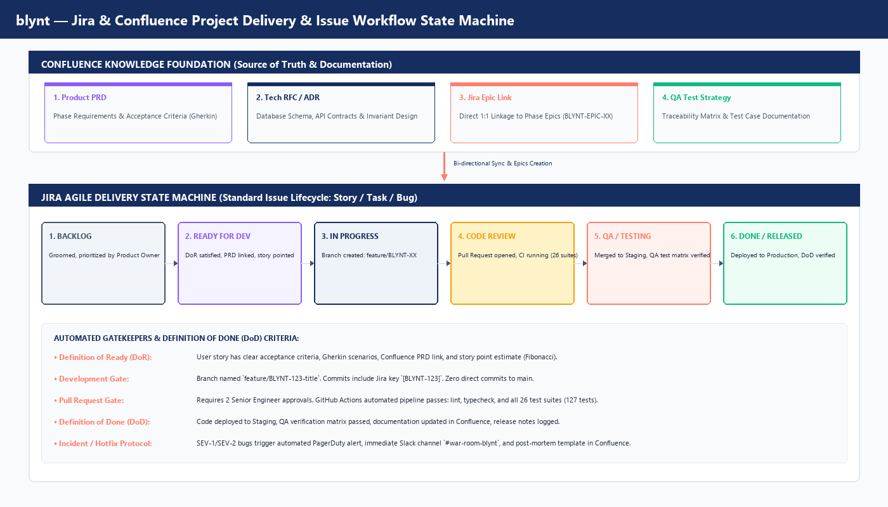

# blynt — Jira & Confluence Agile Workflow & Governance Specification

**Document Classification:** Engineering Delivery Governance & Project Management  
**Target Systems:** Atlassian Jira Software, Confluence Cloud, GitHub Enterprise CI/CD  
**Coverage Scope:** 50-Phase Implementation Governance, State Machine Transitions, DoD/DoR Quality Gates  
**Version:** 1.0 Production Readiness  
**Document Ref:** `BLYNT-PMO-WORKFLOW-V1`  

---

# Table of Contents
* **1. Strategic Project Governance & Ecosystem Architecture**
  * 1.1 The Jira + Confluence + GitHub Unified Delivery Pipeline
  * 1.2 Confluence as the Authoritative Single Source of Truth (SSOT)
  * 1.3 Jira as the Agile Execution Engine
  * 1.4 Bi-Directional Linking Strategy
* **2. Issue Hierarchy & The 50-Phase Epic Architecture**
  * 2.1 The 4-Tier Hierarchy: Initiative -> Epic -> Standard Issue -> Sub-Task
  * 2.2 Mapping the 50 Phases into Jira Epics (`BLYNT-EPIC-01` to `BLYNT-EPIC-50`)
  * 2.3 Issue Types & Taxonomy (Story, Task, Bug, Hotfix)
* **3. The Jira Issue Lifecycle & State Machine**
  * 3.1 Visual Workflow State Machine Diagram
  * 3.2 State Transition Definitions & Progression Rules
  * 3.3 The Hotfix & Emergency Incident Workflow (SEV-1 / SEV-2)
* **4. Quality Gatekeepers: Definition of Ready, Review Protocol & Definition of Done**
  * 4.1 Definition of Ready (DoR) Gatekeeper Checklist
  * 4.2 Pull Request Quality Gate & CI Automation
  * 4.3 Definition of Done (DoD) Sign-Off Criteria
  * 4.4 Formal Peer Review & Quality Sign-Off Governance
* **5. Confluence Space Architecture & Page Templates**
  * 5.1 Confluence Space Structure (`ENG`, `PROD`, `QA`, `SEC`, `OPS`)
  * 5.2 Standard Product Requirement Document (PRD) Template
  * 5.3 Architectural Decision Record (ADR) Template
  * 5.4 Post-Mortem Incident Template
  * 5.5 Standard Jira Issue Description "Review & Approval" Template
* **6. Agile Ceremonies, Story Point Estimation & Sprint Cadence**
  * 6.1 2-Week Sprint Schedule & Cadence
  * 6.2 Story Pointing & Modified Fibonacci Sizing
  * 6.3 Sprint Planning, Standups, Demos & Retrospectives
* **7. Jira Smart Automations & Webhooks**
  * 7.1 Automated State Transitions via GitHub Webhooks
  * 7.2 Slack PagerDuty Alerting for Critical Financial Defects
  * 7.3 Confluence Documentation Synchronizers

---

# 1. Strategic Project Governance & Ecosystem Architecture

For an institutional financial platform where every calculation has legal and statutory ramifications, engineering delivery cannot be chaotic. The Jira and Confluence workflow provides end-to-end traceability from initial business requirement to production deployment.



## 1.1 The Jira + Confluence + GitHub Unified Delivery Pipeline

```
[ CONFLUENCE: Product PRD / Tech RFC ]
             │ (1:1 Document Link)
             ▼
[ JIRA: Phase Epic (BLYNT-EPIC-XX) ]
             │ (Decomposed into Stories & Tasks)
             ▼
[ GITHUB: Feature Branch (feature/BLYNT-123-title) ]
             │ (Automated Webhook Sync)
             ▼
[ GITHUB ACTIONS: Quality Gate (Lint, Typecheck, 26 Test Suites / 127 Tests) ]
             │ (Pull Request Approved by 2 Senior Engineers)
             ▼
[ STAGING: Deployed via AWS App Runner / Amplify ]
             │ (QA Verification Matrix Signed Off)
             ▼
[ JIRA: Transition to DONE / RELEASED ]
             │ (Automated Sync)
             ▼
[ CONFLUENCE: Release Notes Published & Runbook Updated ]
```

## 1.2 Confluence as the Authoritative Single Source of Truth (SSOT)
* **The Golden Rule:** No feature code is written without an approved Confluence PRD (Product Requirements Document) or RFC (Request for Comments).
* **Contents of Confluence:** Architectural Decision Records (ADRs), mathematical formulas, statutory UK tax rules, API schemas, and incident post-mortems.

## 1.3 Jira as the Agile Execution Engine
* **Execution Scope:** Tracking day-to-day sprint velocity, assigning engineering ownership, enforcing code review gates, and monitoring release burn-down.
* **Sprint Cadence:** Fixed 2-week iterations starting Wednesday 10:00 UTC and closing Tuesday 17:00 UTC.

## 1.4 Bi-Directional Linking Strategy
* Every Jira Epic must contain a direct hyperlink to its parent Confluence PRD.
* Every GitHub pull request must include the Jira issue key in its title and branch name (`feature/BLYNT-104-sales-tax-calc`).
* When the pull request is merged, Jira automatically marks the story as `QA / TESTING` or `DONE`.

---

# 2. Issue Hierarchy & The 50-Phase Epic Architecture

## 2.1 The 4-Tier Issue Hierarchy

| Hierarchy Level | Issue Type | Definition & Purpose | Example |
| :--- | :--- | :--- | :--- |
| **Level 1** | **Initiative** | High-level strategic milestone spanning multiple quarters. | `INIT-01`: Milestone 1 — Double-Entry Core Engine |
| **Level 2** | **Epic** | Discrete engineering phase delivering end-to-end architectural capability. | `BLYNT-EPIC-10`: Phase 10 — Sales Invoicing & Billing |
| **Level 3** | **Story / Task / Bug** | Work item deliverable within a single 2-week sprint. | `BLYNT-142`: "Implement 20% UK VAT calculation in MoneyService" |
| **Level 4** | **Sub-Task** | Technical task completed by a single developer in < 1 day. | `BLYNT-143`: "Write unit tests in money.service.spec.ts" |

## 2.2 Mapping the 50 Phases into Jira Epics

Every phase in the blynt roadmap maps 1:1 to a formal Jira Epic:

### Milestone 1: Double-Entry Core Engine (Completed & Verified)
* `BLYNT-EPIC-01`: Phase 1 — Project & Database Foundation
* `BLYNT-EPIC-02`: Phase 2 — Authentication & Sessions
* `BLYNT-EPIC-03`: Phase 3 — Multi-Organisation Management
* `BLYNT-EPIC-04`: Phase 4 — Roles & Permissions (RBAC)
* `BLYNT-EPIC-05`: Phase 5 — Chart of Accounts & Seed Data
* `BLYNT-EPIC-06`: Phase 6 — Financial Years & Accounting Periods
* `BLYNT-EPIC-07`: Phase 7 — Manual Journal Entry & Multi-Line Grid
* `BLYNT-EPIC-08`: Phase 8 — Central Posting & Validation Engine (15 Invariants)

### Milestone 2: Commercial Workflows & Subledgers (Active & Delivered)
* `BLYNT-EPIC-09`: Phase 9 — Contacts V2 & Subledger Architecture
* `BLYNT-EPIC-10`: Phase 10 — Sales Invoicing & Billing Auto-Posting
* `BLYNT-EPIC-11`: Phase 11 — Customer Statements & AR Ageing
* `BLYNT-EPIC-12`: Phase 12 — Purchase Bills & Accounts Payable Subledger
* `BLYNT-EPIC-13`: Phase 13 — Customer Receipts & Supplier Payments
* `BLYNT-EPIC-14`: Phase 14 — Bank Accounts & Statement Reconciliation
* `BLYNT-EPIC-15`: Phase 15 — Financial Reporting Suite V1 (TB, P&L, Balance Sheet)

### Milestone 3: UK Tax Compliance & HMRC MTD Integration (Planned Q1 2027)
* `BLYNT-EPIC-16`: Phase 16 — UK 9-Box VAT Return Calculation
* `BLYNT-EPIC-17`: Phase 17 — HMRC MTD Direct API Integration
* `BLYNT-EPIC-18`: Phase 18 — Year-End Close Automation & Retained Earnings
* `BLYNT-EPIC-19`: Phase 19 — Fixed Asset Register & Depreciation
* `BLYNT-EPIC-20` to `BLYNT-EPIC-25`: CIS Reverse Charge, Practice Portal, FRS 105

### Milestone 4: Advanced Operations, AI & Ecosystem (Planned Q2 2027+)
* `BLYNT-EPIC-26` to `BLYNT-EPIC-30`: UK Open Banking Live Bank Feeds (TrueLayer/Plaid)
* `BLYNT-EPIC-31` to `BLYNT-EPIC-35`: AI Receipt OCR & Document Extraction
* `BLYNT-EPIC-36` to `BLYNT-EPIC-40`: Machine Learning Nominal Code Categorization
* `BLYNT-EPIC-41` to `BLYNT-EPIC-45`: Multi-Currency Accounting & FX Revaluations
* `BLYNT-EPIC-46` to `BLYNT-EPIC-50`: Intercompany Consolidation & Group Accounts

---

# 3. The Jira Issue Lifecycle & State Machine

Every Jira issue moves through a strict 6-stage lifecycle governed by automated transition validators.

## 3.1 State Transition Definitions & Progression Rules

```
┌─────────────┐       DoR Met       ┌───────────────────┐     Branch Created    ┌─────────────────┐
│ 1. BACKLOG  │ ──────────────────> │ 2. READY FOR DEV  │ ────────────────────> │ 3. IN PROGRESS  │
└─────────────┘                     └───────────────────┘                       └─────────────────┘
                                                                                         │
                                                                                         │ PR Opened
                                                                                         ▼
┌─────────────┐       DoD Signed    ┌───────────────────┐     PR Merged / CI    ┌─────────────────┐
│  6. DONE    │ <────────────────── │  5. QA / TESTING  │ <──────────────────── │ 4. CODE REVIEW  │
└─────────────┘                     └───────────────────┘                       └─────────────────┘
```

1. **`BACKLOG`:** Work item captured, preliminary scope drafted. Not estimated or committed.
2. **`READY FOR DEVELOPMENT`:**
   * **Transition Validator:** Requires linked Confluence PRD, clear Gherkin acceptance criteria, and Story Point estimation.
   * **Assignee:** Assigned to engineer during Sprint Planning.
3. **`IN PROGRESS`:**
   * **Transition Validator:** Developer creates Git branch named `feature/BLYNT-XXX-description`.
   * Only one issue in progress per developer at any given time (WIP limit = 1).
4. **`CODE REVIEW`:**
   * **Transition Validator:** Pull Request opened against `develop`.
   * Automated CI pipeline triggered in GitHub Actions.
   * Requires 2 approvals from Senior Engineers. Zero unresolved comments.
5. **`QA / TESTING`:**
   * **Transition Validator:** PR merged to staging branch. Code deployed to AWS Staging.
   * QA engineer executes manual test cases and automated regression suite.
6. **`DONE / RELEASED`:**
   * **Transition Validator:** Production deployment verified, release notes recorded in Confluence, user documentation updated.

## 3.2 The Hotfix & Emergency Incident Workflow (SEV-1 / SEV-2)

When an accounting drift or production outage occurs:

```
[ PagerDuty Alert / Incident Raised ]
                 │
                 ▼
[ JIRA: Bug Created with Severity = SEV-1 ]
                 │
                 ▼
[ Auto-Slack Channel Created: #incident-blynt-123 ]
                 │
                 ▼
[ Git Branch Created: hotfix/BLYNT-123-emergency-patch ]
                 │
                 ▼
[ Emergency PR Gate: Requires Lead Architect + IC Approval ]
                 │
                 ▼
[ Direct Production Deploy via AWS App Runner ]
                 │
                 ▼
[ CONFLUENCE: Post-Mortem Report Generated within 24 Hours ]
```

---

# 4. Quality Gatekeepers: Definition of Ready & Definition of Done

## 4.1 Definition of Ready (DoR) Gatekeeper Checklist
Before an item can transition from `BACKLOG` to `READY FOR DEV`:
* [ ] **Business Value Clear:** User story follows standard format: *"As a [Role], I want [Feature] so that [Benefit]"*.
* [ ] **Gherkin Acceptance Criteria:** At least two acceptance scenarios documented using `Given-When-Then`.
* [ ] **Confluence Link:** Direct link to approved PRD in Confluence Space `PROD`.
* [ ] **Accounting Invariant Check:** Any change to debit/credit handling verified by Lead Accountant.
* [ ] **Story Point Sized:** Estimated using Fibonacci scale by at least 3 team members.
* [ ] **No Blocking Dependencies:** All upstream APIs or database migrations are complete.

## 4.2 Pull Request Quality Gate & CI Automation
Before code can be merged into `develop` or `main`:
* [ ] Branch name formatted as `feature/BLYNT-XXX-slug` or `bugfix/BLYNT-XXX-slug`.
* [ ] Pull request description links to Jira issue key.
* [ ] **Automated CI Checks PASS:**
  * `npm audit`: Zero high or critical vulnerabilities.
  * `npx prisma validate`: Database schema compiles without error.
  * `npm run lint`: Zero ESLint warnings or errors.
  * `npm run typecheck`: TypeScript compilation succeeds without errors.
  * **Unit & Service Tests:** All 26 test suites (127 active tests) pass.
* [ ] Code coverage does not decrease.
* [ ] Two peer code review approvals from designated Senior Engineers.

## 4.3 Definition of Done (DoD) Sign-Off Criteria
Before an issue is closed as `DONE`:
* [ ] Code merged to `main` branch.
* [ ] Deployed to AWS Staging and verified by QA.
* [ ] API endpoints documented in OpenAPI / Swagger (`/api/v1/docs`).
* [ ] Confluence documentation updated in Space `ENG` or `PROD`.
* [ ] Audit log events verified for any new mutating action.

## 4.4 Formal Peer Review & Quality Sign-Off Governance

To uphold mathematical invariants, zero-drift floating-point calculations, and multi-tenant isolation, every Jira Story or Task must complete a mandatory four-tier Review & Approval gate before closure:

| Review Tier | Gatekeeper / Approver | Mandatory Verification Focus | Sign-Off Artifact |
| :--- | :--- | :--- | :--- |
| **Tier 1: Peer Code Review** | 2 Senior Engineers | Strict TypeScript typing, no floating-point math on currencies, domain exception ergonomics, no unhandled async rejections. | GitHub PR Approvals |
| **Tier 2: Invariant & Security Review** | Lead Architect / SecOps | Debit/Credit balance equality (`sum(dr) === sum(cr)`), multi-tenant `organizationId` isolation, audit logging on mutating calls. | Jira Sign-off Comment |
| **Tier 3: QA & Automated Testing** | QA Lead / Test Engineer | 100% test pass on all 26 test suites (127 tests), edge-case validation, idempotency testing, API response status checks. | Jira Test Run Execution Record |
| **Tier 4: Product Owner Acceptance** | Product Owner | Business acceptance against Gherkin scenarios in Confluence PRD, UX alignment with design system, user story sign-off. | Jira Status `DONE` |

---

# 5. Confluence Space Architecture & Page Templates

## 5.1 Confluence Space Structure

| Space Key | Space Name | Purpose & Primary Contents | Space Admins |
| :--- | :--- | :--- | :--- |
| **`ENG`** | **Engineering & Architecture** | Architecture blueprints, ADRs, database schemas, API specs, developer onboarding. | Lead Architect |
| **`PROD`** | **Product Management** | Product Requirement Documents (PRDs), user personas, 50-phase roadmap, competitive benchmarks. | Product Owner |
| **`QA`** | **Quality Assurance** | Test strategies, regression test matrices, automated test execution reports. | QA Lead |
| **`SEC`** | **Security & Compliance** | Statutory UK HMRC MTD certification records, SOC 2 / ISO 27001 policies, audit trail proofs. | Compliance Lead |
| **`OPS`** | **Site Reliability & Operations** | Disaster recovery runbooks, AWS infrastructure playbooks, incident post-mortems. | Lead SRE |

## 5.2 Standard Product Requirement Document (PRD) Template
Used for every Phase Epic in Confluence Space `PROD`:

```markdown
# [PRD] Phase XX: [Feature Title]

**Status:** APPROVED  
**Author:** Product Owner  
**Jira Epic:** BLYNT-EPIC-XX  
**Target Milestone:** Milestone X (Q1 2027)  

## 1. Problem Statement & Business Opportunity
* What customer problem does this phase solve?
* What statutory UK tax or accounting regulation requires it?

## 2. User Personas & Permissions
* Which roles (OWNER, ACCOUNTANT, BOOKKEEPER) have access?

## 3. Functional Requirements & Gherkin Scenarios
* Scenario 1: Successful Posting
  * Given an invoice with subtotal £100 and VAT rate 20%
  * When the accountant clicks "Approve & Post"
  * Then a journal entry with £120 debit to AR and £20 credit to VAT is posted.

## 4. Non-Functional Requirements
* Maximum API latency: < 150ms P95.
* Storage & decimal precision: NUMERIC(19,4).

## 5. Security & Audit Logging
* What AuditLog eventType is emitted?
```

## 5.3 Architectural Decision Record (ADR) Template
Recorded in Confluence Space `ENG` whenever an architectural standard is adopted:

```markdown
# ADR-008: Adoption of Decimal.js for Fixed-Point Financial Math

**Date:** 2026-10-10  
**Status:** ACCEPTED  
**Deciders:** Lead Architect, Senior Backend Engineer  

## Context
JavaScript native floating-point numbers (IEEE 754) produce rounding artifacts (e.g. 0.1 + 0.2 = 0.30000000000000004) that violate statutory accounting invariants.

## Decision
We wrap Decimal.js inside a dedicated `MoneyService` configuring 4 decimal places of fixed-point precision matching PostgreSQL `NUMERIC(19,4)`.

## Consequences
* **Positive:** Zero financial drift; exact debit/credit equality verification.
* **Negative:** Requires converting Prisma Decimal types into MoneyService instances before arithmetic operations.
```

## 5.5 Standard Jira Issue Description "Review & Approval" Template

Every engineering story, task, and bug in Jira must include this standardized Review & Approval matrix embedded in its description:

| Review Milestone | Gatekeeper Role | Sign-Off Status | Approver Handle | Date Verified | Evidence / Link |
| :--- | :--- | :--- | :--- | :--- | :--- |
| **1. Peer Code Review** | Senior Engineer 1 | [ ] PENDING / [x] APPROVED | @dev-lead | YYYY-MM-DD | GitHub PR #___ |
| **2. Invariant & Security Review** | Lead Architect | [ ] PENDING / [x] APPROVED | @architect | YYYY-MM-DD | Invariant Audit |
| **3. QA & Automated Verification** | QA Lead | [ ] PENDING / [x] APPROVED | @qa-lead | YYYY-MM-DD | Test Suite Pass |
| **4. Product Owner Acceptance** | Product Owner | [ ] PENDING / [x] APPROVED | @po-lead | YYYY-MM-DD | Confluence PRD |
| **5. Confluence SSOT Sync** | Technical Author | [ ] PENDING / [x] APPROVED | @tech-writer | YYYY-MM-DD | Space SCRUM |

### Mandatory Review Checklist:
* [ ] **Debit / Credit Invariant:** Balanced entries verified (`sum(debits) === sum(credits)`).
* [ ] **Zero Float Leakage:** All calculations use `MoneyService` (PostgreSQL `NUMERIC(19,4)`).
* [ ] **Multi-Tenant Isolation:** Explicit `organizationId` scoping enforced on every query.
* [ ] **Audit Trail:** Immutable audit event emitted for state-mutating actions.
* [ ] **Confluence Documentation:** Linked to corresponding PRD or Technical Specification in Space `SCRUM`.

---

# 6. Agile Ceremonies, Story Point Estimation & Sprint Cadence

## 6.1 2-Week Sprint Schedule & Cadence

```
Week 1 - Wednesday (10:00 UTC): Sprint Planning (Committing sprint backlog)
Week 1 - Daily (09:30 UTC): Standup (15 mins: Done yesterday, Doing today, Blockers)
Week 1 - Thursday (14:00 UTC): Backlog Refinement & Story Pointing (Sprint N+1)
Week 2 - Daily (09:30 UTC): Standup
Week 2 - Tuesday (15:00 UTC): Sprint Demo & Review (Showcase to stakeholders)
Week 2 - Tuesday (16:00 UTC): Sprint Retrospective (Start, Stop, Continue)
Week 2 - Tuesday (17:00 UTC): Sprint Closure & Deployment Release Cut
```

## 6.2 Story Pointing & Modified Fibonacci Sizing

| Story Points | Complexity Level | Typical Scope & Effort |
| :--- | :--- | :--- |
| **1 Point** | Trivial | Text change, config flag update, simple unit test addition (< 2 hours). |
| **2 Points** | Small | Minor bug fix, small API validation tweak, UI button styling (half-day). |
| **3 Points** | Medium | Standard CRUD endpoint, new DTO with class-validator, simple UI modal (1 day). |
| **5 Points** | Large | Complex business logic, service with transaction locks, multi-line UI grid (2–3 days). |
| **8 Points** | Very Large | Major accounting engine module, new subledger pipeline, complex report generation (1 week). |
| **13+ Points** | Epics | **Too large for a single story.** Must be decomposed into smaller user stories. |

---

# 7. Jira Smart Automations & Webhooks

The blynt project utilizes six production Jira automation rules:

| Rule Name | Trigger Event | Condition | Action Executed |
| :--- | :--- | :--- | :--- |
| **Rule 1: Auto In-Progress** | GitHub: Branch created | Issue in `READY FOR DEV` | Transition issue to `IN PROGRESS`. Assign to branch creator. |
| **Rule 2: Auto Code Review** | GitHub: Pull Request opened | Issue in `IN PROGRESS` | Transition issue to `CODE REVIEW`. Add comment linking PR URL. |
| **Rule 3: Auto QA Testing** | GitHub: PR merged to `develop` | Issue in `CODE REVIEW` | Transition issue to `QA / TESTING`. Notify QA Lead. |
| **Rule 4: Auto Done Release** | AWS: Production deployment event | Issue in `QA / TESTING` | Transition issue to `DONE`. Set `fixVersion` to release tag. |
| **Rule 5: SEV-1 Alerting** | Jira: Bug created with `Priority = Highest` | Issue Type = `Bug` | Send immediate alert to Slack `#war-room-blynt` and page on-call engineer. |
| **Rule 6: Auto-Close Sub-tasks** | Jira: Parent issue transitioned to `Done` | All sub-tasks unresolved | Automatically transition all child sub-tasks to `Done`. |

---

# END OF BLYNT JIRA & CONFLUENCE AGILE WORKFLOW SPECIFICATION
