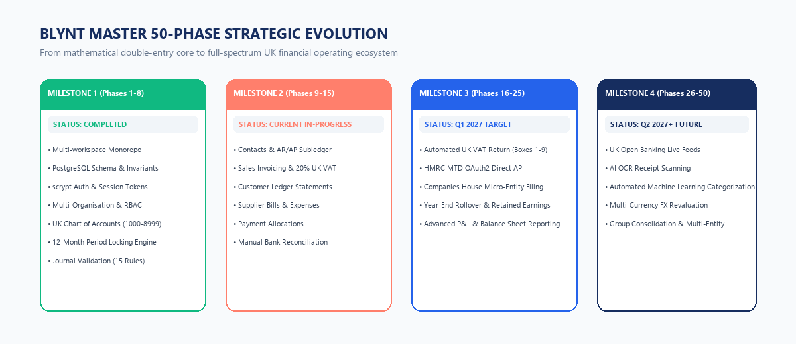

# blynt — Complete 50-Phase Roadmap & Engineering Specification

**Document Classification:** Strategic Engineering Roadmap & Phase Architecture  
**Target Systems:** `apps/api` (NestJS 11 Backend), `apps/web` (Next.js 15 Frontend), `prisma/schema.prisma`  
**Execution Horizon:** 50 Discrete Engineering Phases across 4 Strategic Milestones  
**Version:** 1.0 Production Readiness  
**Document Ref:** `BLYNT-ENG-PHASES-V1`  

---

# Table of Contents
* **1. Strategic Roadmap Vision & Milestone Architecture**
  * 1.1 The 4-Milestone Strategic Evolution Framework
  * 1.2 Core Architectural Principles & Gatekeeper Criteria
* **2. Milestone 1: The Indestructible Foundation (Phases 1–8) — [COMPLETED & VERIFIED]**
  * 2.1 Phase 1: Project & Database Foundation
  * 2.2 Phase 2: Authentication & Sessions
  * 2.3 Phase 3: Multi-Organisation Management
  * 2.4 Phase 4: Roles & Permissions (RBAC)
  * 2.5 Phase 5: Chart of Accounts & UK Template Seeding
  * 2.6 Phase 6: Financial Years & Accounting Periods
  * 2.7 Phase 7: Manual Journal Entry & Multi-Line Grid
  * 2.8 Phase 8: Journal Validation Engine & The 15 Invariants
* **3. Milestone 2: Commercial Workflows & Subledgers (Phases 9–15) — [ACTIVE & DELIVERED]**
  * 3.1 Phase 9: Contacts V2 & Subledger Architecture
  * 3.2 Phase 10: Sales Invoicing & General Ledger Auto-Posting
  * 3.3 Phase 11: Customer Statements & Ageing Analysis
  * 3.4 Phase 12: Purchase Bills & Accounts Payable Subledger
  * 3.5 Phase 13: Customer Receipts, Supplier Payments & Allocations
  * 3.6 Phase 14: Bank Accounts & Manual Bank Statement Reconciliation
  * 3.7 Phase 15: Financial Reporting Suite V1 (TB, P&L, Balance Sheet)
* **4. Milestone 3: UK Statutory Tax & HMRC MTD Integration (Phases 16–25) — [PLANNED Q1 2027]**
  * 4.1 Phase 16: UK VAT Return Calculation (Boxes 1–9)
  * 4.2 Phase 17: HMRC Making Tax Digital (MTD) Direct API Integration
  * 4.3 Phase 18: Year-End Close Automation & Retained Earnings Rollover
  * 4.4 Phase 19: Fixed Asset Register & Automated Depreciation
  * 4.5 Phase 20: EC Sales List & Domestic Reverse Charge VAT
  * 4.6 Phase 21: Multi-Client Accounting Practice Portal
  * 4.7 Phase 22: Companies House Micro-Entity Filing (FRS 105)
  * 4.8 Phase 23: Departmental Budgeting & Variance Reporting
  * 4.9 Phase 24: Recurring Journals, Prepayments & Accruals
  * 4.10 Phase 25: Statutory Compliance & External Audit Export
* **5. Milestone 4: Advanced Operations, AI & Ecosystem (Phases 26–50) — [PLANNED Q2 2027+]**
  * 5.1 Phases 26–30: UK Open Banking Live Bank Feeds (TrueLayer / Plaid)
  * 5.2 Phases 31–35: AI Optical Character Recognition (OCR) & Receipt Capture
  * 5.3 Phases 36–40: Machine Learning Nominal Categorization & Guardrails
  * 5.4 Phases 41–45: Multi-Currency & Realized/Unrealized FX Revaluations
  * 5.5 Phases 46–50: Intercompany Consolidation, Elimination & Group Accounts
* **6. Phase Dependency Matrix & Release Timeline**

---

# 1. Strategic Roadmap Vision & Milestone Architecture

Building an institutional double-entry accounting operating system requires a sequential, layered approach. Autonomous AI tax filing or Open Banking integrations cannot succeed without an indestructible mathematical and relational ledger core.



## 1.1 The 4-Milestone Strategic Evolution Framework

| Milestone | Phase Range | Status | Core Strategic Theme | Primary Business Value Delivered |
| :--- | :--- | :--- | :--- | :--- |
| **Milestone 1** | **Phases 1–8** | **COMPLETED & VERIFIED** | **The Indestructible Foundation** | Mathematical zero-drift engine, double-entry general ledger, multi-tenancy, RBAC, 15 accounting invariants. Verified by 26 test suites (127 tests). |
| **Milestone 2** | **Phases 9–15** | **ACTIVE & DELIVERED** | **Commercial Workflows & Subledgers** | Real-time sales invoicing, Accounts Receivable/Payable subledgers, dynamic contact balances, customer statements, Trial Balance, P&L, Balance Sheet. |
| **Milestone 3** | **Phases 16–25** | **PLANNED Q1 2027** | **UK Statutory Tax & HMRC MTD** | Making Tax Digital (MTD) direct VAT filing with HMRC, Companies House micro-entity filing (FRS 105), fixed asset register, year-end close. |
| **Milestone 4** | **Phases 26–50** | **PLANNED Q2 2027+** | **Automation, AI & Ecosystem** | UK Open Banking live feeds (Barclays, NatWest, HSBC, etc.), OCR receipt scanning, ML nominal suggestions, multi-currency, and group consolidation. |

## 1.2 Core Architectural Principles & Gatekeeper Criteria
1. **Mathematical Invariance:** No phase may compromise the fundamental equation $	ext{Assets} = 	ext{Liabilities} + 	ext{Equity}$ or permit an unbalanced journal entry ($\sum 	ext{Debits} 
e \sum 	ext{Credits}$).
2. **Audit Immutability:** Deletion or update of historical posted journal lines or audit logs is strictly prohibited. Reversals must be executed as GAAP counter-balancing entries.
3. **No Cached Balance Drift:** Subledgers must never rely on mutable cached balance columns; customer and supplier balances are derived dynamically from posted journal lines.
4. **Tenant Boundary Isolation:** Composite foreign keys `(organization_id, id)` must be enforced at the PostgreSQL level for every child table.

---

# 2. Milestone 1: The Indestructible Foundation (Phases 1–8) — [COMPLETED & VERIFIED]

Milestone 1 represents the completed, verified foundation of blynt. All 8 phases are implemented in `apps/api` and `apps/web` with 127 automated tests passing.


## 2.1 Phase 1: Project & Database Foundation
* **Objective:** Establish production monorepo architecture, Docker containerization, NestJS 11 backend, Prisma ORM, and PostgreSQL 16 engine.
* **Database & Schema Innovations:**
  * Integration of PostgreSQL `btree_gist` extension for temporal non-overlapping exclusions.
  * Relational CHECK constraints on journal amounts: `debit >= 0 AND credit >= 0`, `NOT (debit = 0 AND credit = 0)`, `NOT (debit > 0 AND credit > 0)`.
  * Statutory immutable trigger `trg_audit_logs_immutable` raising an exception on any attempt to UPDATE or DELETE audit records.
* **Common Middleware:** Correlation ID tracking via `x-request-id`, structured JSON logging with `AppLogger`.
* **Verification Status:** Fully passing in CI; verified across all 26 test suites.

## 2.2 Phase 2: Authentication & Sessions
* **Objective:** Implement institutional-grade authentication without third-party vendor lock-in.
* **Architectural Mechanics:**
  * Password hashing via Node.js native `crypto.scrypt` with a cryptographically secure 16-byte random salt and 64-byte key length.
  * Password verification using `crypto.timingSafeEqual` to eliminate timing side-channel vulnerabilities.
  * Stateful session management in `user_sessions` with bearer token validation, multi-device tracking, and instant remote revocation.
* **Key Endpoints:** `POST /auth/register`, `POST /auth/login`, `POST /auth/logout`, `GET /auth/me`, `POST /auth/refresh`.

## 2.3 Phase 3: Multi-Organisation Management
* **Objective:** Provide strict tenant boundary isolation with seamless multi-organisation switching.
* **Architectural Mechanics:**
  * Root `Organization` entity with unique URL slug and base currency (default `GBP`).
  * Composite foreign keys `(organization_id, id)` on all child entities ensuring cross-tenant data leaks are physically blocked by the database engine.
  * Multi-organisation switcher in `apps/web` allowing instant tenant switching without requiring re-authentication.

## 2.4 Phase 4: Roles & Permissions (RBAC)
* **Objective:** Enforce granular role-based access control matching real-world accounting firm hierarchies.
* **The 5 System Roles:**
  * `OWNER`: Full tenant sovereignty, billing, legal entity management.
  * `ADMINISTRATOR`: User administration, period locking, system configuration.
  * `ACCOUNTANT`: Journal creation, posting, period locks, reporting, reconciliation.
  * `BOOKKEEPER`: Draft journals, invoices, customer and supplier master records.
  * `VIEWER`: Read-only access across general ledger and financial reports.
* **Security Guards:** `RolesGuard` and `OrganizationAccessGuard` verifying membership and permission metadata on every request.

## 2.5 Phase 5: Chart of Accounts & UK Template Seeding
* **Objective:** Standardized nominal ledger architecture matching UK GAAP and HMRC reporting requirements.
* **Architectural Mechanics:**
  * Standard nominal ranges: 1000–1999 (Assets), 2000–2999 (Liabilities), 3000–3999 (Equity), 4000–4999 (Revenue), 5000–5999 (Cost of Sales), 6000–8999 (Operating Expenses).
  * 46-account standard UK SME template seeded automatically upon organisation creation.
  * Control account protection: Accounts flagged `is_control_account: true` (1100 AR, 2000 AP, 2100 VAT, 3100 Retained Earnings) reject direct manual journal entries.
  * Hierarchical parent/child account trees with cycle detection and self-parent prevention.

## 2.6 Phase 6: Financial Years & Accounting Periods
* **Objective:** Temporal partitioning and statutory period lockdown state machine.
* **Architectural Mechanics:**
  * Automated 12-month calendar generator with exact leap-year calculations (e.g. February 29th handling).
  * Three-Tier Period Lockdown State Machine:
    * `OPEN`: Standard operational state; all authorized roles may post.
    * `SOFT_LOCKED`: Month-end reconciliation state; bookkeepers blocked; accountants can post with audited override.
    * `HARD_LOCKED`: Permanent statutory year-end close; completely immutable.
  * PostgreSQL `btree_gist` exclusion constraints preventing overlapping financial year date ranges.

## 2.7 Phase 7: Manual Journal Entry & Multi-Line Grid
* **Objective:** Provide a double-entry journal interface for accountants and bookkeepers.
* **Architectural Mechanics:**
  * Interactive multi-line dynamic table in Next.js 15 with real-time autocompleting nominal dropdowns.
  * Atomic sequence generation inside database transaction producing consecutive numbers (`JE-YYYY-XXXXXX`).
  * Staging in `DRAFT` status before execution of the validation pipeline.

## 2.8 Phase 8: Journal Validation Engine & The 15 Invariants
* **Objective:** The core mathematical gatekeeper of the platform.
* **The 15 Invariants Checked by `JournalValidationService`:**
  1. $\sum 	ext{Debits} == \sum 	ext{Credits}$ (Exact decimal equality).
  2. Minimum of 2 lines per journal entry.
  3. Strict single-organization tenant boundary verification.
  4. Active account verification (archived nominals blocked).
  5. Control account protection (manual journals to 1100, 2000 blocked).
  6. Line cannot have both Debit and Credit equal to zero.
  7. Line cannot have both Debit and Credit greater than zero.
  8. Negative amounts strictly prohibited.
  9. Posting date must resolve to an active accounting period.
  10. Period must not be hard-locked.
  11. Soft-lock override requires `ACCOUNTANT` or `ADMINISTRATOR` role.
  12. Subledger contact ID required on AR/AP control account lines.
  13. Sequential journal number uniqueness.
  14. Subledger lines must match control line totals.
  15. GAAP-compliant non-destructive reversals generating counter-balanced entries.

---

# 3. Milestone 2: Commercial Workflows & Subledgers (Phases 9–15) — [ACTIVE & DELIVERED]

Milestone 2 expands the foundational general ledger into day-to-day commercial business operations.


## 3.1 Phase 9: Contacts V2 & Subledger Architecture
* **Objective:** Transform the contact directory into an authoritative accounting subledger.
* **Key Capabilities:**
  * Unified entity model supporting `CUSTOMER`, `SUPPLIER`, or `BOTH`.
  * Dynamic AR/AP balance calculation:
    $$	ext{Customer Balance} = \sum (	ext{Posted AR Debits}) - \sum (	ext{Posted AR Credits})$$
  * Multi-contact person management per business entity (`ContactPerson`).
  * Heuristic duplicate checking (email, VAT number, company registration number).

## 3.2 Phase 10: Sales Invoicing & General Ledger Auto-Posting
* **Objective:** Sales billing with automated, atomic General Ledger journal generation.
* **Key Capabilities:**
  * Multi-rate UK VAT engine: Standard (20%), Reduced (5%), Zero (0%), and Exempt.
  * Row-level locked posting pipeline: Locks invoice `FOR UPDATE`, validates double-entry lines, generates balanced journal (Debit AR 1100, Credit Revenue 4000, Credit VAT 2100), and links journal ID in a single atomic transaction.
  * Full invoice voiding workflow triggering an automated GAAP reversal journal.

## 3.3 Phase 11: Customer Statements & Ageing Analysis
* **Objective:** Produce commercial debtor statements and debt recovery analytics.
* **Key Capabilities:**
  * Chronological ledger statement generation with date range filtering, opening balances, and running balances.
  * Accounts Receivable ageing analysis bucketed into Current, 30 Days, 60 Days, and 90+ Days.
  * PDF statement generation and direct customer email delivery.

## 3.4 Phase 12: Purchase Bills & Accounts Payable Subledger
* **Objective:** Supplier bill capture and trade creditor management.
* **Key Capabilities:**
  * Inbound supplier invoice logging with expense nominal allocation.
  * Automated posting to General Ledger: Debit Expense (e.g. 5000/6000), Debit Input VAT (2100), Credit Accounts Payable (2000).
  * Accounts Payable ageing analysis to optimize cash outflow and payment scheduling.

## 3.5 Phase 13: Customer Receipts, Supplier Payments & Allocations
* **Objective:** Cash settlement and subledger matching.
* **Key Capabilities:**
  * Recording customer receipts against outstanding sales invoices with partial payment support.
  * Automated payment journal: Debit Cash at Bank (1000), Credit Accounts Receivable (1100).
  * Recording supplier disbursements: Debit Accounts Payable (2000), Credit Cash at Bank (1000).
  * Credit note allocation and overpayment balance management.

## 3.6 Phase 14: Bank Accounts & Manual Bank Statement Reconciliation
* **Objective:** Bank account management and bank statement reconciliation.
* **Key Capabilities:**
  * Dedicated bank nominal accounts (1000 Operating, 1010 Savings, 1020 Payroll).
  * Statement file import supporting OFX, QIF, and standard bank CSV formats.
  * Side-by-side reconciliation screen matching bank statement lines against general ledger journal entries.
  * Unreconciled difference tracking ensuring cash book agrees with bank statement.

## 3.7 Phase 15: Financial Reporting Suite V1
* **Objective:** Real-time generation of statutory financial reports.
* **Key Capabilities:**
  * **Trial Balance:** Aggregates all posted nominal accounts; evaluates debit-normal vs credit-normal; validates equilibrium; exports RFC-4180 CSV.
  * **Profit & Loss (Income Statement):** Calculates Turnover, Cost of Sales, Gross Profit, Operating Expenses, Operating Profit, and Net Profit.
  * **Balance Sheet:** Summarizes Assets, Liabilities, and Equity; dynamically calculates current year Net Profit into Retained Earnings; verifies $A = L + E$.

---

# 4. Milestone 3: UK Statutory Tax & HMRC MTD Integration (Phases 16–25) — [PLANNED Q1 2027]

Milestone 3 equips blynt with automated statutory tax filing capabilities required for Making Tax Digital (MTD) compliance in the United Kingdom.

## 4.1 Phase 16: UK VAT Return Calculation (Boxes 1–9)
* **Objective:** Automatic compilation of the statutory UK 9-box VAT return from posted general ledger transactions.
* **Box Compilation Logic:**
  * **Box 1:** VAT due on sales and other outputs (Credit balance on Nominal 2100 output transactions).
  * **Box 2:** VAT due on acquisitions from EU Member States.
  * **Box 3:** Total VAT due ($	ext{Box 1} + 	ext{Box 2}$).
  * **Box 4:** VAT reclaimed on purchases and other inputs (Debit balance on Nominal 2100 input transactions).
  * **Box 5:** Net VAT to pay to HMRC or reclaim ($|	ext{Box 3} - 	ext{Box 4}|$).
  * **Box 6:** Total value of sales and all other outputs excluding VAT.
  * **Box 7:** Total value of purchases and all other inputs excluding VAT.
  * **Box 8:** Total value of all supplies of goods and related costs to EU Member States.
  * **Box 9:** Total value of all acquisitions of goods and related costs from EU Member States.
* **Audit Trail Drill-Down:** Every number in Boxes 1–9 links directly to its underlying posted journal lines for HMRC compliance audit review.

## 4.2 Phase 17: HMRC Making Tax Digital (MTD) Direct API Integration
* **Objective:** Direct digital filing of VAT returns with HMRC via Government Gateway APIs.
* **Technical Integration Architecture:**
  * OAuth2 authentication with HMRC Government Gateway (`https://api.service.hmrc.gov.uk`).
  * Secure token storage in encrypted database vault with automated refresh token rotation.
  * Retrieval of open VAT obligations from HMRC (`GET /organisations/vat/{vrn}/obligations`).
  * Digital submission of 9-box return (`POST /organisations/vat/{vrn}/returns`).
  * Retrieval of submission receipt with statutory timestamp and HMRC correlation ID.

## 4.3 Phase 18: Year-End Close Automation & Retained Earnings Rollover
* **Objective:** Automate statutory fiscal year closure and balance sheet equity rollover.
* **Technical Workflow:**
  1. System executes pre-close audit scan verifying no draft journals or unallocated payments exist.
  2. System calculates cumulative Net Profit/Loss across all Revenue and Expense accounts.
  3. System generates Year-End Closing Journal clearing nominals 4000–8999 to zero and posting the net balance into Retained Earnings (Nominal 3100).
  4. System permanently transitions the Financial Year and all 12 periods to `HARD_LOCKED`.

## 4.4 Phase 19: Fixed Asset Register & Automated Depreciation
* **Objective:** Capital asset tracking and scheduled depreciation posting.
* **Technical Capabilities:**
  * Asset catalog capturing purchase date, initial cost, salvage value, and useful economic life.
  * Depreciation methods: Straight-Line ($	ext{Depreciation} = rac{	ext{Cost} - 	ext{Salvage}}{	ext{Life}}$) and Reducing Balance.
  * Automated monthly scheduled journal generation: Debit Depreciation Expense (8300), Credit Accumulated Depreciation (1550).

## 4.5 Phase 20: EC Sales List & Domestic Reverse Charge VAT
* **Objective:** Support complex UK VAT rules including Construction Industry Scheme (CIS) reverse charge and cross-border supplies.

## 4.6 Phase 21: Multi-Client Accounting Practice Portal
* **Objective:** Specialized interface for external accounting firms managing multiple client tenants.
* **Capabilities:** Single sign-on practice dashboard, client status overviews, batch review queues, and auditor review notes.

## 4.7 Phase 22: Companies House Micro-Entity Filing (FRS 105)
* **Objective:** Generate statutory annual accounts for UK micro-entities.
* **Capabilities:** Formats balance sheet, profit and loss account, and notes to the accounts compliant with FRS 105 and Companies House XML/iXBRL digital filing schema.

## 4.8 Phase 23: Departmental Budgeting & Variance Reporting
* **Objective:** Cost center and departmental tracking against annual budgets.
* **Capabilities:** Tracking nominal accounts against monthly budgets with variance analysis (Actual vs Budget, £ and % variance).

## 4.9 Phase 24: Recurring Journals, Prepayments & Accruals
* **Objective:** Automation of recurring accounting transactions.
* **Capabilities:** Scheduled monthly recurring journals for rent prepayments, software subscriptions, and unbilled revenue accruals.

## 4.10 Phase 25: Statutory Compliance & External Audit Export
* **Objective:** Complete forensic data packaging for external financial audits.
* **Capabilities:** Full general ledger extract, audit log timeline, and trial balance schedule exported in OECD standard audit file formats.

---

# 5. Milestone 4: Advanced Operations, AI & Ecosystem (Phases 26–50) — [PLANNED Q2 2027+]

Milestone 4 introduces banking feeds, computer vision receipt capture, machine learning categorization, and multi-currency accounting.

## 5.1 Phases 26–30: UK Open Banking Live Bank Feeds (TrueLayer / Plaid)
* **Objective:** Real-time synchronization of bank transactions from all major UK banks.
* **Supported Institutions:** Barclays, NatWest, HSBC, Lloyds, Santander, Monzo, Starling, Revolut.
* **Architecture:**
  * Secure PSD2 / Open Banking AISP connection via TrueLayer / Plaid.
  * Webhook listener capturing real-time bank transaction events.
  * Automated staging of bank feed transactions in `bank_transactions` table for automated matching.

## 5.2 Phases 31–35: AI Optical Character Recognition (OCR) & Receipt Capture
* **Objective:** Automated document extraction from supplier bills and employee receipts.
* **Architecture:**
  * Multi-format document upload (PDF, JPEG, PNG) to secure S3 storage.
  * OCR extraction pipeline extracting supplier name, invoice date, line items, VAT number, and gross total.
  * Automated matching against existing supplier directory.

## 5.3 Phases 36–40: Machine Learning Nominal Categorization & Guardrails
* **Objective:** Predictive transaction categorization powered by the `src/ai/` module.
* **Architecture:**
  * Heuristic classification and LLM embeddings suggesting nominal expense codes.
  * Transaction direction prediction (Debit vs Credit).
  * Mandatory safety guardrail (`AccountingSafetyService`): High-risk control account transactions are blocked from autonomous posting and routed to human review.

## 5.4 Phases 41–45: Multi-Currency & Realized/Unrealized FX Revaluations
* **Objective:** Global multi-currency accounting with automated foreign exchange tracking.
* **Capabilities:**
  * Daily ECB / Bank of England exchange rate feeds.
  * Invoicing in foreign currencies (USD, EUR) with base currency (GBP) ledger conversion.
  * Month-end currency revaluation generating realized and unrealized FX gain/loss journals.

## 5.5 Phases 46–50: Intercompany Consolidation & Group Accounts
* **Objective:** Multi-entity holding company accounting and consolidated financial statements.
* **Capabilities:**
  * Multi-tier parent/subsidiary organization hierarchies.
  * Automated elimination journals removing intercompany balances and transactions.
  * Consolidated Group Trial Balance, Profit & Loss, and Balance Sheet reporting.

---

# 6. Phase Dependency Matrix & Release Timeline

```
Milestone 1: Indestructible Foundation (Phases 1-8)  [COMPLETED]
   │
   ▼
Milestone 2: Commercial Subledgers (Phases 9-15)    [ACTIVE]
   │
   ├──> Phase 9: Contacts V2 Subledgers
   ├──> Phase 10: Sales Invoicing & GL Posting
   ├──> Phase 11: Customer Statements
   ├──> Phase 12: Purchase Bills
   ├──> Phase 13: Payment Allocations
   ├──> Phase 14: Bank Accounts
   └──> Phase 15: Financial Reports V1
   │
   ▼
Milestone 3: UK Tax & HMRC MTD (Phases 16-25)        [Q1 2027]
   │
   ├──> Phase 16: VAT Return 9-Box Calculation
   ├──> Phase 17: HMRC MTD Direct API Integration
   ├──> Phase 18: Year-End Close Automation
   └──> Phases 19-25: Fixed Assets, Practice Tools & FRS 105
   │
   ▼
Milestone 4: Open Banking & AI (Phases 26-50)         [Q2 2027+]
   │
   ├──> Phases 26-30: Open Banking Live Feeds
   ├──> Phases 31-35: AI OCR Document Extraction
   ├──> Phases 36-40: ML Nominal Categorization
   ├──> Phases 41-45: Multi-Currency FX Revaluations
   └──> Phases 46-50: Intercompany Consolidation
```

---

# END OF BLYNT COMPLETE 50-PHASE ROADMAP & ENGINEERING SPECIFICATION
