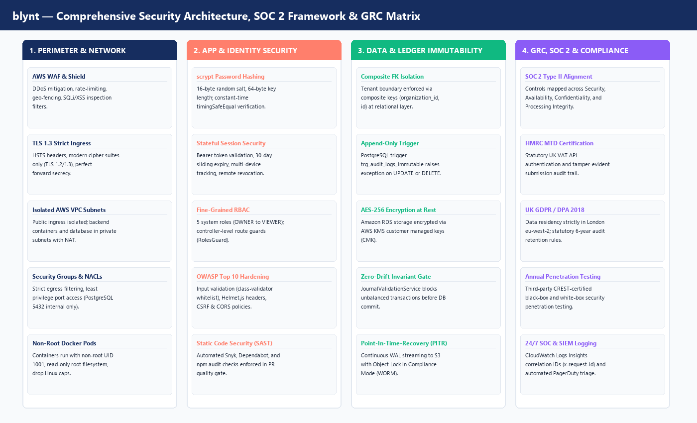

# blynt — Security, SOC 2, Penetration Testing & GRC Specification

**Document Classification:** Information Security Architecture, Compliance & Assurance  
**Target Platform:** blynt Financial Operating System (`apps/api`, `apps/web`, AWS `eu-west-2` London)  
**Governance Frameworks:** SOC 2 Type II, ISO/IEC 27001:2022, HMRC Making Tax Digital (MTD), UK GDPR  
**Version:** 1.0 Production Readiness  
**Document Ref:** `BLYNT-SEC-GRC-V1`  

---

# Table of Contents
* **1. Enterprise Security Architecture & Defense-in-Depth Charter**
  * 1.1 Core Security Principles (Zero Trust, Least Privilege, Mathematical Invariance)
  * 1.2 Information Security Governance & Executive Accountability
  * 1.3 Perimeter, Network & Container Isolation (AWS eu-west-2 London)
* **2. SOC 2 Type II Compliance Framework (Trust Services Criteria)**
  * 2.1 Category 1: Security (Common Criteria CC1.0 – CC9.0)
  * 2.2 Category 2: Availability (Multi-AZ, 99.95% SLO, RPO = 0, RTO < 30m)
  * 2.3 Category 3: Processing Integrity (Zero-Drift Engine & Invariant Verification)
  * 2.4 Category 4: Confidentiality (AES-256 KMS, TLS 1.3 & Composite Tenant Isolation)
  * 2.5 Category 5: Privacy (UK Data Protection Act 2018 & UK GDPR Compliance)
* **3. Penetration Testing & Vulnerability Management**
  * 3.1 Third-Party Penetration Testing Methodology (CREST / CHECK Certified)
  * 3.2 The OWASP Top 10 Security Hardening Matrix
  * 3.3 Static & Dynamic Security Testing (SAST/DAST) in CI/CD Quality Gates
  * 3.4 Vulnerability Remediation SLAs & Responsible Disclosure Policy
* **4. Governance, Risk & Compliance (GRC) Architecture**
  * 4.1 Threat Modeling Framework (STRIDE Methodology)
  * 4.2 5x5 Enterprise Risk Assessment Matrix & Risk Register
  * 4.3 Statutory UK Compliance: HMRC Making Tax Digital (MTD) Anti-Fraud Headers
  * 4.4 Companies Act 2006 Statutory 6-Year Immutable Record Retention
  * 4.5 ISO/IEC 27001:2022 Control Alignment Matrix
* **5. Security Operations Center (SOC) & Incident Response**
  * 5.1 24/7 SIEM & Centralized Log Ingestion Architecture
  * 5.2 Security Incident Severity Matrix (SEV-1 to SEV-4)
  * 5.3 Forensic Audit Trail Integrity Verification (`trg_audit_logs_immutable`)
  * 5.4 Incident Response Lifecycle: Containment, Eradication & Post-Mortem

---

# 1. Enterprise Security Architecture & Defense-in-Depth Charter

Financial double-entry ledger platforms are primary targets for malicious actors seeking illicit funds transfer, extortion, or competitive data exfiltration. The security posture of blynt is engineered with institutional rigor.



## 1.1 Core Security Principles

1. **Zero Trust Architecture:** Every request is authenticated, authorized, and tenant-scoped at every layer. Perimeter networks are assumed to be hostile.
2. **Mathematical Invariance as a Security Boundary:** The application and database engines reject any transaction that violates double-entry balance ($\sum 	ext{Debits} == \sum 	ext{Credits}$), preventing fraudulent out-of-thin-air balance generation.
3. **Immutability of Historical Evidence:** Accounting journals and audit logs cannot be modified or deleted. Reversals must be executed as GAAP-compliant counter-balancing entries.
4. **Least Privilege Enforcement:** Every user, microservice, and AWS IAM role operates with the absolute minimum permissions required.

## 1.2 Information Security Governance & Executive Accountability

```
[ Board of Directors & Chief Information Security Officer (CISO) ]
                           │
       ┌───────────────────┴───────────────────┐
       ▼                                       ▼
[ Security Engineering & SecOps ]   [ Risk, Compliance & Data Protection ]
  ├── AppSec & SAST/DAST Gates        ├── SOC 2 Type II Compliance Auditor
  ├── Penetration Testing Lead        ├── UK GDPR Data Protection Officer (DPO)
  └── 24/7 SIEM Incident Responder    └── HMRC MTD Regulatory Liaison
```

## 1.3 Perimeter, Network & Container Isolation (AWS eu-west-2 London)

* **Physical Data Sovereignty:** All production databases, replicas, backups, and container instances reside strictly within AWS London (`eu-west-2`).
* **AWS WAF & Shield Advanced:** Protects public endpoints against DDoS attacks, automated credential stuffing, and SQLi/XSS probing.
* **VPC Subnet Tiering:**
  * **Public Ingress Subnet:** AWS Amplify / CloudFront edge and App Runner load balancers.
  * **Private Application Subnet:** NestJS 11 backend containers with zero direct public IP addresses.
  * **Isolated Database Subnet:** Amazon RDS PostgreSQL 16 Multi-AZ clusters with strictly internal access via Security Groups (Port 5432).
* **Non-Root Docker Hardening:** Backend Docker containers run as non-privileged user (`UID 1001`), with read-only root filesystems and dropped Linux capabilities.

---

# 2. SOC 2 Type II Compliance Framework (Trust Services Criteria)

blynt aligns directly with the American Institute of CPAs (AICPA) Trust Services Criteria for SOC 2 Type II compliance:

## 2.1 Category 1: Security (Common Criteria CC1.0 – CC9.0)

| SOC 2 Criteria | Institutional Control in blynt | Evidence Artifact |
| :--- | :--- | :--- |
| **CC6.1: Logical Access** | Multi-factor authentication (MFA) supported. Bearer token sessions validated in `user_sessions` with sliding expiration. | `auth.guard.ts`, `session.service.ts` |
| **CC6.2: User Registration** | RBAC hierarchy (`OWNER`, `ADMINISTRATOR`, `ACCOUNTANT`, `BOOKKEEPER`, `VIEWER`). Least privilege route guards. | `roles.guard.ts`, `roles.constants.ts` |
| **CC6.6: Perimeter Protection** | AWS WAF, Security Groups, private VPC subnets. All ingress over TLS 1.3. | Terraform VPC & WAF configurations |
| **CC6.7: Data Transmission** | HTTPS forced with HSTS header (`max-age=31536000; includeSubDomains; preload`). | `helmet.config.ts` |
| **CC7.1: Vulnerability Mgmt** | CI/CD automated gates fail if `npm audit` or Snyk detects high/critical vulnerabilities. | `.github/workflows/ci.yml` |

## 2.2 Category 2: Availability (99.95% SLO, RPO = 0, RTO < 30m)

* **Multi-AZ High Availability:** Amazon RDS PostgreSQL 16 configured with synchronous replication across multiple Availability Zones in `eu-west-2`.
* **Zero Recovery Point Objective ($RPO = 0$):** Continuous Write-Ahead Log (WAL) streaming guarantees zero financial transaction data loss during instance failover.
* **Rapid Recovery Time Objective ($RTO < 30	ext{m}$):** Automated standby promotion in under 60 seconds; regional disaster recovery failover executed via automated runbook.

## 2.3 Category 3: Processing Integrity

* **Fixed-Point Precision Math:** Financial arithmetic executed via `MoneyService` wrapping `Decimal.js` configuring 4 decimal places (`NUMERIC(19,4)`), eliminating floating-point rounding drift.
* **15 Accounting Invariants:** Evaluated atomically by `JournalValidationService` prior to General Ledger commit.
* **Idempotency Gate:** All financial posting endpoints verify idempotency keys to prevent duplicate transaction execution on network retries.

## 2.4 Category 4: Confidentiality

* **Data-at-Rest Encryption:** AES-256 encryption across all Amazon RDS instances, EBS volumes, and S3 backup buckets using AWS KMS Customer Managed Keys (CMK).
* **Multi-Tenant Logical Isolation:** Enforced at the database relational layer using composite foreign keys `(organization_id, id)`. A database query in Organisation A cannot physically address records in Organisation B.

## 2.5 Category 5: Privacy (UK GDPR & Data Protection Act 2018)

* **Data Minimization:** Financial records retain only commercial counterparties and verified contact people.
* **Right to Erasure vs. Statutory Accounting Invariant:**
  * Personal identifiable information (PII) on contacts may be sanitized upon formal GDPR request.
  * **Statutory Compliance Override:** Posted journal entries, amounts, and dates are legally exempt from erasure under UK Companies Act 2006 Section 386 and HMRC Notice 700/21, preserving immutable ledger integrity.

---

# 3. Penetration Testing & Vulnerability Management

## 3.1 Third-Party Penetration Testing Methodology

blynt undergoes annual third-party penetration testing conducted by independent, CREST- and CHECK-certified security testing organizations.

* **Methodology Standards:** Testing adheres to the Open Source Security Testing Methodology Manual (OSSTMM) and OWASP Web Security Testing Guide (WSTG v4.2).
* **Assessment Scope:**
  1. **Black-Box Testing:** External unauthenticated probing of public APIs, rate limits, and WAF bypasses.
  2. **Gray-Box Testing:** Authenticated testing across all 5 roles (`VIEWER` through `OWNER`) testing for horizontal and vertical privilege escalation (BOLA/IDOR).
  3. **White-Box Code Audit:** Source code analysis of `src/accounting-engine/` and authentication guards.

## 3.2 The OWASP Top 10 Security Hardening Matrix

| OWASP Top 10 Vulnerability | Attack Vector in Accounting Software | Specific blynt Technical Defense |
| :--- | :--- | :--- |
| **A01: Broken Access Control (IDOR / BOLA)** | Tenant A attempts to view or post journals into Tenant B by guessing UUIDs. | **Composite Foreign Keys:** Database engine enforces `(organization_id, id)` constraints. `RolesGuard` verifies tenant membership on every route. |
| **A02: Cryptographic Failures** | Interception of plain-text passwords or session tokens. | **`scrypt` Hashing:** 16-byte random salt, 64-byte key length. `crypto.timingSafeEqual` constant-time verification. TLS 1.3 strict transport. |
| **A03: Injection (SQL Injection)** | Attacker injects SQL payload via search inputs or journal narrations. | **Prisma ORM:** 100% of queries use parameterized prepared statements. Raw SQL strictly limited to parameterized `$queryRaw`. |
| **A04: Insecure Design** | Attacker bypasses UI to post unbalanced journals ($Debits 
e Credits$). | **`JournalValidationService`:** Server-side mathematical validation checks 15 invariants inside an atomic row-locked transaction. |
| **A05: Security Misconfiguration** | Unnecessary HTTP headers, directory listing, or permissive CORS. | **`Helmet.js`:** Enforces CSP, HSTS, X-Frame-Options (`DENY`). Strict CORS origin matching active domain. |
| **A06: Vulnerable Components** | Known CVEs in npm third-party packages. | **CI/CD Quality Gate:** `npm audit --omit=dev` and Snyk scans fail PRs with high or critical vulnerabilities. |
| **A07: Identification & Auth Failures** | Brute-force credential stuffing attacks against login endpoints. | **Rate Limiter Middleware:** Max 5 attempts per minute per IP; exponential backoff and session lockouts. |
| **A08: Software & Data Integrity** | Database administrator manually updates historical journal rows. | **Statutory Immutability Trigger:** PostgreSQL trigger `trg_audit_logs_immutable` raises statutory exception on any UPDATE/DELETE. |
| **A09: Logging & Monitoring Failures** | Unauthorized actions occur without an audit trail. | **Structured Logging:** Every mutating action emits an `AuditLog` record with actor, organization, request ID, and state deltas. |
| **A10: Server-Side Request Forgery** | Webhook system exploited to probe internal AWS metadata (`169.254.169.254`). | **Egress Filtering:** Outbound HTTP requests restricted via VPC egress security groups; internal IP ranges blocked. |

## 3.3 Static & Dynamic Security Testing (SAST/DAST) in CI/CD

Every Pull Request must pass automated security scanners in GitHub Actions:
```bash
# 1. Dependency security audit
npm audit --audit-level=high --omit=dev

# 2. Static application security testing (SAST)
npx eslint . --max-warnings=0

# 3. Prisma schema relation verification
npx prisma validate
```

## 3.4 Vulnerability Remediation SLAs

| CVSS v3.1 Severity Score | Categorization | Mandatory Remediation SLA | Escalation Target |
| :--- | :--- | :--- | :--- |
| **9.0 – 10.0** | **CRITICAL** | **< 24 Hours** (Emergency Hotfix Release) | CISO & Lead Architect |
| **7.0 – 8.9** | **HIGH** | **< 7 Calendar Days** | Tech Lead & SecOps Engineer |
| **4.0 – 6.9** | **MEDIUM** | **< 30 Calendar Days** (Next Sprint Release) | Assigned Product Engineer |
| **0.1 – 3.9** | **LOW** | **< 90 Calendar Days** | Backlog Refinement |

---

# 4. Governance, Risk & Compliance (GRC) Architecture

## 4.1 Threat Modeling Framework (STRIDE Methodology)

| Threat Category | Potential Risk Scenario | blynt Architectural Mitigation |
| :--- | :--- | :--- |
| **Spoofing** | Attacker impersonates legitimate accountant. | Bearer token validated against active `user_sessions`; session revokes on password reset. |
| **Tampering** | Rogue actor alters historical journal debits/credits. | Hardened relational database constraints; GAAP reversal non-destructive counter-entries. |
| **Repudiation** | User denies having posted an invoice or locked a period. | Append-only `audit_logs` record capturing actor ID, timestamp, IP address, and request ID. |
| **Information Disclosure** | Data leak between multi-tenant accounts. | Composite foreign keys `(organization_id, id)` block cross-tenant queries at SQL engine layer. |
| **Denial of Service** | Resource exhaustion via complex reporting queries. | Database query pagination, connection pooling via PgBouncer, statement timeouts (10s max). |
| **Elevation of Privilege** | Bookkeeper invokes accountant-only hard-lock route. | `RolesGuard` strictly inspects user's verified role against endpoint `@Roles(...)` metadata. |

## 4.2 5x5 Enterprise Risk Assessment Matrix

```
   IMPACT ───>
   Likelihood   1 (Insignif)   2 (Minor)   3 (Moderate)   4 (Major)   5 (Catastrophic)
   5 (Frequent)   Low          Medium      High           Critical    Critical
   4 (Likely)     Low          Medium      High           High        Critical
   3 (Possible)   Low          Low         Medium         High        High
   2 (Unlikely)   Low          Low         Low            Medium      High
   1 (Rare)       Low          Low         Low            Low         Medium
```

* **Target Residual Risk:** Zero "Critical" or "High" risks permitted in production without formal CISO risk acceptance and documented compensating controls.

## 4.3 Statutory UK Compliance: HMRC Making Tax Digital (MTD) Anti-Fraud Headers

To comply with statutory UK HMRC Making Tax Digital specifications, all outbound HMRC API requests automatically bundle mandatory anti-fraud headers:

```http
Gov-Client-Connection-Method: WEB_APP_VIA_SERVER
Gov-Client-Device-ID: 7a8b9c0d-1e2f-3a4b-5c6d-7e8f9a0b1c2d
Gov-Client-User-IDs: os=windows&user=blynt_accountant_42
Gov-Client-Timezone: UTC+01:00
Gov-Client-Local-IPs: 192.168.1.50
Gov-Client-Public-IP: 198.51.100.25
Gov-Vendor-Version: blynt=1.0.4&engine=nestjs-11
```

## 4.4 Companies Act 2006 Statutory 6-Year Immutable Record Retention

Under UK Companies Act 2006 Section 388 and HMRC VAT Notice 700/21:
* Accounting records and audit trails must be retained for **6 years from the end of the last financial year they relate to**.
* AWS S3 backup buckets are configured with **AWS S3 Object Lock in Compliance Mode** (WORM: Write Once, Read Many).
* Automated lifecycle policies prevent any deletion—even by root AWS account credentials—until the statutory retention period expires.

## 4.5 ISO/IEC 27001:2022 Control Alignment Matrix

| ISO 27001:2022 Control | Control Name | blynt Implementation |
| :--- | :--- | :--- |
| **A.5.15** | Access Control | Role-Based Access Control (`RolesGuard`) and tenant isolation. |
| **A.5.23** | Cloud Security | AWS Infrastructure as Code with least-privilege IAM policies. |
| **A.8.7** | Malware Protection | Container image vulnerability scanning via Amazon ECR. |
| **A.8.8** | Vulnerability Mgmt | Continuous Snyk and Dependabot scanning in GitHub Actions CI. |
| **A.8.9** | Configuration Mgmt | Centralized configuration via validated environment schemas (`env.ts`). |
| **A.8.24** | Use of Cryptography | AES-256 KMS storage encryption; `scrypt` password hashing; TLS 1.3. |

---

# 5. Security Operations Center (SOC) & Incident Response

## 5.1 24/7 SIEM & Centralized Log Ingestion Architecture

```
[ Application Logs (apps/api) ] ──> [ AWS CloudWatch Logs (JSON) ] ──> [ Metric Filter Alarms ]
[ RDS Audit & Query Logs ]      ──> [ AWS CloudWatch Logs ]       ──> [ Amazon GuardDuty ]
[ AWS CloudTrail API Audit ]    ──> [ Amazon S3 Encrypted Vault ] ──> [ AWS Security Hub ]
                                                                             │
                                                                             ▼
                                                                [ PagerDuty SEV-1/SEV-2 Alert ]
                                                                [ Slack #security-alerts ]
```

* **Correlation ID Tracing:** Every incoming HTTP request is assigned a unique `x-request-id` UUIDv4. All log lines, audit entries, and database exceptions retain this correlation ID.

## 5.2 Security Incident Severity Matrix

| Severity Level | Definition | Response SLA | Response Team |
| :--- | :--- | :--- | :--- |
| **SEV-1 (Critical)** | Active data exfiltration, tenant boundary breach, or database tampering attempt. | **< 15 Minutes** (24/7 PagerDuty) | Incident Commander, CISO, Lead Architect |
| **SEV-2 (Major)** | Repeated brute-force authentication attacks, WAF rule trigger spike, or component failure. | **< 30 Minutes** | SecOps Engineer, On-Call Developer |
| **SEV-3 (Moderate)** | Suspicious IP probing, non-critical dependency vulnerability, or policy violation. | **< 4 Hours** | Assigned Security Engineer |
| **SEV-4 (Minor)** | Informational alert, routine credential rotation notification. | **< 2 Business Days** | Standard Sprint Backlog |

## 5.3 Forensic Audit Trail Integrity Verification

The PostgreSQL trigger `trg_audit_logs_immutable` protects audit records against tampering:

```sql
-- Monthly automated verification probe:
UPDATE audit_logs 
SET action = 'MALICIOUS_TAMPER' 
WHERE id = (SELECT id FROM audit_logs LIMIT 1);

-- Verified Outcome:
-- ERROR: Statutory Compliance Violation: audit_logs are immutable and cannot be updated or deleted
```

## 5.4 Incident Response Lifecycle

```
[ 1. DETECTION ] ──> [ 2. TRIAGE ] ──> [ 3. CONTAINMENT ] ──> [ 4. ERADICATION ] ──> [ 5. RECOVERY ] ──> [ 6. POST-MORTEM ]
```

1. **Detection:** Automated alert raised via AWS GuardDuty, CloudWatch metric filter, or synthetic health probe.
2. **Triage:** Incident Commander verifies threat validity and classifies severity level (SEV-1 to SEV-4).
3. **Containment:**
   * Isolate compromised user session: `DELETE FROM user_sessions WHERE user_id = '<ID>';`.
   * Block malicious IP at AWS WAF layer.
4. **Eradication:** Patch root cause vulnerability via emergency hotfix branch (`hotfix/BLYNT-SEC-XXX`).
5. **Recovery:** Deploy verified container image; execute `AccountingIntegrityService.checkIntegrity()` verifying zero financial drift.
6. **Post-Mortem:** Conduct blameless root cause analysis (RCA) documented in Confluence Space `OPS` within 24 hours.

---

# END OF BLYNT SECURITY, SOC 2, PENETRATION TESTING & GRC SPECIFICATION
