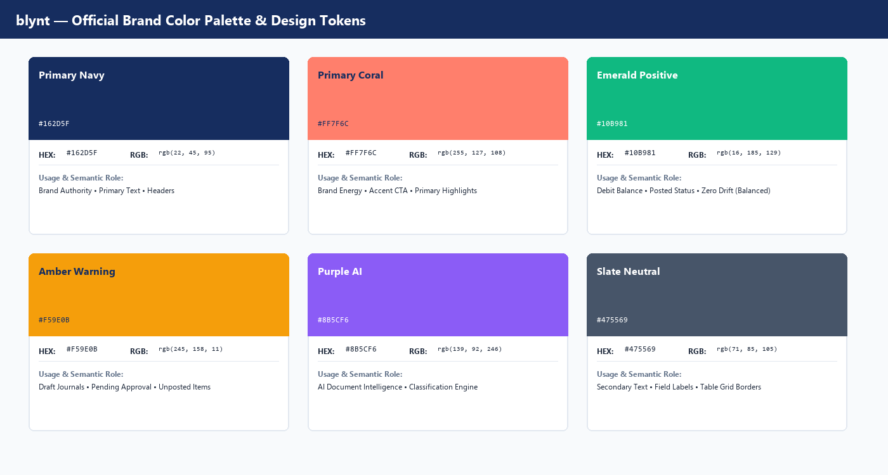
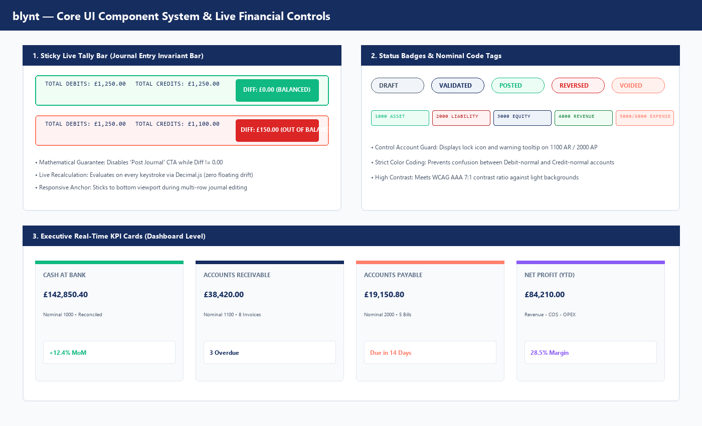

# blynt — UI Design System, Brand Guidelines & Logo Specification

**Document Classification:** Brand Identity, Frontend Architecture & Design System  
**Target Systems:** `apps/web` (Next.js 15 Web Application), Marketing Deliverables, PDF Reports, Presentation Decks  
**Version:** 1.0 Production Readiness  
**Document Ref:** `BLYNT-DS-LOGO-V1`  

---

# Table of Contents
* **1. Brand Identity & Logo System**
  * 1.1 Brand Story & Core Design Philosophy
  * 1.2 The Official Logo Mark: Anatomy & Geometry
  * 1.3 Logo Lockups: Standalone Mark, Horizontal Logo & Favicon
  * 1.4 Clear Space & Minimum Sizing Rules
  * 1.5 Brand Misuse & Guardrails (Do's and Don'ts)
* **2. Color Palette & Design Tokens**
  * 2.1 The Official Color Palette
  * 2.2 Color Tokens & Semantic Roles
  * 2.3 Accessibility & WCAG Contrast Compliance
  * 2.4 Dark Mode vs. Light Mode Palette Architecture
* **3. Typography System**
  * 3.1 Primary Font Family (Inter / Segoe UI)
  * 3.2 Monospace Financial Tabular Numbers (Consolas / JetBrains Mono)
  * 3.3 The blynt Type Scale Hierarchy
* **4. Core Financial UI Component Library**
  * 4.1 Sticky Live Tally Bar (The Real-Time Invariant Bar)
  * 4.2 Status Badges & Accounting Tags
  * 4.3 Executive KPI Metric Cards
  * 4.4 Financial Data Grids & Table Specifications
  * 4.5 Multi-Row Dynamic Journal Entry Editor
* **5. Application Shell & View Layouts**
  * 5.1 App Shell, Navigation Sidebar & Multi-Tenant Switcher
  * 5.2 Real-Time Executive Dashboard
  * 5.3 Commercial Invoicing & Subledger Statement Workspace
  * 5.4 Interactive Financial Reports Suite

---

# 1. Brand Identity & Logo System

The blynt brand represents the intersection of **institutional accounting precision** and **modern, effortless financial clarity**.


## 1.1 Brand Story & Core Design Philosophy

Traditional accounting software (Sage, Xero, QuickBooks) is plagued by visual clutter, outdated skeuomorphism, and disconnected tables that confuse business owners and slow down accountants.

The visual ethos of **`blynt`** is built upon three foundational pillars:
1. **Calm Authority:** Deep Navy (`#162D5F`) communicates institutional trustworthiness, fiduciary stability, and audit-grade durability.
2. **Dynamic Energy:** Vibrant Coral (`#FF7F6C`) signals modern speed, agile interaction, and intelligent action.
3. **Mathematical Precision:** Zero clutter, pure geometry, and tabular alignment that make financial anomalies instantly visible.

## 1.2 The Official Logo Mark: Anatomy & Geometry

The official `blynt` mark is a custom geometric monogram representing the letter **'b'**, split into two complementary interlocking shapes:

* **The Upper Arch (Coral `#FF7F6C`):** A smooth, rounded cantilever representing forward motion, cloud intelligence, and commercial growth.
* **The Foundation Base (Navy `#162D5F`):** A sturdy, solid diagonal base representing the general ledger, double-entry equilibrium, and rock-solid compliance.
* **The Optical Bridge:** A crisp 16px white negative space channel separating the two shapes, symbolizing transparency and the balance between debits and credits.

## 1.3 Logo Lockups: Standalone Mark, Horizontal Logo & Favicon


| Lockup Variant | File Asset | Usage Context | Recommended Minimum Width |
| :--- | :--- | :--- | :--- |
| **Standalone Mark** | `blynt-logo.png` | App launcher, avatar, cover pages, mobile header, social icons | **24px** (Digital) / **8mm** (Print) |
| **Horizontal Lockup** | `blynt-logo-horizontal.png` | Navigation header, invoice headers, PDF report banners | **120px** (Digital) / **35mm** (Print) |
| **Square Web Favicon** | `favicon.svg` | Browser tab icon, PWA manifest (16x16, 32x32, 192x192) | **16px** (Display) |
| **Monochrome Dark** | `brand/blynt-logo-dark.svg` | Dark mode application navigation bar | **120px** (Digital) |

## 1.4 Clear Space & Minimum Sizing Rules

```
       ┌──────────────────────────────────────────────────┐
       │                      [ X ]                       │
       │         ┌──────────────────────────────┐         │
       │   [ X ] │     ( b )     blynt          │  [ X ]  │
       │         └──────────────────────────────┘         │
       │                      [ X ]                       │
       └──────────────────────────────────────────────────┘
```

* **The Clear Space Rule ('X'):** The minimum exclusion zone surrounding the logo is defined as **`X`**, where `X` equals half the total height of the mark. No typography, buttons, borders, or page edges may encroach into this exclusion zone.
* **Minimum Digital Sizes:**
  * Mark Only: Never render below **20 x 20 pixels**.
  * Horizontal Lockup: Never render below **100 x 30 pixels**.
* **Minimum Print Sizes:**
  * Mark Only: **8mm x 10mm**.
  * Horizontal Lockup: **30mm x 10mm**.

## 1.5 Brand Misuse & Guardrails (Do's and Don'ts)

| Prohibited Misuse | Why It Is Forbidden | Mandatory Correction |
| :--- | :--- | :--- |
| **DO NOT rotate or tilt the logo** | Destroys the optical balance of the double-entry base. | Always present horizontally at 0° angle. |
| **DO NOT alter the brand colors** | Weakens brand recognition. | Strictly use Coral `#FF7F6C` and Navy `#162D5F`. |
| **DO NOT add heavy drop shadows** | Violates the flat, modern fintech aesthetic. | Use clean flat SVG rendering or subtle border. |
| **DO NOT stretch, condense or distort** | Distorts the geometric curve radii. | Constrain aspect ratio proportionally (1:1 mark). |
| **DO NOT capitalize the wordmark** | The brand name is strictly lowercase **"blynt"**. | Render exclusively in lowercase bold Segoe UI / Inter. |

---

# 2. Color Palette & Design Tokens



## 2.1 The Official Color Palette

The blynt color system is strictly curated to balance statutory legibility with modern digital energy:

| Color Name | HEX Code | RGB | HSL | CMYK (Print) | Semantic Usage |
| :--- | :--- | :--- | :--- | :--- | :--- |
| **Primary Navy** | `#162D5F` | `22, 45, 95` | `221°, 62%, 23%` | `77, 53, 0, 63` | Brand Authority, Table Headers, Primary Text, 3000 Equity Accounts |
| **Primary Coral** | `#FF7F6C` | `255, 127, 108` | `8°, 100%, 71%` | `0, 50, 58, 0` | Brand Accents, Primary CTA Buttons, Highlights, 5000/6000 Expenses |
| **Emerald Positive** | `#10B981` | `16, 185, 129` | `160°, 84%, 39%` | `91, 0, 30, 27` | Debit Balances, Asset Accounts (1000), Balanced State ($\Delta = 0$), Paid |
| **Amber Warning** | `#F59E0B` | `245, 158, 11` | `38°, 92%, 50%` | `0, 36, 96, 4` | Draft Status, Soft-Locked Periods, Pending Approval, Overdue Warnings |
| **Purple AI** | `#8B5CF6` | `139, 92, 246` | `258°, 90%, 66%` | `43, 63, 0, 3` | AI Document Intelligence, OCR Suggestions, Automated Categorization |
| **Slate Neutral** | `#475569` | `71, 85, 105` | `215°, 19%, 35%` | `32, 19, 0, 59` | Secondary Body Text, Meta Labels, Table Row Borders, Inactive Elements |
| **Surface Light** | `#F8FAFC` | `248, 250, 252` | `210°, 40%, 98%` | `2, 1, 0, 1` | Primary Application Background, Alternating Table Rows |
| **Border Gray** | `#E2E8F0` | `226, 232, 240` | `214°, 32%, 91%` | `6, 3, 0, 6` | Component Borders, Table Gridlines, Card Dividers |

## 2.2 CSS Design Tokens (`apps/web/src/app/globals.css`)

```css
:root {
  /* Brand Core Tokens */
  --brand-navy: #162D5F;
  --brand-coral: #FF7F6C;
  --brand-navy-tint: #EEF2F9;
  --brand-coral-tint: #FFF1EE;

  /* Functional Status Tokens */
  --color-success: #10B981;
  --color-success-bg: #ECFDF5;
  --color-warning: #F59E0B;
  --color-warning-bg: #FFFBEB;
  --color-danger: #EF4444;
  --color-danger-bg: #FEF2F2;
  --color-ai: #8B5CF6;
  --color-ai-bg: #F5F3FF;

  /* Neutral Surface Tokens */
  --bg-page: #F8FAFC;
  --bg-card: #FFFFFF;
  --bg-card-hover: #F1F5F9;
  --border-subtle: #E2E8F0;
  --text-primary: #162D5F;
  --text-secondary: #475569;
  --text-muted: #94A3B8;

  /* Typography */
  --font-sans: 'Inter', system-ui, -apple-system, sans-serif;
  --font-mono: 'Consolas', 'JetBrains Mono', monospace;
}
```

## 2.3 Accessibility & WCAG Contrast Compliance

All color combinations in blynt meet or exceed **WCAG 2.1 Level AAA and AA** criteria:
* **Navy (`#162D5F`) on White (`#FFFFFF`):** Contrast ratio of **14.8 : 1** (Exceeds AAA requirement of 7:1).
* **Navy (`#162D5F`) on Surface Light (`#F8FAFC`):** Contrast ratio of **14.1 : 1** (AAA compliant).
* **Coral CTA (`#FF7F6C`) with Navy Text (`#162D5F`):** Contrast ratio of **4.9 : 1** (AA compliant for buttons).
* **Emerald Text (`#065F46`) on Success BG (`#ECFDF5`):** Contrast ratio of **7.6 : 1** (AAA compliant).

---

# 3. Typography System

Financial software demands absolute numeric legibility. Misaligned numbers cause severe reporting errors.

## 3.1 Primary Font Family: Inter / Segoe UI
* **Usage:** Navigation, headings, card titles, form labels, general body copy.
* **Attributes:** Tall x-height, open apertures, distinct letterforms (e.g., distinguishing 'I', 'l', and '1').

## 3.2 Monospace Financial Tabular Numbers
* **Usage:** General Ledger amounts, debit/credit columns, invoice totals, account codes.
* **Font Family:** `Consolas`, `JetBrains Mono`, or `Inter` with `font-feature-settings: "tnum" 1`.
* **Guarantee:** Every numeral (`0` to `9`) occupies the exact same horizontal width (fixed-pitch). Decimal points align vertically without drifting.

## 3.3 The blynt Type Scale Hierarchy

| Style Token | Font Size | Line Height | Weight | Tracking | Primary Usage |
| :--- | :--- | :--- | :--- | :--- | :--- |
| **Display 1** | **38px** (2.375rem) | 48px | Bold (700) | -0.025em | Document Covers, Large KPI Totals |
| **Heading 1** | **24px** (1.5rem) | 32px | Bold (700) | -0.02em | Main Page Titles, Module Banners |
| **Heading 2** | **18px** (1.125rem) | 26px | Semi-Bold (600) | -0.01em | Card Headers, Modal Titles, Section Dividers |
| **Heading 3** | **14px** (0.875rem) | 20px | Semi-Bold (600) | 0.0em | Table Column Headers, Form Group Titles |
| **Body 1** | **14px** (0.875rem) | 22px | Regular (400) | 0.0em | Standard Form Fields, Table Data Rows |
| **Body 2** | **12px** (0.75rem) | 18px | Regular (400) | 0.0em | Secondary Descriptions, Subledger Dates |
| **Mono Tabular** | **13px** (0.8125rem) | 20px | Medium (500) | 0.0em | Debits, Credits, Balances, VAT Amounts |
| **Badge Micro** | **11px** (0.6875rem) | 14px | Bold (700) | +0.03em | Status Badges, Nominal Code Pills |

---

# 4. Core Financial UI Component Library



## 4.1 Sticky Live Tally Bar (The Real-Time Invariant Bar)

The Sticky Live Tally Bar is the central user experience innovation of the blynt journal entry creator:
* **Location:** Fixed to the bottom of the viewport (`position: sticky; bottom: 0; z-index: 50`).
* **Live Mathematical Evaluation:** Evaluates every input stroke through `Decimal.js`:
  $$\Delta = |\sum 	ext{Debits} - \sum 	ext{Credits}|$$
* **Balanced State ($\Delta = 0.00$):**
  * Background: Emerald Light (`#F0FDF4`).
  * Border: Emerald (`#10B981`).
  * Badge: Solid Emerald with white text `DIFF: £0.00 (BALANCED)`.
  * CTA Button: "Post Journal" enabled with Coral accent.
* **Unbalanced State ($\Delta > 0.00$):**
  * Background: Coral Tint (`#FEF2F2`).
  * Border: Coral Accent (`#EF4444`).
  * Badge: Pulsing Red with white text `DIFF: £X.XX (OUT OF BALANCE)`.
  * CTA Button: "Post Journal" disabled (`opacity: 0.5; cursor: not-allowed`).

## 4.2 Status Badges & Accounting Tags

* **`DRAFT`:** Slate background (`#F1F5F9`), Slate text (`#475569`). Indicates editable, uncommitted document.
* **`VALIDATED`:** Light Navy tint (`#EEF2F9`), Navy text (`#162D5F`). Invariants passed; awaiting posting signature.
* **`POSTED`:** Emerald tint (`#ECFDF5`), Emerald text (`#047857`). Committed to General Ledger; immutable.
* **`REVERSED`:** Soft Red tint (`#FEF2F2`), Crimson text (`#DC2626`). GAAP counter-balanced entry generated.
* **`VOIDED`:** Coral tint (`#FFF1EE`), Coral text (`#FF7F6C`). Invoice cancelled and unlinked.

## 4.3 Executive KPI Metric Cards

Rendered prominently at the top of the dashboard:
* **Cash at Bank:** Nominal 1000 balance with real-time bank reconciliation status.
* **Accounts Receivable:** Nominal 1100 aggregate balance with overdue invoice count badge.
* **Accounts Payable:** Nominal 2000 aggregate balance with upcoming 14-day cash outflow forecast.
* **Net Profit (YTD):** Dynamic formula ($	ext{Revenue} - 	ext{COS} - 	ext{OPEX}$) with net margin percentage.

## 4.4 Financial Data Grids & Table Specifications

All accounting tables in blynt enforce the following rules:
1. **Right-Alignment:** All currency amounts (`Debit`, `Credit`, `Balance`) must be right-aligned (`text-align: right; font-variant-numeric: tabular-nums`).
2. **Left-Alignment:** Nominal codes, descriptions, and contact names are left-aligned.
3. **Center-Alignment:** Status badges, dates, and action menus are centered.
4. **Zebra Striping:** Alternating rows use Surface Light (`#F8FAFC`) to assist horizontal eye tracking across wide tables.
5. **Sticky Headers:** Table header row sticks to top of container during long scrolls.

---

# 5. Application Shell & View Layouts

## 5.1 App Shell, Navigation Sidebar & Multi-Tenant Switcher

```
┌────────────────────────────────────────────────────────────────────────┐
│ [ b blynt ]   [ Organization Switcher: Acme UK Ltd ▼ ]   [ User: John ]│
├──────────────┬─────────────────────────────────────────────────────────┤
│ • Dashboard  │  Dashboard Overview                                     │
│ • Accounting │  ┌──────────────┐ ┌──────────────┐ ┌──────────────────┐ │
│   - COA      │  │ CASH AT BANK │ │ A/R OVERDUE  │ │ NET PROFIT (YTD) │ │
│   - Journals │  │ £142,850.40  │ │ £38,420.00   │ │ £84,210.00       │ │
│   - Ledger   │  └──────────────┘ └──────────────┘ └──────────────────┘ │
│ • Sales      │                                                         │
│   - Invoices │  Recent Posted Transactions                             │
│   - Contacts │  ┌───────┬────────────┬─────────────┬──────────┬──────┐ │
│ • Purchases  │  │ Date  │ Number     │ Narration   │ Amount   │ Stat │ │
│ • Reports    │  ├───────┼────────────┼─────────────┼──────────┼──────┤ │
│ • Settings   │  │ 10/12 │ JE-2026-01 │ Sales Inv   │ £2,400   │ POST │ │
└──────────────┴──┴───────┴────────────┴─────────────┴──────────┴──────┘─┘
```

* **Sidebar Navigation:** Grouped into logical accounting domains (`Accounting`, `Sales`, `Purchases`, `Reports`, `Settings`).
* **Tenant Switcher:** Instant organisation switching without re-authenticating, re-scoping active tokens automatically.
* **Responsive Breakpoints:**
  * Desktop (`>= 1280px`): Full persistent sidebar and 4-column KPI cards.
  * Tablet (`768px - 1279px`): Collapsed icon sidebar and 2-column KPI cards.
  * Mobile (`< 768px`): Bottom sheet navigation drawer and stacked cards.

---

# END OF BLYNT UI DESIGN SYSTEM, BRAND GUIDELINES & LOGO SPECIFICATION
