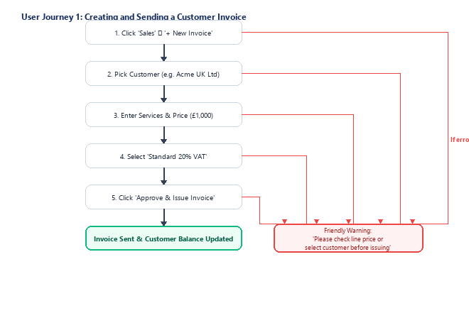
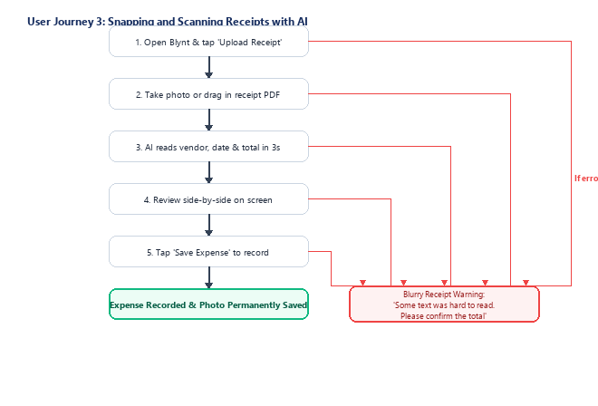
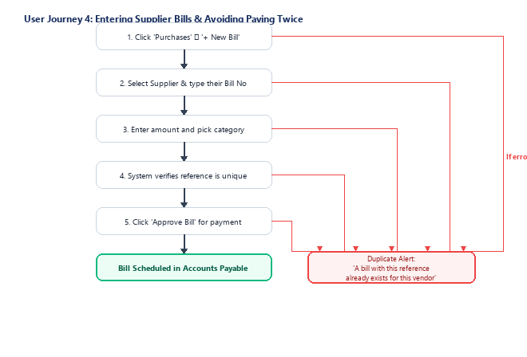
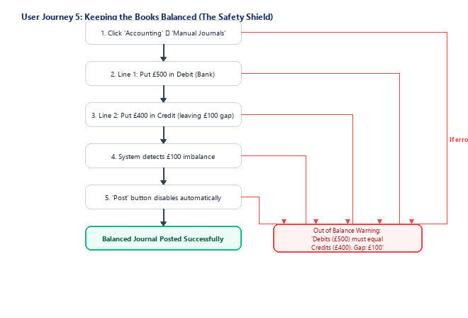
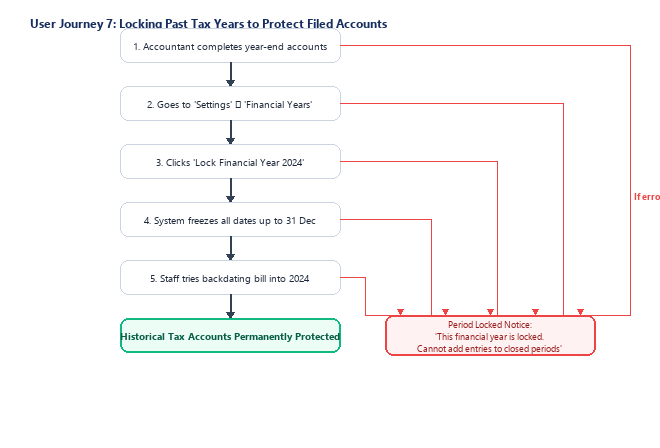
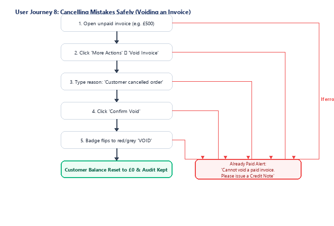
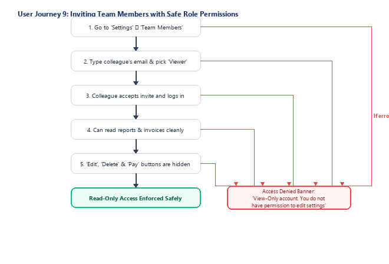
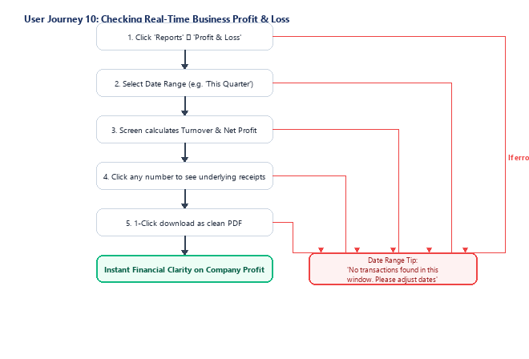
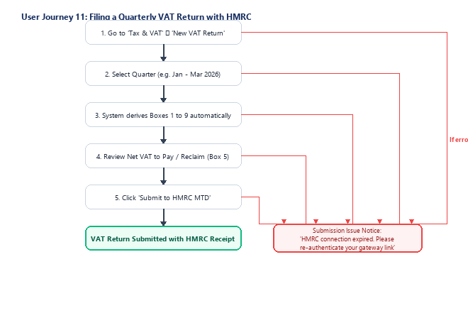
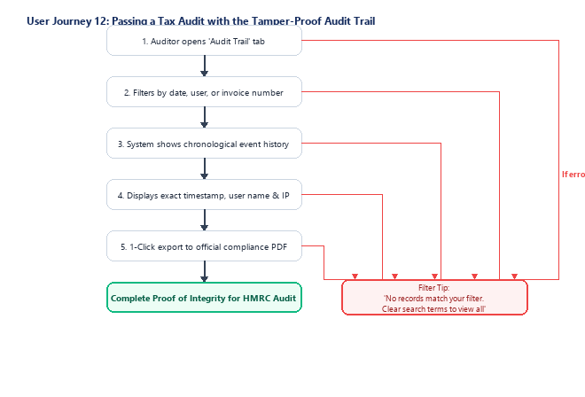

# Blynt — User-Side Business Operations & Experience Report

**Document Classification:** Business User Operations & Client Experience Manual  
**Target Audience:** Business Owners, Office Managers, Bookkeepers, and External Clients (100% Non-Technical)  
**System Name:** Blynt UK Cloud Accounting SaaS  
**Purpose:** Explain exactly how real people use Blynt, what happens on screen, how safety guardrails prevent mistakes, and how businesses stay protected.  

---

## Journey 1: Creating and Sending a Customer Invoice

* **Who Uses This:** Business Owner / Office Administrator
* **What You Are Trying to Do:** You want to invoice a customer for work completed, ensure UK VAT (20%) is calculated accurately, and deliver a professional bill that gets paid quickly.

### Visual Flowchart

### What You See & Do on Screen
You see a clean, modern form. As soon as you type £1,000 and select 20% VAT, the box at the bottom instantly displays: Subtotal £1,000.00 + VAT £200.00 = Total to Pay £1,200.00. Clicking 'Approve & Issue' immediately sends a branded email to your customer with a secure viewing link and attached PDF.

### How Blynt Protects Your Business Behind the Scenes
Blynt checks that the customer is active, verifies your math to the exact penny, updates your company's revenue ledger, and sets the customer's balance to £1,200 without requiring spreadsheet formulas.

### What Happens If You Make a Mistake
If you forget to enter a price or quantity, the empty box turns red with a helpful message: 'Please enter an item price.' The invoice remains safely on screen without erasing your typing.

---

## Journey 2: How Your Customer Opens and Pays Online

* **Who Uses This:** External Client / Customer (The Payer)
* **What You Are Trying to Do:** Your customer receives your invoice email and wants to pay you immediately on their phone or computer using a credit card or Apple Pay without needing a password.

### Visual Flowchart

### What You See & Do on Screen
Your customer taps the link on their iPhone, Android, or laptop. The invoice opens instantly displaying your logo, company details, itemized breakdown, and bank details. Tapping 'Pay Now' opens a secure card checkout. Within 2 seconds of paying, the screen shows a green checkmark and emails them a receipt.

### How Blynt Protects Your Business Behind the Scenes
Blynt connects securely to the card network, confirms the money has cleared, immediately marks the invoice status as green 'PAID', and updates your bank balance. An anti-duplicate shield locks the button so your client is never charged twice.

### What Happens If You Make a Mistake
If their bank card has insufficient funds, a friendly message appears: 'Your card was declined by your bank. Please check your card details or try another card.' The invoice remains open so they can easily re-try.

---

## Journey 3: Snapping and Scanning Receipts with AI

* **Who Uses This:** Employee / Bookkeeper on the go
* **What You Are Trying to Do:** You bought lunch or petrol for a business trip and want to record the expense and keep the receipt for tax deductions without typing numbers.

### Visual Flowchart

### What You See & Do on Screen
You drop a photo of a coffee or fuel receipt into the upload box. In 2 to 3 seconds, Blynt reads the receipt and shows a split-screen: the photo on the left, and the extracted Vendor ('Costa Coffee'), Date ('12 Oct 2026'), and Total ('£12.00') on the right.

### How Blynt Protects Your Business Behind the Scenes
Blynt's smart document engine checks that Net + VAT equals the Total. It suggests the category ('Travel & Meals') based on past receipts. When you save, the photo is permanently attached so you can throw away the paper receipt safely.

### What Happens If You Make a Mistake
If the receipt is wrinkled or faded, a yellow box appears asking you to confirm: 'We could not read the total with high certainty. Please check the amount before saving.' You can type the correct total in one second.

---

## Journey 4: Entering Supplier Bills & Avoiding Paying Twice

* **Who Uses This:** Bookkeeper / Office Manager
* **What You Are Trying to Do:** You received an invoice from a supplier (e.g. your IT hosting provider) and want to log it for payment while ensuring you never accidentally pay the same bill twice.

### Visual Flowchart

### What You See & Do on Screen
You open the bill entry form, pick the vendor, type their invoice reference (e.g. 'INV-8891'), and enter the amount. The screen clearly displays the due date so you know exactly when cash will leave your account.

### How Blynt Protects Your Business Behind the Scenes
Blynt checks your supplier records. If you already logged 'INV-8891' last week, the system immediately flags the duplicate, protecting you from paying the vendor twice. Once approved, the bill shows up on your payments schedule.

### What Happens If You Make a Mistake
If you type an existing reference, an alert banner appears: 'Duplicate Bill: Invoice INV-8891 was already recorded on 02 Oct. Click here to view the original bill.'

---

## Journey 5: Keeping the Books Balanced (The Safety Shield)

* **Who Uses This:** Accountant / Certified Bookkeeper
* **What You Are Trying to Do:** You are recording an end-of-month adjustment and want complete peace of mind that human typing mistakes will never throw your company accounts out of balance.

### Visual Flowchart

### What You See & Do on Screen
As you type adjusting lines into the journal table, a live indicator at the bottom compares Money In (Debits) vs Money Out (Credits). If the two sides don't match, the indicator turns red and displays: 'Out of Balance by £100.00'.

### How Blynt Protects Your Business Behind the Scenes
Blynt acts as your financial guardian. Traditional spreadsheet bookkeeping allows accidental gaps that lead to audit penalties. Blynt's safety shield physically stops anyone from saving an entry until the math is 100% equal.

### What Happens If You Make a Mistake
The 'Post to Ledger' button remains greyed out until you adjust the lines so Debits equal Credits. Once balanced, the badge turns green ('Balanced: £500.00') and the button unlocks.

---

## Journey 6: Connecting the Bank & 1-Click Reconciliation

* **Who Uses This:** Business Owner / Bookkeeper
* **What You Are Trying to Do:** You want to link your business bank account, see all incoming and outgoing payments, and match them against customer invoices with a single click.

### Visual Flowchart

### What You See & Do on Screen
Your bank transactions appear on the left side of the screen. On the right, Blynt automatically scans your unpaid invoices. When a £1,200 deposit matches an invoice for £1,200, a green card appears: 'Match: Invoice #1042 - Acme UK Ltd'. You simply click 'OK'.

### How Blynt Protects Your Business Behind the Scenes
Blynt clears the bank transaction, updates the invoice status to PAID, and confirms that your accounting cash balance matches your real online banking balance to the penny.

### What Happens If You Make a Mistake
If a customer transferred money without including their invoice reference, Blynt allows you to click 'Find & Match' to search by customer name or amount and link the payment manually in 5 seconds.

---

## Journey 7: Locking Past Tax Years to Protect Filed Accounts

* **Who Uses This:** Accountant / Business Owner
* **What You Are Trying to Do:** Your accountant has filed your annual tax return with HMRC. You want to freeze past months so nobody in the company can accidentally edit or backdate receipts into closed periods.

### Visual Flowchart

### What You See & Do on Screen
The accountant clicks 'Lock Year'. A confirmation popup warns that locking freezes the historical records. Once locked, a padlock icon appears next to 2024. If an employee later tries to date a bill in 2024, the date box displays a clear red warning.

### How Blynt Protects Your Business Behind the Scenes
Blynt places a temporal database shield over the closed period. It stops accidental backdating that could trigger tax discrepancies or audit fines with HMRC.

### What Happens If You Make a Mistake
If an official auditor adjustment is genuinely required, only the business Owner can use 'Emergency Reopen', which requires entering a formal written reason that is permanently recorded in the audit log.

---

## Journey 8: Cancelling Mistakes Safely (Voiding an Invoice)

* **Who Uses This:** Business Owner / Billing Clerk
* **What You Are Trying to Do:** A customer cancelled an order after you issued an invoice. You need to cancel the invoice legally so they no longer owe money, while maintaining a proper audit paper trail.

### Visual Flowchart

### What You See & Do on Screen
You open the invoice, click 'Void', and type a brief explanation. The invoice status badge immediately flips to 'VOID'. The customer's account page shows their balance drops back to £0.00.

### How Blynt Protects Your Business Behind the Scenes
Under UK tax rules, companies cannot simply 'delete' issued invoices. Blynt automatically posts a balancing reversal behind the scenes, ensuring your sales revenue and VAT liability are corrected cleanly without erasing the history.

### What Happens If You Make a Mistake
If the customer has already paid money towards the invoice, Blynt prevents voiding and guides you: 'This invoice has payments recorded. Please issue a Credit Note and Refund instead.'

---

## Journey 9: Inviting Team Members with Safe Role Permissions

* **Who Uses This:** Business Owner
* **What You Are Trying to Do:** You want an external auditor or junior staff member to look at company reports without having permission to alter bank accounts, delete invoices, or change company settings.

### Visual Flowchart

### What You See & Do on Screen
You invite your auditor as a 'Viewer'. When they log in, they see all financial statements, invoices, and bank balances. However, buttons like 'Create Invoice', 'Edit Bank', or 'Delete' do not appear on their screen.

### How Blynt Protects Your Business Behind the Scenes
Blynt enforces strict role boundaries: Owners have full control, Accountants can reconcile and lock years, Bookkeepers can enter daily bills and invoices, and Viewers have strictly read-only access.

### What Happens If You Make a Mistake
If a Viewer attempts to change a setting via a direct link, an error banner appears: 'Access Denied: Your account has view-only permissions.'

---

## Journey 10: Checking Real-Time Business Profit & Loss

* **Who Uses This:** Business Owner / Director
* **What You Are Trying to Do:** You want to see how much money your business made this quarter, your profit margins, and where your expenses went without waiting for an accountant.

### Visual Flowchart

### What You See & Do on Screen
You open the Profit & Loss report. At the top, you see Total Sales. Below, your Cost of Sales and Operating Expenses are neatly grouped. At the bottom, a green number shows your Net Operating Profit. Clicking on 'Software Expenses' expands to show every software bill.

### How Blynt Protects Your Business Behind the Scenes
Because every invoice and bill is recorded in real time, your financial reports are always 100% current. You don't have to wait for month-end reconciliations to know if you are profitable.

### What Happens If You Make a Mistake
If you choose a date range where no trading occurred, Blynt displays: 'No transactions found in this date window. Please select another period.'

---

## Journey 11: Filing a Quarterly VAT Return with HMRC

* **Who Uses This:** Accountant / Business Owner
* **What You Are Trying to Do:** It is the end of the tax quarter and you need to calculate your UK VAT return, review the 9 standard boxes, and submit to HMRC under Making Tax Digital.

### Visual Flowchart

### What You See & Do on Screen
You click 'Generate VAT Return'. The screen displays the official 9-box UK VAT summary. Box 1 shows VAT on sales, Box 4 shows VAT reclaimed on purchases, and Box 5 shows the exact net amount to pay or reclaim. You click 'Submit to HMRC'. In 5 seconds, an official HMRC confirmation receipt reference appears.

### How Blynt Protects Your Business Behind the Scenes
Blynt connects directly to the government Making Tax Digital (MTD) gateway, sends the encrypted return, and locks the transactions in that quarter so they cannot be altered after filing.

### What Happens If You Make a Mistake
If your government gateway login expired, Blynt alerts you: 'Your HMRC authorization has expired. Please click here to reconnect your Government Gateway credentials in 30 seconds.'

---

## Journey 12: Passing a Tax Audit with the Tamper-Proof Audit Trail

* **Who Uses This:** HMRC Tax Inspector / Compliance Auditor
* **What You Are Trying to Do:** A tax auditor or investor visits your office and asks to verify that no sales were deleted and all bookkeeping changes have an accountable author.

### Visual Flowchart

### What You See & Do on Screen
The auditor searches for Invoice #1004. The screen shows the complete chronological lifecycle: 'Created by John on 10 Oct at 09:15', 'Approved by Sarah on 10 Oct at 10:00', 'Voided by John on 12 Oct at 14:30 with reason: Client cancelled project'.

### How Blynt Protects Your Business Behind the Scenes
Blynt records every action in an append-only, tamper-evident log protected by database triggers. Nobody—not even the business owner or IT staff—can delete or alter historical audit records.

### What Happens If You Make a Mistake
If an auditor filters for a non-existent transaction, a clear message shows: 'No events found matching your filter criteria. Click Reset to view full history.'

---

