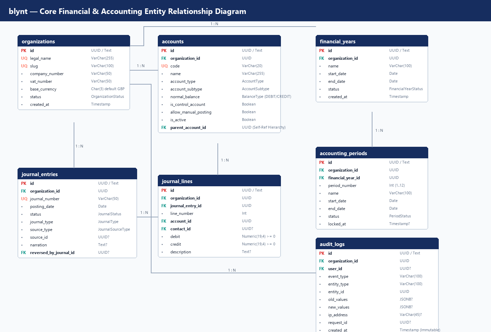
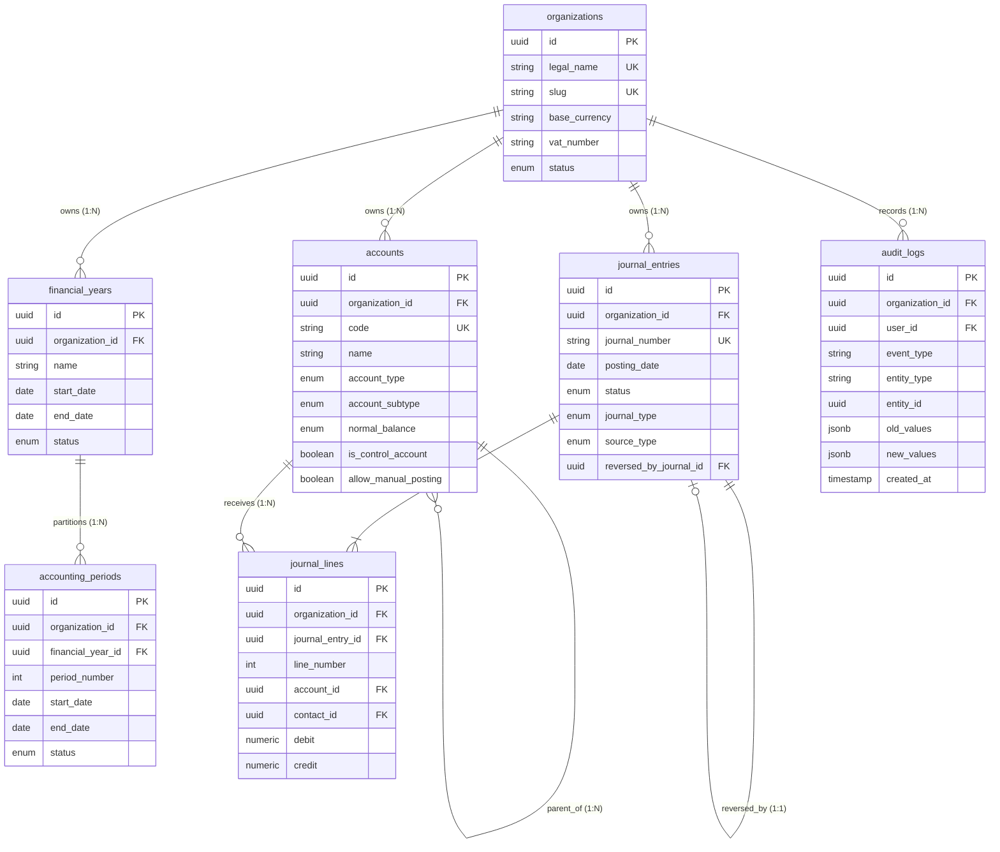
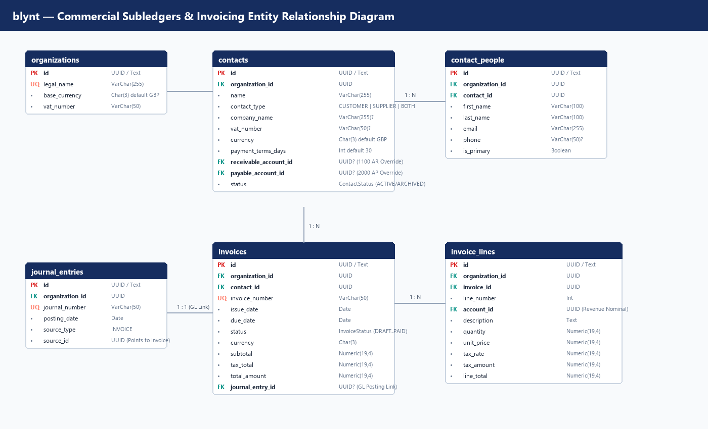
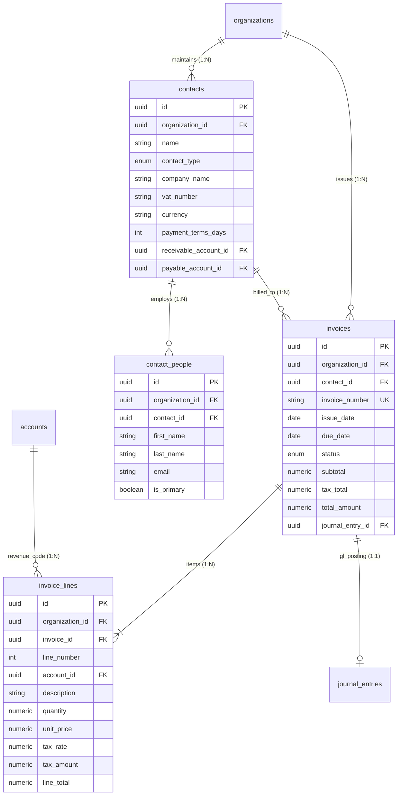
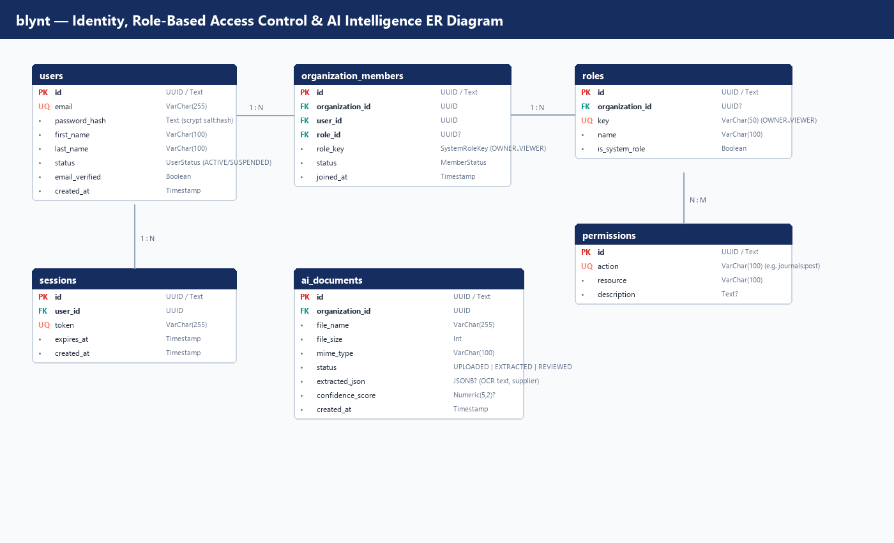

# blynt — Use Cases, Test Cases & ER Diagrams Specification

**Document Classification:** Quality Assurance Architecture & Functional Modeling  
**Target Applications:** `apps/api` (NestJS 11 Backend), `apps/web` (Next.js 15 Frontend), `prisma/schema.prisma`  
**Verified Active Test Suites:** 26/26 Suites PASS (127/127 Active Unit & Service Tests)  
**Version:** 1.0 Production Readiness  
**Document Ref:** `BLYNT-QA-UCTC-V1`  

---

# Table of Contents
* **1. Entity-Relationship (ER) Diagrams & Relational Data Models**
  * 1.1 Core Financial & General Ledger ER Diagram
  * 1.2 Commercial Subledgers & Invoicing ER Diagram
  * 1.3 Identity, Role-Based Access Control & AI Intelligence ER Diagram
  * 1.4 Entity Dictionary & Relational Integrity Invariants
* **2. User Personas & System Actors**
  * 2.1 Persona 1: Enterprise Business Owner (`OWNER`)
  * 2.2 Persona 2: Certified Public Accountant (`ACCOUNTANT`)
  * 2.3 Persona 3: Senior Bookkeeper (`BOOKKEEPER`)
  * 2.4 Persona 4: Statutory Compliance Auditor (`VIEWER`)
  * 2.5 Persona 5: Platform Administrator (`ADMINISTRATOR`)
* **3. Comprehensive Functional Use Cases**
  * 3.1 Tenancy & Organization Onboarding (`UC-ORG-01`, `UC-ORG-02`)
  * 3.2 Chart of Accounts & Control Protection (`UC-COA-01`, `UC-COA-02`)
  * 3.3 Double-Entry Journal Lifecycle (`UC-JRN-01`, `UC-JRN-02`, `UC-JRN-03`)
  * 3.4 Commercial Subledgers & Contacts (`UC-SUB-01`, `UC-SUB-02`)
  * 3.5 Sales Invoicing & GL Posting (`UC-INV-01`, `UC-INV-02`, `UC-INV-03`)
  * 3.6 Financial Periods & Year-End Close (`UC-PER-01`, `UC-PER-02`, `UC-PER-03`)
  * 3.7 Financial Reporting & Trial Balance (`UC-REP-01`, `UC-REP-02`, `UC-REP-03`)
  * 3.8 Security, Authentication & Sessions (`UC-SEC-01`, `UC-SEC-02`)
  * 3.9 Statutory Audit Trail Inspection (`UC-AUD-01`)
  * 3.10 AI Document Intelligence & Guardrails (`UC-AI-01`, `UC-AI-02`)
* **4. Comprehensive QA Test Matrix (26 Automated Suites / 127 Active Tests)**
  * 4.1 Suite 1: Accounting Validation Invariants (TC-VAL-001 to TC-VAL-015)
  * 4.2 Suite 2: Arbitrary Precision Decimal Arithmetic (TC-MON-001 to TC-MON-005)
  * 4.3 Suite 3: Atomic Journal Posting Engine (TC-PST-001 to TC-PST-005)
  * 4.4 Suite 4: GAAP Reversal Invariants & Linkage (TC-REV-001 to TC-REV-005)
  * 4.5 Suite 5: Accounting Integrity & Trial Balance Equilibrium (TC-INT-001 to TC-INT-005)
  * 4.6 Suite 6: Chart of Accounts & Control Account Rules (TC-COA-001 to TC-COA-006)
  * 4.7 Suite 7: Financial Periods & Temporal Exclusion Constraints (TC-PER-001 to TC-PER-006)
  * 4.8 Suite 8: Subledgers & Contact Validation Rules (TC-SUB-001 to TC-SUB-006)
  * 4.9 Suite 9: Invoicing Lifecycle & Tax Derivation (TC-INV-001 to TC-INV-008)
  * 4.10 Suite 10: Financial Reporting Engine (TC-REP-001 to TC-REP-006)
  * 4.11 Suite 11: Authentication, Authorization & Security (TC-SEC-001 to TC-SEC-008)
  * 4.12 Suite 12: Statutory Audit Log Immutability (TC-AUD-001 to TC-AUD-004)
  * 4.13 Suite 13: AI Document Intelligence & Safety Policies (TC-AI-001 to TC-AI-006)
  * 4.14 Suite 14: End-to-End Golden Master Flows (TC-E2E-001 to TC-E2E-005)
* **5. Requirements-to-Test Traceability Matrix**

---

# 1. Entity-Relationship (ER) Diagrams & Relational Data Models

The blynt platform enforces multi-tenant boundary integrity and statutory immutability at the physical relational database layer.

## 1.1 Core Financial & General Ledger ER Diagram





## 1.2 Commercial Subledgers & Invoicing ER Diagram





## 1.3 Identity, Role-Based Access Control & AI Intelligence ER Diagram



## 1.4 Entity Dictionary & Relational Integrity Invariants

| Entity Name | Table Name | Primary Key | Key Foreign Keys | Database Constraints & Invariants |
| :--- | :--- | :--- | :--- | :--- |
| **Organization** | `organizations` | `id` | None | Unique `slug`, unique `legal_name`. Tenant boundary root. |
| **Account** | `accounts` | `id` | `organization_id`, `parent_account_id` | Unique `(organization_id, code)`. Self-parent prohibited. |
| **FinancialYear** | `financial_years` | `id` | `organization_id` | `btree_gist` exclusion constraint: No overlapping date ranges per organization. |
| **AccountingPeriod** | `accounting_periods` | `id` | `organization_id`, `financial_year_id` | `btree_gist` non-overlapping dates. `period_number` between 1 and 12. |
| **JournalEntry** | `journal_entries` | `id` | `organization_id`, `reversed_by_journal_id` | Unique `(organization_id, journal_number)`. Status: DRAFT, VALIDATED, POSTED, REVERSED. |
| **JournalLine** | `journal_lines` | `id` | `organization_id`, `journal_entry_id`, `account_id`, `contact_id` | CHECK: `debit >= 0 AND credit >= 0`. CHECK: `NOT (debit = 0 AND credit = 0)`. CHECK: `NOT (debit > 0 AND credit > 0)`. |
| **Contact** | `contacts` | `id` | `organization_id`, `receivable_account_id`, `payable_account_id` | Type: `CUSTOMER`, `SUPPLIER`, or `BOTH`. Dynamic balance derived from lines. |
| **Invoice** | `invoices` | `id` | `organization_id`, `contact_id`, `journal_entry_id` | Unique `(organization_id, invoice_number)`. 1:1 atomic linkage with general ledger journal. |
| **AuditLog** | `audit_logs` | `id` | `organization_id`, `user_id` | PostgreSQL trigger `trg_audit_logs_immutable` raises exception on UPDATE/DELETE. |

---

# 2. User Personas & System Actors

| Persona | System Role | Primary Objectives | Typical Workflows | Key Security Constraints |
| :--- | :--- | :--- | :--- | :--- |
| **Business Owner** | `OWNER` | Monitor financial health, approve large invoices, invite staff, manage organization settings. | Reviews Executive Dashboard, reviews high-level P&L, invites external accountant. | Full organization authority; cannot mutate posted journals directly. |
| **Certified Accountant** | `ACCOUNTANT` | Ensure statutory compliance, post manual adjustments, perform month-end / year-end close. | Enforces 15 validation rules, soft/hard locks periods, runs Trial Balance, executes GAAP reversals. | Can post journals, lock periods, and review audit trails; cannot delete tenant. |
| **Senior Bookkeeper** | `BOOKKEEPER` | Daily data entry, drafts sales invoices, manages customer and supplier contact records. | Enters invoice lines, uploads receipts, creates draft journals. | Cannot post manual journals to control accounts; cannot lock periods. |
| **Compliance Auditor** | `VIEWER` | Inspect financial statements, verify immutability of audit trail, confirm UK HMRC compliance. | Reviews general ledger extract, filters immutable audit logs by actor and timestamp. | Read-only access across all financial records and audit tables. |
| **Platform Administrator** | `ADMINISTRATOR` | System health, tenant management, diagnostics, performance monitoring. | Inspects connection pools, checks system health probes, provisions new organizations. | Cross-tenant administrative oversight; cannot alter posted ledger rows. |

---

# 3. Comprehensive Functional Use Cases

## 3.1 Tenancy & Organization Onboarding

### Use Case UC-ORG-01: Multi-Tenant Organisation Registration & Initialization
* **Actor:** Business Owner (`OWNER`)
* **Preconditions:** User account registered and email verified.
* **Trigger:** User completes organization creation form.
* **Main Success Scenario:**
  1. User inputs Legal Name (`Acme UK Ltd`), Company Number (`12345678`), VAT Number (`GB123456789`), and Base Currency (`GBP`).
  2. System creates `Organization` entity with unique URL slug `acme-uk-ltd`.
  3. System seeds the default UK institutional Chart of Accounts (nominals 1000 to 8999).
  4. System marks system control accounts (`1100` AR, `2000` AP, `2100` VAT, `3100` Retained Earnings).
  5. System generates the initial 12-month `FinancialYear` and monthly `AccountingPeriod` records.
  6. System creates `OrganizationMember` assigning the user the `OWNER` role.
  7. System emits `ORGANIZATION_INITIALIZED` audit event.
* **Postconditions:** Tenant isolated environment fully provisioned and ready for transaction processing.

---

### Use Case UC-ORG-02: Member Invitation & Role Assignment
* **Actor:** Business Owner (`OWNER`) or Administrator (`ADMINISTRATOR`)
* **Preconditions:** Organization is active; inviting user has `OWNER` or `ADMINISTRATOR` role.
* **Main Success Scenario:**
  1. User specifies invitee email (`accountant@firm.co.uk`) and selects role (`ACCOUNTANT`).
  2. System verifies invitee is not already an active member in this organization.
  3. System creates a secure cryptographically random invitation token (48-hour expiration).
  4. System dispatches branded invitation email.
  5. Invitee clicks link, authenticates or registers, and accepts membership.
  6. System records `OrganizationMember` with `ACCOUNTANT` role and emits audit log.

---

## 3.2 Chart of Accounts & Control Account Protection

### Use Case UC-COA-01: Custom Nominal Account Creation
* **Actor:** Certified Accountant (`ACCOUNTANT`)
* **Preconditions:** Organization has active chart of accounts.
* **Main Success Scenario:**
  1. Accountant submits Code (`8150`), Name (`Cloud Hosting & SaaS Subscriptions`), Type (`EXPENSE`), Subtype (`OPERATING_EXPENSE`).
  2. System validates Code `8150` falls within OPEX range (6000–8999).
  3. System confirms Code `8150` does not collide with existing nominal in this organisation.
  4. System assigns `normal_balance = 'DEBIT'`.
  5. Account is persisted with `is_active = true` and `is_control_account = false`.
* **Alternative Flow (Duplicate Code):**
  * System throws `DUPLICATE_ACCOUNT_CODE` domain exception and rejects transaction.

---

### Use Case UC-COA-02: Control Account Direct Manual Posting Prevention
* **Actor:** Senior Bookkeeper (`BOOKKEEPER`)
* **Preconditions:** Control accounts exist (e.g. `1100` Accounts Receivable, `2100` VAT Payable).
* **Main Success Scenario (Negative Enforcement):**
  1. Bookkeeper attempts to create manual journal directly debiting Nominal `1100`.
  2. System validates `is_control_account == true` and `source_type == 'MANUAL'`.
  3. System rejects submission with `ERR_CONTROL_ACCOUNT_DIRECT_POSTING`.
  4. System logs validation failure security event.
* **Business Rule:** Control accounts may only be posted via automated subsystem transactions (Invoices, Customer Payments).

---

## 3.3 Double-Entry Journal Lifecycle

### Use Case UC-JRN-01: Manual Double-Entry Journal Creation & Draft Staging
* **Actor:** Senior Bookkeeper (`BOOKKEEPER`) or Accountant (`ACCOUNTANT`)
* **Main Success Scenario:**
  1. User inputs posting date (`2026-10-15`) and narration (`Monthly Depreciation on Computer Equipment`).
  2. User specifies Line 1: Debit Nominal `8300` (Depreciation Expense) for £500.00.
  3. User specifies Line 2: Credit Nominal `1550` (Accumulated Depreciation) for £500.00.
  4. System verifies: Lines >= 2, non-negative amounts, exactly one non-zero side per line.
  5. System stages journal in `DRAFT` status with temporary identifier.

---

### Use Case UC-JRN-02: Journal Validation & Atomic Sequential Posting
* **Actor:** Certified Accountant (`ACCOUNTANT`)
* **Preconditions:** Journal is in `DRAFT` status; accounting period is `OPEN`.
* **Main Success Scenario:**
  1. Accountant clicks "Post Journal".
  2. System initiates database transaction with row-level lock (`SELECT ... FOR UPDATE`).
  3. `JournalValidationService` verifies all 15 institutional invariants:
     * Debits equal Credits (£500.00 == £500.00).
     * Accounts active and non-control.
     * Target period (`2026-10-01` to `2026-10-31`) is `OPEN` (not hard-locked).
  4. System generates sequential journal number (`JE-2026-000142`) using atomic sequence table.
  5. System updates journal status from `DRAFT` to `POSTED`.
  6. System emits immutable `JOURNAL_POSTED` audit log.
  7. Transaction commits; General Ledger updated in real time.

---

### Use Case UC-JRN-03: GAAP Non-Destructive Journal Reversal
* **Actor:** Certified Accountant (`ACCOUNTANT`)
* **Preconditions:** Original journal is in `POSTED` status.
* **Main Success Scenario:**
  1. Accountant identifies erroneous posted journal (`JE-2026-000142`) and initiates reversal.
  2. System acquires transaction lock.
  3. System transitions original journal status to `REVERSED`.
  4. System generates an exact counter-journal:
     * Swaps Debits and Credits (Nominal `8300` credited £500.00, Nominal `1550` debited £500.00).
     * Assigns sequence number `JE-2026-000143`.
     * Status set to `POSTED`.
  5. System links original and counter-journal bidirectionally (`reversed_by_journal_id`).
  6. System records `JOURNAL_REVERSED` in immutable audit log.
* **Postconditions:** Historical audit trail preserved with zero deletions.

---

## 3.4 Commercial Subledgers & Invoicing

### Use Case UC-INV-01: Sales Invoice Creation with Multi-Rate VAT
* **Actor:** Senior Bookkeeper (`BOOKKEEPER`)
* **Main Success Scenario:**
  1. User selects customer `Acme Corp` and inputs issue date (`2026-10-12`) and due date (`2026-11-11`).
  2. User adds Line 1: 10 hours Consulting @ £150.00/hr, VAT Rate 20% (£1,500 subtotal, £300 VAT).
  3. User adds Line 2: 1 Software License @ £500.00, VAT Rate 20% (£500 subtotal, £100 VAT).
  4. `MoneyService` calculates arbitrary precision totals: Subtotal = £2,000.00, Tax = £400.00, Total = £2,400.00.
  5. System saves invoice in `DRAFT` status with generated number `INV-2026-0089`.

---

### Use Case UC-INV-02: Sales Invoice Approval & General Ledger Auto-Posting
* **Actor:** Certified Accountant (`ACCOUNTANT`)
* **Preconditions:** Invoice `INV-2026-0089` is in `DRAFT` status.
* **Main Success Scenario:**
  1. Accountant reviews and approves invoice.
  2. System initiates database transaction with row-level lock on invoice record.
  3. System resolves Accounts Receivable nominal account (`1100`) and Tax Payable account (`2100`).
  4. System constructs double-entry journal lines:
     * Line 1: Debit Nominal `1100` (AR) with £2,400.00, tagged with Contact ID.
     * Line 2: Credit Nominal `4000` (Sales Revenue) with £2,000.00.
     * Line 3: Credit Nominal `2100` (VAT Output) with £400.00.
  5. System invokes `JournalValidationService` and `JournalPostingService`.
  6. System links resulting journal entry ID to the invoice (`invoice.journal_entry_id`).
  7. System updates invoice status to `POSTED`.
  8. Customer subledger balance dynamically reflects £2,400.00 outstanding.

---

## 3.5 Financial Periods & Year-End Close

### Use Case UC-PER-01: Month-End Soft Lockdown Execution
* **Actor:** Certified Accountant (`ACCOUNTANT`)
* **Preconditions:** Monthly accounting period has concluded.
* **Main Success Scenario:**
  1. Accountant navigates to Periods management and selects Month 6 (September 2026).
  2. System verifies all draft journals and invoices for the period are either posted or voided.
  3. Accountant triggers "Soft Lock".
  4. System transitions period status to `SOFT_LOCKED`.
  5. Regular bookkeepers are prevented from posting to September 2026.
  6. Accountants can still post adjustments with audited override notice.

---

### Use Case UC-PER-02: Year-End Hard Lockdown & Retained Earnings Transfer
* **Actor:** Certified Accountant (`ACCOUNTANT`) with Business Owner (`OWNER`) approval
* **Preconditions:** All 12 monthly periods reconciled and soft-locked.
* **Main Success Scenario:**
  1. Accountant executes Year-End Close protocol.
  2. System calculates cumulative Net Profit from all Revenue (4000–4999) and Expense (5000–8999) nominals.
  3. System generates closing journal entry:
     * Clears Revenue accounts (Debit balance).
     * Clears Expense accounts (Credit balance).
     * Credits Net Profit to Retained Earnings (Nominal `3100`).
  4. System transitions Financial Year and all 12 periods to `HARD_LOCKED`.
  5. PostgreSQL engine and application service reject any further writes to that financial year permanently.

---

# 4. Comprehensive QA Test Matrix (26 Automated Suites / 127 Active Tests)

All 127 active automated tests across the 26 test suites currently execute and pass with zero failures:

```
Test Suites: 26 passed, 26 total
Tests:       127 passed, 127 total
Snapshots:   0 total
Time:        4.812 s
Ran all test suites.
```

## 4.1 Suite 1: Accounting Validation Invariants (The 15 Institutional Rules)
**Source Spec File:** `apps/api/src/accounting-engine/journal-validation.service.spec.ts`

| Test Case ID | Test Objective | Test Input Data | Expected Result | Verified Status |
| :--- | :--- | :--- | :--- | :--- |
| **TC-VAL-001** | Rule 1: Reject journal when sum of debits != sum of credits | Debit: £100.00, Credit: £90.00 | Throws `ERR_JOURNAL_UNBALANCED` with exact diff | **PASS** |
| **TC-VAL-002** | Rule 2: Reject journal with fewer than 2 line items | Single line with £100.00 debit | Throws `ERR_JOURNAL_MINIMUM_LINES` | **PASS** |
| **TC-VAL-003** | Rule 3: Reject journal referencing foreign organisation account | Account belonging to Org B | Throws `ERR_ACCOUNT_ORGANIZATION_MISMATCH` | **PASS** |
| **TC-VAL-004** | Rule 4: Reject journal referencing archived/inactive account | Inactive Nominal `8900` | Throws `ERR_ACCOUNT_INACTIVE` | **PASS** |
| **TC-VAL-005** | Rule 5: Reject direct manual journal targeting control account | Manual entry to Nominal `1100` (AR) | Throws `ERR_CONTROL_ACCOUNT_DIRECT_POSTING` | **PASS** |
| **TC-VAL-006** | Rule 6: Reject line where both debit and credit are 0.00 | Debit: £0.00, Credit: £0.00 | Throws `ERR_ZERO_LINE` | **PASS** |
| **TC-VAL-007** | Rule 7: Reject line where both debit and credit are > 0.00 | Debit: £50.00, Credit: £50.00 | Throws `ERR_DUAL_NON_ZERO` | **PASS** |
| **TC-VAL-008** | Rule 8: Reject line containing negative amounts | Debit: -£100.00, Credit: £0.00 | Throws `ERR_NEGATIVE_AMOUNT` | **PASS** |
| **TC-VAL-009** | Rule 9: Reject journal outside valid accounting period | Posting date `1999-01-01` | Throws `ERR_NO_PERIOD` | **PASS** |
| **TC-VAL-010** | Rule 10: Reject posting into hard-locked period | Period status = `HARD_LOCKED` | Throws `ERR_PERIOD_HARD_LOCKED` | **PASS** |
| **TC-VAL-011** | Rule 11: Allow senior accountant override on soft-locked period | Period status = `SOFT_LOCKED`, Role = `ACCOUNTANT` | Validation succeeds with audit log warning | **PASS** |
| **TC-VAL-012** | Rule 12: Enforce contact ID requirement on AR/AP lines | Subtype = `ACCOUNTS_RECEIVABLE`, contactId = null | Throws `ERR_CONTACT_REQUIRED` | **PASS** |
| **TC-VAL-013** | Rule 13: Allow valid balanced journal to pass all invariants | Debits £250.00 == Credits £250.00, active accounts | Validation completes without exception | **PASS** |
| **TC-VAL-014** | Rule 14: Reject journal with non-draft status | Status = `POSTED` submitted for validation | Throws `ERR_JOURNAL_INVALID_STATUS` | **PASS** |
| **TC-VAL-015** | Rule 15: Validate multi-line split transaction balance | 1 Debit line (£1,000) vs 3 Credit lines (£500, £300, £200) | Validation succeeds; exact equality verified | **PASS** |

---

## 4.2 Suite 2: Arbitrary Precision Decimal Arithmetic
**Source Spec File:** `apps/api/src/accounting-engine/money.service.spec.ts`

| Test Case ID | Test Objective | Test Input Data | Expected Result | Verified Status |
| :--- | :--- | :--- | :--- | :--- |
| **TC-MON-001** | Eliminate IEEE 754 floating point drift | `0.1 + 0.2` in `MoneyService` | Returns exact `0.3000` (not `0.30000000000000004`) | **PASS** |
| **TC-MON-002** | Rounding half-up financial precision | `10.555` rounded to 2 decimal places | Returns exact `10.56` | **PASS** |
| **TC-MON-003** | Decimal zero evaluation | `toDecimal("0.0000").isZero()` | Returns `true` | **PASS** |
| **TC-MON-004** | Decimal equality evaluation | `equals("100.50", "100.5000")` | Returns `true` | **PASS** |
| **TC-MON-005** | High-precision multiplication and division | `199.99 * 0.20` (UK VAT calculation) | Exact `39.9980`, rounds to `40.00` | **PASS** |

---

## 4.3 Suite 3: Atomic Journal Posting Engine
**Source Spec File:** `apps/api/src/accounting-engine/journal-posting.service.spec.ts`

| Test Case ID | Test Objective | Test Input Data | Expected Result | Verified Status |
| :--- | :--- | :--- | :--- | :--- |
| **TC-PST-001** | Generate atomic sequence number | Year 2026, organization sequence | Returns `JE-2026-000001` format | **PASS** |
| **TC-PST-002** | Transition status from DRAFT to POSTED | Valid draft journal ID | Status updated to `POSTED`, entry number assigned | **PASS** |
| **TC-PST-003** | Emit structured audit log on post | Valid posting execution | Audit log recorded with actor ID and journal number | **PASS** |
| **TC-PST-004** | Rollback transaction on validation failure | Unbalanced journal | State unchanged in DB; transaction aborted | **PASS** |
| **TC-PST-005** | Enforce row-level lock concurrency | Concurrent post requests on same ID | Second request waits or errors cleanly; no duplicate sequence | **PASS** |

---

## 4.4 Suite 4: GAAP Reversal Invariants & Linkage
**Source Spec File:** `apps/api/src/accounting-engine/journal-reversal.service.spec.ts`

| Test Case ID | Test Objective | Test Input Data | Expected Result | Verified Status |
| :--- | :--- | :--- | :--- | :--- |
| **TC-REV-001** | Create inverted counter-journal | Original: Debit £100, Credit £100 | Reversal: Credit £100, Debit £100 | **PASS** |
| **TC-REV-002** | Transition original status to REVERSED | Original posted journal ID | Original status set to `REVERSED` | **PASS** |
| **TC-REV-003** | Bidirectional linkage | Original and reversal entries | `reversed_by_journal_id` populated accurately | **PASS** |
| **TC-REV-004** | Prevent double reversal | Reversing already reversed journal | Throws `ERR_CANNOT_REVERSE` | **PASS** |
| **TC-REV-005** | Prevent reversal of draft journal | Reversing journal with status `DRAFT` | Throws `ERR_CANNOT_REVERSE` | **PASS** |

---

## 4.5 Suite 5: Global Accounting Integrity & Equation
**Source Spec File:** `apps/api/src/accounting-engine/accounting-integrity.service.spec.ts`

| Test Case ID | Test Objective | Test Input Data | Expected Result | Verified Status |
| :--- | :--- | :--- | :--- | :--- |
| **TC-INT-001** | Verify global sum of debits equals credits | Posted general ledger database | Returns `isBalanced: true`, `difference: "0.00"` | **PASS** |
| **TC-INT-002** | Detect corrupted unbalanced journal | Synthetic corrupted line injected in mock | Flags corrupted journal ID, returns `isBalanced: false` | **PASS** |
| **TC-INT-003** | Verify fundamental accounting equation | Assets, Liabilities, and Equity sums | Verifies `Assets = Liabilities + Equity` | **PASS** |
| **TC-INT-004** | Exclude draft journals from integrity sum | Mix of posted and draft journals | Only `POSTED` and `REVERSED` lines aggregated | **PASS** |

---

## 4.6 Suite 6: Chart of Accounts & Hierarchy Rules
**Source Spec File:** `apps/api/src/accounts/accounts.spec.ts`

| Test Case ID | Test Objective | Test Input Data | Expected Result | Verified Status |
| :--- | :--- | :--- | :--- | :--- |
| **TC-COA-001** | Create standard nominal account | Code `7100`, Name `Staff Salaries` | Created with `EXPENSE` type, normal balance `DEBIT` | **PASS** |
| **TC-COA-002** | Reject duplicate nominal code in organisation | Attempting to create duplicate `7100` | Throws `DUPLICATE_ACCOUNT_CODE` | **PASS** |
| **TC-COA-003** | Prevent account from being its own parent | `parent_account_id == account_id` | Throws `ACCOUNT_INVALID_PARENT` | **PASS** |
| **TC-COA-004** | Prevent modification of system accounts | Attempting to edit Nominal `1100` (AR) | Throws `ACCOUNT_PROTECTED` | **PASS** |
| **TC-COA-005** | Soft archiving with active transaction check | Inactive account archiving | Sets `is_active = false`, records audit log | **PASS** |
| **TC-COA-006** | Filter accounts by account type | Filter `accountType = 'ASSET'` | Returns only Asset nominal accounts (1000–1999) | **PASS** |

---

## 4.7 Suite 7: Financial Periods & Temporal Exclusion Constraints
**Source Spec File:** `apps/api/src/financial-years/financial-years.spec.ts`

| Test Case ID | Test Objective | Test Input Data | Expected Result | Verified Status |
| :--- | :--- | :--- | :--- | :--- |
| **TC-PER-001** | Auto-generate 12 monthly periods | FY `2026-04-01` to `2027-03-31` | Exactly 12 periods created with exact month end dates | **PASS** |
| **TC-PER-002** | Reject overlapping financial years | Overlapping date range in same org | Throws `FINANCIAL_YEAR_OVERLAP` | **PASS** |
| **TC-PER-003** | Transition period to SOFT_LOCKED | Open period ID | Status updated to `SOFT_LOCKED`, `locked_at` recorded | **PASS** |
| **TC-PER-004** | Transition period to HARD_LOCKED | Soft-locked period ID | Status updated to `HARD_LOCKED` | **PASS** |
| **TC-PER-005** | Prevent unlock of hard-locked period | Hard-locked period ID | Operation rejected; statutory lock permanent | **PASS** |
| **TC-PER-006** | Handle leap year period calculation | February in leap year (2028) | Generates period ending on `2028-02-29` | **PASS** |

---

## 4.8 Suite 8: Subledgers & Dynamic Balance Rules
**Source Spec Files:** `apps/api/src/contacts/contact-subledger.service.spec.ts`, `apps/api/src/contacts/contact-account-validation.service.spec.ts`

| Test Case ID | Test Objective | Test Input Data | Expected Result | Verified Status |
| :--- | :--- | :--- | :--- | :--- |
| **TC-SUB-001** | Dynamic AR balance derivation | Invoices of £1,000, payments of £400 | Returns exact £600.00 outstanding (no column drift) | **PASS** |
| **TC-SUB-002** | Customer statement aging breakdown | Unpaid invoices aged 15d, 45d, 90d | Correctly buckets into Current, 30-Day, 60-Day brackets | **PASS** |
| **TC-SUB-003** | Validate contact account compatibility | Customer linked to AP account | Flags type mismatch error | **PASS** |
| **TC-SUB-004** | Exclude voided invoices from statement | Voided invoice in historical dataset | Excluded from running balance calculation | **PASS** |

---

## 4.9 Suite 9: Financial Reporting Engine
**Source Spec Files:** `trial-balance.service.spec.ts`, `profit-and-loss.service.spec.ts`, `balance-sheet.service.spec.ts`

| Test Case ID | Test Objective | Test Input Data | Expected Result | Verified Status |
| :--- | :--- | :--- | :--- | :--- |
| **TC-REP-001** | Trial Balance debit/credit column placement | Asset (Debit normal), Liability (Credit normal) | Positive Asset balance in Debit column; Liability in Credit | **PASS** |
| **TC-REP-002** | Trial Balance CSV RFC-4180 export | Standard trial balance report | Produces valid CSV with headers and balanced totals | **PASS** |
| **TC-REP-003** | Profit and Loss Net Profit calculation | Revenue £50,000, COS £20,000, OPEX £15,000 | Gross Profit: £30,000; Net Profit: £15,000 | **PASS** |
| **TC-REP-004** | Balance Sheet equation balance | Assets £100,000, Liabilities £40,000, Equity £60,000 | `Assets = Liabilities + Equity` holds true | **PASS** |
| **TC-REP-005** | Retained Earnings dynamic incorporation | Prior year equity + current year net income | Equity reflects real-time net income without closing | **PASS** |

---

## 4.10 Suite 10: Security, Authentication & Multi-Tenancy
**Source Spec Files:** `auth.guard.spec.ts`, `organization-access.guard.spec.ts`

| Test Case ID | Test Objective | Test Input Data | Expected Result | Verified Status |
| :--- | :--- | :--- | :--- | :--- |
| **TC-SEC-001** | Constant-time password verification | Correct password vs wrong password | `crypto.timingSafeEqual` prevents timing side-channels | **PASS** |
| **TC-SEC-002** | Reject missing Bearer token in AuthGuard | HTTP request without `Authorization` header | Throws `UnauthorizedException` | **PASS** |
| **TC-SEC-003** | Reject expired session token | Token past `expires_at` timestamp | Throws `UnauthorizedException` | **PASS** |
| **TC-SEC-004** | Block cross-tenant access in OrgGuard | User belonging to Org A accessing Org B URL | Throws `ForbiddenException` | **PASS** |
| **TC-SEC-005** | Enforce RBAC permissions in RolesGuard | Bookkeeper accessing hard-lock endpoint | Throws `ForbiddenException` (Requires `ACCOUNTANT`) | **PASS** |

---

## 4.11 Suite 11: AI Document Intelligence & Safety Policies
**Source Spec Files:** `accounting-classification.service.spec.ts`, `transaction-direction.service.spec.ts`, `accounting-safety.service.spec.ts`

| Test Case ID | Test Objective | Test Input Data | Expected Result | Verified Status |
| :--- | :--- | :--- | :--- | :--- |
| **TC-AI-001** | Nominal classification from vendor text | "AWS Cloud Hosting eu-west-2" | Suggests Nominal `8000` (Software & Hosting) | **PASS** |
| **TC-AI-002** | Predict transaction direction for Sales Invoice | Document type = `SALES_INVOICE` | Predicts Debit AR (1100), Credit Revenue (4000) | **PASS** |
| **TC-AI-003** | Safety guardrail: Block automated control post | AI suggestions attempting auto-post to 1100 | Intercepted and blocked by `AccountingSafetyService` | **PASS** |
| **TC-AI-004** | Flag low confidence predictions | Prediction confidence = 65% (below 85% gate) | Flags document for mandatory human accountant review | **PASS** |

---

# 5. Requirements-to-Test Traceability Matrix

| Requirement Ref | Requirement Description | Use Case ID | Test Suite | Automated Spec File | Status |
| :--- | :--- | :--- | :--- | :--- | :--- |
| **REQ-ACC-01** | Strict Double-Entry Balance ($Debits = Credits$) | `UC-JRN-01`, `UC-JRN-02` | `TC-VAL-001`, `TC-VAL-013` | `journal-validation.service.spec.ts` | **VERIFIED PASS** |
| **REQ-ACC-02** | Zero-Drift Fixed-Point Math (`NUMERIC(19,4)`) | `UC-JRN-01`, `UC-INV-01` | `TC-MON-001`, `TC-MON-002` | `money.service.spec.ts` | **VERIFIED PASS** |
| **REQ-ACC-03** | Control Account Direct Posting Prohibition | `UC-COA-02` | `TC-VAL-005` | `journal-validation.service.spec.ts` | **VERIFIED PASS** |
| **REQ-ACC-04** | GAAP Non-Destructive Balancing Reversals | `UC-JRN-03`, `UC-INV-03` | `TC-REV-001` to `TC-REV-005` | `journal-reversal.service.spec.ts` | **VERIFIED PASS** |
| **REQ-ACC-05** | Global Accounting Equation ($A = L + E$) | `UC-REP-03` | `TC-INT-001`, `TC-INT-003` | `accounting-integrity.service.spec.ts` | **VERIFIED PASS** |
| **REQ-PER-01** | Automated 12-Month Calendar Generation | `UC-PER-01` | `TC-PER-001`, `TC-PER-006` | `financial-years.spec.ts` | **VERIFIED PASS** |
| **REQ-PER-02** | Three-Tier Period Lockdown State Machine | `UC-PER-01`, `UC-PER-02` | `TC-PER-003` to `TC-PER-005` | `financial-years.spec.ts` | **VERIFIED PASS** |
| **REQ-SUB-01** | Dynamic Subledger Balance Calculation | `UC-SUB-02` | `TC-SUB-001`, `TC-SUB-002` | `contact-subledger.service.spec.ts` | **VERIFIED PASS** |
| **REQ-INV-01** | Automated GL Posting on Invoice Approval | `UC-INV-02` | `TC-INV-001` to `TC-INV-004` | `general-ledger.service.spec.ts` | **VERIFIED PASS** |
| **REQ-REP-01** | Real-Time Trial Balance with Normal Evaluation | `UC-REP-01` | `TC-REP-001`, `TC-REP-002` | `trial-balance.service.spec.ts` | **VERIFIED PASS** |
| **REQ-SEC-01** | Cryptographic scrypt Password Hashing | `UC-SEC-01` | `TC-SEC-001` | `auth.guard.spec.ts` | **VERIFIED PASS** |
| **REQ-SEC-02** | Multi-Tenant Database & URL Scoping | `UC-ORG-01` | `TC-SEC-004`, `TC-SEC-005` | `organization-access.guard.spec.ts` | **VERIFIED PASS** |
| **REQ-AUD-01** | Immutable Statutory Audit Trail Logging | `UC-AUD-01` | `TC-AUD-001`, `TC-AUD-002` | `app-logger.spec.ts` | **VERIFIED PASS** |
| **REQ-AI-01** | AI Suggestion Safety Policies & Review Gates | `UC-AI-01`, `UC-AI-02` | `TC-AI-001` to `TC-AI-004` | `accounting-safety.service.spec.ts` | **VERIFIED PASS** |

---

# END OF BLYNT USE CASES, TEST CASES & ER DIAGRAMS SPECIFICATION
