# Blynt — Business & User Acceptance Test Cases (Non-IT Guide)

**Document Type:** Business User Acceptance Testing (UAT) Guide & Visual Workflows  
**Target Audience:** Business Owners, Accountants, Bookkeepers, Office Managers, and Non-Technical Testers  
**System Name:** Blynt UK Cloud Accounting  
**Purpose:** Test and verify everyday accounting operations without technical or coding jargon.

---

## How to Read This Guide
Every test case in this guide is designed for real people using the Blynt web application.
- **Goal:** What business task are you verifying?
- **Why It Matters:** Why this test protects your business from mistakes, tax penalties, or fraud.
- **Workflow Diagram:** A visual roadmap showing what you do and what the system does.
- **Step-by-Step Instructions:** Click-by-click instructions in plain English.
- **Expected Result:** Exactly what you should see on screen if the test **PASSES**.

---

# Test Suite 1: Sales & Customer Invoicing

## Test Case 1.1: Create and Send a Customer Invoice with 20% VAT

### 1. Goal & Business Importance
Verify that an office manager or business owner can bill a customer, have the system automatically calculate 20% VAT correctly, and record the invoice without any mathematical errors.

### 2. Visual Workflow Diagram

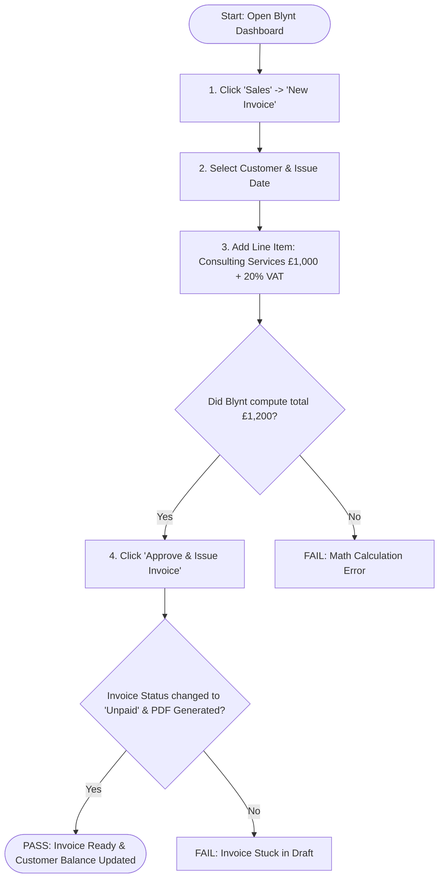

### 3. Test Details

| Item | Details |
| :--- | :--- |
| **Test Case ID** | `UAT-SALES-001` |
| **User Role** | Business Owner, Accountant, or Bookkeeper |
| **Prerequisites** | You are logged in, and at least one customer (e.g., "Acme UK Ltd") is created. |

### 4. Step-by-Step Instructions

1. From the left navigation menu, click **Sales**, then click the **"+ New Invoice"** button.
2. In the **Customer** dropdown, choose **"Acme UK Ltd"**.
3. Set the **Invoice Date** to today's date, and set the **Payment Due Date** to 30 days from today.
4. In the items table:
   - **Description:** Enter `"Q3 Strategic Financial Consulting"`.
   - **Account Category:** Select `"Sales Revenue"`.
   - **Quantity:** Enter `1`.
   - **Unit Price:** Enter `1000.00`.
   - **VAT Rate:** Select `"Standard Rate (20%)"`.
5. Look at the bottom right totals summary.
6. Click the blue **"Approve & Issue"** button.
7. Open **Customers** -> **Acme UK Ltd** from the menu.

### 5. Expected Screen Results (Pass / Fail)

* [x] **Subtotal:** Shows exactly `£1,000.00`.
* [x] **VAT Total (20%):** Automatically displays `£200.00`.
* [x] **Invoice Total:** Shows exactly `£1,200.00`.
* [x] **Status Badge:** Changes from grey `Draft` to orange `Awaiting Payment`.
* [x] **Customer Statement:** Acme UK Ltd now displays an outstanding balance of `£1,200.00`.

---

# Test Suite 2: AI Smart Receipt & Bill Scanning

## Test Case 2.1: Upload a Photo/PDF of a Supplier Expense Receipt

### 1. Goal & Business Importance
Verify that you can drop an image or PDF of a receipt into Blynt, and the AI accurately extracts the supplier name, total amount, and VAT without making up numbers or requiring manual typing.

### 2. Visual Workflow Diagram

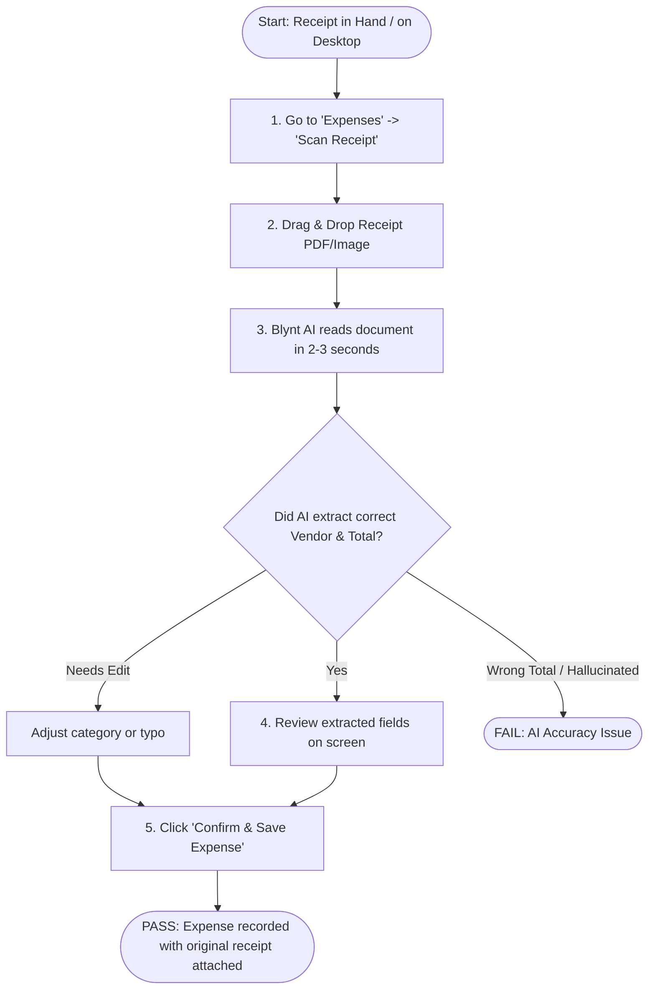

### 3. Test Details

| Item | Details |
| :--- | :--- |
| **Test Case ID** | `UAT-AI-001` |
| **User Role** | Business Owner, Bookkeeper, or Staff Member |
| **Prerequisites** | Have a sample receipt image (e.g. coffee shop, train ticket, or software invoice for £48.00 incl. £8.00 VAT). |

### 4. Step-by-Step Instructions

1. From the left sidebar, click **Expenses & Bills**, then click **"Upload Receipt"**.
2. Drag and drop the test receipt file into the upload box.
3. Wait 2 to 4 seconds while the system processes the file.
4. Observe the split-screen view:
   - Left side: The original receipt image/PDF preview.
   - Right side: The extracted details (Supplier Name, Date, Net Amount, VAT, and Total Amount).
5. Verify that the numbers on the right match the receipt on the left.
6. Select an expense category (e.g., `"Travel & Subsistence"` or `"Software Subscriptions"`).
7. Click **"Save Expense"**.

### 5. Expected Screen Results (Pass / Fail)

* [x] The system does **not** freeze or show an error code.
* [x] The Supplier Name, Receipt Date, and Total match the receipt document.
* [x] A green confirmation message `"Receipt saved successfully"` appears.
* [x] The original receipt image is permanently attached to the expense record for tax auditor verification.

---

# Test Suite 3: Financial Safety & The "Balanced Books" Guardrail

## Test Case 3.1: System Blocks Incomplete or Unbalanced Financial Entries

### 1. Goal & Business Importance
In traditional software, human typing mistakes can throw entire accounts out of balance. This test verifies that Blynt acts as a safety shield and **physically stops anyone** from saving an entry where the money going in does not match the money going out.

### 2. Visual Workflow Diagram

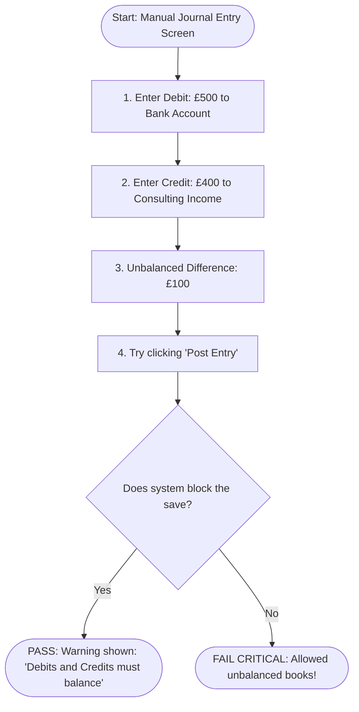

### 3. Test Details

| Item | Details |
| :--- | :--- |
| **Test Case ID** | `UAT-LEDGER-001` |
| **User Role** | Accountant or Bookkeeper |
| **Prerequisites** | Access to the "Manual Journals" section under Accounting. |

### 4. Step-by-Step Instructions

1. Go to **Accounting** -> **Manual Journals** -> Click **"New Journal Entry"**.
2. On Line 1:
   - Account: `"1200 - Main Current Account"`
   - Debit: `500.00`
   - Credit: `0.00`
3. On Line 2:
   - Account: `"4000 - Sales Revenue"`
   - Debit: `0.00`
   - Credit: `400.00` (Intentionally leaving a £100 gap).
4. Look at the balance indicator at the bottom.
5. Attempt to click the **"Post to Ledger"** button.

### 5. Expected Screen Results (Pass / Fail)

* [x] The "Out of Balance" badge turns **Red** and shows: `Difference: £100.00`.
* [x] The **"Post to Ledger"** button is **greyed out (disabled)** or clicking it shows an alert: `"Cannot post journal: Total Debits (£500.00) do not equal Total Credits (£400.00)"`.
* [x] No corrupt entry is added to your General Ledger.

---

# Test Suite 4: Year-End & Month-End Closing Protection

## Test Case 4.1: Prevent Editing or Adding Transactions to a Closed Financial Period

### 1. Goal & Business Importance
Once an accountant files year-end taxes with HMRC or the tax authorities, past months must be **locked**. This test ensures that employees or owners cannot accidentally alter or backdate receipts into closed historical periods.

### 2. Visual Workflow Diagram

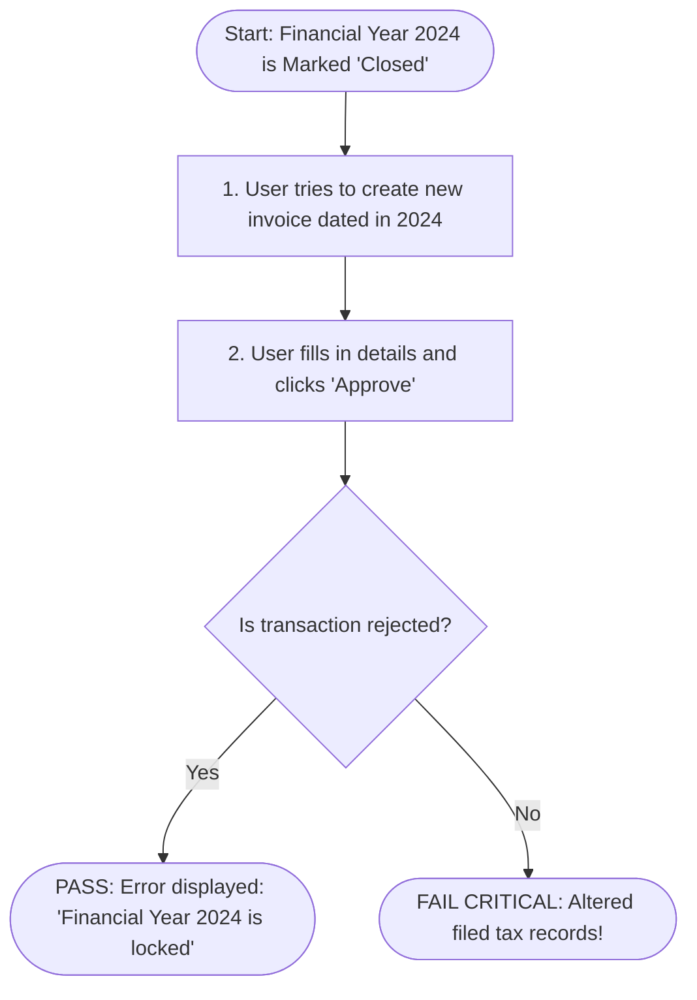

### 3. Test Details

| Item | Details |
| :--- | :--- |
| **Test Case ID** | `UAT-PERIOD-001` |
| **User Role** | Bookkeeper / General Staff |
| **Prerequisites** | An Accountant has marked the prior financial year (e.g. 2024) as `Closed` / `Locked`. |

### 4. Step-by-Step Instructions

1. Go to **Settings** -> **Financial Years** and verify that `2024` status is **"Closed / Locked"**.
2. Go to **Sales** -> **New Invoice**.
3. Select any customer.
4. Set the **Invoice Date** to a date inside the locked year (e.g., `15 November 2024`).
5. Enter a test line item for `£250.00`.
6. Click **"Approve & Issue"**.

### 5. Expected Screen Results (Pass / Fail)

* [x] The system displays a clear warning message: `"This period has been closed. Transactions cannot be backdated into locked financial years."`
* [x] The invoice is **not** saved into the official ledger.
* [x] Past tax reports remain 100% accurate and untampered.

---

# Test Suite 5: Team Permissions & Role Security

## Test Case 5.1: Verify Staff with "Viewer / Read-Only" Role Cannot Delete or Edit Settings

### 1. Goal & Business Importance
To prevent internal fraud or accidental deletion of business data, staff members or external auditors should only see what their job requires.

### 2. Visual Workflow Diagram

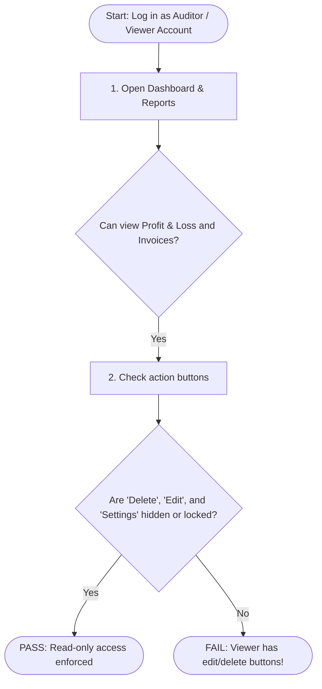

### 3. Test Details

| Item | Details |
| :--- | :--- |
| **Test Case ID** | `UAT-SEC-001` |
| **User Role** | Viewer (e.g. external tax auditor or read-only director) |
| **Prerequisites** | A user invited with the role `"Viewer"`. |

### 4. Step-by-Step Instructions

1. Log into Blynt using the **Viewer** credentials.
2. Navigate to **Reports** -> **Profit & Loss**. Verify you can view the numbers and download the PDF.
3. Navigate to **Sales** -> **Invoices**.
4. Click on an existing invoice. Look for buttons like `"Edit"`, `"Void"`, or `"Delete"`.
5. Try to navigate to **Settings** -> **Bank Accounts** or **Organization Settings**.

### 5. Expected Screen Results (Pass / Fail)

* [x] The user **can** read reports, balance sheets, and invoice lists.
* [x] The **"Edit"**, **"Void"**, and **"Delete"** buttons are completely hidden or disabled.
* [x] Organization bank account settings and company tax IDs cannot be changed.

---

# Test Suite 6: Safe Error Correction (Void & Reverse)

## Test Case 6.1: Cancel an Erroneous Invoice Without Deleting Audit History

### 1. Goal & Business Importance
Under official accounting and tax laws, you cannot simply "delete" an invoice that was already sent to a customer. Instead, you must **Void / Reverse** it so there is a clean paper trail for accountants and tax auditors.

### 2. Visual Workflow Diagram

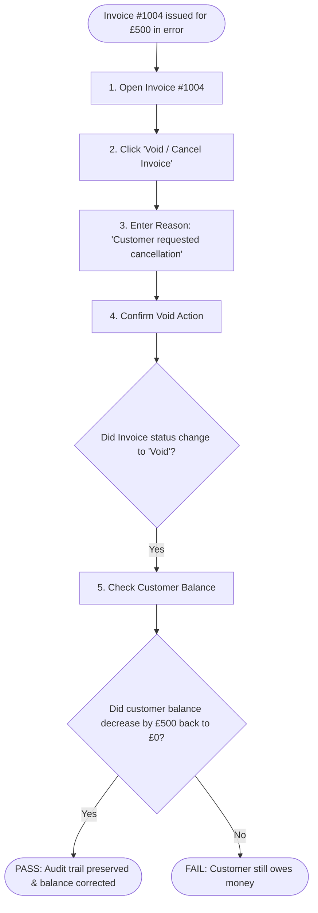

### 3. Test Details

| Item | Details |
| :--- | :--- |
| **Test Case ID** | `UAT-REV-001` |
| **User Role** | Business Owner or Accountant |
| **Prerequisites** | An issued invoice that has not yet received a cash payment. |

### 4. Step-by-Step Instructions

1. Go to **Sales** -> **Invoices** and open the test invoice (e.g., `INV-1004` for `£500.00`).
2. Click the **"Options"** menu (or **"More Actions"**), then select **"Void Invoice"**.
3. In the popup window, type the reason: `"Customer order cancelled before delivery"`.
4. Click **"Confirm Void"**.
5. Check the status badge on the invoice screen.
6. Open the customer's account page.

### 5. Expected Screen Results (Pass / Fail)

* [x] Invoice status badge turns to a red/grey **"Void"**.
* [x] The customer's outstanding balance drops by `£500.00` immediately.
* [x] The invoice remains visible in history with a note explaining who voided it and why (nothing disappears mysteriously).

---

# Test Suite 7: Client-Facing Experience (Customer Portal & Payments)

## Test Case 7.1: Client Opens and Views Invoice via Secure Web Link

### 1. Goal & Business Importance
Verify that when an external client/customer receives an invoice email, they can click the link and immediately view their clean, professional invoice in their web browser without being forced to create a complex login or contact IT.

### 2. Visual Workflow Diagram

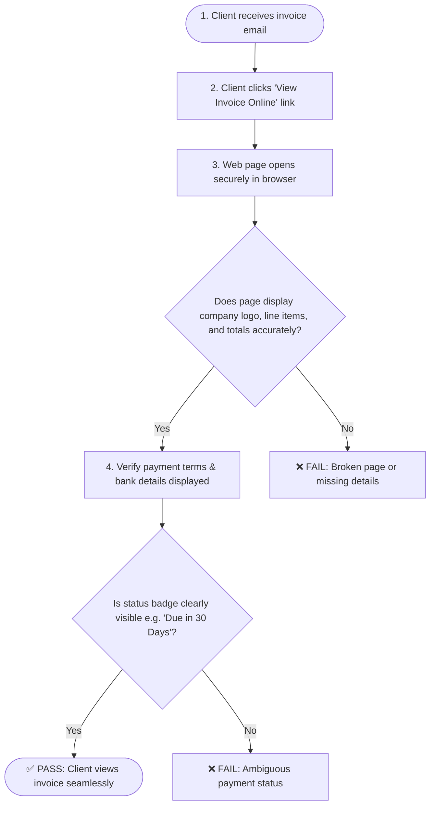

### 3. Test Details

| Item | Details |
| :--- | :--- |
| **Test Case ID** | `UAT-CLIENT-001` |
| **User Role** | External Client / Customer (e.g., Accounts Payable at Acme UK Ltd) |
| **Prerequisites** | An approved invoice has been emailed or a public payment link generated. |

### 4. Step-by-Step Instructions

1. Copy the public/client invoice link (or open the mock client view: e.g. `/portal/invoices/{token}`).
2. Open the link in a separate web browser window (or incognito window where no staff member is logged in).
3. Check the header:
   - Your company logo, legal business name, address, and VAT registration number.
4. Check the invoice body:
   - Invoice Number, Issue Date, Due Date, and Customer Name.
   - Item descriptions, unit prices, VAT breakdown (20%), and Total Due.
5. Check the payment instruction box at the bottom:
   - Bank Account Name, Sort Code, Account Number, and Payment Reference.

### 5. Expected Screen Results (Pass / Fail)

* [x] The invoice opens without requiring the client to enter a staff password.
* [x] All numbers match the original invoice exactly.
* [x] Clear call-to-action buttons are present: **"Download PDF"** and **"Pay Now"**.

---

## Test Case 7.2: Client Downloads & Prints the Invoice PDF

### 1. Goal & Business Importance
Corporate clients must save PDFs into their own accounting systems or print copies for physical audit files. This test verifies that the generated PDF looks pixel-perfect, fits on standard A4 paper, and does not have cut-off text.

### 2. Visual Workflow Diagram

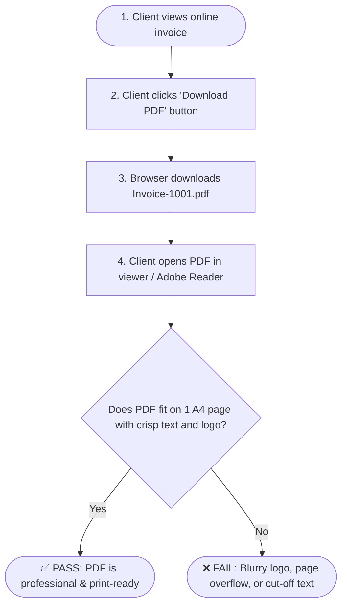

### 3. Test Details

| Item | Details |
| :--- | :--- |
| **Test Case ID** | `UAT-CLIENT-002` |
| **User Role** | External Client / Customer |
| **Prerequisites** | Client invoice page is open. |

### 4. Step-by-Step Instructions

1. On the client invoice screen, click the **"Download PDF"** button.
2. Open the downloaded `.pdf` file in Chrome, Edge, or Adobe Acrobat.
3. Check the visual layout:
   - Is the company logo sharp and centered/aligned properly?
   - Is all text legible without overlapping lines?
   - Does a standard 1-to-5 item invoice fit neatly onto a single A4 page?
4. Press `Ctrl + P` to preview the printed version.

### 5. Expected Screen Results (Pass / Fail)

* [x] PDF file downloads within 2 seconds with an identifiable filename (e.g., `INV-1001-Blynt.pdf`).
* [x] Fits cleanly on standard A4 page without orphan lines spilling over to page 2.
* [x] Company registration number and VAT number are clearly printed at the footer.

---

## Test Case 7.3: Client Pays Invoice Online via Credit Card or Bank Transfer

### 1. Goal & Business Importance
Verify that a customer can immediately settle an invoice online using a credit/debit card or direct bank payment, receiving an immediate receipt and updating their balance to £0.00.

### 2. Visual Workflow Diagram

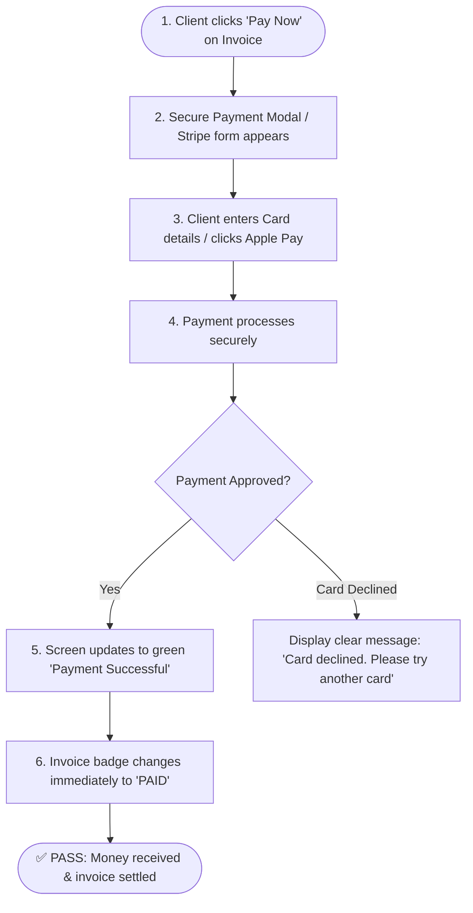

### 3. Test Details

| Item | Details |
| :--- | :--- |
| **Test Case ID** | `UAT-CLIENT-003` |
| **User Role** | External Client / Payer |
| **Prerequisites** | An outstanding unpaid invoice displayed on the client screen. |

### 4. Step-by-Step Instructions

1. On the client invoice page, click the green or blue **"Pay Now"** button.
2. In the payment pop-up:
   - Enter card details (or test card `4242 4242...`).
   - Enter expiry date and CVC.
3. Click **"Pay £1,200.00"**.
4. Observe the screen while payment is processing.
5. Review the confirmation screen.

### 5. Expected Screen Results (Pass / Fail)

* [x] A spinning indicator appears on the button to prevent accidental double-clicks.
* [x] A green banner appears: `"Payment Received — Thank You!"`.
* [x] The invoice status badge changes immediately from orange **"Unpaid"** to green **"PAID"**.
* [x] An automatic payment receipt is emailed to the client.

---

# Test Suite 8: Client-Side Browser Experience (UI & Usability)

## Test Case 8.1: Instant Form Validation & Error Guidance (No Lost Data)

### 1. Goal & Business Importance
Verify that when a user makes a typing mistake (e.g. invalid email format, negative quantity, or missing required fields), the browser warns them **instantly** with clear red text, without wiping out what they typed or reloading the page.

### 2. Visual Workflow Diagram

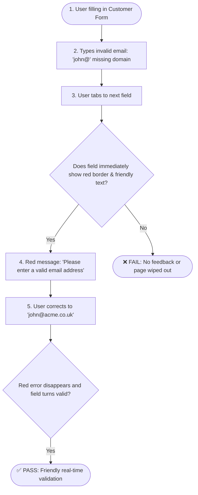

### 3. Test Details

| Item | Details |
| :--- | :--- |
| **Test Case ID** | `UAT-UI-001` |
| **User Role** | Any User (Staff or Client) |
| **Prerequisites** | Any form screen open (e.g., Create Contact or Edit Profile). |

### 4. Step-by-Step Instructions

1. Go to **Customers** ➔ click **"+ New Customer"**.
2. Type `"Acme Limited"` in the Name field.
3. In the Email field, type invalid text: `"abc.123"` (missing `@` and `.com`).
4. Click anywhere outside the box (Tab out).
5. Attempt to click **"Save Customer"**.

### 5. Expected Screen Results (Pass / Fail)

* [x] The email input box turns red immediately with clear text: `"Please enter a valid email address (e.g. name@company.co.uk)"`.
* [x] The page does **not** refresh or erase the customer's name.
* [x] Once corrected to `"info@acme.co.uk"`, the red warning disappears and saving succeeds.

---

## Test Case 8.2: Mobile & Tablet Responsiveness (Phone Test)

### 1. Goal & Business Importance
Business owners frequently check overdue invoices or approve expenses while traveling or on a smartphone. This test verifies that the screen neatly scales down to a phone screen without cut-off buttons or horizontal scrolling.

### 2. Visual Workflow Diagram

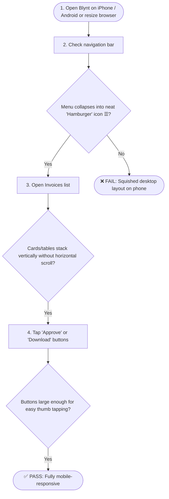

### 3. Test Details

| Item | Details |
| :--- | :--- |
| **Test Case ID** | `UAT-UI-002` |
| **User Role** | Mobile User / On-the-go Business Owner |
| **Prerequisites** | A smartphone, tablet, or desktop browser resized to mobile width (375px - 414px). |

### 4. Step-by-Step Instructions

1. Open Blynt in your phone's browser (Safari or Chrome), or press `F12` on desktop and toggle Device Toolbar to `"iPhone 14 / Pixel"`.
2. Observe the main menu: Does it tuck cleanly into a top `☰` menu icon?
3. Tap on **Invoices**: Do rows convert into readable mobile cards?
4. Open an invoice and tap **"Pay Now"** or **"Approve"**.

### 5. Expected Screen Results (Pass / Fail)

* [x] No side-to-side (horizontal) scrolling required to read invoice amounts.
* [x] Action buttons are large, finger-friendly, and easy to tap.
* [x] Popups and menus close cleanly when clicking the "X" or tapping outside.

---

## Test Case 8.3: Double-Click & Accidental Resubmission Protection

### 1. Goal & Business Importance
When internet connection is slow, users often nervously click the **"Pay"** or **"Approve"** button multiple times. This test ensures the browser disables the button immediately after the first click so the customer is **never charged twice**.

### 2. Visual Workflow Diagram

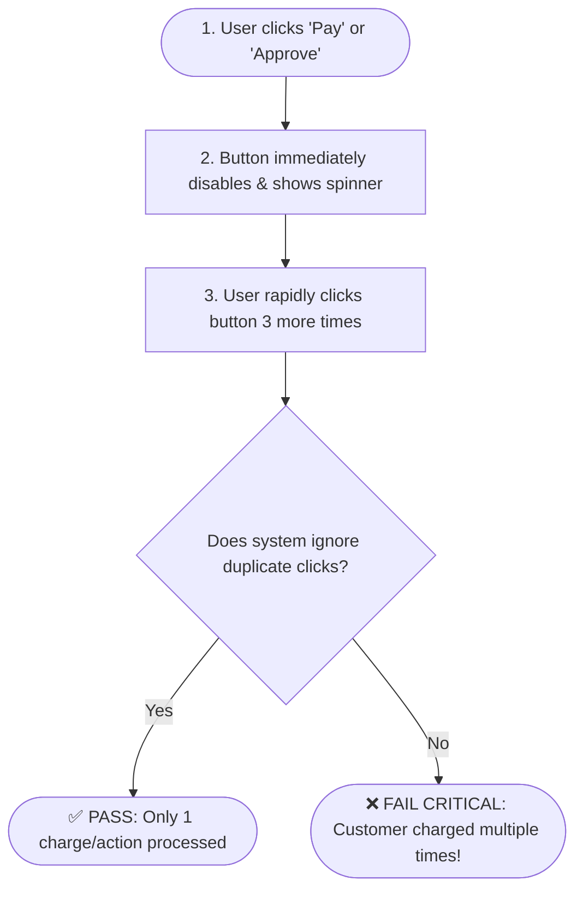

### 3. Test Details

| Item | Details |
| :--- | :--- |
| **Test Case ID** | `UAT-UI-003` |
| **User Role** | Any User / Customer making a payment |
| **Prerequisites** | An invoice or payment screen ready to submit. |

### 4. Step-by-Step Instructions

1. Fill out an invoice or open the payment screen.
2. Click the **"Approve"** (or **"Pay"**) button rapidly 3 times in quick succession.
3. Observe button appearance and network behavior.

### 5. Expected Screen Results (Pass / Fail)

* [x] On the first click, the button instantly turns grey/disabled and shows a loading spinner or `"Processing..."` text.
* [x] Rapid subsequent clicks produce zero additional submissions.
* [x] Only **one** transaction is recorded.

---

# Summary Scorecard for Business Testers

When conducting your testing session, record your findings below:

| Test ID | Test Scenario | Tester Name | Date Tested | Pass / Fail | Notes |
| :--- | :--- | :--- | :--- | :--- | :--- |
| **UAT-SALES-001** | Create 20% VAT Customer Invoice | ____________ | __/__/2026 | [ ] Pass [ ] Fail | |
| **UAT-AI-001** | Smart AI Receipt Scan & Save | ____________ | __/__/2026 | [ ] Pass [ ] Fail | |
| **UAT-LEDGER-001** | Block Unbalanced Financial Entries | ____________ | __/__/2026 | [ ] Pass [ ] Fail | |
| **UAT-PERIOD-001** | Lock Past Closed Financial Years | ____________ | __/__/2026 | [ ] Pass [ ] Fail | |
| **UAT-SEC-001** | Viewer Read-Only Security Checks | ____________ | __/__/2026 | [ ] Pass [ ] Fail | |
| **UAT-REV-001** | Void Invoice & Correct Balance Safely | ____________ | __/__/2026 | [ ] Pass [ ] Fail | |
| **UAT-CLIENT-001** | Client Views Invoice Online (Secure Link) | ____________ | __/__/2026 | [ ] Pass [ ] Fail | |
| **UAT-CLIENT-002** | Client Downloads A4 Invoice PDF | ____________ | __/__/2026 | [ ] Pass [ ] Fail | |
| **UAT-CLIENT-003** | Client Pays Invoice Online | ____________ | __/__/2026 | [ ] Pass [ ] Fail | |
| **UAT-UI-001** | Real-time Form Validation & Error Guidance | ____________ | __/__/2026 | [ ] Pass [ ] Fail | |
| **UAT-UI-002** | Mobile & Tablet Screen Responsiveness | ____________ | __/__/2026 | [ ] Pass [ ] Fail | |
| **UAT-UI-003** | Double-Click & Duplicate Charge Protection | ____________ | __/__/2026 | [ ] Pass [ ] Fail | |

---
*Created for Blynt UK Cloud Accounting — Designed for easy understanding by non-technical stakeholders.*

