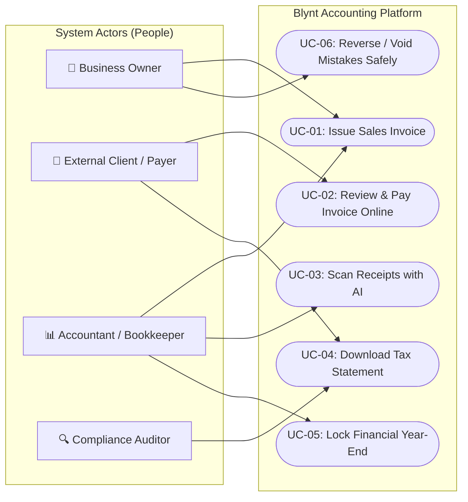
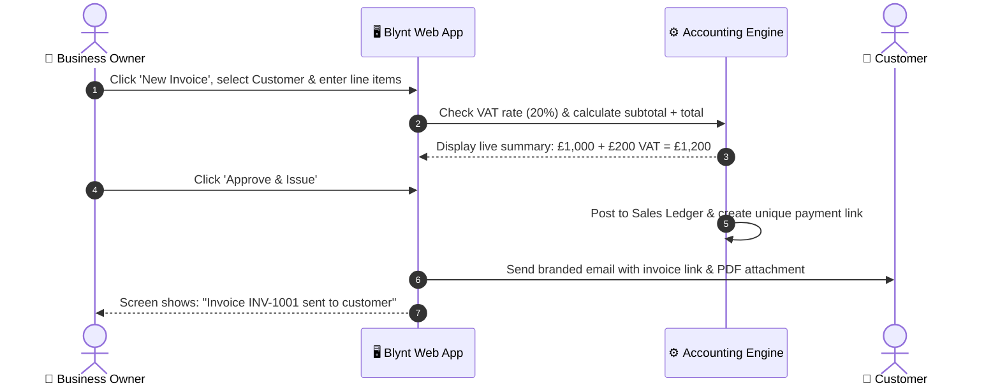
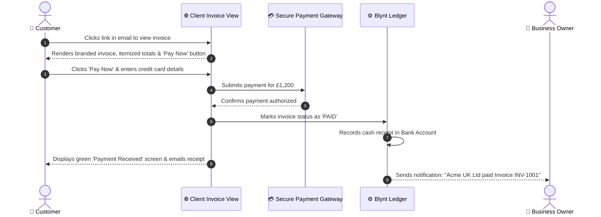
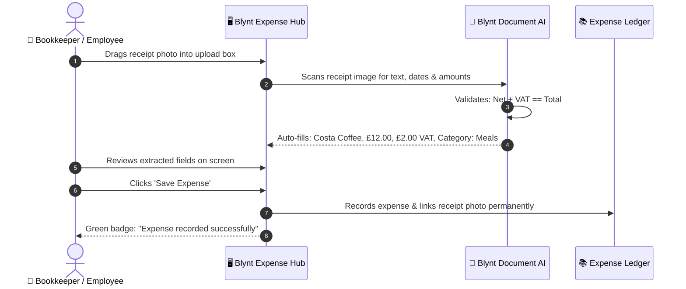
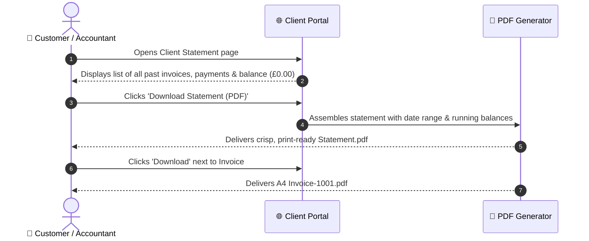
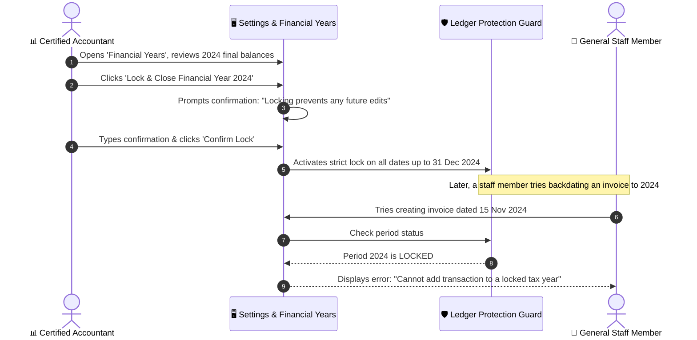
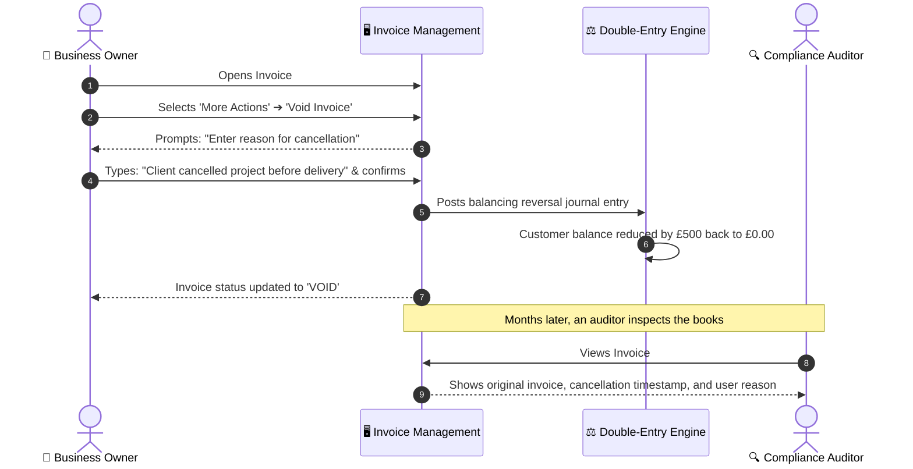

# Blynt — Business Use Cases & User Journey Guide (Non-IT)

**Document Type:** Business Requirements & User Case Specification  
**Target Audience:** Business Owners, Operational Stakeholders, External Clients, and Non-Technical Teams  
**System Name:** Blynt UK Cloud Accounting  
**Purpose:** Describe how real people interact with Blynt to achieve business goals, with visual diagrams and plain-English workflows.

---

# 1. Master System Actors & Use Case Map

The diagram below shows who uses Blynt and what each person achieves:

---

# 2. Detailed Business Use Cases

---

## Use Case 1: Issue & Send a Customer Invoice
* **Use Case ID:** `UC-BIZ-01`
* **Primary Actor:** Business Owner or Billing Administrator
* **User Story:** *As a business owner, I want to bill my customer for services rendered with automatic 20% UK VAT calculation, so that I get paid accurately and maintain up-to-date bookkeeping.*

### 1. Visual Interaction Diagram

### 2. Standard Business Flow (Happy Path)
1. **Initiate:** The owner clicks **Sales** ➔ **+ New Invoice**.
2. **Customer Selection:** Selects or types a customer name (e.g., `"Acme UK Ltd"`). The customer's billing address and payment terms (e.g., 30 days) auto-fill.
3. **Item Entry:** Adds descriptions and amounts (e.g., `"Marketing Strategy Consulting"`, `£1,000.00`).
4. **Tax Calculation:** Selects `"Standard 20% VAT"`. Blynt automatically calculates `£200.00` VAT and displays the total `£1,200.00`.
5. **Issue:** The owner clicks **"Approve & Issue"**.
6. **Delivery:** The system posts the transaction to the accounting ledger, updates Acme UK Ltd's balance to `£1,200.00`, and delivers an email to the client with a secure viewing link.

### 3. Alternative & Exception Paths
* **Customer Not on File:** The owner can click **"+ Add New Customer"** directly from the dropdown without losing what they typed.
* **Missing Details:** If the owner forgets to enter a price or quantity, the system highlights the missing box in red and prevents issuing.

### 4. Business Value
* Eliminates spreadsheet math mistakes.
* Ensures UK HMRC VAT compliance automatically.
* Keeps customer statements synchronized in real time.

---

## Use Case 2: External Client Views & Pays Invoice Online
* **Use Case ID:** `UC-CLIENT-01`
* **Primary Actor:** External Customer / Payer (e.g., Accounts Payable at Acme UK Ltd)
* **User Story:** *As a customer who received a bill, I want to open the invoice link on my phone or computer and pay immediately via card or bank transfer, so that my account is settled without phone calls or paper cheques.*

### 1. Visual Interaction Diagram

### 2. Standard Business Flow (Happy Path)
1. **Receive:** The customer opens their inbox and clicks the **"View Invoice Online"** link.
2. **Review:** The customer views the itemized invoice in their web browser (showing company logo, invoice number, line items, and VAT breakdown).
3. **Initiate Payment:** The customer clicks the prominent **"Pay £1,200.00"** button.
4. **Enter Details:** A secure card form opens (or Apple Pay / Google Pay button on mobile). The customer types their card details.
5. **Confirmation:** The customer clicks **"Submit Payment"**.
6. **Completion:** Within 2 seconds, the screen updates with a green checkmark: *"Payment Successful — Thank you for your business!"*. The status updates to **PAID**, and an automated payment receipt is emailed to the client.

### 3. Alternative & Exception Paths
* **Card Declined / Insufficient Funds:** The system displays a friendly message: *"Your card was declined by your bank. Please check your details or try a different card."* The invoice remains open and unpaid.
* **Prefer Bank Transfer:** The client scrolls down to find the sort code, account number, and unique payment reference to pay via online banking.

### 4. Business Value
* Businesses get paid up to 3x faster than waiting for manual bank wires.
* Customers experience a seamless, modern payment checkout.

---

## Use Case 3: Capture & Categorize Expense Receipts with AI
* **Use Case ID:** `UC-BIZ-02`
* **Primary Actor:** Bookkeeper or Employee on the Go
* **User Story:** *As an employee or bookkeeper, I want to take a photo of a paper receipt and let AI extract the details, so that I don't waste time typing numbers and keeping boxes of paper receipts.*

### 1. Visual Interaction Diagram

### 2. Standard Business Flow (Happy Path)
1. **Upload:** User clicks **Expenses** ➔ **Upload Receipt** and drops a photo/PDF of a receipt into the box.
2. **AI Reading:** Blynt's Document AI analyzes the document in 2-3 seconds.
3. **Review:** The screen shows a side-by-side view: the original receipt on the left, and the pre-filled fields (Supplier, Date, Net, VAT, Total) on the right.
4. **Verification:** The user confirms the extracted category (e.g. `"Travel & Meals"`).
5. **Save:** The user clicks **"Save Expense"**. The expense is posted, and the receipt image is permanently archived for HMRC audit compliance.

### 3. Alternative & Exception Paths
* **Blurry or Unclear Receipt:** The AI flags a yellow warning: *"Some items couldn't be read clearly with high confidence. Please verify the total."* The user can manually type or adjust the number.
* **Total Doesn't Add Up:** If extracted line items don't equal the receipt total, the system asks the user to confirm before saving.

### 4. Business Value
* Eliminates manual data entry hours.
* Zero risk of losing paper receipts for tax deductions.

---

## Use Case 4: Customer Downloads Tax-Compliant PDF Statement
* **Use Case ID:** `UC-CLIENT-02`
* **Primary Actor:** External Customer or Customer's Accountant
* **User Story:** *As a corporate client, I want to download my full transaction statement and individual invoice PDFs, so that I can provide them to my finance team for tax filing.*

### 1. Visual Interaction Diagram

### 2. Standard Business Flow (Happy Path)
1. **Open Portal:** The client accesses their account history via the link provided on any invoice.
2. **View Activity:** The client views a chronological summary of all invoices received, dates, payments made, and current outstanding balance.
3. **Download Statement:** The client clicks **"Download Statement"**, selecting a date range (e.g., *Last 12 Months*).
4. **Review PDF:** The browser downloads an official PDF statement formatted for corporate accounting.

### 3. Alternative & Exception Paths
* **Dispute on Item:** The client can click a **"Question this Invoice"** button on any item to send an instant message directly to the vendor's billing team.

### 4. Business Value
* Reduces billing support emails by over 70%.
* Gives customers 24/7 transparent access to their accounts.

---

## Use Case 5: Accountant Closes & Locks Year-End Books
* **Use Case ID:** `UC-BIZ-03`
* **Primary Actor:** Certified Public Accountant (External or In-House)
* **User Story:** *As an accountant, I want to lock a completed financial year after filing tax returns, so that nobody can accidentally backdate or alter filed numbers.*

### 1. Visual Interaction Diagram

### 2. Standard Business Flow (Happy Path)
1. **Review:** The accountant finalizes annual accounts, runs the Trial Balance, and files tax returns with HMRC.
2. **Navigate:** Goes to **Settings** ➔ **Financial Years**.
3. **Lock:** Selects the closed year (e.g. `2024`) and clicks **"Lock Financial Year"**.
4. **Confirm:** Reviews the warning prompt and clicks **"Confirm Lock"**.
5. **Protection:** The system places a permanent freeze on the date range. Any future attempt by any user to add, edit, or backdate a transaction in that range is immediately blocked.

### 3. Alternative & Exception Paths
* **Emergency Reopening:** Only an authorized Account Owner can temporarily unlock a period by providing an audit reason that is permanently recorded in the security log.

### 4. Business Value
* Protects the business against accidental tax discrepancies and statutory filing penalties.

---

## Use Case 6: Correcting an Invoice Error via Safe Reversal (Void)
* **Use Case ID:** `UC-BIZ-04`
* **Primary Actor:** Business Owner or Accountant
* **User Story:** *As a business owner, when a client cancels an order, I want to safely cancel the invoice so their account balance returns to zero while preserving a complete audit record.*

### 1. Visual Interaction Diagram

### 2. Standard Business Flow (Happy Path)
1. **Locate Invoice:** User navigates to **Sales** ➔ **Invoices** and clicks on the unpaid invoice.
2. **Initiate Void:** Clicks **Options** ➔ **"Void Invoice"**.
3. **Reason:** Enters an explanation (e.g., *"Customer project cancelled by mutual agreement"*).
4. **Confirm:** Clicks **"Confirm Void"**.
5. **Outcome:** The system generates an offsetting reversal entry. The customer's balance drops back to `£0.00`, the invoice status becomes **VOID**, and the full paper trail remains visible for future auditors.

### 3. Alternative & Exception Paths
* **Invoice Already Paid:** If the customer already paid money towards the invoice, the system prevents a simple "Void" and prompts the user to issue a **Credit Note & Refund** instead, ensuring bank records match.

### 4. Business Value
* Complies with UK Companies Act & HMRC audit rules against unauthorized deletion of accounting records.

---

# 3. Non-IT Use Case Summary Matrix

| Use Case ID | Name | Actor | Business Goal | Primary Safeguard |
| :--- | :--- | :--- | :--- | :--- |
| **`UC-BIZ-01`** | Issue Customer Invoice | Business Owner | Bill client with accurate VAT | Auto-computed 20% VAT math |
| **`UC-CLIENT-01`** | Client Online Payment | External Customer | Settle bill instantly via card/bank | Real-time receipt & 0 double-charging |
| **`UC-BIZ-02`** | AI Receipt Capture | Bookkeeper | Record expenses without manual typing | Pre-save review & photo archiving |
| **`UC-CLIENT-02`** | Self-Service Statement | Customer / Auditor | Download PDF invoices & history | 24/7 transparent client portal |
| **`UC-BIZ-03`** | Lock Financial Period | Accountant | Prevent changes after tax filing | Date freeze on historical entries |
| **`UC-BIZ-04`** | Safe Invoice Voiding | Business Owner | Cancel bad invoices legally | Zero-deletion audit paper trail |

---
*Created for Blynt UK Cloud Accounting — Bridging real-world business operations and software verification.*
