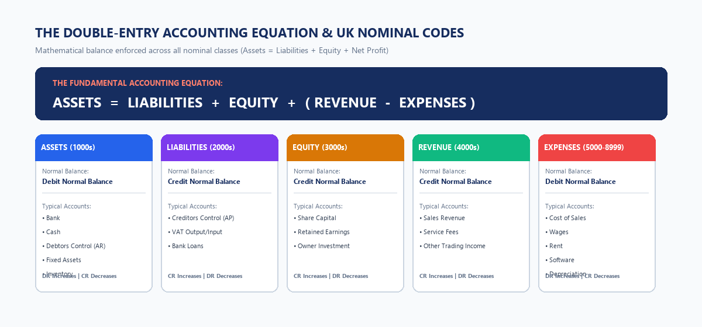
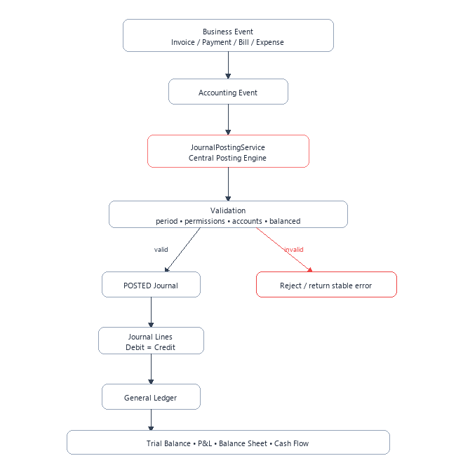
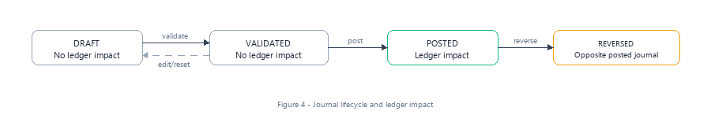
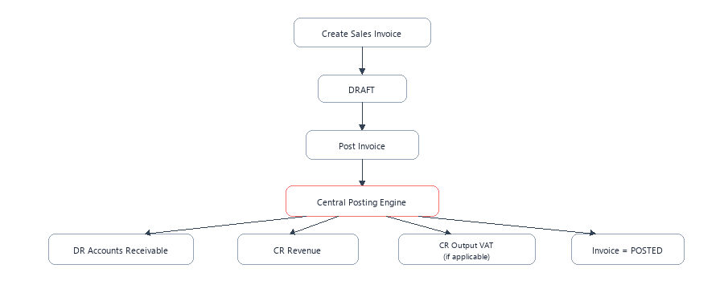
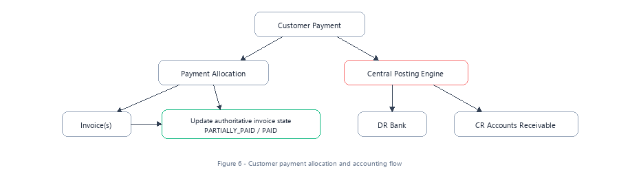
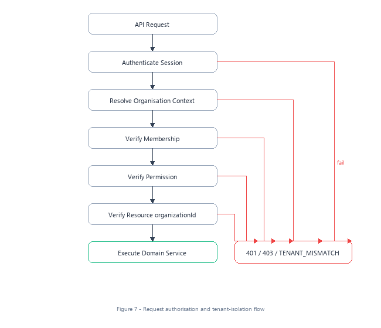

# blynt — Comprehensive Technical Architecture & Code Explainer

This document serves as the master engineering walkthrough for the **blynt** codebase. It explains every subsystem, data pipeline, mathematical model, and database invariant, bridging high-level accounting principles with low-level TypeScript and PostgreSQL mechanics.

---

## 1. System Overview & The Core Double-Entry Equation

In institutional accounting, financial truth is governed by the **Fundamental Accounting Equation**:
$$\text{Assets} = \text{Liabilities} + \text{Equity} + (\text{Revenue} - \text{Expenses})$$

Every economic event is a **double-entry transaction** with at least two opposing legs:
* A **Debit (DR)** increases an Asset or Expense, and decreases a Liability, Equity, or Revenue.
* A **Credit (CR)** increases a Liability, Equity, or Revenue, and decreases an Asset or Expense.
* **The Invariant:** At all times, down to the fraction of a penny, the sum of all debits must equal the sum of all credits:
  $$\sum \text{Debits} - \sum \text{Credits} \equiv 0$$



---

## 2. Full C4 System Architecture & Component Journey

```
[ Next.js 15 Web Client (React 19 / Turbopack) ]
                 │ (HTTPS / REST API with Bearer Token)
                 ▼
[ NestJS 11 Application Gateway on Port 4000 ]
  ├── Common Pipeline (AllExceptionsFilter, ValidationPipe, AppLogger)
  ├── Auth & Session Module (scrypt password hashing & session management)
  ├── Organisation Scoping Module (Active workspace extraction)
  ├── Accounting Engine Module (Validation, Posting, Reversals, Fixed-Point Math)
  ├── Contacts & Subledger Foundation (Dynamic AR/AP Statements)
  ├── Invoicing & Commercial Billing (Sales Invoicing & UK VAT Auto-Posting)
  └── Financial Reporting Engine (Trial Balance, P&L, Balance Sheet)
                 │ (Prisma Client with Connection Pooling)
                 ▼
[ PostgreSQL 16+ Relational Engine ]
  ├── Composite Foreign Keys (organization_id, id)
  ├── Temporal Exclusion Constraints (btree_gist non-overlapping dates)
  ├── Mathematical CHECK Constraints (non-negative debits/credits)
  └── Append-Only Database Triggers (audit_logs immutability)
```


---

## 3. Deep Dive: The Accounting Engine (`apps/api/src/accounting-engine/`)

The accounting engine is the mathematical core of the platform.



### 3.1 `MoneyService` (`money.service.ts`)
* **Problem:** JavaScript's native `number` type represents values in 64-bit IEEE 754 floating-point format (`0.1 + 0.2 = 0.30000000000000004`). In financial ledgers, this causes rounding drift.
* **Solution:** `MoneyService` wraps `Decimal.js`, enforcing 4 decimal places of fixed-point precision (`NUMERIC(19,4)`):
```typescript
@Injectable()
export class MoneyService {
  toDecimal(val: Decimal.Value | Prisma.Decimal): Decimal {
    return new Decimal(val.toString());
  }

  isZero(val: Decimal.Value | Prisma.Decimal): boolean {
    return this.toDecimal(val).isZero();
  }

  equals(a: Decimal.Value | Prisma.Decimal, b: Decimal.Value | Prisma.Decimal): boolean {
    return this.toDecimal(a).equals(this.toDecimal(b));
  }

  round(val: Decimal.Value | Prisma.Decimal, places: number = 2): Decimal {
    return this.toDecimal(val).toDecimalPlaces(places, Decimal.ROUND_HALF_UP);
  }
}
```

### 3.2 `JournalValidationService` (`journal-validation.service.ts`)
Before any journal entry transitions to `VALIDATED`, this service enforces the **15 Institutional Accounting Invariants**:
1. **Total Debits Equal Total Credits:** Difference must be exactly `0.0000`.
2. **Minimum Line Count:** Must contain at least 2 distinct lines.
3. **Organisation Boundary:** All referenced account IDs must belong to the active organisation.
4. **Account State:** Accounts must be `ACTIVE` (not archived).
5. **Control Account Protection:** Direct manual posting to accounts where `isControlAccount = true` or `allowManualPosting = false` (e.g. Debtors Control `1100`, Creditors Control `2000`) is categorically rejected.
6. **No Dual Positive Line:** A line cannot have both `debit > 0` AND `credit > 0`.
7. **No Dual Zero Line:** A line cannot have both `debit == 0` AND `credit == 0`.
8. **No Negative Values:** Negative debits or credits are rejected.
9. **Accounting Period Resolution:** The journal date must resolve to an existing accounting period.
10. **Hard-Lock Rejection:** If the period is `HARD_LOCKED`, posting is strictly blocked.
11. **Soft-Lock Warning:** If the period is `SOFT_LOCKED`, only users with `ACCOUNTANT` or `OWNER` role are permitted.
12. **Organisation Active:** The organisation must not be `SUSPENDED` or `ARCHIVED`.
13. **Currency Consistency:** All line items must use the organisation's base currency.
14. **Draft Reset on Edit:** If a `VALIDATED` journal is modified, its status is automatically reset to `DRAFT`.
15. **Audit Trail Logging:** Every validation attempt is recorded in `audit_logs`.



### 3.3 `JournalPostingService` (`journal-posting.service.ts`)
* Manages atomic journal numbering format `JE-YYYY-XXXXXX` (e.g., `JE-2026-000001`).
* Uses organisation-scoped atomic database sequence counters inside serializable transactions to prevent concurrency collisions.

### 3.4 `JournalReversalService` (`journal-reversal.service.ts`)
* Implements GAAP-compliant journal reversals.
* Rather than deleting an erroneous journal, it creates an equal and opposite balancing journal, linking back to the parent entry in the audit trail.

---

## 4. Subledgers & Commercial Billing (`apps/api/src/contacts/` & `invoices/`)

Traditional accounting systems separate the General Ledger (GL) from the Subledgers (Customer Accounts Receivable and Supplier Accounts Payable).





### 4.1 Dynamic Subledger Balance Derivation (`ContactSubledgerService`)
Rather than storing a mutable `current_balance` column that can get out of sync, customer balances are **derived dynamically** by aggregating posted journal lines tagged with the contact's ID:
$$\text{Customer Balance} = \sum(\text{Debits to AR}) - \sum(\text{Credits to AR})$$
This guarantees that customer statements always reconcile with the nominal balance of Debtors Control (`1100`).

### 4.2 Automated Invoicing Pipeline (`InvoicesService`)
When an invoice is approved and posted:
1. Calculates UK VAT (20% Standard, 5% Reduced, 0% Zero).
2. Generates an automated balanced General Ledger journal:
   * `DR 1100 (Debtors Control Account)` — Full gross amount (tagged with `contactId`).
   * `CR 4000 (Sales Revenue)` — Net invoice total.
   * `CR 2100 (VAT Output Tax)` — Total VAT amount.

---

## 5. Defense-in-Depth Multi-Tenant Security Model



### 5.1 Composite Foreign Key Hardening (PostgreSQL Schema)
Every child table enforces composite foreign keys containing `organization_id`:
```sql
ALTER TABLE "journal_lines" 
ADD CONSTRAINT "journal_lines_organization_id_contact_id_fkey" 
FOREIGN KEY ("organization_id", "contact_id") 
REFERENCES "contacts"("organization_id", "id") 
ON DELETE RESTRICT ON UPDATE CASCADE;
```
If an application query attempts to associate a journal line in Company A with a Contact in Company B, PostgreSQL terminates the transaction immediately with foreign key violation code `23503`.

### 5.2 Append-Only Audit Trail (Triggers)
```sql
CREATE OR REPLACE FUNCTION prevent_audit_log_mutation()
RETURNS TRIGGER AS $$
BEGIN
  RAISE EXCEPTION 'audit_logs rows are immutable and cannot be updated or deleted';
END;
$$ LANGUAGE plpgsql;

CREATE TRIGGER trg_audit_logs_immutable
BEFORE UPDATE OR DELETE ON audit_logs
FOR EACH ROW EXECUTE FUNCTION prevent_audit_log_mutation();
```

---

## 6. AWS Architecture, Migration & CI/CD Pipeline


